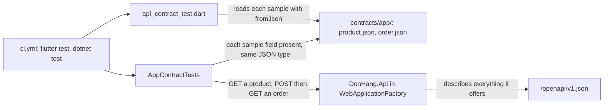

## Before you start

- [[frontend.l4.backend-for-frontend]] — you know ADR `0018` keeps DonHang.App calling `DonHang.Api` directly, and names the tests that keep the answers' shape.
- [[backend.l2.openapi-contract]] — you know the OpenAPI document is generated from the code, so it changes whenever the code does.
- [[backend.l4.message-schema-evolution]] — you know `OrderMessageContractTests` fails in the pull request when one side renames or retypes a message property.
- [[design.l2.webapplicationfactory]] — you know `WebApplicationFactory<Program>` runs the real API inside a test, with real PostgreSQL behind it.

## The situation

It is stage-4. Tidying `DonHang.Api/Dtos.cs`, a developer renames the product's `PriceVnd` to `Price`, updates the API's own tests, and opens a pull request. The OpenAPI document changes with the code, as it should, and still describes a valid API. DonHang.App's screen tests pass too: they build `Product` objects directly and never read an answer from the API. Yet the app's `Product.fromJson` still reads `priceVnd`, so after the deploy the app could not read a single product, and nothing the API publishes says the app needs that field. How can a change like this fail in the pull request, while the API stays free to change everything the app does not read?

## Core concepts

- consumer and provider — the side that reads an answer, here DonHang.App, and the side that gives it, here `DonHang.Api`.
- sample answer — a JSON file shaped like one of the provider's answers, holding only the fields the consumer reads.
- **contract test** — a test that checks one side of an integration against a shared description of what the other side expects, so a mismatch fails a test instead of a customer's screen.
- **consumer-driven contract** — a contract written by the consumer, listing only what it reads, which the provider runs tests against.

## How it works



In the situation above, the consumer is DonHang.App and the provider is `DonHang.Api`. The app reads only a few fields of the API's answers: a product's `id`, `name` and `priceVnd`, and an order's `id`, `status` and each item's `productId`, `quantity` and `unitPriceVnd`. The contract is those fields and nothing else, kept as two sample answers in `contracts/app/` at the repository's root.

Each side has its own contract test, and both read the same samples. On the app's side, `api_contract_test.dart` passes each sample to `Product.fromJson` and `OrderResult.fromJson`, the code that reads real answers. If `fromJson` starts reading a field the sample lacks, or under another name or type, this test fails, so the samples cannot fall behind what the app reads. On the API's side, `AppContractTests` starts the API with `WebApplicationFactory`, asks it for a product and a placed order, and walks each sample: every field must be in the answer, with the same JSON type. The rename fails there, because the answer no longer has `priceVnd`. `ci.yml` runs `flutter test` and `dotnet test` on every pull request, so either test failing marks the pull request red.

Because the consumer writes the samples, the contract is consumer-driven. Fields the samples omit are never checked, so the API may add fields freely.

The OpenAPI document sits beside this, drawn dotted because no test reads it. It describes everything the API offers and follows the code, so a rename changes it without failing anything. The contract describes what one client depends on, as `OrderMessageContractTests` does for messages.

## In the Đơn Hàng system

The app's side:

```dart file=DonHang.App/test/api_contract_test.dart tag=stage-4 lines=15-39
Map<String, dynamic> sample(String name) =>
    jsonDecode(File('../contracts/app/$name').readAsStringSync()) as Map<String, dynamic>;

void main() {
  test('Product.fromJson reads the product sample', () {
    final json = sample('product.json');
    final product = Product.fromJson(json);

    expect(product.id, json['id']);
    expect(product.name, json['name']);
    expect(product.priceVnd, json['priceVnd']);
  });

  test('OrderResult.fromJson reads the order sample', () {
    final json = sample('order.json');
    final order = OrderResult.fromJson(json);
    final item = (json['items'] as List<dynamic>).single as Map<String, dynamic>;

    expect(order.id, json['id']);
    expect(order.status, json['status']);
    expect(order.items.single.productId, item['productId']);
    expect(order.items.single.quantity, item['quantity']);
    expect(order.items.single.unitPriceVnd, item['unitPriceVnd']);
  });
}
```

`sample` reads a file from `../contracts/app/`, a path relative to `DonHang.App`, where `flutter test` runs. `product.json` holds `id` `3`, `name` `"Tai nghe"` and `priceVnd` `890000`; `order.json` holds `id` `13`, `status` `"new"` and one item with `productId`, `quantity` and `unitPriceVnd`. Each test hands the decoded sample to the app's own `fromJson` and checks that every field the app keeps equals the sample's value.

In `product.dart`, outside this excerpt, `fromJson` reads each field with a cast such as `json['priceVnd'] as int`, so a sample whose field is missing or has another type makes the test throw.

The API's side:

```csharp file=DonHang.Tests/Integration/AppContractTests.cs tag=stage-4 lines=59-80
    // Every property of the sample, at any depth: present, with the same
    // kind of JSON value. An array's first sample element describes each
    // element of the answer's array.
    private static void AssertMatches(JsonElement sample, JsonElement answer, string path)
    {
        Assert.True(sample.ValueKind == answer.ValueKind,
            $"{path}: the app expects {sample.ValueKind}, the api sends {answer.ValueKind}");
        if (sample.ValueKind == JsonValueKind.Object)
        {
            foreach (var field in sample.EnumerateObject())
            {
                Assert.True(answer.TryGetProperty(field.Name, out var value), $"{path}.{field.Name}: missing from the api's answer");
                AssertMatches(field.Value, value, $"{path}.{field.Name}");
            }
        }
        else if (sample.ValueKind == JsonValueKind.Array && sample.GetArrayLength() > 0)
        {
            Assert.NotEqual(0, answer.GetArrayLength());
            foreach (var item in answer.EnumerateArray())
                AssertMatches(sample[0], item, $"{path}[]");
        }
    }
```

`AssertMatches` walks the sample, not the answer. It first requires the same `ValueKind`, the kind of JSON value, such as object, array, string, number, true, false or null. For each field of a sample object it requires that name in the answer, then checks the value the same way, so each order item is checked too. For an array, the sample's first element describes every element of the answer, and an empty answer array fails. Fields only the answer has are never visited: `OrderDto` in `Dtos.cs` also sends `customerId` and `placedAt`, and this test ignores both. Values are not compared, only the shape.

Outside this excerpt, the two tests call `factory.CreateClient()`. `Product_HasEveryFieldTheAppReads` reads `/api/v1/products/{productId}` for a product it inserted and calls `AssertMatches` with the path `"product"`. The other posts an order to `/api/v1/orders` with the test-authentication headers, then GETs the order at the `Location` it returns. In `ci.yml`, `dotnet test` runs in the `test` job and `flutter test` in the `app` job.

## Trade-offs

| Way to keep the app and the API in step | Catches the `priceVnd` rename | Fails on a change the app ignores | Who writes it | Cost |
|---|---|---|---|---|
| OpenAPI document only | no: it changes with the code | no | generated from the API | none added |
| App tests against fakes | no: the fakes are the app's own guess | no | the app team | none added |
| Try the app against a deployed API | yes, after the deploy | no | nobody, it is a habit | late, by hand, easy to skip |
| Consumer-driven contract (chosen) | yes, in the pull request | no | the app team writes samples; each side runs a test | two small tests, samples kept with `fromJson` |
| Contract listing every field of every answer | yes | yes, such as `customerId` or `placedAt` | either side | every API change edits the samples |

The chosen row checks shape, not meaning. If the API kept `priceVnd` but sent the price in thousands, both tests would still pass. A contract test removes one kind of surprise; review of the API's change still has to catch the rest.

## What would you choose if…

…the product screen needs a product's photo? Let the API add the field first; no test fails, since the samples do not list it. Then the app's pull request adds it to `Product.fromJson` and to `product.json` together, and from then on `AppContractTests` fails if the API ever stops sending it.

…the API must rename `priceVnd`? Not in one step. The API sends both names, the app moves its `fromJson` and its sample to the new name, and the API drops the old one once nothing reads it. `AppContractTests` passes at every step, because each sample matches an answer that still has its fields.

…a staff app joins DonHang.App? Give it samples of its own, listing what it reads, and a test on the API's side for them. The API then answers to two contracts, and a field either client reads stays.

## Seniors often assume…

- **"The OpenAPI document already guarantees that the app will not break."** → Actually the document describes what the API offers today and is generated from the code, so a rename produces a new, valid document. It cannot say which fields a client depends on. You notice this when a pull request that renames a field changes `/openapi/v1.json` and every check stays green.
- **"Tests that run the app against a fake API prove it works with the real one."** → Actually the fake is written by the same team as the code it feeds, so both carry the same guess about the answer. In DonHang.App the fake hands the screen ready-made `Product` objects: widget tests such as `product_list_screen_test.dart` build `Product` objects directly and never meet the API's JSON. You notice this when every app test passes and the product list still fails against the deployed API.
- **"A contract test has to list every field of every response."** → Actually a contract that lists fields no client reads fails on changes that harm no one, and the team can drift into editing samples until the test turns green. `order.json` leaves out `customerId` and `placedAt` because the app does not read them. You notice this when an API pull request that adds or removes an unused field fails the contract test.

## Try it (3 minutes)

1. In the Đơn Hàng repository at `stage-4`, from `DonHang.App`, run `flutter test test/api_contract_test.dart`.
2. In `contracts/app/product.json`, rename `priceVnd` to `price` and run the same command again.
3. Restore the file with `git checkout contracts/app/product.json`.

Expected result: the first run passes both tests. The second fails `Product.fromJson reads the product sample` with a type error thrown from `Product.fromJson`, and the order test still passes.

Then answer: if instead you renamed `PriceVnd` everywhere in `DonHang.Api`, which test would fail, and why not the one you just ran?

<details><summary>Suggested answer</summary>

`AppContractTests.Product_HasEveryFieldTheAppReads` would fail with `product.priceVnd: missing from the api's answer`, since the sample still lists `priceVnd` and the API no longer sends it. The Dart test reads only the sample, which you did not change, so it keeps passing. That is why the contract needs a test on each side.

</details>

## Connections

- [[backend.l2.openapi-contract]] — prerequisite: the document of everything the API offers, which this contract narrows to one client.
- [[backend.l4.message-schema-evolution]] — the same idea one layer over: a test that keeps a message readable by its readers.
- [[design.l2.webapplicationfactory]] — prerequisite: how `AppContractTests` runs the real API inside the test.
- [[backend.l2.breaking-changes]] — the contract is how the API learns which of its changes break this client.
- [[backend.l4.expand-and-contract]] — the way to rename a field the contract lists without failing it.
- [[frontend.l2.server-errors-in-forms]] — the error answers the app also reads, which `contracts/app/` does not cover at stage-4.
- [[frontend.l4.backend-for-frontend]] — prerequisite: the decision to call the API directly, which this contract keeps safe.

## Five-line summary

1. An app's contract with an API lists only the fields the app reads, and a test on each side keeps both to it.
2. A contract test checks one side of an integration against a shared description of what the other side expects.
3. At stage-4 `api_contract_test.dart` reads the samples in `contracts/app/` with the app's own `Product.fromJson` and `OrderResult.fromJson`.
4. `AppContractTests` fails when the API's answer lacks a sample's field or sends another JSON type, so renaming `PriceVnd` fails in the pull request.
5. The OpenAPI document describes all the API offers; the consumer-driven contract describes what one client depends on, so the API may add fields freely.
