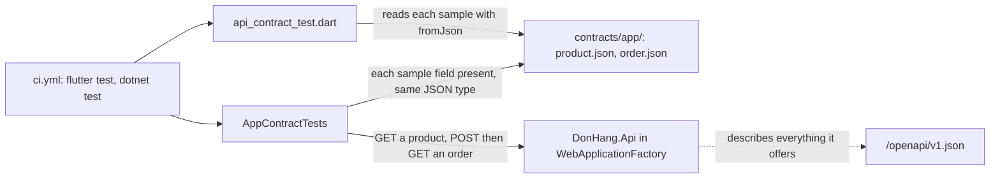

## Bạn cần biết trước

- [[frontend.l4.backend-for-frontend]] — bạn biết ADR `0018` giữ DonHang.App gọi thẳng `DonHang.Api`, và nêu tên các test giữ hình dạng câu trả lời.
- [[backend.l2.openapi-contract]] — bạn biết tài liệu OpenAPI được sinh ra từ code, nên code đổi thì nó đổi theo.
- [[backend.l4.message-schema-evolution]] — bạn biết `OrderMessageContractTests` hỏng ngay trong pull request khi một bên đổi tên hoặc đổi kiểu một property của message.
- [[design.l2.webapplicationfactory]] — bạn biết `WebApplicationFactory<Program>` chạy API thật bên trong test, với PostgreSQL thật phía sau.

## Tình huống

Đang ở stage-4. Trong lúc dọn `DonHang.Api/Dtos.cs`, một developer đổi tên `PriceVnd` của sản phẩm thành `Price`, sửa các test của API cho khớp, rồi mở pull request. Tài liệu OpenAPI đổi theo code, đúng như mong đợi, và vẫn mô tả một API hợp lệ. Các test màn hình của DonHang.App cũng qua: chúng tự dựng object `Product` và không bao giờ đọc câu trả lời từ API. Thế nhưng `Product.fromJson` của app vẫn đọc `priceVnd`, nên sau khi deploy, app không đọc được sản phẩm nào, và không thứ gì API công bố cho biết app cần field đó. Làm sao để một thay đổi như vậy hỏng ngay trong pull request, mà API vẫn tự do đổi mọi thứ app không đọc?

## Khái niệm cốt lõi

- bên dùng và bên cung cấp — bên đọc câu trả lời, ở đây là DonHang.App, và bên đưa ra câu trả lời, ở đây là `DonHang.Api`.
- câu trả lời mẫu — một file JSON có hình dạng giống một câu trả lời của bên cung cấp, chỉ chứa những field bên dùng đọc.
- **contract test** (test kiểm một bên của tích hợp theo bản mô tả chung về điều bên kia cần, để chỗ lệch hỏng ở test) — test kiểm một bên của một tích hợp theo bản mô tả chung về điều bên kia cần, để chỗ lệch làm hỏng một test thay vì màn hình của khách.
- **consumer-driven contract** (hợp đồng do bên dùng viết, chỉ liệt kê những gì nó thật sự đọc, bên cung cấp chạy test theo hợp đồng đó) — hợp đồng do bên dùng viết, chỉ liệt kê những gì nó đọc, và bên cung cấp chạy test theo hợp đồng đó.

## Cơ chế hoạt động



Trong tình huống trên, bên dùng là DonHang.App và bên cung cấp là `DonHang.Api`. App chỉ đọc vài field trong câu trả lời của API: `id`, `name` và `priceVnd` của sản phẩm, và `id`, `status` của đơn hàng cùng `productId`, `quantity`, `unitPriceVnd` của từng dòng hàng. Hợp đồng chính là những field đó, không hơn, giữ dưới dạng hai câu trả lời mẫu trong `contracts/app/` ở thư mục gốc của repo.

Mỗi bên có contract test riêng, và cả hai đọc cùng các mẫu. Phía app, `api_contract_test.dart` đưa từng mẫu vào `Product.fromJson` và `OrderResult.fromJson`, chính đoạn code đọc câu trả lời thật. Nếu `fromJson` bắt đầu đọc một field mẫu không có, hoặc đọc dưới tên khác hay kiểu khác, test này hỏng, nên các mẫu không thể tụt lại sau những gì app đọc. Phía API, `AppContractTests` khởi động API bằng `WebApplicationFactory`, xin một sản phẩm và một đơn đã đặt, rồi duyệt từng mẫu: field nào của mẫu cũng phải có trong câu trả lời, với cùng kiểu JSON. Lần đổi tên kia hỏng ở đây, vì câu trả lời không còn `priceVnd`. `ci.yml` chạy `flutter test` và `dotnet test` trên mọi pull request, nên chỉ cần một trong hai test hỏng là pull request chuyển đỏ.

Vì bên dùng viết các mẫu, hợp đồng này là consumer-driven. Field nào mẫu bỏ qua thì không bao giờ bị kiểm, nên API được tự do thêm field.

Tài liệu OpenAPI nằm bên cạnh, vẽ nét đứt vì không test nào đọc nó. Nó mô tả mọi thứ API cung cấp và đi theo code, nên một lần đổi tên làm nó đổi mà không làm hỏng gì. Hợp đồng thì mô tả điều một client phụ thuộc vào, như `OrderMessageContractTests` làm cho message.

## Trong hệ thống Đơn Hàng

Phía app:

```dart file=DonHang.App/test/api_contract_test.dart tag=stage-4 lines=15-39
Map<String, dynamic> sample(String name) =>
    jsonDecode(File('../contracts/app/$name').readAsStringSync()) as Map<String, dynamic>;

void main() {
  test('Product.fromJson reads the product sample', () {
    final json = sample('product.json');
    final product = Product.fromJson(json);

    expect(product.id, json['id']);
    expect(product.name, json['name']);
    expect(product.priceVnd, json['priceVnd']);
  });

  test('OrderResult.fromJson reads the order sample', () {
    final json = sample('order.json');
    final order = OrderResult.fromJson(json);
    final item = (json['items'] as List<dynamic>).single as Map<String, dynamic>;

    expect(order.id, json['id']);
    expect(order.status, json['status']);
    expect(order.items.single.productId, item['productId']);
    expect(order.items.single.quantity, item['quantity']);
    expect(order.items.single.unitPriceVnd, item['unitPriceVnd']);
  });
}
```

`sample` đọc một file trong `../contracts/app/`, đường dẫn tương đối tính từ `DonHang.App`, nơi `flutter test` chạy. `product.json` chứa `id` `3`, `name` `"Tai nghe"` và `priceVnd` `890000`. `order.json` chứa `id` `13`, `status` `"new"` và một dòng hàng có `productId`, `quantity` và `unitPriceVnd`. Mỗi test đưa mẫu đã giải mã vào `fromJson` của chính app, rồi kiểm từng field app giữ lại có bằng giá trị trong mẫu không.

Trong `product.dart`, ngoài đoạn trích, `fromJson` đọc từng field kèm ép kiểu, như `json['priceVnd'] as int`, nên mẫu nào thiếu field hoặc field mang kiểu khác sẽ làm test ném lỗi.

Phía API:

```csharp file=DonHang.Tests/Integration/AppContractTests.cs tag=stage-4 lines=59-80
    // Every property of the sample, at any depth: present, with the same
    // kind of JSON value. An array's first sample element describes each
    // element of the answer's array.
    private static void AssertMatches(JsonElement sample, JsonElement answer, string path)
    {
        Assert.True(sample.ValueKind == answer.ValueKind,
            $"{path}: the app expects {sample.ValueKind}, the api sends {answer.ValueKind}");
        if (sample.ValueKind == JsonValueKind.Object)
        {
            foreach (var field in sample.EnumerateObject())
            {
                Assert.True(answer.TryGetProperty(field.Name, out var value), $"{path}.{field.Name}: missing from the api's answer");
                AssertMatches(field.Value, value, $"{path}.{field.Name}");
            }
        }
        else if (sample.ValueKind == JsonValueKind.Array && sample.GetArrayLength() > 0)
        {
            Assert.NotEqual(0, answer.GetArrayLength());
            foreach (var item in answer.EnumerateArray())
                AssertMatches(sample[0], item, $"{path}[]");
        }
    }
```

`AssertMatches` duyệt theo mẫu, không theo câu trả lời. Trước hết nó đòi cùng `ValueKind`, tức loại giá trị JSON, như object, array, string, number, true, false hay null. Với mỗi field của một object trong mẫu, nó đòi câu trả lời có tên đó, rồi kiểm giá trị theo cùng cách, nên từng dòng hàng của đơn cũng được kiểm. Với array, phần tử đầu tiên của mẫu mô tả mọi phần tử của câu trả lời, và array rỗng trong câu trả lời thì hỏng. Field chỉ câu trả lời có thì không bao giờ được duyệt tới: `OrderDto` trong `Dtos.cs` còn gửi `customerId` và `placedAt`, và test này bỏ qua cả hai. Giá trị không được so sánh, chỉ hình dạng.

Ngoài đoạn trích, hai test gọi `factory.CreateClient()`. `Product_HasEveryFieldTheAppReads` đọc `/api/v1/products/{productId}` cho một sản phẩm nó đã chèn vào, rồi gọi `AssertMatches` với đường dẫn `"product"`. Test còn lại gửi một đơn tới `/api/v1/orders` kèm các header xác thực dùng cho test, rồi GET đơn đó ở địa chỉ `Location` trả về. Trong `ci.yml`, `dotnet test` chạy ở job `test` và `flutter test` ở job `app`.

## Đánh đổi

| Cách giữ app và API khớp nhau | Bắt được lần đổi tên `priceVnd` | Hỏng vì thay đổi app không quan tâm | Ai viết | Chi phí |
|---|---|---|---|---|
| Chỉ dựa vào tài liệu OpenAPI | không: nó đổi theo code | không | sinh ra từ API | không thêm gì |
| Test app với dữ liệu giả | không: dữ liệu giả là phỏng đoán của chính app | không | nhóm app | không thêm gì |
| Thử app với API đã deploy | có, sau khi deploy | không | không ai, chỉ là thói quen | muộn, làm tay, dễ bỏ qua |
| Consumer-driven contract (đã chọn) | có, ngay trong pull request | không | nhóm app viết mẫu, mỗi bên chạy một test | hai test nhỏ, mẫu đi cùng `fromJson` |
| Hợp đồng liệt kê mọi field của mọi câu trả lời | có | có, như `customerId` hay `placedAt` | bên nào cũng được | mỗi thay đổi của API đều phải sửa mẫu |

Dòng đã chọn kiểm hình dạng, không kiểm ý nghĩa. Nếu API giữ `priceVnd` nhưng gửi giá theo đơn vị nghìn đồng, cả hai test vẫn qua. Contract test loại bỏ một kiểu bất ngờ, phần còn lại vẫn phải do người review thay đổi của API bắt.

## Bạn sẽ chọn gì nếu…

…màn hình sản phẩm cần ảnh của sản phẩm? Để API thêm field trước. Không test nào hỏng, vì các mẫu không liệt kê nó. Sau đó pull request của app thêm field vào `Product.fromJson` và `product.json` cùng lúc, và từ đó `AppContractTests` sẽ hỏng nếu có ngày API thôi gửi field này.

…API buộc phải đổi tên `priceVnd`? Không làm trong một bước. API gửi cả hai tên, app chuyển `fromJson` và mẫu của mình sang tên mới, rồi API bỏ tên cũ khi không còn ai đọc. `AppContractTests` qua ở mọi bước, vì mỗi mẫu đều khớp với một câu trả lời vẫn còn đủ field của nó.

…có thêm một app cho nhân viên bên cạnh DonHang.App? Cho nó bộ mẫu riêng, liệt kê những gì nó đọc, và một test phía API cho bộ mẫu đó. Khi ấy API chịu trách nhiệm với hai hợp đồng, và field nào một trong hai client đọc thì field đó phải ở lại.

## Senior hay nhầm rằng…

- **"Tài liệu OpenAPI đã đảm bảo app sẽ không hỏng."** → Thực ra tài liệu mô tả những gì API cung cấp hôm nay và được sinh ra từ code, nên một lần đổi tên cho ra một tài liệu mới, vẫn hợp lệ. Nó không thể cho biết client phụ thuộc vào field nào. Bạn sẽ nhận ra khi một pull request đổi tên field làm `/openapi/v1.json` đổi, mà mọi check vẫn xanh.
- **"Test chạy app với API giả chứng minh app chạy được với API thật."** → Thực ra API giả do chính nhóm viết đoạn code nhận dữ liệu từ nó viết ra, nên cả hai mang cùng một phỏng đoán về câu trả lời. Ở DonHang.App, dữ liệu giả đưa cho màn hình những object `Product` dựng sẵn: các widget test như `product_list_screen_test.dart` tự dựng `Product` và không bao giờ gặp JSON của API. Bạn sẽ nhận ra khi mọi test của app đều qua mà danh sách sản phẩm vẫn hỏng với API đã deploy.
- **"Contract test phải liệt kê mọi field của mọi response."** → Thực ra hợp đồng liệt kê những field không client nào đọc sẽ hỏng vì những thay đổi chẳng hại ai, và nhóm dễ quen tay sửa mẫu cho tới khi test xanh. `order.json` bỏ `customerId` và `placedAt` vì app không đọc chúng. Bạn sẽ nhận ra khi một pull request của API thêm hoặc bỏ một field không ai dùng lại làm contract test hỏng.

## Thử ngay (3 phút)

1. Trong repo Đơn Hàng ở `stage-4`, từ `DonHang.App`, chạy `flutter test test/api_contract_test.dart`.
2. Trong `contracts/app/product.json`, đổi tên `priceVnd` thành `price` rồi chạy lại lệnh đó.
3. Khôi phục file bằng `git checkout contracts/app/product.json`.

Kết quả mong đợi: lần chạy đầu, cả hai test đều qua. Lần thứ hai, `Product.fromJson reads the product sample` hỏng với một lỗi kiểu ném ra từ `Product.fromJson`, còn test đơn hàng vẫn qua.

Rồi trả lời: nếu thay vào đó bạn đổi tên `PriceVnd` ở mọi chỗ trong `DonHang.Api`, test nào sẽ hỏng, và vì sao không phải test bạn vừa chạy?

<details><summary>Gợi ý đáp án</summary>

`AppContractTests.Product_HasEveryFieldTheAppReads` sẽ hỏng với `product.priceVnd: missing from the api's answer`, vì mẫu vẫn liệt kê `priceVnd` mà API không còn gửi nó. Test Dart chỉ đọc mẫu, thứ bạn không đổi, nên vẫn qua. Đó là lý do hợp đồng cần một test ở mỗi bên.

</details>

## Liên hệ

- [[backend.l2.openapi-contract]] — bài cần trước: tài liệu về mọi thứ API cung cấp, mà hợp đồng này thu hẹp lại cho một client.
- [[backend.l4.message-schema-evolution]] — cùng ý tưởng ở một lớp khác: một test giữ cho message vẫn đọc được với những bên đọc nó.
- [[design.l2.webapplicationfactory]] — bài cần trước: cách `AppContractTests` chạy API thật bên trong test.
- [[backend.l2.breaking-changes]] — hợp đồng là cách API biết thay đổi nào của nó làm hỏng client này.
- [[backend.l4.expand-and-contract]] — cách đổi tên một field có trong hợp đồng mà không làm hợp đồng hỏng.
- [[frontend.l2.server-errors-in-forms]] — các câu trả lời lỗi mà app cũng đọc, thứ `contracts/app/` chưa bao phủ ở stage-4.
- [[frontend.l4.backend-for-frontend]] — bài cần trước: quyết định gọi thẳng API, mà hợp đồng này giữ an toàn.

## Tóm tắt 5 dòng

1. Hợp đồng giữa app và API chỉ liệt kê những field app đọc, và mỗi bên có một test giữ mình đúng với hợp đồng.
2. Contract test kiểm một bên của tích hợp theo bản mô tả chung về điều bên kia cần.
3. Ở stage-4, `api_contract_test.dart` đọc các mẫu trong `contracts/app/` bằng chính `Product.fromJson` và `OrderResult.fromJson` của app.
4. `AppContractTests` hỏng khi câu trả lời của API thiếu một field có trong mẫu hoặc gửi kiểu JSON khác, nên đổi tên `PriceVnd` sẽ hỏng ngay trong pull request.
5. Tài liệu OpenAPI mô tả mọi thứ API cung cấp, còn consumer-driven contract mô tả điều một client phụ thuộc vào, nên API được tự do thêm field.
