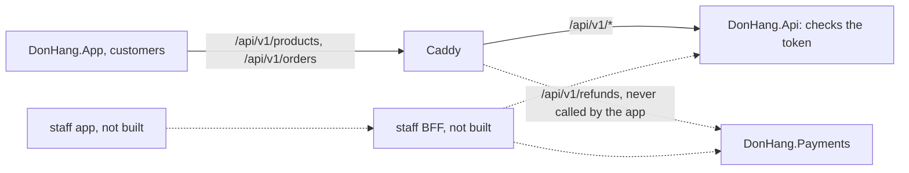

## Before you start

- [[backend.l4.api-gateway]] — you know Caddy routes `/api/v1/refunds` to Payments and the rest to the API, and each service still checks every token itself.
- [[frontend.l4.client-technology-drivers]] — you know ADR `0017` keeps one Flutter code base, so Đơn Hàng has one kind of client app today.
- [[design.l4.conways-law]] — you know Đơn Hàng is built by one team, and a boundary between parts tends to follow how teams talk.

## The situation

It is stage-4, and the team is preparing Đơn Hàng for many shops. In a design meeting, a developer proposes adding a backend for frontend now: a small server between DonHang.App and the API, built only for the app. "Every serious app has one, and adding it later will hurt," they say. Another developer answers that Caddy already sits in front of the API, so Đơn Hàng has one. A third asks what the new server would do on its first day, and nobody can name a screen it would change. When does an app earn a server of its own, and does DonHang.App need one today?

## Core concepts

- **backend for frontend (BFF)** — a server-side component built for one kind of client: it calls the backend services and returns what that client's screens need, in the shape they need it.
- a kind of client — a group of screens with the same users and needs, such as DonHang.App for customers, or a future app for shop staff.
- combining answers — one screen needing data from more than one service, so something must call each service and join the results.
- an extra hop — one more server that every request passes through on its way, which adds time and one more thing to deploy and watch.

## How it works



In the situation above, the customers' app is the only kind of client. Caddy picks a service by path, the same way for every client: it sends every path starting with `/api/v1/refunds` to Payments and every other `/api/v1/` path to `DonHang.Api`. Nothing in the Caddyfile reshapes an API answer; it only chooses where the request goes. That is the API gateway's job, and it is why Caddy is not a BFF. The app never asks for refunds, so every request for Đơn Hàng's data lands on the API. Signing in talks to Keycloak, which is not part of this decision.

A BFF belongs to one kind of client and speaks for that client's screens: it calls the API, Payments or both, keeps the fields the screens show, joins them, and returns one answer per screen. The dotted part of the diagram is the case where that pays: a staff app that shows refunds next to orders, which the customers' app never shows. With one BFF per kind of client, each client's answers can change without the other client having to follow.

So a BFF earns its place on one of two signals. Clients differ, and changing the API for one would make it worse for the other. Or one screen needs answers from several services combined, and combining them in the app would mean several requests per screen and the app knowing each service's path.

Without either signal, a BFF only costs: one more service to deploy, monitor and keep running, and one more hop on every request. It adds no safety either. The services behind it still check each token themselves, as they already do behind Caddy.

## In the Đơn Hàng system

How the app gets an order, from the Ordering feature:

```dart file=DonHang.App/lib/features/ordering/orders_api.dart tag=stage-4 lines=10-25
// lesson: frontend.l4.backend-for-frontend
// The Ordering feature's calls to DonHang.Api, each a single request whose
// answer the screen shows as it is. Orders belong to a customer, so these
// requests carry the signed-in customer's token.
class OrdersApi {
  final ApiClient _client;

  OrdersApi(this._client);

  Future<OrderResult> fetchOrder(int id) async {
    final response = await _client.get('/orders/$id', signedIn: true);
    if (response.statusCode != 200) {
      throw Exception('failed to load order $id (${response.statusCode})');
    }
    return OrderResult.fromJson(jsonDecode(response.body) as Map<String, dynamic>);
  }
```

The comment states the fact the decision rests on: each call is one request, and the screen shows the answer as it is. `fetchOrder` sends `GET /orders/$id` with `signedIn: true`, so the customer's token goes with it, and turns the body into an `OrderResult` without asking any other service. `ApiClient`, defined in `api_client.dart` outside this excerpt, is the app's shared HTTP helper: it puts Caddy's address and the `/api/v1` prefix in front of each path and, when `signedIn: true`, adds the customer's token, so the request Caddy sees is `GET /api/v1/orders/$id`. Outside this excerpt, `createOrder` in the same file places an order with one `POST /orders`. In `catalog_api.dart`, the Catalog feature's two calls, `/products` and `/products/$id`, follow the same pattern and carry no token. Because the token reaches `DonHang.Api`, the API decides whether this customer may read this order.

The decision, from ADR `0018` (written in Vietnamese):

```markdown file=docs/adr/0018-app-goi-thang-api-chua-them-bff.md tag=stage-4 lines=35-56
### Quyết định

Chọn giữ nguyên: DonHang.App tiếp tục gọi thẳng DonHang.Api. Một loại client,
một đội, câu trả lời đã vừa với màn hình: chưa có vấn đề nào mà BFF giải
quyết, còn chi phí của nó thì có ngay. Caddyfile và Gateway không đổi.

### Hệ quả

- Không thêm service. Kiểm quyền vẫn ở API: ai được đọc một đơn do
  `DonHang.Api` quyết định, như đã làm sau API gateway.
- Hình dạng câu trả lời mà app dựa vào được giữ bằng hợp đồng
  `contracts/app/`: app kiểm nó đọc được các mẫu
  (`DonHang.App/test/api_contract_test.dart`), API kiểm nó vẫn trả đủ các field
  đó (`DonHang.Tests/Integration/AppContractTests.cs`).
- Nếu sau này có BFF, nó chỉ phục vụ client của nó: không giữ quy tắc nghiệp
  vụ, và không thay việc kiểm quyền của các service phía sau.

Đội xem lại quyết định khi:

- Có loại client thứ hai (ví dụ app cho nhân viên cửa hàng) mà câu trả lời của
  API không hợp, và sửa API cho client đó sẽ làm khó client kia.
- Một màn hình phải ghép dữ liệu từ API và Payments.
```

"Quyết định" (decision) keeps DonHang.App calling `DonHang.Api` directly: one kind of client, one team, answers that already fit the screens. A BFF would solve no problem the team has, while its cost starts at once. The Caddyfile and the cluster's Gateway do not change.

"Hệ quả" (consequences) adds no service and keeps the authorization check in the API, which decides who may read an order, as it already does behind the API gateway. The second bullet names the tests that keep the answers' shape; the next lesson covers them. The third bullet limits any future BFF: it serves only its client, holds no business rules, and does not replace the checks of the services behind it.

The last list says when the team reopens the decision: a second kind of client, such as an app for shop staff, whose needs the API's answers do not fit, where changing the API for it would make things harder for the other client; or a screen that must combine data from the API and Payments.

Two more parts of the ADR sit outside this excerpt. Its options section also rejects an API where each client sends a query naming the fields it wants: it fixes fetching too much or too little, which the app does not meet, and the team would have to learn, protect and limit the load of a new kind of API. Its record of feedback answers the proposal to build a BFF now so it is easier later: a BFF inserted later does not change the API behind it, only the address the app calls, while building it early pays running costs from today for a need not yet there.

## Trade-offs

| Option | Services to run | Hops per request | Who shapes each answer | Fits |
|---|---|---|---|---|
| App calls the API directly (chosen) | none added | through Caddy only | the API, once for every client | one kind of client whose screens the API's answers already fit |
| One BFF for DonHang.App | one more, deployed and monitored | one more | the BFF, for this app's screens | a screen that must combine the API and Payments |
| One BFF per kind of client | one per client kind | one more | each BFF, for its own client | clients whose needs pull the API in different directions |
| An API where each client picks the fields it wants | none added, but a new kind of API | through Caddy only | each client, in its own query | many clients fetching too much or too little; ADR `0018` rejects it for the cost of a new kind of API |

Every row except the first adds work today. That is the ADR's reasoning: a BFF's cost is certain and immediate, while its benefit waits for a second kind of client or a combined screen.

## What would you choose if…

…shops ask for a staff app that lists today's orders with their refund status? This meets both reopening conditions: a second kind of client, and a screen joining the API and Payments. A staff BFF that calls both and returns one list per screen is now worth its cost, and the customers' app keeps calling the API directly.

…the customers' product screen needs one extra field, such as a product's photo? Add the field to the API's answer. One kind of client still wants one shape, and the next lesson shows how the app's contract notices the change.

…the team splits into a team per client, one for the customers' app and one for the staff app? Each team would want to change its own answers without waiting for the other. A BFF per client, owned by that client's team, lets each change alone, which is the team boundary and the code boundary drawn together.

## Seniors often assume…

- **"A BFF is just another name for an API gateway."** → Actually a gateway is one way in for every client, routing by path and changing no answer, as Caddy does. A BFF belongs to one kind of client and shapes answers for its screens. You notice this when someone points at Caddy as "our BFF", yet no answer the app receives is any different because of it.
- **"Every app should get its own BFF from day one, even as the only client."** → Actually a single client gets nothing a BFF adds, and pays for one more service and one more hop at once. As the ADR's record of feedback answers, inserting a BFF later leaves the API behind it unchanged and only changes the address the app calls. You notice this when the new service only forwards each request to the API and returns the answer as it came.
- **"Putting business rules in the BFF keeps the services simpler."** → Actually a rule in one client's BFF does not apply to another client, or to a request that reaches the service another way. ADR `0018` forbids it, and keeps who may read an order in `DonHang.Api`. You notice this when the staff app can do something the customers' app is stopped from doing, because only one BFF checks it.

## Try it (3 minutes)

1. In the Đơn Hàng repository at `stage-4`, run `grep -rnE "_client\.(get|post)\(" DonHang.App/lib/features`.
2. Run `grep -rn "refunds" Caddyfile DonHang.App/lib`.
3. For each of ADR `0018`'s two reopening conditions, say what these results would have to show for it to hold.

Expected result: the first command prints four lines, two in `catalog_api.dart` (`/products`, `/products/$id`) and two in `orders_api.dart` (`/orders/$id`, and a `_client.post(` call whose path is on the next line). The second prints two lines, both from the `Caddyfile`, and none from the app.

<details><summary>Suggested answer</summary>

Every call names one path of `DonHang.Api`, and no file of the app mentions refunds, so no screen combines the API and Payments. For the second condition to hold, a screen would need a call to `/api/v1/refunds` next to a call to the API, with the two answers joined. The first condition cannot show in this code at all: it needs a second kind of client, and the repository holds only one app.

</details>

## Connections

- [[backend.l4.api-gateway]] — prerequisite: the gateway that routes for every client, which a BFF does not replace.
- [[backend.l3.payments-service]] — the service a combined screen would need next to the API, and the reason the second reopening condition names Payments.
- [[design.l4.where-boundaries-are-enforced]] — a BFF is one more part held apart by the network, with the same costs of a call across it.
- [[backend.l2.api-versioning]] — the API's own way to change answers without breaking a client; a BFF is the option when two clients need different answers at once.
- [[design.l4.conways-law]] — a BFF per client team is a code boundary drawn along a team boundary.
- [[frontend.l4.app-api-contract]] — next: the tests that keep the API's answers in the shape the app reads, without a BFF.

## Five-line summary

1. A backend for frontend pays off only when clients differ or one screen must combine several services.
2. A BFF is a server built for one kind of client that calls the services and shapes answers for its screens.
3. At stage-4 every DonHang.App screen that shows Đơn Hàng's data gets it with one request to `DonHang.Api`, and the app never calls Payments.
4. ADR `0018` keeps the app calling the API directly, since a BFF would add one service and one hop for nothing.
5. A BFF holds no business rules and does not replace the services' checks; `DonHang.Api` still decides who reads an order.
