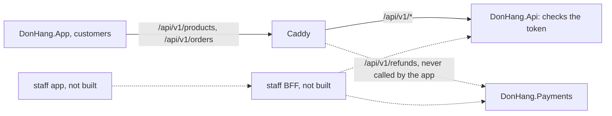

## Bạn cần biết trước

- [[backend.l4.api-gateway]] — bạn biết Caddy chuyển `/api/v1/refunds` tới Payments và phần còn lại tới API, còn mỗi service vẫn tự kiểm tra mọi token.
- [[frontend.l4.client-technology-drivers]] — bạn biết ADR `0017` giữ một code base Flutter duy nhất, nên hôm nay Đơn Hàng chỉ có một loại app client.
- [[design.l4.conways-law]] — bạn biết Đơn Hàng do một nhóm xây, và ranh giới giữa các phần thường đi theo cách các nhóm trao đổi với nhau.

## Tình huống

Đang ở stage-4, nhóm chuẩn bị đưa Đơn Hàng tới nhiều cửa hàng. Trong một buổi họp thiết kế, một developer đề xuất thêm backend for frontend ngay bây giờ: một server nhỏ đứng giữa DonHang.App và API, chỉ làm cho app. "App nghiêm túc nào cũng có, để sau mới thêm thì sẽ đau," họ nói. Một developer khác đáp rằng Caddy đã đứng trước API rồi, nên Đơn Hàng có sẵn một cái. Người thứ ba hỏi server mới sẽ làm gì trong ngày đầu tiên, và không ai kể ra được màn hình nào sẽ thay đổi. Khi nào một app xứng đáng có server riêng, và hôm nay DonHang.App có cần không?

## Khái niệm cốt lõi

- **backend for frontend (BFF)** (Thành phần phía server làm riêng cho một loại client, gọi các service và trả đúng thứ màn hình của client đó cần) — thành phần phía server làm cho một loại client: nó gọi các service backend và trả về đúng thứ các màn hình của client đó cần, theo đúng hình dạng chúng cần.
- một loại client — một nhóm màn hình có cùng người dùng và cùng nhu cầu, như DonHang.App cho khách hàng, hay một app cho nhân viên cửa hàng sau này.
- ghép câu trả lời — một màn hình cần dữ liệu từ nhiều service, nên phải có thứ gì đó gọi từng service rồi nối kết quả lại.
- thêm một chặng — thêm một server mà mọi request phải đi qua trên đường tới đích, tốn thêm thời gian và thêm một thứ phải deploy và theo dõi.

## Cơ chế hoạt động



Trong tình huống trên, app của khách hàng là loại client duy nhất. Caddy chọn service theo đường dẫn, giống nhau cho mọi client: mọi đường dẫn bắt đầu bằng `/api/v1/refunds` đi tới Payments, mọi đường dẫn `/api/v1/` khác đi tới `DonHang.Api`. Không gì trong Caddyfile sửa lại hình dạng câu trả lời của API. Nó chỉ chọn request đi đâu. Đó là phần việc của API gateway, và cũng là lý do Caddy không phải BFF. App không bao giờ hỏi tới refund, nên mọi request lấy dữ liệu của Đơn Hàng đều tới API. Đăng nhập thì nói chuyện với Keycloak, không thuộc quyết định này.

BFF thuộc về một loại client và nói thay cho các màn hình của client đó: nó gọi API, Payments hoặc cả hai, giữ lại các field màn hình hiển thị, nối chúng lại, và trả về một câu trả lời cho mỗi màn hình. Phần nét đứt trong sơ đồ là trường hợp BFF đáng làm: một app cho nhân viên hiển thị refund cạnh đơn hàng, thứ mà app của khách không bao giờ hiển thị. Khi mỗi loại client có một BFF, câu trả lời cho client này đổi được mà client kia không phải đổi theo.

Vậy BFF có chỗ đứng khi có một trong hai dấu hiệu. Thứ nhất, các client khác nhau, và sửa API cho client này sẽ làm nó tệ đi với client kia. Thứ hai, một màn hình cần ghép câu trả lời từ nhiều service, và ghép trong app thì mỗi màn hình phải gửi nhiều request, còn app phải biết đường dẫn của từng service.

Không có dấu hiệu nào thì BFF chỉ tốn: thêm một service phải deploy, theo dõi và giữ cho chạy, thêm một chặng trên mọi request. Nó cũng không làm hệ thống an toàn hơn. Các service phía sau vẫn tự kiểm tra từng token, như chúng đang làm sau Caddy.

## Trong hệ thống Đơn Hàng

Cách app lấy một đơn hàng, từ feature Ordering:

```dart file=DonHang.App/lib/features/ordering/orders_api.dart tag=stage-4 lines=10-25
// lesson: frontend.l4.backend-for-frontend
// The Ordering feature's calls to DonHang.Api, each a single request whose
// answer the screen shows as it is. Orders belong to a customer, so these
// requests carry the signed-in customer's token.
class OrdersApi {
  final ApiClient _client;

  OrdersApi(this._client);

  Future<OrderResult> fetchOrder(int id) async {
    final response = await _client.get('/orders/$id', signedIn: true);
    if (response.statusCode != 200) {
      throw Exception('failed to load order $id (${response.statusCode})');
    }
    return OrderResult.fromJson(jsonDecode(response.body) as Map<String, dynamic>);
  }
```

Comment nói ra điều mà quyết định dựa vào: mỗi lời gọi là một request, và màn hình hiển thị câu trả lời nguyên như nhận được. `fetchOrder` gửi `GET /orders/$id` với `signedIn: true`, nên token của khách đi kèm, rồi chuyển body thành `OrderResult` mà không hỏi service nào khác. `ApiClient`, định nghĩa trong `api_client.dart` ngoài đoạn trích, là helper HTTP dùng chung của app: nó gắn địa chỉ của Caddy và tiền tố `/api/v1` vào trước mỗi đường dẫn, và khi `signedIn: true` thì thêm token của khách, nên request Caddy nhận được là `GET /api/v1/orders/$id`. Ngoài đoạn trích, `createOrder` trong cùng file đặt đơn bằng một `POST /orders`. Trong `catalog_api.dart`, hai lời gọi của feature Catalog, `/products` và `/products/$id`, theo cùng khuôn đó và không mang token. Vì token tới được `DonHang.Api`, API quyết định khách này có được đọc đơn này hay không.

Quyết định, lấy từ ADR `0018`:

```markdown file=docs/adr/0018-app-goi-thang-api-chua-them-bff.md tag=stage-4 lines=35-56
### Quyết định

Chọn giữ nguyên: DonHang.App tiếp tục gọi thẳng DonHang.Api. Một loại client,
một đội, câu trả lời đã vừa với màn hình: chưa có vấn đề nào mà BFF giải
quyết, còn chi phí của nó thì có ngay. Caddyfile và Gateway không đổi.

### Hệ quả

- Không thêm service. Kiểm quyền vẫn ở API: ai được đọc một đơn do
  `DonHang.Api` quyết định, như đã làm sau API gateway.
- Hình dạng câu trả lời mà app dựa vào được giữ bằng hợp đồng
  `contracts/app/`: app kiểm nó đọc được các mẫu
  (`DonHang.App/test/api_contract_test.dart`), API kiểm nó vẫn trả đủ các field
  đó (`DonHang.Tests/Integration/AppContractTests.cs`).
- Nếu sau này có BFF, nó chỉ phục vụ client của nó: không giữ quy tắc nghiệp
  vụ, và không thay việc kiểm quyền của các service phía sau.

Đội xem lại quyết định khi:

- Có loại client thứ hai (ví dụ app cho nhân viên cửa hàng) mà câu trả lời của
  API không hợp, và sửa API cho client đó sẽ làm khó client kia.
- Một màn hình phải ghép dữ liệu từ API và Payments.
```

Phần "Quyết định" giữ DonHang.App gọi thẳng `DonHang.Api`: một loại client, một nhóm, câu trả lời đã vừa với màn hình. BFF không giải quyết vấn đề nào nhóm đang có, còn chi phí của nó bắt đầu ngay. Caddyfile và Gateway của cluster không đổi.

Phần "Hệ quả" không thêm service và giữ phần kiểm tra phân quyền ở API, nơi quyết định ai được đọc một đơn, như API vẫn làm sau API gateway. Gạch đầu dòng thứ hai nêu tên các test giữ hình dạng câu trả lời, bài tiếp theo sẽ nói về chúng. Gạch đầu dòng thứ ba giới hạn mọi BFF sau này: nó chỉ phục vụ client của nó, không giữ quy tắc nghiệp vụ, và không thay phần kiểm tra của các service phía sau.

Danh sách cuối nói khi nào nhóm mở lại quyết định: có loại client thứ hai, như app cho nhân viên cửa hàng, mà câu trả lời của API không hợp với nhu cầu, và sửa API cho nó sẽ làm khó client kia. Hoặc có một màn hình phải ghép dữ liệu từ API và Payments.

Ngoài đoạn trích, ADR còn hai phần nữa. Phần các phương án cũng loại một kiểu API mà mỗi client gửi một câu truy vấn nêu tên các field nó muốn: kiểu này chữa chuyện lấy quá nhiều hay quá ít dữ liệu, điều app không gặp, còn nhóm sẽ phải học, bảo vệ và giới hạn tải cho một loại API mới. Phần ghi nhận góp ý trả lời đề xuất xây BFF ngay để sau này dễ hơn: BFF chen vào sau này không đổi API phía sau, chỉ đổi địa chỉ app gọi, còn xây sớm thì trả chi phí vận hành từ hôm nay cho một nhu cầu chưa có.

## Đánh đổi

| Cách làm | Service phải chạy | Số chặng mỗi request | Ai định hình câu trả lời | Hợp với |
|---|---|---|---|---|
| App gọi thẳng API (đã chọn) | không thêm | chỉ qua Caddy | API, một lần cho mọi client | một loại client mà câu trả lời của API đã vừa với các màn hình |
| Một BFF cho DonHang.App | thêm một, phải deploy và theo dõi | thêm một | BFF, cho các màn hình của app này | một màn hình phải ghép API và Payments |
| Mỗi loại client một BFF | mỗi loại client một cái | thêm một | từng BFF, cho client của nó | các client có nhu cầu kéo API về những hướng khác nhau |
| Một API mà mỗi client tự chọn field mình muốn | không thêm, nhưng là một loại API mới | chỉ qua Caddy | từng client, trong câu truy vấn của nó | nhiều client lấy quá nhiều hoặc quá ít dữ liệu. ADR `0018` loại nó vì cái giá của một loại API mới |

Mọi dòng trừ dòng đầu đều thêm việc ngay hôm nay. Đó là lập luận của ADR: chi phí của BFF là chắc chắn và tới ngay, còn lợi ích của nó phải chờ một loại client thứ hai hoặc một màn hình cần ghép dữ liệu.

## Bạn sẽ chọn gì nếu…

…các cửa hàng xin một app cho nhân viên, liệt kê đơn hàng hôm nay kèm trạng thái refund? Yêu cầu này chạm cả hai điều kiện mở lại: một loại client thứ hai, và một màn hình nối API với Payments. Một BFF cho nhân viên, gọi cả hai và trả một danh sách cho mỗi màn hình, giờ đáng với chi phí của nó. App của khách vẫn gọi thẳng API.

…màn hình sản phẩm của khách cần thêm một field, như ảnh sản phẩm? Thêm field đó vào câu trả lời của API. Vẫn chỉ một loại client muốn một hình dạng, và bài tiếp theo cho thấy hợp đồng của app nhận ra thay đổi này thế nào.

…nhóm tách thành mỗi client một nhóm, một nhóm cho app của khách và một nhóm cho app của nhân viên? Mỗi nhóm sẽ muốn đổi câu trả lời của mình mà không phải chờ nhóm kia. Mỗi client một BFF, do nhóm của client đó sở hữu, cho phép từng nhóm đổi độc lập. Ranh giới nhóm và ranh giới code được vẽ cùng nhau.

## Senior hay nhầm rằng…

- **"BFF chỉ là tên khác của API gateway."** → Thực ra gateway là một lối vào chung cho mọi client, định tuyến theo đường dẫn và không đổi câu trả lời nào, như Caddy đang làm. BFF thuộc về một loại client và định hình câu trả lời cho các màn hình của nó. Bạn sẽ nhận ra khi ai đó chỉ vào Caddy và gọi là "BFF của mình", trong khi không câu trả lời nào app nhận được khác đi vì nó.
- **"App nào cũng nên có BFF riêng ngay từ ngày đầu, kể cả khi là client duy nhất."** → Thực ra một client duy nhất không nhận được gì từ BFF, mà phải trả ngay cho thêm một service và thêm một chặng. Như phần ghi nhận góp ý của ADR đã trả lời, chen BFF vào sau này không đổi API phía sau, chỉ đổi địa chỉ app gọi. Bạn sẽ nhận ra khi service mới chỉ chuyển từng request sang API rồi trả câu trả lời nguyên như nhận được.
- **"Đặt quy tắc nghiệp vụ trong BFF giúp các service gọn hơn."** → Thực ra một quy tắc nằm trong BFF của client này không áp dụng cho client khác, hay cho request tới service bằng đường khác. ADR `0018` cấm điều đó, và giữ quyết định ai được đọc một đơn trong `DonHang.Api`. Bạn sẽ nhận ra khi app của nhân viên làm được một việc mà app của khách bị chặn, chỉ vì một BFF có kiểm tra còn BFF kia thì không.

## Thử ngay (3 phút)

1. Trong repo Đơn Hàng ở `stage-4`, chạy `grep -rnE "_client\.(get|post)\(" DonHang.App/lib/features`.
2. Chạy `grep -rn "refunds" Caddyfile DonHang.App/lib`.
3. Với từng điều kiện mở lại trong hai điều kiện của ADR `0018`, nói xem kết quả trên phải cho thấy gì thì điều kiện đó mới đúng.

Kết quả mong đợi: lệnh thứ nhất in bốn dòng, hai dòng trong `catalog_api.dart` (`/products`, `/products/$id`) và hai dòng trong `orders_api.dart` (`/orders/$id`, và một lời gọi `_client.post(` có đường dẫn nằm ở dòng kế tiếp). Lệnh thứ hai in hai dòng, cả hai từ `Caddyfile`, không dòng nào từ app.

<details><summary>Gợi ý đáp án</summary>

Mỗi lời gọi nêu một đường dẫn của `DonHang.Api`, và không file nào của app nhắc tới refund, nên không màn hình nào ghép API với Payments. Để điều kiện thứ hai đúng, phải có một màn hình gọi `/api/v1/refunds` cạnh một lời gọi tới API, rồi nối hai câu trả lời lại. Điều kiện thứ nhất hoàn toàn không thể hiện trong code này: nó cần một loại client thứ hai, còn repo chỉ có một app.

</details>

## Liên hệ

- [[backend.l4.api-gateway]] — bài cần trước: gateway định tuyến cho mọi client, thứ mà BFF không thay thế.
- [[backend.l3.payments-service]] — service mà một màn hình ghép dữ liệu sẽ cần bên cạnh API, và là lý do điều kiện mở lại thứ hai nhắc tên Payments.
- [[design.l4.where-boundaries-are-enforced]] — BFF là thêm một phần tách rời qua mạng, chịu cùng những cái giá của một lời gọi qua mạng.
- [[backend.l2.api-versioning]] — cách của chính API để đổi câu trả lời mà không làm hỏng client. BFF là phương án khi hai client cần hai câu trả lời khác nhau cùng lúc.
- [[design.l4.conways-law]] — mỗi nhóm client một BFF là ranh giới code vẽ theo ranh giới nhóm.
- [[frontend.l4.app-api-contract]] — bài tiếp theo: các test giữ câu trả lời của API đúng hình dạng app đọc, không cần BFF.

## Tóm tắt 5 dòng

1. BFF chỉ đáng làm khi các client khác nhau hoặc một màn hình phải ghép dữ liệu từ nhiều service.
2. BFF là server làm cho một loại client, gọi các service và định hình câu trả lời cho các màn hình của client đó.
3. Ở stage-4, mọi màn hình của DonHang.App hiển thị dữ liệu Đơn Hàng đều lấy bằng một request tới `DonHang.Api`, và app không bao giờ gọi Payments.
4. ADR `0018` giữ app gọi thẳng API, vì BFF sẽ thêm một service và một chặng mà không đổi lại gì.
5. BFF không giữ quy tắc nghiệp vụ và không thay phần kiểm tra của các service. `DonHang.Api` vẫn quyết định ai được đọc một đơn.
