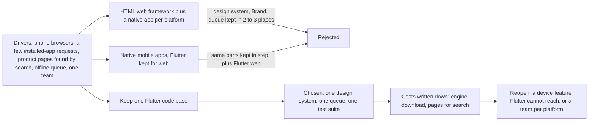

## Before you start

- [[design.l4.architectural-drivers]] — you know an architecture is chosen from its drivers, not from a style, and that a changed driver is the reason to revisit it.
- [[design.l4.one-deployment-for-all-shops]] — you know Đơn Hàng serves 1,000 shops from one shared deployment, so a shop is data, not a copy.
- [[frontend.l3.brand-themes]] — you know a shop's look is one `Brand` value given to one theme builder, not copied screens.
- [[frontend.l3.offline-order-queue]] — you know DonHang.App keeps an order on the device and sends it later when the API cannot answer.

## The situation

Đơn Hàng now serves many shops, and three requests about the app reach the team in one week. A few shops ask for an app their customers can install on a phone. A developer wants to rewrite the web client with a web framework that builds HTML, because Flutter web "feels heavy". Another developer says a serious product needs a separate app for each phone platform, because those are faster.

Each request sounds reasonable, and each points to a different technology. One team builds both the backend and the app. Which client technology should DonHang.App use for 1,000 shops, and what should decide it?

## Core concepts

- a web app — a client that runs inside the browser, so a customer opens it from a link and installs nothing. A web framework that builds HTML makes its pages from the browser's own HTML elements; Flutter web draws the screen itself.
- **native app** — an app written for one platform, such as Android or iOS, with that platform's own language and tools.
- **cross-platform** — one code base built into apps for several platforms, as Flutter does for web, Android and iOS.
- a platform folder — the folder in a Flutter project, such as `web/`, `android/` or `ios/`, that lets the project be built for that platform.
- a client technology driver — a need that decides the choice: which devices customers use, which device features the app needs, working offline, how people find the product, and what the team knows and can keep up.

## How it works



In the situation above, the installed-app request becomes a driver, the HTML-framework request becomes option 2, plus native apps for installed-app requests, and the per-platform request becomes option 3. ADR `0017` judges all three against the same drivers: customers order from phone browsers, a few shops want an installed app, some want product pages found by search engines, the app works offline, and one team builds everything. The first three are assumptions from talks with shops, not measurements.

At stage-4 DonHang.App is cross-platform code with just the `web/` platform folder. Only two files, both named `browser_web.dart`, call the browser. One gives the offline queue its `localStorage` store; the other keeps sign-in values while the browser visits the sign-in page. The rest, including `lib/design/` and the queue, does not touch the browser; the few files that need storage or sign-in reach it only through these two, which this lesson calls the device wrapper. On an installed app, that platform's wrapper is where a device feature, such as a counter printer, would be reached. Adding `android/` or `ios/`, plus that platform's version of the two files, would let the same code be built as an installed app.

The two other options both add native apps. Each is another code base in another language, so one team would write the design system, every shop's `Brand` and the offline queue again and keep them in step.

So the ADR keeps one Flutter code base. It writes down two costs, the download of Flutter's engine (the part of Flutter that draws the screens, fetched before anything shows) and pages that do not suit search engines, and two reasons to decide again: a device feature Flutter cannot reach, or a team per platform.

## In the Đơn Hàng system

The three options and the decision, as ADR `0017` writes them:

```markdown file=docs/adr/0017-giu-mot-ma-flutter-cho-moi-nen-tang.md tag=stage-4 lines=23-44
### Các phương án

- Giữ một mã Flutter: web như bây giờ, Android và iOS build từ cùng mã khi có
  cửa hàng cần app cài trên máy (thêm thư mục nền tảng, viết lại phần trong
  hai file `browser_web.dart` cho nền tảng đó). Design system, `Brand`, hàng
  đợi offline và test dùng chung cho mọi nền tảng.
- Viết lại client web bằng một framework web dựng HTML, và làm app native
  riêng cho từng nền tảng khi cần: mỗi client hợp nhất với nền tảng của nó,
  trang web có sẵn HTML cho máy tìm kiếm. Nhưng design system, `Brand` và hàng
  đợi offline phải viết lại và giữ đồng bộ ở hai tới ba nơi, bằng hai tới ba
  ngôn ngữ, với một đội.
- App native cho từng nền tảng di động, giữ Flutter cho web: trình duyệt vẫn
  là nơi khách đặt nhiều nhất nên Flutter web vẫn phải giữ, cộng thêm hai mã
  native; cùng chi phí giữ đồng bộ như phương án trên.

### Quyết định

Chọn giữ một mã Flutter cho mọi nền tảng. Với một đội, giá trị lớn nhất là
một design system, một hàng đợi offline và một bộ test; mỗi cửa hàng vẫn chỉ
khác nhau ở giá trị `Brand`, trên nền tảng nào cũng vậy. Stage-4 không thêm
thư mục `android/` hay `ios/`: chưa cửa hàng nào cần app cài trên máy đủ để
đội trả chi phí phát hành lên các kho ứng dụng.
```

The first option states its own price: a new platform needs its folder and its own version of the device wrapper.

The second option gets credit: each client fits its platform, and the web pages can carry HTML for search engines when that HTML is built on the server. It loses on the team driver, because one team would keep the same parts in two to three languages.

The third option cannot drop Flutter web, since the browser is where the ADR assumes most customers order.

Each shop still differs only by its `Brand` value in `lib/design/brand.dart`, on any platform. Stage-4 adds no `android/` or `ios/` folder, because no shop needs an installed app enough yet to pay for publishing to the app stores.

What the decision costs, and when to reopen it:

```markdown file=docs/adr/0017-giu-mot-ma-flutter-cho-moi-nen-tang.md tag=stage-4 lines=46-64
### Hệ quả

- Trình duyệt phải tải engine của Flutter cùng `main.dart.js` trước khi vẽ
  khung hình đầu tiên; `scripts/frontend/web-bundle.sh` cho thấy kích thước
  đó, và nó là chi phí của quyết định này ở lần mở đầu tiên.
- Output của Flutter web không hợp với việc máy tìm kiếm lập chỉ mục: HTML mà
  `app-web` trả cho một trang sản phẩm không chứa tên sản phẩm
  (`scripts/frontend/what-the-server-sends.sh`). Nếu cửa hàng cần trang sản
  phẩm công khai cho máy tìm kiếm, các trang đó làm bằng HTML dựng từ server,
  tách khỏi app, và được quyết trong một ADR riêng. Đặt hàng vẫn ở trong app.
- Thêm một nền tảng là thêm thư mục nền tảng và phần bọc API thiết bị, không
  viết lại màn hình.

Đội xem lại quyết định khi:

- Cửa hàng cần một tính năng của thiết bị mà Flutter không với tới được, kể cả
  qua phần bọc API của nền tảng.
- Đội tách thành các đội riêng theo nền tảng; lúc đó một mã chung không còn
  tiết kiệm được việc giữ đồng bộ giữa người với người.
```

The first consequence is the cost on the first open: the browser downloads Flutter's engine together with `main.dart.js`, the app's code in Dart (the language Flutter apps are written in) compiled to JavaScript, before it draws the first frame. `scripts/frontend/web-bundle.sh` shows that size, so the cost is measured.

The second consequence is about search. `app-web`, the service that serves DonHang.App's web files, returns HTML for one product's address without the product's name; `what-the-server-sends.sh` shows that HTML. Flutter web draws the name only after the app runs, and Flutter's own docs say Flutter web output does not suit what search engines need to index. The ADR moves public product pages to a separate decision and keeps ordering in the app.

Both conditions to reopen are drivers, not tastes: a device feature Flutter cannot reach even through the device wrapper, or one team per platform, when one code base no longer saves the work of keeping people in step.

## Trade-offs

| Option | Devices it reaches | Shared parts (design system, `Brand`, offline queue, tests) | First open in the browser | Product pages for search | Cost for one team |
|---|---|---|---|---|---|
| One Flutter code base (chosen) | web now; Android and iOS after adding their platform folders | written once | downloads the engine and `main.dart.js` first | the HTML sent lacks the product name; separate pages, separate ADR | one code base, two `browser_web.dart` files per new platform |
| HTML web framework plus native apps | web, and each platform its own app | written and kept in step in two to three places and languages | no Flutter engine to download | HTML for search engines, if built on the server | two to three code bases |
| Native mobile apps, Flutter kept for web | web plus each phone platform | same as the row above | same as the chosen option | same as the chosen option | Flutter web plus two native code bases |

No row is free. The chosen option pays in the browser: a heavier first open and pages that do not suit search engines. The other two pay in people.

## What would you choose if…

…forty shops now ask for an installed Android app? That is not a condition to reopen. The ADR already says what it costs: add the `android/` platform folder, write the platform's version of the parts behind `browser_web.dart`, and pay for publishing to the store. The screens, the design system and the queue stay as they are.

…a shop needs the app to talk to a device that Flutter cannot reach, even through the device wrapper? That is the first condition. Reopen ADR `0017` with that driver written down, and weigh a native app for that need against keeping the shared parts in step twice.

…the company grows to a web team, an Android team and an iOS team? That is the second condition, because each team works apart anyway. Reopen the ADR along those team lines.

## Seniors often assume…

- **"One cross-platform code base is always cheaper than separate apps."** → Actually it is cheaper for Đơn Hàng because one team keeps one design system, one queue and one test suite. ADR `0017` still lists its costs in the browser, and its second condition to reopen says the saving ends when each platform gets its own team. You notice this when a cross-platform proposal has no "consequences" section at all.
- **"A native app is always faster, so a serious product has to be native."** → Actually speed is one driver, and it has to be measured where customers are. Đơn Hàng assumes, from talks with shops, that most customers order from phone browsers, where a native app does not run. You notice this when a rewrite proposal says "faster" but names no measurement and no device.
- **"The technology the team likes best is the right one, as long as it can draw the screens."** → Actually all three options in ADR `0017` can draw the screens. They differ in what one team must keep in step, what the browser downloads and what a search engine sees. You notice this when a decision record compares how pleasant each framework is to write and never mentions the offline queue or the team size.

## Try it (3 minutes)

1. Take three requests that might reach the team after ADR `0017`: (a) the developer from the situation still wants the HTML web framework, because Flutter web "feels heavy"; (b) a shop needs the app to read from a device on the counter that Flutter cannot reach, even through the device wrapper; (c) twenty shops want customers to install the app on Android phones.
2. For each one, say whether it reopens ADR `0017`, and which line of the ADR supports your answer.

Expected result: one request reopens the decision and two do not.

<details><summary>Suggested answer</summary>

(a) does not: it is the second option, already rejected because one team would keep the same parts in two to three languages; "feels heavy" names no new driver. (b) reopens it: the first condition, a device feature Flutter cannot reach. (c) does not: the first option and the consequences already say how to add a platform, a folder and the device wrapper, without rewriting screens.

</details>

## Connections

- [[design.l4.architectural-drivers]] — the same way of choosing from drivers, applied here to the client instead of the backend.
- [[management.l3.weighing-options-in-an-adr]] — the method ADR `0017` follows: options weighed against one set of needs, with costs and conditions to reopen.
- [[design.l4.conways-law]] — the reason the second condition watches how the team is split.
- [[frontend.l3.web-bundle-size]] — where the first-open cost this lesson accepts is measured.
- [[frontend.l3.profile-mode]] — how to measure speed on a real device before calling one technology faster.
- [[frontend.l4.pages-for-search]] — next: why Flutter web sends no text for search engines, and what the separate pages would be.

## Five-line summary

1. A client technology is chosen from drivers such as devices, device features, offline work, search and the team, not from taste.
2. A client can be a web app, a native app per platform, or one cross-platform code base such as Flutter's.
3. DonHang.App has only a `web/` platform folder; most of its Dart code could be built for Android and iOS too.
4. ADR `0017` keeps one Flutter code base, so one team keeps one design system, one offline queue and one `Brand` per shop.
5. It accepts the engine download and pages that do not suit search engines, and reopens for an unreachable device feature or a team per platform.
