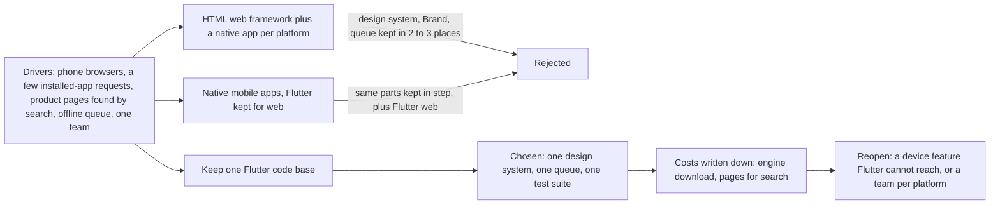

## Bạn cần biết trước

- [[design.l4.architectural-drivers]] — bạn biết kiến trúc được chọn từ các yếu tố định hình nó chứ không từ một kiểu có sẵn, và một yếu tố định hình thay đổi là lý do để xem lại lựa chọn.
- [[design.l4.one-deployment-for-all-shops]] — bạn biết Đơn Hàng phục vụ 1.000 cửa hàng từ một bản triển khai dùng chung, nên một cửa hàng là dữ liệu, không phải một bản sao.
- [[frontend.l3.brand-themes]] — bạn biết giao diện của một cửa hàng là một giá trị `Brand` đưa vào một hàm dựng theme duy nhất, không phải các màn hình chép lại.
- [[frontend.l3.offline-order-queue]] — bạn biết DonHang.App giữ đơn trên máy và gửi sau khi API không trả lời được.

## Tình huống

Đơn Hàng giờ phục vụ nhiều cửa hàng, và trong một tuần, team nhận ba đề nghị về app. Vài cửa hàng muốn có app để khách cài lên điện thoại. Một lập trình viên muốn viết lại client web bằng một framework web dựng HTML, vì Flutter web "cảm giác nặng". Một lập trình viên khác cho rằng sản phẩm nghiêm túc thì cần app riêng cho từng nền tảng điện thoại, vì như vậy nhanh hơn.

Đề nghị nào nghe cũng hợp lý, và mỗi đề nghị chỉ về một công nghệ khác nhau. Chỉ có một team làm cả backend lẫn app. DonHang.App nên dùng công nghệ client nào cho 1.000 cửa hàng, và điều gì nên quyết định chuyện đó?

## Khái niệm cốt lõi

- web app — client chạy trong trình duyệt, nên khách mở nó từ một đường link và không cài gì. Một framework web dựng HTML tạo trang từ chính các phần tử HTML của trình duyệt, còn Flutter web tự vẽ màn hình.
- **native app** — app viết riêng cho một nền tảng, như Android hay iOS, bằng ngôn ngữ và công cụ của chính nền tảng đó.
- **đa nền tảng** (cross-platform) — một mã nguồn được build thành app cho nhiều nền tảng, như Flutter làm cho web, Android và iOS.
- thư mục nền tảng — thư mục trong project Flutter, như `web/`, `android/` hay `ios/`, cho phép build project cho nền tảng đó.
- yếu tố định hình công nghệ client — một nhu cầu quyết định lựa chọn: khách dùng thiết bị nào, app cần tính năng nào của thiết bị, chạy offline, người ta tìm thấy sản phẩm bằng cách nào, và team biết gì, duy trì được gì.

## Cơ chế hoạt động



Trong tình huống trên, đề nghị có app cài trên máy trở thành một yếu tố định hình. Đề nghị dùng framework HTML trở thành phương án 2, kèm app native cho những cửa hàng muốn app cài trên máy. Đề nghị app riêng cho từng nền tảng trở thành phương án 3. ADR `0017` cân cả ba theo cùng các yếu tố định hình: khách đặt hàng từ trình duyệt trên điện thoại, vài cửa hàng muốn app cài trên máy, một số muốn trang sản phẩm được máy tìm kiếm tìm thấy, app chạy được offline, và một team làm mọi thứ. Ba yếu tố đầu là giả định rút ra từ các cuộc trao đổi với cửa hàng, không phải số đo.

Ở stage-4, DonHang.App là code đa nền tảng nhưng chỉ có thư mục nền tảng `web/`. Chỉ hai file, cùng tên `browser_web.dart`, gọi tới trình duyệt. Một file cung cấp cho hàng đợi offline chỗ lưu trong `localStorage`. File kia giữ các giá trị đăng nhập trong lúc trình duyệt sang trang đăng nhập. Phần còn lại, kể cả `lib/design/` và hàng đợi, không đụng tới trình duyệt. Vài file cần chỗ lưu hay cần đăng nhập chỉ tới được trình duyệt qua hai file này, mà bài này gọi là phần bọc API thiết bị. Trên một app cài trên máy, phần bọc của nền tảng đó là nơi app với tới một tính năng của thiết bị, chẳng hạn máy in ở quầy. Thêm `android/` hay `ios/`, cùng bản của hai file đó cho nền tảng tương ứng, là build được chính code này thành app cài trên máy.

Hai phương án còn lại đều thêm native app. Mỗi app là một mã nguồn nữa, viết bằng một ngôn ngữ khác, nên một team sẽ phải viết lại design system, `Brand` của từng cửa hàng và hàng đợi offline, rồi giữ chúng đồng bộ với nhau.

Vì vậy ADR giữ một mã nguồn Flutter. Nó ghi lại hai chi phí: phải tải engine của Flutter (phần của Flutter vẽ màn hình, được tải về trước khi có gì hiện ra), và các trang không hợp với máy tìm kiếm. Nó cũng ghi hai lý do để quyết định lại: một tính năng của thiết bị mà Flutter không với tới được, hoặc mỗi nền tảng có một team riêng.

## Trong hệ thống Đơn Hàng

Ba phương án và quyết định, như ADR `0017` viết:

```markdown file=docs/adr/0017-giu-mot-ma-flutter-cho-moi-nen-tang.md tag=stage-4 lines=23-44
### Các phương án

- Giữ một mã Flutter: web như bây giờ, Android và iOS build từ cùng mã khi có
  cửa hàng cần app cài trên máy (thêm thư mục nền tảng, viết lại phần trong
  hai file `browser_web.dart` cho nền tảng đó). Design system, `Brand`, hàng
  đợi offline và test dùng chung cho mọi nền tảng.
- Viết lại client web bằng một framework web dựng HTML, và làm app native
  riêng cho từng nền tảng khi cần: mỗi client hợp nhất với nền tảng của nó,
  trang web có sẵn HTML cho máy tìm kiếm. Nhưng design system, `Brand` và hàng
  đợi offline phải viết lại và giữ đồng bộ ở hai tới ba nơi, bằng hai tới ba
  ngôn ngữ, với một đội.
- App native cho từng nền tảng di động, giữ Flutter cho web: trình duyệt vẫn
  là nơi khách đặt nhiều nhất nên Flutter web vẫn phải giữ, cộng thêm hai mã
  native; cùng chi phí giữ đồng bộ như phương án trên.

### Quyết định

Chọn giữ một mã Flutter cho mọi nền tảng. Với một đội, giá trị lớn nhất là
một design system, một hàng đợi offline và một bộ test; mỗi cửa hàng vẫn chỉ
khác nhau ở giá trị `Brand`, trên nền tảng nào cũng vậy. Stage-4 không thêm
thư mục `android/` hay `ios/`: chưa cửa hàng nào cần app cài trên máy đủ để
đội trả chi phí phát hành lên các kho ứng dụng.
```

Phương án đầu tự nêu cái giá của nó: một nền tảng mới cần thư mục riêng và bản phần bọc API thiết bị của riêng nó.

Phương án thứ hai được ghi nhận điểm mạnh: mỗi client hợp với nền tảng của nó, và trang web có thể mang sẵn HTML cho máy tìm kiếm khi HTML đó được dựng trên server. Nó thua ở yếu tố team, vì một team sẽ phải giữ cùng những phần đó bằng hai tới ba ngôn ngữ.

Phương án thứ ba không bỏ được Flutter web, vì ADR giả định trình duyệt là nơi phần lớn khách đặt hàng.

Mỗi cửa hàng vẫn chỉ khác nhau ở giá trị `Brand` trong `lib/design/brand.dart`, trên nền tảng nào cũng vậy. Stage-4 không thêm thư mục `android/` hay `ios/`, vì chưa cửa hàng nào cần app cài trên máy tới mức đáng trả chi phí phát hành lên các kho ứng dụng.

Quyết định này tốn gì, và khi nào mở lại:

```markdown file=docs/adr/0017-giu-mot-ma-flutter-cho-moi-nen-tang.md tag=stage-4 lines=46-64
### Hệ quả

- Trình duyệt phải tải engine của Flutter cùng `main.dart.js` trước khi vẽ
  khung hình đầu tiên; `scripts/frontend/web-bundle.sh` cho thấy kích thước
  đó, và nó là chi phí của quyết định này ở lần mở đầu tiên.
- Output của Flutter web không hợp với việc máy tìm kiếm lập chỉ mục: HTML mà
  `app-web` trả cho một trang sản phẩm không chứa tên sản phẩm
  (`scripts/frontend/what-the-server-sends.sh`). Nếu cửa hàng cần trang sản
  phẩm công khai cho máy tìm kiếm, các trang đó làm bằng HTML dựng từ server,
  tách khỏi app, và được quyết trong một ADR riêng. Đặt hàng vẫn ở trong app.
- Thêm một nền tảng là thêm thư mục nền tảng và phần bọc API thiết bị, không
  viết lại màn hình.

Đội xem lại quyết định khi:

- Cửa hàng cần một tính năng của thiết bị mà Flutter không với tới được, kể cả
  qua phần bọc API của nền tảng.
- Đội tách thành các đội riêng theo nền tảng; lúc đó một mã chung không còn
  tiết kiệm được việc giữ đồng bộ giữa người với người.
```

Hệ quả đầu tiên là chi phí ở lần mở đầu: trước khi vẽ khung hình đầu tiên, trình duyệt tải engine của Flutter cùng `main.dart.js`, tức code Dart của app (ngôn ngữ dùng để viết app Flutter) đã biên dịch sang JavaScript. `scripts/frontend/web-bundle.sh` cho thấy kích thước đó, nên chi phí này đo được.

Hệ quả thứ hai liên quan tới tìm kiếm. `app-web`, service phục vụ các file web của DonHang.App, trả về HTML cho địa chỉ của một sản phẩm mà không có tên sản phẩm. `what-the-server-sends.sh` cho thấy HTML đó. Flutter web chỉ vẽ cái tên sau khi app chạy, và chính tài liệu của Flutter nói output của Flutter web không hợp với những gì máy tìm kiếm cần để lập chỉ mục. ADR đẩy các trang sản phẩm công khai sang một quyết định riêng và giữ việc đặt hàng trong app.

Cả hai điều kiện mở lại đều là yếu tố định hình, không phải sở thích: một tính năng của thiết bị mà Flutter không với tới được kể cả qua phần bọc API thiết bị, hoặc mỗi nền tảng một team, khi một mã nguồn chung không còn tiết kiệm được công giữ mọi người đồng bộ với nhau.

## Đánh đổi

| Phương án | Tới được thiết bị nào | Phần dùng chung (design system, `Brand`, hàng đợi offline, test) | Lần mở đầu trong trình duyệt | Trang sản phẩm cho máy tìm kiếm | Chi phí với một team |
|---|---|---|---|---|---|
| Một mã nguồn Flutter (được chọn) | web ngay bây giờ; Android và iOS sau khi thêm thư mục nền tảng của chúng | viết một lần | tải engine và `main.dart.js` trước | HTML gửi đi thiếu tên sản phẩm; trang riêng, ADR riêng | một mã nguồn, hai file `browser_web.dart` cho mỗi nền tảng mới |
| Framework web dựng HTML cộng native app | web, và mỗi nền tảng một app riêng | viết và giữ đồng bộ ở hai tới ba nơi, bằng hai tới ba ngôn ngữ | không phải tải engine Flutter | có HTML cho máy tìm kiếm, nếu dựng trên server | hai tới ba mã nguồn |
| App native cho di động, giữ Flutter cho web | web cộng từng nền tảng điện thoại | như hàng trên | như phương án được chọn | như phương án được chọn | Flutter web cộng hai mã nguồn native |

Không hàng nào miễn phí. Phương án được chọn trả giá trong trình duyệt: lần mở đầu nặng hơn và các trang không hợp với máy tìm kiếm. Hai phương án kia trả giá bằng con người.

## Bạn sẽ chọn gì nếu…

…bốn mươi cửa hàng giờ đòi app Android cài trên máy? Đó không phải điều kiện mở lại. ADR đã nói rõ cái giá: thêm thư mục nền tảng `android/`, viết bản cho nền tảng đó của những phần nằm sau `browser_web.dart`, và trả chi phí phát hành lên kho ứng dụng. Màn hình, design system và hàng đợi giữ nguyên.

…một cửa hàng cần app nói chuyện với một thiết bị mà Flutter không với tới được, kể cả qua phần bọc API thiết bị? Đó là điều kiện thứ nhất. Mở lại ADR `0017`, ghi rõ yếu tố định hình đó, rồi cân một native app cho riêng nhu cầu này với cái giá giữ đồng bộ hai bản của các phần dùng chung.

…công ty lớn lên thành một team web, một team Android và một team iOS? Đó là điều kiện thứ hai, vì đằng nào mỗi team cũng làm việc tách biệt. Mở lại ADR theo đúng cách các team được chia.

## Senior hay nhầm rằng…

- **"Một mã nguồn đa nền tảng lúc nào cũng rẻ hơn các app riêng."** → Thực ra nó rẻ hơn với Đơn Hàng vì một team giữ một design system, một hàng đợi và một bộ test. ADR `0017` vẫn liệt kê các chi phí của nó trong trình duyệt, và điều kiện mở lại thứ hai nói khoản tiết kiệm đó hết khi mỗi nền tảng có team riêng. Bạn sẽ nhận ra khi một đề xuất đa nền tảng không có phần "hệ quả" nào cả.
- **"Native app lúc nào cũng nhanh hơn, nên sản phẩm nghiêm túc phải làm native."** → Thực ra tốc độ chỉ là một yếu tố định hình, và phải đo ở nơi khách thật sự dùng. Từ các cuộc trao đổi với cửa hàng, Đơn Hàng giả định phần lớn khách đặt hàng từ trình duyệt trên điện thoại, nơi native app không chạy. Bạn sẽ nhận ra khi một đề xuất viết lại nói "nhanh hơn" mà không nêu số đo nào, thiết bị nào.
- **"Công nghệ team thích nhất là công nghệ đúng, miễn là nó vẽ được màn hình."** → Thực ra cả ba phương án trong ADR `0017` đều vẽ được màn hình. Chúng khác nhau ở chỗ một team phải giữ đồng bộ những gì, trình duyệt phải tải gì và máy tìm kiếm thấy gì. Bạn sẽ nhận ra khi một bản ghi quyết định so xem framework nào viết dễ chịu hơn mà không hề nhắc tới hàng đợi offline hay quy mô team.

## Thử ngay (3 phút)

1. Lấy ba đề nghị có thể tới tay team sau ADR `0017`: (a) lập trình viên trong tình huống vẫn muốn dùng framework web dựng HTML, vì Flutter web "cảm giác nặng"; (b) một cửa hàng cần app đọc dữ liệu từ một thiết bị ở quầy mà Flutter không với tới được, kể cả qua phần bọc API thiết bị; (c) hai mươi cửa hàng muốn khách cài app lên điện thoại Android.
2. Với từng đề nghị, nói xem nó có mở lại ADR `0017` không, và dòng nào trong ADR ủng hộ câu trả lời của bạn.

Kết quả mong đợi: một đề nghị mở lại quyết định, hai đề nghị thì không.

<details><summary>Gợi ý đáp án</summary>

(a) không: đây là phương án thứ hai, đã bị loại vì một team sẽ phải giữ cùng những phần đó bằng hai tới ba ngôn ngữ, và "cảm giác nặng" không nêu yếu tố định hình mới nào. (b) có: điều kiện thứ nhất, một tính năng của thiết bị mà Flutter không với tới được. (c) không: phương án đầu và phần hệ quả đã nói cách thêm một nền tảng, gồm một thư mục và phần bọc API thiết bị, không viết lại màn hình.

</details>

## Liên hệ

- [[design.l4.architectural-drivers]] — cùng cách chọn từ các yếu tố định hình, ở đây áp dụng cho client thay vì backend.
- [[management.l3.weighing-options-in-an-adr]] — phương pháp ADR `0017` làm theo: cân các phương án theo cùng một tập nhu cầu, kèm chi phí và điều kiện mở lại.
- [[design.l4.conways-law]] — lý do điều kiện thứ hai để ý cách team được chia.
- [[frontend.l3.web-bundle-size]] — nơi đo chi phí ở lần mở đầu mà bài này chấp nhận.
- [[frontend.l3.profile-mode]] — cách đo tốc độ trên thiết bị thật trước khi gọi một công nghệ là nhanh hơn.
- [[frontend.l4.pages-for-search]] — bước tiếp theo: vì sao Flutter web không gửi chữ nào cho máy tìm kiếm, và các trang riêng sẽ trông ra sao.

## Tóm tắt 5 dòng

1. Công nghệ client được chọn từ các yếu tố định hình như thiết bị, tính năng thiết bị, chạy offline, tìm kiếm và team, không theo sở thích.
2. Client có thể là web app, native app cho từng nền tảng, hoặc một mã nguồn đa nền tảng như của Flutter.
3. DonHang.App chỉ có thư mục nền tảng `web/`, nhưng phần lớn code Dart của nó cũng build được cho Android và iOS.
4. ADR `0017` giữ một mã nguồn Flutter, để một team giữ một design system, một hàng đợi offline và một `Brand` cho mỗi cửa hàng.
5. Nó chấp nhận chi phí tải engine và các trang không hợp với máy tìm kiếm, và sẽ mở lại khi cần một tính năng thiết bị không với tới được hoặc khi mỗi nền tảng có một team.
