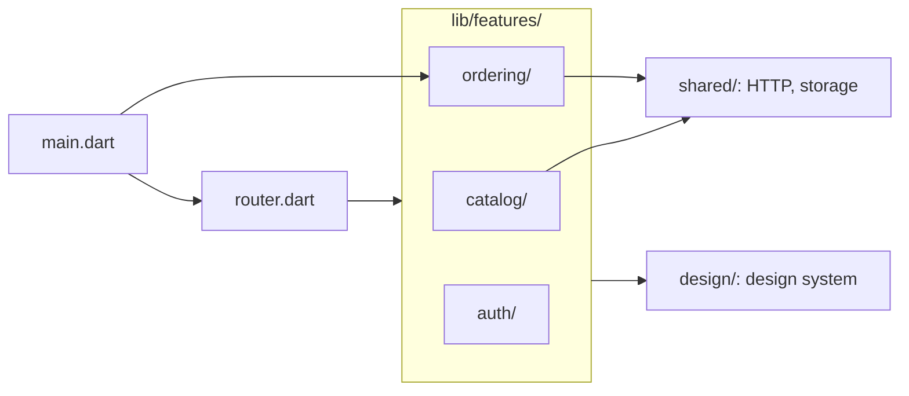

## Before you start

- [[design.l3.modules-cut-through-layers]] — you know `DonHang.Api` splits its code by bounded context, Catalog and Ordering, and each module keeps its own layers inside.
- [[frontend.l3.sync-conflicts]] — you know the ordering part of DonHang.App: the queue, the order shapes, and the warning when the charged total differs.
- [[frontend.l3.component-library]] — you know `lib/design/` holds the components every screen shares, such as `StatusBanner`.

## The situation

It is stage-3, and you are asked to change how DonHang.App places an order. You open the order screen in `screens/`, then the order shapes in `models.dart`, then `orderProvider` in `providers.dart`, the API call in `api_client.dart`, and the queue in `offline/`. Five places, and each one also holds code that products or sign-in use. Nothing tells you which of the other code in those files your change can break. The backend already split this code into Catalog and Ordering modules. How should the app's files be grouped, so that a change to ordering lands in one place?

## Core concepts

- **package by feature** — grouping code by what it does for the customer, one folder per feature holding every kind of file that feature needs: screens, providers, models and API calls.
- a feature — one job the app does for the customer, such as browsing products, placing an order or signing in, that changes for its own reasons.
- package by kind — the opposite grouping: one folder or file per kind of code, such as all screens together and all models together. It is how DonHang.App's `lib/` was split up to stage-3.
- shared code — code several features use but none owns, such as the HTTP setup, on-device storage and the design system; it stays outside the feature folders.

## How it works



Each arrow means "imports code from". Start with the middle box, `lib/features/`; the files on the left come last. In the situation above, the ordering code you chased through five places now sits in one folder, `lib/features/ordering/`. Package by feature put it there: the order screens, the order shapes, the API calls for orders and the offline queue. `catalog/` does the same for products, and `auth/` for signing in.

Some code belongs to no single feature. The HTTP setup (the address of the API and the token header that ordering's calls send) and on-device storage serve more than one feature, so they sit in `lib/shared/`. Catalog and ordering import it; auth does not. The design system stays in `lib/design/`, and all three features import it. A feature uses these; it does not keep its own copy.

Two files sit outside every folder: `main.dart` and `router.dart`. They put the features together into one app. `router.dart` gives each feature's screens a path; `main.dart` starts the app with the design system, the router and the ordering queue's sync. That is the job a composition root does for `DonHang.Api`: one place assembles the parts, so the parts do not assemble each other.

The feature names are not new words. Catalog and Ordering are the names of `DonHang.Api`'s modules. When the team says "Ordering", that word leads to `DonHang.Domain` and `DonHang.Infrastructure` on the backend and to `features/ordering/` in the app. Auth has no backend module, because signing in is Keycloak's job and the app only keeps the token.

## In the Đơn Hàng system

Why `lib/` changed at stage-4, and where each part went, from the design doc:

```markdown file=docs/design/app-structure.md tag=stage-4 lines=5-25
### Vì sao đổi

Tới stage-3, `lib/` chia theo loại file: `screens/`, `widgets/`, `offline/`,
`auth/`, cùng `models.dart`, `providers.dart` và `api_client.dart` dùng chung.
Code của việc đặt đơn nằm rải ở năm chỗ, mỗi chỗ chung với các phần khác; sửa
một phần phải mở nhiều thư mục, và không gì cho biết phần nào được dùng phần
nào. Từ stage-4 `lib/` chia theo feature: mỗi thư mục là một việc app làm cho
khách, với màn hình, provider, model và lời gọi API của việc đó.

### Thư mục

| Thư mục | Nội dung |
|---|---|
| `features/auth/` | Đăng nhập bằng Keycloak (`auth_controller.dart`, `keycloak_sign_in.dart`), đọc `sub` của token (`token_subject.dart`), phần bọc trình duyệt cho đăng nhập (`browser*.dart`), `login_screen.dart`, `auth_callback_screen.dart` |
| `features/catalog/` | Model `Product`, lời gọi API (`catalog_api.dart`, `catalogApiProvider`), danh sách sản phẩm có bản lưu trên máy (`catalog_providers.dart`: `productsProvider`, `productProvider`), màn hình danh sách và chi tiết, `ProductCatalog`, `ProductTile` |
| `features/ordering/` | Model đơn (`order.dart`: `OrderItemRequest`, `OrderResult`, `totalVnd`), lời gọi API (`orders_api.dart`: `ordersApiProvider`, `orderProvider`), hàng đợi offline (`order_queue.dart`, `queue_sync.dart`), màn hình đặt đơn, chi tiết đơn, đơn đang chờ |
| `shared/` | Phần truyền tải HTTP mọi feature dùng (`api_client.dart`: địa chỉ API, header token, `ApiProblem`, `ApiUnreachable`), lưu trên máy (`local_store.dart`) và phần bọc trình duyệt của nó (`browser*.dart`) |
| `design/` | Design system: token, theme, `Brand`, các component |
| `l10n/` | File ARB và code `gen-l10n` sinh ra |
| `gallery/`, `gallery_main.dart` | Gallery component, điểm vào riêng |
| `main.dart`, `router.dart` | Ghép các feature thành app |
```

The first paragraph names the stage-3 problem from the situation: ordering code in five places, each shared with other parts, and nothing showing which part uses which. Its last sentence is the new rule: each folder is one job the app does for the customer.

The table lists each folder of `lib/` and what it holds; the rows to read are ordering and shared. In the `features/ordering/` row, the order shapes from `models.dart`, `orderProvider` from `providers.dart`, and the queue from `offline/` are now one folder's files. `shared/` keeps only what is not one feature's: the HTTP transport and on-device storage. Further down, outside this excerpt, the doc says Catalog and Ordering carry the names of `DonHang.Api`'s modules.

The start of `main.dart`, which belongs to no feature:

```dart file=DonHang.App/lib/main.dart tag=stage-4 lines=5-13
import 'design/brand.dart';
import 'design/theme.dart';
// lesson: frontend.l4.feature-folders
// main.dart, like router.dart, belongs to no feature: it starts the app with
// the design system, the router and Ordering's queue sync, the job a
// composition root does for DonHang.Api.
import 'features/ordering/ordering.dart';
import 'l10n/app_localizations.dart';
import 'router.dart';
```

`main.dart` reaches into `design/` for the theme, into `features/ordering/` for the queue's sync, into `l10n/` for the app's translated text, and into `router.dart`. No feature imports `main.dart` or `router.dart`; the assembling goes one way. `router.dart`, outside this excerpt, imports one file from each of `auth/`, `catalog/` and `ordering/`. Which file that is, and why only that one, is the next lesson.

## Trade-offs

| Grouping | Where an ordering change goes | Finding one screen | HTTP and design code | Fits |
|---|---|---|---|---|
| By kind (stage-3) | five places, each shared with other features | all screens in `screens/` | one copy each | an app with one or two screens |
| By feature, shared code outside (stage-4, chosen) | mostly `features/ordering/` | the feature's folder, by the job it does | one copy each, in `shared/` and `design/` | several features that change for different reasons |
| By feature, each feature copies its own HTTP and design code | `features/ordering/` | the feature's folder | one copy per feature, drifting apart | rarely; the copies must be kept in step by hand |

The chosen grouping costs more folders and a decision for every new file: which feature owns it, or is it shared. In return, a change for one job has one home.

## What would you choose if…

…you start a new app with a sign-in screen and one list? Group by kind. With one or two screens there is little to find, and every change touches the same few files anyway. Move to feature folders when a second job for the customer starts changing for its own reasons.

…DonHang.App needs a screen listing a customer's past orders? It serves a job the app already has, so it goes into `features/ordering/`. `app-structure.md` says the same: a single screen that serves an existing feature goes into that feature.

…shops ask for a new job for their customers, one that changes for its own reasons, not for ordering's? That is a new folder under `lib/features/`. The doc also asks for a row in its dependency table, which the next lesson explains.

## Seniors often assume…

- **"Folder layout is a matter of taste; it does not change how many places a change touches."** → Actually the layout decides where code for one job lives. At stage-3 an ordering change opened five places shared with products and sign-in; at stage-4 it opens mostly `features/ordering/`. You notice this when a small change's pull request lists files from `screens/`, `models.dart`, `providers.dart` and `api_client.dart` at once.
- **"Package by feature means each feature copies its own HTTP and design code."** → Actually code several features use but none owns stays outside the features. DonHang.App keeps the HTTP transport and storage in `lib/shared/` and the design system in `lib/design/`, one copy each. You notice this when two features show the same banner in two slightly different colors, or one feature still sends a header the other dropped.
- **"Keeping every screen in one folder makes screens easiest to find, however large the app grows."** → Actually a screen is rarely changed alone: its provider, its model and its API call change with it, and those live elsewhere when grouped by kind. You find a screen quickly but then search for the rest. You notice this when `screens/` holds a long list of files and you still open three other places for each change.

## Try it (3 minutes)

1. In the Đơn Hàng repository, run `git ls-tree --name-only stage-3 DonHang.App/lib/` and then `git ls-tree --name-only stage-4 DonHang.App/lib/features/ordering/`.
2. For each file in the stage-4 ordering folder, write down where its code lived at stage-3.

Expected result: the stage-4 folder lists eight files; seven of them hold code that came from five different places in the stage-3 list.

<details><summary>Suggested answer</summary>

The three order screens came from `screens/`. `order.dart` holds the order shapes that were in `models.dart`. `orders_api.dart` holds the order calls that were in `api_client.dart` and `orderProvider` from `providers.dart`. `order_queue.dart` and `queue_sync.dart` came from `offline/`. `ordering.dart` is new: the feature's public file, the topic of the next lesson. The rest of `offline/`, `local_store.dart` and the small files it needs to run in a browser (`browser*.dart`), did not go to ordering: they went to `shared/`, because catalog keeps its saved product list with them too.

</details>

## Connections

- [[design.l3.modules-cut-through-layers]] — the same idea one layer back: `DonHang.Api` split by bounded context, and the app now uses the same names.
- [[design.l2.composition-root]] — the role `main.dart` and `router.dart` play for the app.
- [[frontend.l1.composing-widgets]] — small pieces put together into screens, now one level up: features put together into an app.
- [[frontend.l4.feature-public-files]] — next: how one public file per feature, and a test, keep the features apart.
- [[design.l4.where-boundaries-are-enforced]] — why a folder alone does not stop one feature reaching into another.

## Five-line summary

1. Package by feature groups an app's files by the job they do for the customer, so a change to one job has one home.
2. At stage-3 DonHang.App's ordering code sat in five places split by kind, each shared with products or sign-in.
3. At stage-4 `lib/features/` holds `catalog/`, `ordering/` and `auth/`; shared HTTP, storage and design code stay outside, one copy each.
4. Catalog and Ordering carry `DonHang.Api`'s module names; `main.dart` and `router.dart` assemble the features, as a composition root does.
5. Feature folders pay off when several features change for different reasons; an app with one or two screens gains little.
