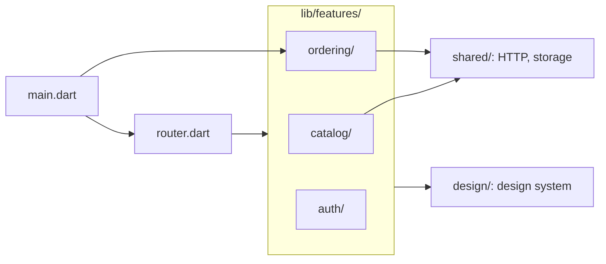

## Bạn cần biết trước

- [[design.l3.modules-cut-through-layers]] — bạn biết `DonHang.Api` chia code theo bounded context, Catalog và Ordering, và mỗi module tự giữ các tầng của mình bên trong.
- [[frontend.l3.sync-conflicts]] — bạn biết phần đặt đơn của DonHang.App: hàng đợi, các kiểu dữ liệu của đơn, và cảnh báo khi tổng tiền bị tính khác.
- [[frontend.l3.component-library]] — bạn biết `lib/design/` giữ các component mà mọi màn hình dùng chung, như `StatusBanner`.

## Tình huống

Đang ở stage-3, bạn được giao đổi cách DonHang.App đặt một đơn. Bạn mở màn hình đặt đơn trong `screens/`, rồi các kiểu dữ liệu của đơn trong `models.dart`, rồi `orderProvider` trong `providers.dart`, lời gọi API trong `api_client.dart`, và hàng đợi trong `offline/`. Năm chỗ, và chỗ nào cũng chứa thêm code mà phần sản phẩm hay phần đăng nhập dùng. Không gì cho bạn biết thay đổi của mình có thể làm hỏng đoạn code nào khác trong các file đó. Backend đã tách phần code này thành hai module Catalog và Ordering. Vậy file của app nên xếp thế nào, để một thay đổi về đặt đơn chỉ nằm ở một chỗ?

## Khái niệm cốt lõi

- **package by feature** (Xếp code theo tính năng người dùng thấy, mỗi tính năng một thư mục chứa mọi loại file của nó) — gom code theo việc nó làm cho khách, mỗi feature một thư mục chứa mọi loại file feature đó cần: màn hình, provider, model và lời gọi API.
- feature — một việc app làm cho khách, như xem sản phẩm, đặt đơn hay đăng nhập, và thay đổi vì lý do riêng của nó.
- xếp theo loại file — cách gom ngược lại: mỗi loại code một thư mục hoặc một file, như mọi màn hình nằm chung, mọi model nằm chung. Đến stage-3, `lib/` của DonHang.App được chia theo cách này.
- code dùng chung — code mà nhiều feature dùng nhưng không feature nào sở hữu, như phần thiết lập HTTP, phần lưu trên máy và design system. Nó nằm ngoài các thư mục feature.

## Cơ chế hoạt động



Mỗi mũi tên nghĩa là "import code từ". Hãy bắt đầu từ ô giữa, `lib/features/`, còn các file bên trái thì đọc sau cùng. Đoạn code đặt đơn mà trong tình huống trên bạn phải lần qua năm chỗ, giờ nằm trong một thư mục: `lib/features/ordering/`. Package by feature đã đặt nó ở đó: các màn hình đơn, các kiểu dữ liệu của đơn, các lời gọi API cho đơn và hàng đợi offline. `catalog/` làm điều tương tự cho sản phẩm, `auth/` cho đăng nhập.

Có những đoạn code không thuộc riêng feature nào. Phần thiết lập HTTP (địa chỉ API và header token mà các lời gọi của ordering gửi đi) cùng phần lưu trên máy phục vụ nhiều hơn một feature, nên chúng nằm trong `lib/shared/`. Catalog và ordering import nó, auth thì không. Design system vẫn ở `lib/design/`, và cả ba feature đều import nó. Feature dùng những phần này chứ không giữ bản sao riêng.

Có hai file nằm ngoài mọi thư mục: `main.dart` và `router.dart`. Chúng ghép các feature thành một app. `router.dart` gán cho màn hình của từng feature một đường dẫn. `main.dart` khởi động app với design system, router và phần đồng bộ hàng đợi của ordering. Đó chính là việc composition root làm cho `DonHang.Api`: một chỗ lắp các phần lại với nhau, để các phần không phải tự lắp lẫn nhau.

Tên feature không phải từ mới. Catalog và Ordering là tên các module của `DonHang.Api`. Khi cả nhóm nói "Ordering", từ đó dẫn tới `DonHang.Domain` và `DonHang.Infrastructure` ở backend, và tới `features/ordering/` trong app. Auth không có module nào ở backend, vì đăng nhập là việc của Keycloak, app chỉ giữ token.

## Trong hệ thống Đơn Hàng

Vì sao `lib/` đổi ở stage-4, và từng phần đi đâu, theo tài liệu thiết kế:

```markdown file=docs/design/app-structure.md tag=stage-4 lines=5-25
### Vì sao đổi

Tới stage-3, `lib/` chia theo loại file: `screens/`, `widgets/`, `offline/`,
`auth/`, cùng `models.dart`, `providers.dart` và `api_client.dart` dùng chung.
Code của việc đặt đơn nằm rải ở năm chỗ, mỗi chỗ chung với các phần khác; sửa
một phần phải mở nhiều thư mục, và không gì cho biết phần nào được dùng phần
nào. Từ stage-4 `lib/` chia theo feature: mỗi thư mục là một việc app làm cho
khách, với màn hình, provider, model và lời gọi API của việc đó.

### Thư mục

| Thư mục | Nội dung |
|---|---|
| `features/auth/` | Đăng nhập bằng Keycloak (`auth_controller.dart`, `keycloak_sign_in.dart`), đọc `sub` của token (`token_subject.dart`), phần bọc trình duyệt cho đăng nhập (`browser*.dart`), `login_screen.dart`, `auth_callback_screen.dart` |
| `features/catalog/` | Model `Product`, lời gọi API (`catalog_api.dart`, `catalogApiProvider`), danh sách sản phẩm có bản lưu trên máy (`catalog_providers.dart`: `productsProvider`, `productProvider`), màn hình danh sách và chi tiết, `ProductCatalog`, `ProductTile` |
| `features/ordering/` | Model đơn (`order.dart`: `OrderItemRequest`, `OrderResult`, `totalVnd`), lời gọi API (`orders_api.dart`: `ordersApiProvider`, `orderProvider`), hàng đợi offline (`order_queue.dart`, `queue_sync.dart`), màn hình đặt đơn, chi tiết đơn, đơn đang chờ |
| `shared/` | Phần truyền tải HTTP mọi feature dùng (`api_client.dart`: địa chỉ API, header token, `ApiProblem`, `ApiUnreachable`), lưu trên máy (`local_store.dart`) và phần bọc trình duyệt của nó (`browser*.dart`) |
| `design/` | Design system: token, theme, `Brand`, các component |
| `l10n/` | File ARB và code `gen-l10n` sinh ra |
| `gallery/`, `gallery_main.dart` | Gallery component, điểm vào riêng |
| `main.dart`, `router.dart` | Ghép các feature thành app |
```

Đoạn đầu gọi tên vấn đề ở stage-3 trong tình huống: code đặt đơn nằm ở năm chỗ, mỗi chỗ chung với các phần khác, và không gì cho biết phần nào dùng phần nào. Câu cuối của đoạn là quy tắc mới: mỗi thư mục là một việc app làm cho khách.

Bảng liệt kê từng thư mục của `lib/` và nội dung của nó. Hai dòng cần đọc là ordering và shared. Ở dòng `features/ordering/`, các kiểu dữ liệu của đơn từ `models.dart`, `orderProvider` từ `providers.dart`, và hàng đợi từ `offline/` giờ là file của cùng một thư mục. `shared/` chỉ giữ những gì không thuộc riêng feature nào: phần truyền tải HTTP và phần lưu trên máy. Ở phía dưới, ngoài đoạn trích, tài liệu ghi rằng Catalog và Ordering mang tên các module của `DonHang.Api`.

Phần đầu của `main.dart`, file không thuộc feature nào:

```dart file=DonHang.App/lib/main.dart tag=stage-4 lines=5-13
import 'design/brand.dart';
import 'design/theme.dart';
// lesson: frontend.l4.feature-folders
// main.dart, like router.dart, belongs to no feature: it starts the app with
// the design system, the router and Ordering's queue sync, the job a
// composition root does for DonHang.Api.
import 'features/ordering/ordering.dart';
import 'l10n/app_localizations.dart';
import 'router.dart';
```

`main.dart` lấy theme từ `design/`, lấy phần đồng bộ hàng đợi từ `features/ordering/`, lấy văn bản đã dịch của app từ `l10n/`, và import `router.dart`. Không feature nào import `main.dart` hay `router.dart`: việc lắp ghép chỉ đi một chiều. `router.dart`, ngoài đoạn trích, import đúng một file từ mỗi thư mục `auth/`, `catalog/` và `ordering/`. File đó là file nào, và vì sao chỉ một file, là nội dung của bài tiếp theo.

## Đánh đổi

| Cách gom | Thay đổi về đặt đơn nằm ở đâu | Tìm một màn hình | Code HTTP và design | Hợp với |
|---|---|---|---|---|
| Theo loại file (stage-3) | năm chỗ, mỗi chỗ chung với feature khác | mọi màn hình trong `screens/` | mỗi thứ một bản | app có một hai màn hình |
| Theo feature, code dùng chung để ngoài (stage-4, đã chọn) | phần lớn trong `features/ordering/` | thư mục của feature, theo việc nó làm | mỗi thứ một bản, trong `shared/` và `design/` | nhiều feature thay đổi vì những lý do khác nhau |
| Theo feature, mỗi feature tự chép code HTTP và design | `features/ordering/` | thư mục của feature | mỗi feature một bản, lệch nhau dần | hiếm khi, vì các bản sao phải giữ khớp nhau bằng tay |

Cách gom đã chọn tốn thêm thư mục, và mỗi file mới đều cần một quyết định: feature nào sở hữu nó, hay nó là code dùng chung. Đổi lại, thay đổi cho một việc chỉ có một chỗ ở.

## Bạn sẽ chọn gì nếu…

…bạn bắt đầu một app mới có một màn hình đăng nhập và một danh sách? Hãy xếp theo loại file. Với một hai màn hình thì chẳng có gì nhiều để tìm, và thay đổi nào cũng chạm vào đúng mấy file đó. Hãy chuyển sang thư mục feature khi một việc thứ hai làm cho khách bắt đầu thay đổi vì lý do riêng của nó.

…DonHang.App cần một màn hình liệt kê các đơn cũ của khách? Màn hình đó phục vụ một việc app đã có, nên nó vào `features/ordering/`. `app-structure.md` cũng nói vậy: một màn hình lẻ phục vụ feature đã có thì vào feature đó.

…các shop muốn thêm một việc mới cho khách của họ, việc này thay đổi vì lý do riêng chứ không phải vì ordering? Đó là một thư mục mới dưới `lib/features/`. Tài liệu còn yêu cầu thêm một dòng vào bảng phụ thuộc của nó, điều bài tiếp theo sẽ giải thích.

## Senior hay nhầm rằng…

- **"Xếp thư mục là chuyện sở thích, nó không đổi số chỗ mà một thay đổi phải chạm vào."** → Thực ra cách xếp quyết định code của một việc nằm ở đâu. Ở stage-3, một thay đổi về đặt đơn phải mở năm chỗ dùng chung với phần sản phẩm và phần đăng nhập. Ở stage-4, nó chủ yếu mở `features/ordering/`. Bạn sẽ nhận ra khi pull request của một thay đổi nhỏ liệt kê cùng lúc file từ `screens/`, `models.dart`, `providers.dart` và `api_client.dart`.
- **"Package by feature nghĩa là mỗi feature tự chép code HTTP và design của riêng mình."** → Thực ra code mà nhiều feature dùng nhưng không feature nào sở hữu thì nằm ngoài các feature. DonHang.App giữ phần truyền tải HTTP và phần lưu trên máy trong `lib/shared/`, design system trong `lib/design/`, mỗi thứ một bản. Bạn sẽ nhận ra khi hai feature hiện cùng một banner với hai màu hơi khác nhau, hoặc một feature vẫn gửi một header mà feature kia đã bỏ.
- **"Để mọi màn hình trong một thư mục thì tìm màn hình dễ nhất, dù app lớn tới đâu."** → Thực ra hiếm khi một màn hình bị sửa một mình: provider, model và lời gọi API của nó đổi theo, và khi xếp theo loại file thì chúng nằm ở chỗ khác. Bạn tìm ra màn hình nhanh, nhưng sau đó lại phải đi tìm phần còn lại. Bạn sẽ nhận ra khi `screens/` chứa một danh sách file dài mà mỗi lần sửa bạn vẫn phải mở thêm ba chỗ khác.

## Thử ngay (3 phút)

1. Trong repo Đơn Hàng, chạy `git ls-tree --name-only stage-3 DonHang.App/lib/` rồi `git ls-tree --name-only stage-4 DonHang.App/lib/features/ordering/`.
2. Với mỗi file trong thư mục ordering ở stage-4, ghi lại code của nó nằm ở đâu vào stage-3.

Kết quả mong đợi: thư mục ở stage-4 liệt kê tám file. Bảy file trong đó chứa code đến từ năm chỗ khác nhau trong danh sách của stage-3.

<details><summary>Gợi ý đáp án</summary>

Ba màn hình đơn đến từ `screens/`. `order.dart` giữ các kiểu dữ liệu của đơn vốn nằm trong `models.dart`. `orders_api.dart` giữ các lời gọi về đơn vốn nằm trong `api_client.dart`, cùng `orderProvider` từ `providers.dart`. `order_queue.dart` và `queue_sync.dart` đến từ `offline/`. `ordering.dart` là file mới: file công khai của feature, chủ đề của bài tiếp theo. Phần còn lại của `offline/`, gồm `local_store.dart` và mấy file nhỏ nó cần để chạy trong trình duyệt (`browser*.dart`), không về ordering mà sang `shared/`, vì catalog cũng giữ danh sách sản phẩm đã lưu bằng chúng.

</details>

## Liên hệ

- [[design.l3.modules-cut-through-layers]] — cùng ý tưởng, lùi về một tầng: `DonHang.Api` chia theo bounded context, và giờ app dùng cùng những cái tên đó.
- [[design.l2.composition-root]] — vai trò mà `main.dart` và `router.dart` đảm nhận cho app.
- [[frontend.l1.composing-widgets]] — các mảnh nhỏ ghép thành màn hình, giờ lên thêm một bậc: các feature ghép thành một app.
- [[frontend.l4.feature-public-files]] — bài tiếp theo: một file công khai cho mỗi feature, cùng một test, giữ các feature tách nhau thế nào.
- [[design.l4.where-boundaries-are-enforced]] — vì sao chỉ một thư mục thì không ngăn được feature này với vào bên trong feature khác.

## Tóm tắt 5 dòng

1. Package by feature xếp file của app theo việc chúng làm cho khách, để thay đổi cho một việc chỉ có một chỗ ở.
2. Ở stage-3, code đặt đơn của DonHang.App nằm ở năm chỗ chia theo loại file, chỗ nào cũng dùng chung với phần sản phẩm hoặc phần đăng nhập.
3. Ở stage-4, `lib/features/` chứa `catalog/`, `ordering/` và `auth/`. Code HTTP, phần lưu trên máy và design dùng chung nằm ngoài, mỗi thứ một bản.
4. Catalog và Ordering mang tên module của `DonHang.Api`. `main.dart` và `router.dart` ghép các feature lại, như một composition root.
5. Thư mục feature đáng làm khi nhiều feature thay đổi vì những lý do khác nhau. App có một hai màn hình thì lợi chẳng bao nhiêu.
