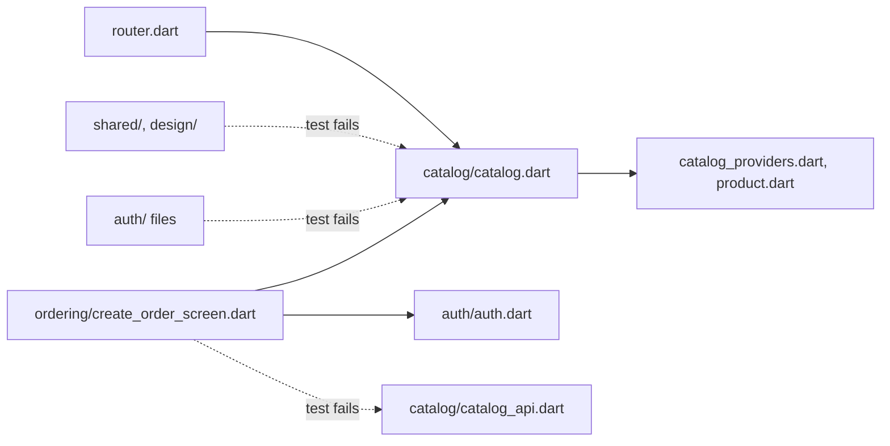

## Before you start

- [[frontend.l4.feature-folders]] — you know that at stage-4 `lib/features/` holds `catalog/`, `ordering/` and `auth/`, with shared code in `lib/shared/` and `lib/design/`.
- [[design.l3.testing-module-boundaries]] — you know `ModuleBoundaryTests` fails when a backend module widens its contract or depends on the wrong module.
- [[design.l3.one-way-module-dependencies]] — you know Ordering depends on Catalog and Catalog depends on nothing in Ordering, so the modules form no cycle.
- [[frontend.l3.brand-themes]] — you know a test can read the app's files as text and fail on a line, as the test for `Colors.` does.

## The situation

It is stage-4, and DonHang.App's files sit in `lib/features/catalog/`, `ordering/` and `auth/`. A pull request makes the order screen load products itself: `create_order_screen.dart` imports `../catalog/catalog_api.dart` and uses `catalogApiProvider`, Catalog's own API client. It builds and the screen works, yet on the backend the same reach would not compile, because Ordering sees Catalog only through `ICatalog` and the rest is `internal`. In the app, a folder is only a folder. Later Catalog changes how it loads products, and the order screen breaks in a file Catalog never knew was used. What keeps one feature out of another feature's files, when any Dart file can import any other?

## Core concepts

- a feature's public file — the one file in a feature's folder named after the feature, such as `catalog.dart`, listing what code outside the feature may use.
- a feature's own files — every other file in the folder, such as `catalog_api.dart`; only files of the same feature import them.
- the allowed direction — a list, per feature, of the features it may use, written so that no two features use each other.
- the feature boundary test — an architecture test that reads every one-line `import` and `export` written with single quotes under `lib/`, the form every file in DonHang.App uses, and fails when a line breaks either rule; it is a fitness function for the app's structure.

## How it works



Each arrow is an `import` or `export` line; dotted arrows make the test fail. `router.dart` and the order screen import `catalog.dart`, the order screen also imports `auth.dart`, and `catalog.dart` exports names from the files it points at. The situation's import of `catalog_api.dart` reaches past Catalog's public file into one of Catalog's own files.

Dart cannot stop that line by itself. It has no `internal` keyword: a name is private only when it starts with `_`, and in DonHang.App that means only inside the file that declares it. `catalogApiProvider` has no `_`, so any file in the app may import it.

The public file narrows what one import brings in: `catalog.dart` passes on a few names with `export … show`, and a file importing it sees only those. It does not stop anyone importing the other file directly.

The boundary test closes that gap. It reads each one-line `import` and `export` written with single quotes under `lib/`, the form every file in DonHang.App uses, and works out which file it points at. A line into another feature must point at that feature's public file, and that feature must be on the importer's allowed list. `shared/` and `design/` may use no feature, since the features use them.

The allowed lists fix one direction: Ordering may use Catalog and Auth, Catalog may use Auth for its sign-in button, and Auth uses neither. So an Auth file importing `catalog.dart` fails, and no cycle can form. `DonHang.Api` gets the same from `ICatalog`, `internal` and `ModuleBoundaryTests`; here one test holds it.

## In the Đơn Hàng system

Catalog's public file, the whole of it:

```dart file=DonHang.App/lib/features/catalog/catalog.dart tag=stage-4 lines=1-8
// lesson: frontend.l4.feature-public-files
// The Catalog feature's public file: the screens router.dart shows, and the
// product list and its model, which Ordering's CreateOrderScreen uses.
// catalog_api.dart, the tiles and the saved copy stay Catalog's own.
export 'catalog_providers.dart' show productsProvider;
export 'product.dart' show Product;
export 'product_detail_screen.dart' show ProductDetailScreen;
export 'product_list_screen.dart' show ProductListScreen;
```

Four names leave Catalog: two screens for the router, and `productsProvider` with `Product` for Ordering. Not listed, so Catalog's own: `catalog_api.dart`, the API client; `product_tile.dart`, the widget for one product, and `product_catalog.dart`, which lays the tiles out; and the names in `catalog_providers.dart` that keep the saved copy of the product list. In `create_order_screen.dart`, outside this excerpt, line 15 imports `../catalog/catalog.dart`, and the screen's `build` reads `productsProvider` through `ref`. That is the app's version of Ordering reaching products only through `ICatalog`. Auth and Ordering have public files of the same kind, `auth.dart` and `ordering.dart`.

The rules, from `feature_boundaries_test.dart`:

```dart file=DonHang.App/test/architecture/feature_boundaries_test.dart tag=stage-4 lines=46-63
// What the rules say about [from] using [target], both paths under lib/;
// null when it is allowed.
String? check(String from, String target) {
  final into = featureOf(target);
  if (into == null) return null;
  final owner = featureOf(from);
  if (owner == into) return null;
  if (from.startsWith('shared/') || from.startsWith('design/')) {
    return 'shared/ and design/ may not use a feature';
  }
  if (target != 'features/$into/$into.dart') {
    return 'only features/$into/$into.dart is public';
  }
  if (owner != null && !(allowed[owner] ?? const {}).contains(into)) {
    return '$owner may not use $into';
  }
  return null;
}
```

Read the checks top to bottom. A target outside `features/` is always fine, and so is a file of the same feature. Then come the diagram's three dotted arrows, in code order: `shared/` or `design/` using a feature, a line past a public file, then a feature off its allowed list, each with its own reason. `router.dart` and `main.dart` belong to no feature, so `owner` is null and only the public-file rule applies to them. Outside this excerpt, `featureOf` returns the folder name under `features/`, the map `allowed` near the top of the file holds the three lists, and `main` collects every failing line with its file and line number before the test fails once.

## Trade-offs

| Option | Where the rule is written | What it costs | Fits |
|---|---|---|---|
| Folders only | nowhere; people reading pull requests hold it | nothing to keep | one or two features, one person |
| Public file per feature and a boundary test (stage-4, chosen) | `allowed` and the public-file rule in one test | one test, and each public file kept current | several features, one team, one app |
| One Dart package per feature | each package's own `pubspec.yaml`, listing what it depends on | a package setup per feature, kept in step | code several apps share |
| One app per feature, each with its own release, combined on one screen | the contract between the separate apps | separate builds, releases and a contract to keep | separate teams that release on their own |

A Dart package is a folder of code with its own `pubspec.yaml`, the file listing the packages it depends on; DonHang.App is one package today. In the last row, each team builds and releases its feature as a separate app, and one more piece, owned by no feature, loads those apps and places them together on the screen. The chosen option keeps one app and one build, and puts the whole rule where a pull request that changes it shows the change.

## What would you choose if…

…Catalog's product list should mark products that sit in a waiting order? That is Catalog using Ordering, the reverse of the allowed direction, and it would form a cycle. Put the marked list on an Ordering screen, which may use Catalog, or let `router.dart` place the two side by side. Adding `ordering` to Catalog's list would make the test pass, which is why that edit belongs in review.

…Ordering needs `catalogApiProvider` itself? Add it to the `show` list in `catalog.dart`. The pull request then edits Catalog's public file, the same signal as widening `ICatalog` on the backend.

…a second team takes over Ordering and wants to release on its own schedule? Then one app per feature starts to pay off. Until the teams split, DonHang.App has one team and stays one app.

## Seniors often assume…

- **"Dart has no internal keyword, so nothing can stop one folder from using another folder's files."** → Actually the compiler cannot, but a test can: `feature_boundaries_test.dart` reads every one-line, single-quoted import under `lib/` and fails on a reach past a public file. The rule is checked on every test run instead of every build. You notice this when a pull request with such an import fails `flutter test` in the `ci` workflow, naming the file, the line and the rule.
- **"Code review catches imports across features just as well as a test does."** → Actually a reviewer sees import lines only in the files a pull request changes, and has to remember which file is public. The test checks every file on every run. Review still matters for the edits the test cannot judge: a longer `show` list or a new entry in `allowed`. You notice this when an import into another feature's file turns up months later, while someone changes that file.
- **"A boundary is only real when each feature is its own package or its own app."** → Actually a boundary is as real as what checks it. One test inside one app holds it on every run, without a package setup per feature or a release per feature. Separate apps pay off when separate teams own the features. You notice this when a plan to split the app lists the build and release work, and no second team appears in it.

## Try it (3 minutes)

1. In the Đơn Hàng repository at `stage-4`, open `DonHang.App/lib/features/ordering/create_order_screen.dart` and add the line `import '../catalog/catalog_api.dart';` right after line 15.
2. In `DonHang.App/`, run `flutter test test/architecture/feature_boundaries_test.dart`, then undo with `git checkout -- lib/features/ordering/create_order_screen.dart`.

Expected result: the test fails, and its message lists `lib/features/ordering/create_order_screen.dart:16` with the reason `only features/catalog/catalog.dart is public`.

<details><summary>Suggested answer</summary>

The new line is line 16 and points at `features/catalog/catalog_api.dart`. Its owner is `ordering`, its target is in `catalog`, and the target is not `features/catalog/catalog.dart`, so `check` returns the public-file reason. Ordering is allowed to use Catalog, so the direction rule never runs for this line. Import `../catalog/catalog.dart` from an Auth file instead, and you get the third reason, `auth may not use catalog`.

</details>

## Connections

- [[frontend.l4.feature-folders]] — prerequisite: the folders this lesson puts a boundary around.
- [[design.l3.module-contracts]] — the same idea one layer back: `ICatalog` plays the part of `catalog.dart` for `DonHang.Api`.
- [[design.l3.testing-module-boundaries]] — the backend's boundary test; this one reads imports instead of types.
- [[design.l3.one-way-module-dependencies]] — the direction rule that `allowed` writes down for the app.
- [[design.l4.conways-law]] — why one team keeps one app instead of one app per feature.
- [[design.l4.where-boundaries-are-enforced]] — this boundary is held by a test run, not by the compiler or the network.
- [[frontend.l4.library-reach]] — next: the cost of an outside library that every feature imports.

## Five-line summary

1. Other code reaches a feature of DonHang.App only through its public file, and a test, not the compiler, keeps it that way.
2. Each feature has one public file, such as `catalog.dart`, exporting with `show` the screens, providers and models others may use.
3. Dart has no `internal`, so `feature_boundaries_test.dart` reads every one-line, single-quoted import under `lib/` and fails on a reach past a public file.
4. Its allowed lists fix one direction: Ordering uses Catalog and Auth, Catalog uses Auth, Auth uses neither, so no cycle forms.
5. One app per feature, released separately, pays off when separate teams own features; DonHang.App has one team and stays one app.
