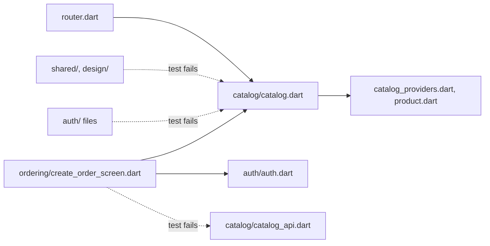

## Bạn cần biết trước

- [[frontend.l4.feature-folders]] — bạn biết ở stage-4 `lib/features/` chứa `catalog/`, `ordering/` và `auth/`, còn code dùng chung nằm trong `lib/shared/` và `lib/design/`.
- [[design.l3.testing-module-boundaries]] — bạn biết `ModuleBoundaryTests` fail khi một module backend nới rộng hợp đồng của mình hoặc phụ thuộc vào sai module.
- [[design.l3.one-way-module-dependencies]] — bạn biết Ordering phụ thuộc vào Catalog, còn Catalog không phụ thuộc gì vào Ordering, nên các module không tạo thành vòng.
- [[frontend.l3.brand-themes]] — bạn biết một test có thể đọc file của app dưới dạng văn bản và fail vì một dòng, như test bắt `Colors.` đã làm.

## Tình huống

Đang ở stage-4, file của DonHang.App nằm trong `lib/features/catalog/`, `ordering/` và `auth/`. Một pull request cho màn hình đặt đơn tự tải sản phẩm: `create_order_screen.dart` import `../catalog/catalog_api.dart` và dùng `catalogApiProvider`, API client riêng của Catalog. Code build được, màn hình chạy đúng. Vậy mà ở backend, với tay kiểu này sẽ không compile, vì Ordering chỉ thấy Catalog qua `ICatalog`, phần còn lại là `internal`. Trong app, thư mục chỉ là thư mục. Về sau Catalog đổi cách tải sản phẩm, và màn hình đặt đơn hỏng ở một file mà Catalog không hề biết có người dùng. Khi file Dart nào cũng import được file Dart nào, thì cái gì giữ một feature tránh xa file của feature khác?

## Khái niệm cốt lõi

- file công khai của feature — file duy nhất trong thư mục của feature mang tên feature, như `catalog.dart`, liệt kê những gì code bên ngoài feature được dùng.
- file riêng của feature — mọi file khác trong thư mục, như `catalog_api.dart`. Chỉ file cùng feature mới import chúng.
- chiều được phép — với mỗi feature, một danh sách các feature nó được dùng, viết sao cho không có hai feature nào dùng lẫn nhau.
- test ranh giới feature — một architecture test đọc mọi dòng `import` và `export` viết trên một dòng bằng nháy đơn dưới `lib/` (dạng mà mọi file trong DonHang.App đều dùng), và fail khi một dòng phạm một trong hai quy tắc. Nó là một fitness function cho cấu trúc của app.

## Cơ chế hoạt động



Mỗi mũi tên là một dòng `import` hoặc `export`. Mũi tên nét đứt làm test fail. `router.dart` và màn hình đặt đơn import `catalog.dart`, màn hình đặt đơn còn import `auth.dart`, và `catalog.dart` export các tên từ những file nó trỏ tới. Dòng import `catalog_api.dart` trong tình huống thì vượt qua file công khai của Catalog, với thẳng vào một file riêng của Catalog.

Tự Dart không chặn được dòng đó. Dart không có từ khóa `internal`: một tên chỉ private khi bắt đầu bằng `_`, và trong DonHang.App điều đó nghĩa là chỉ trong file khai báo nó. `catalogApiProvider` không có `_`, nên file nào trong app cũng import được.

File công khai thu hẹp những gì một dòng import mang vào: `catalog.dart` chuyển tiếp vài tên bằng `export … show`, và file import nó chỉ thấy những tên đó. Nhưng nó không cấm ai import thẳng file kia.

Test ranh giới lấp chỗ hở đó. Nó đọc từng dòng `import` và `export` viết trên một dòng bằng nháy đơn dưới `lib/` (dạng mà mọi file trong DonHang.App đều dùng), rồi tính ra dòng đó trỏ tới file nào. Dòng nào trỏ vào một feature khác thì phải trỏ đúng file công khai của feature đó, và feature đó phải có trong danh sách được phép của file import. `shared/` và `design/` không được dùng feature nào, vì chính các feature dùng chúng.

Các danh sách được phép chốt một chiều: Ordering được dùng Catalog và Auth, Catalog được dùng Auth cho nút đăng nhập, còn Auth không dùng ai. Nên một file của Auth import `catalog.dart` sẽ fail, và không vòng nào hình thành được. `DonHang.Api` có điều tương tự nhờ `ICatalog`, `internal` và `ModuleBoundaryTests`. Ở đây một test giữ hết.

## Trong hệ thống Đơn Hàng

File công khai của Catalog, toàn bộ:

```dart file=DonHang.App/lib/features/catalog/catalog.dart tag=stage-4 lines=1-8
// lesson: frontend.l4.feature-public-files
// The Catalog feature's public file: the screens router.dart shows, and the
// product list and its model, which Ordering's CreateOrderScreen uses.
// catalog_api.dart, the tiles and the saved copy stay Catalog's own.
export 'catalog_providers.dart' show productsProvider;
export 'product.dart' show Product;
export 'product_detail_screen.dart' show ProductDetailScreen;
export 'product_list_screen.dart' show ProductListScreen;
```

Bốn tên ra khỏi Catalog: hai màn hình cho router, cùng `productsProvider` và `Product` cho Ordering. Những gì không có trong danh sách là của riêng Catalog: `catalog_api.dart`, API client. `product_tile.dart`, widget cho một sản phẩm, và `product_catalog.dart`, file xếp các tile. Và các tên trong `catalog_providers.dart` giữ bản lưu của danh sách sản phẩm. Trong `create_order_screen.dart`, ngoài đoạn trích này, dòng 15 import `../catalog/catalog.dart`, và `build` của màn hình đọc `productsProvider` qua `ref`. Đó là phiên bản trong app của chuyện Ordering chỉ tới được sản phẩm qua `ICatalog`. Auth và Ordering cũng có file công khai cùng kiểu, là `auth.dart` và `ordering.dart`.

Các quy tắc, lấy từ `feature_boundaries_test.dart`:

```dart file=DonHang.App/test/architecture/feature_boundaries_test.dart tag=stage-4 lines=46-63
// What the rules say about [from] using [target], both paths under lib/;
// null when it is allowed.
String? check(String from, String target) {
  final into = featureOf(target);
  if (into == null) return null;
  final owner = featureOf(from);
  if (owner == into) return null;
  if (from.startsWith('shared/') || from.startsWith('design/')) {
    return 'shared/ and design/ may not use a feature';
  }
  if (target != 'features/$into/$into.dart') {
    return 'only features/$into/$into.dart is public';
  }
  if (owner != null && !(allowed[owner] ?? const {}).contains(into)) {
    return '$owner may not use $into';
  }
  return null;
}
```

Đọc các phép kiểm từ trên xuống. Đích nằm ngoài `features/` thì luôn ổn, file cùng feature cũng vậy. Tiếp theo là ba mũi tên nét đứt của sơ đồ, theo thứ tự trong code: `shared/` hoặc `design/` dùng một feature, một dòng vượt qua file công khai, rồi một feature nằm ngoài danh sách được phép, mỗi trường hợp có lý do riêng. `router.dart` và `main.dart` không thuộc feature nào, nên `owner` là null và chỉ quy tắc file công khai áp dụng cho chúng. Ngoài đoạn trích, `featureOf` trả về tên thư mục dưới `features/`, map `allowed` ở gần đầu file giữ ba danh sách, và `main` gom mọi dòng phạm quy cùng file và số dòng của nó rồi mới cho test fail một lần.

## Đánh đổi

| Cách làm | Quy tắc được viết ở đâu | Tốn gì | Hợp với |
|---|---|---|---|
| Chỉ có thư mục | không đâu cả, người đọc pull request phải tự nhớ | không phải giữ gì | một hai feature, một người |
| Mỗi feature một file công khai, cùng một test ranh giới (stage-4, đã chọn) | `allowed` và quy tắc file công khai, trong một test | một test, và mỗi file công khai phải luôn cập nhật | nhiều feature, một nhóm, một app |
| Mỗi feature một Dart package | `pubspec.yaml` riêng của mỗi package, liệt kê những gì nó phụ thuộc | mỗi feature một bộ thiết lập package, phải giữ khớp nhau | code mà nhiều app dùng chung |
| Mỗi feature một app, release riêng, ghép lên một màn hình | hợp đồng giữa các app tách rời | build riêng, release riêng, và một hợp đồng phải giữ | các nhóm tách rời, release độc lập |

Dart package là một thư mục code có `pubspec.yaml` riêng, file liệt kê các package nó phụ thuộc. Hiện DonHang.App là một package. Ở dòng cuối, mỗi nhóm build và release feature của mình thành một app riêng, và cần thêm một phần không thuộc feature nào để tải các app đó và đặt chúng cạnh nhau trên màn hình. Cách đã chọn giữ một app, một bản build, và đặt toàn bộ quy tắc ở chỗ mà pull request nào sửa nó cũng lộ ra thay đổi.

## Bạn sẽ chọn gì nếu…

…danh sách sản phẩm của Catalog cần đánh dấu những sản phẩm đang nằm trong một đơn chờ? Đó là Catalog dùng Ordering, ngược chiều được phép, và sẽ tạo thành vòng. Hãy đặt danh sách có đánh dấu lên một màn hình của Ordering, vì Ordering được dùng Catalog, hoặc để `router.dart` đặt hai màn hình cạnh nhau. Thêm `ordering` vào danh sách của Catalog sẽ làm test pass, và đó là lý do sửa đổi như vậy phải qua review.

…Ordering cần chính `catalogApiProvider`? Thêm nó vào danh sách `show` trong `catalog.dart`. Khi đó pull request sửa file công khai của Catalog, cùng tín hiệu như khi nới rộng `ICatalog` ở backend.

…một nhóm thứ hai nhận Ordering và muốn release theo lịch riêng? Lúc đó mỗi feature một app mới bắt đầu đáng giá. Chừng nào các nhóm chưa tách, DonHang.App có một nhóm và vẫn là một app.

## Senior hay nhầm rằng…

- **"Dart không có từ khóa internal, nên không gì ngăn được một thư mục dùng file của thư mục khác."** → Thực ra compiler thì không ngăn được, nhưng test thì được: `feature_boundaries_test.dart` đọc mọi dòng import viết trên một dòng bằng nháy đơn dưới `lib/` và fail khi có dòng vượt qua file công khai. Quy tắc được kiểm ở mỗi lần chạy test thay vì mỗi lần build. Bạn sẽ nhận ra khi một pull request có dòng import như vậy fail `flutter test` trong workflow `ci`, kèm tên file, số dòng và quy tắc bị phạm.
- **"Code review bắt import xuyên feature tốt không kém test."** → Thực ra reviewer chỉ thấy dòng import trong những file mà pull request thay đổi, và phải nhớ file nào là công khai. Test kiểm mọi file ở mỗi lần chạy. Review vẫn cần cho những sửa đổi test không phán xét được: một danh sách `show` dài thêm hay một mục mới trong `allowed`. Bạn sẽ nhận ra khi vài tháng sau mới phát hiện một dòng import vào file của feature khác, lúc ai đó sửa file đó.
- **"Ranh giới chỉ thật khi mỗi feature là một package hay một app riêng."** → Thực ra ranh giới thật đến đâu là do thứ kiểm nó. Một test trong một app giữ được ranh giới ở mỗi lần chạy, không cần mỗi feature một bộ thiết lập package hay một lần release. App tách rời chỉ đáng giá khi các nhóm tách rời sở hữu các feature. Bạn sẽ nhận ra khi một kế hoạch tách app liệt kê đủ việc build và release, nhưng không hề có nhóm thứ hai nào trong đó.

## Thử ngay (3 phút)

1. Trong repo Đơn Hàng ở `stage-4`, mở `DonHang.App/lib/features/ordering/create_order_screen.dart` và thêm dòng `import '../catalog/catalog_api.dart';` ngay sau dòng 15.
2. Trong `DonHang.App/`, chạy `flutter test test/architecture/feature_boundaries_test.dart`, rồi hoàn tác bằng `git checkout -- lib/features/ordering/create_order_screen.dart`.

Kết quả mong đợi: test fail, và thông báo của nó liệt kê `lib/features/ordering/create_order_screen.dart:16` với lý do `only features/catalog/catalog.dart is public`.

<details><summary>Gợi ý đáp án</summary>

Dòng mới là dòng 16 và trỏ tới `features/catalog/catalog_api.dart`. Owner của nó là `ordering`, đích nằm trong `catalog`, và đích không phải `features/catalog/catalog.dart`, nên `check` trả về lý do của quy tắc file công khai. Ordering được phép dùng Catalog, nên quy tắc về chiều không bao giờ chạy cho dòng này. Nếu thay vào đó bạn import `../catalog/catalog.dart` từ một file của Auth, bạn sẽ nhận lý do thứ ba, `auth may not use catalog`.

</details>

## Liên hệ

- [[frontend.l4.feature-folders]] — bài cần trước: các thư mục mà bài này dựng ranh giới quanh chúng.
- [[design.l3.module-contracts]] — cùng ý tưởng, lùi về một tầng: `ICatalog` đóng vai của `catalog.dart` cho `DonHang.Api`.
- [[design.l3.testing-module-boundaries]] — test ranh giới của backend. Test ở bài này đọc import thay vì đọc kiểu.
- [[design.l3.one-way-module-dependencies]] — quy tắc một chiều mà `allowed` ghi lại cho app.
- [[design.l4.conways-law]] — vì sao một nhóm giữ một app thay vì mỗi feature một app.
- [[design.l4.where-boundaries-are-enforced]] — ranh giới này do một lần chạy test giữ, không phải compiler hay mạng.
- [[frontend.l4.library-reach]] — bài tiếp theo: cái giá của một thư viện bên ngoài mà mọi feature đều import.

## Tóm tắt 5 dòng

1. Code khác chỉ chạm vào một feature của DonHang.App qua file công khai của nó, và giữ điều đó là một test chứ không phải compiler.
2. Mỗi feature có một file công khai, như `catalog.dart`, dùng `show` để export những màn hình, provider và model mà nơi khác được dùng.
3. Dart không có `internal`, nên `feature_boundaries_test.dart` đọc mọi dòng import một dòng, nháy đơn dưới `lib/` và fail khi có dòng vượt qua file công khai.
4. Các danh sách được phép chốt một chiều: Ordering dùng Catalog và Auth, Catalog dùng Auth, Auth không dùng ai, nên không vòng nào hình thành.
5. Mỗi feature một app, release riêng, chỉ đáng giá khi các nhóm tách rời sở hữu feature. DonHang.App có một nhóm và vẫn là một app.
