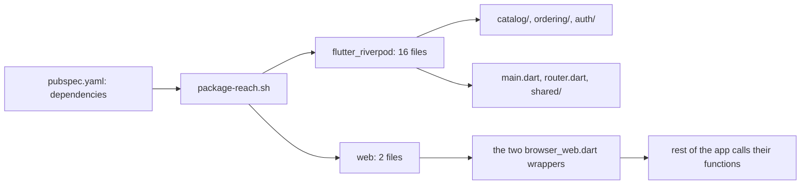

## Before you start

- [[frontend.l4.feature-public-files]] — you know DonHang.App's code sits in three features, `catalog/`, `ordering/` and `auth/`, with shared code in `shared/` and `design/`, plus `main.dart` and `router.dart`.
- [[design.l4.over-abstraction]] — you know an abstraction earns its place with a reason that exists today, not one that might come later.
- [[management.l3.vendor-lock-in]] — you know the cost of leaving something grows with every place your code uses it.
- [[frontend.l2.overriding-providers-in-tests]] — you know a widget test can give a provider a fixed value with `ProviderScope(overrides: […])`.

## The situation

It is stage-4. In a planning meeting, a developer proposes moving DonHang.App to a different state library they used in an earlier job. "It is one line in `pubspec.yaml`," they say, "like swapping `http`." Another developer answers that the app should first wrap every outside library in its own interface, so any later swap is cheap. Both sound reasonable, and the meeting turns into a debate about which library is better. Nobody in the room knows how many files would change. How do you read what replacing a library costs, before anyone argues about it?

## Core concepts

- a dependency's reach — the number of Dart files under `lib/` that import it; replacing the dependency means editing each of those files.
- an app-wide library — a library whose reach covers every feature, because it decides how every screen reads and changes data; Riverpod is DonHang.App's.
- a wrapper — the app's own functions or interface around a library, so that only the wrapper's files import it; an adapter is one kind.
- replacing feature by feature — moving one feature at a time to the new library, with old and new both in `pubspec.yaml` until the last feature has moved.

## How it works



`pubspec.yaml` is the file where a Flutter app lists the packages it uses. `package-reach.sh` takes the names under its `dependencies:`. It skips `dev_dependencies:`, which hold packages that only tests and tools use, such as `flutter_test` and `flutter_lints`. For each name it lists the files under `lib/` with an `import` or `export` line naming that package, and prints how many, largest first.

In the situation above, the number that matters is the reach of `flutter_riverpod`: 16 files, in all three features and in `main.dart`, `router.dart` and `shared/`. Only `flutter` reaches more, 20. The script labels it `(Flutter SDK)` because it comes with Flutter itself, so nobody plans to replace it. `http`, the library the developer compared it with, reaches 3.

That gap is not an accident of how the code was written. A state library decides how every screen reads data and how a change reaches the screens that show it, so every feature imports it. Choosing one is a decision for the whole app, judged by questions such as: can a test replace a provider's value, how does a change reach a screen, and does the team already know the library.

`web` sits at the other end. It reaches only the two `browser_web.dart` files, and both are wrappers: the rest of the app calls their functions and never imports `package:web`. Replacing `web` touches those two files.

So the meeting's question has a number for an answer, read before the debate starts. A library with a small reach is cheap to replace; an app-wide library is replaced feature by feature, as planned work.

## In the Đơn Hàng system

The measure, from `package-reach.sh`:

```bash file=scripts/frontend/package-reach.sh tag=stage-4 lines=15-28
# lesson: frontend.l4.library-reach
# For each package, the files under lib/ with an import or export line of
# package:<name>/, leaving out lib/l10n/, which gen-l10n writes. Replacing
# a package means touching every one of these files.
echo "Files under lib/ (without lib/l10n/) that import each dependency:"
for package in $packages; do
  files=$(grep -rlE "^(import|export) +'package:$package/" lib --include='*.dart' | grep -v '^lib/l10n/' | LC_ALL=C sort || true)
  count=$(grep -c . <<< "$files" || true)
  label=$package
  grep -qx "$package" <<< "$sdk" && label="$package (Flutter SDK)"
  line=$(printf '%3d  %s' "$count" "$label")
  if [ "$count" -gt 0 ] && [ "$count" -le 3 ]; then line="$line: $(paste -sd ' ' <<< "$files")"; fi
  echo "$line"
done | LC_ALL=C sort -k1,1nr -k2,2
```

```text output=true
Files under lib/ (without lib/l10n/) that import each dependency:
 20  flutter (Flutter SDK)
 16  flutter_riverpod
  6  go_router
  3  http: lib/features/auth/keycloak_sign_in.dart lib/features/ordering/orders_api.dart lib/shared/api_client.dart
  2  web: lib/features/auth/browser_web.dart lib/shared/browser_web.dart
  1  crypto: lib/features/auth/keycloak_sign_in.dart
  1  flutter_web_plugins (Flutter SDK): lib/main.dart
  0  cupertino_icons
  0  flutter_localizations (Flutter SDK)
  0  intl
```

Line 21 is the whole measure: every file under `lib/` with a line starting `import` or `export` that names `package:<name>/`, minus `lib/l10n/`, which `gen-l10n` writes rather than people. `$packages` and `$sdk`, set above this excerpt, hold the names under `dependencies:` and those that come with Flutter. Line 26 prints the file names when there are three or fewer, and line 28 sorts by count, so the costliest dependencies come first.

In the output, `http` names its three files, and `web` names two files that are both `browser_web.dart`.

One of those two files:

```dart file=DonHang.App/lib/shared/browser_web.dart tag=stage-4 lines=3-21
// lesson: frontend.l4.library-reach
// One of the two files in lib/ that import package:web, both wrappers
// around the browser; the rest of the app calls these functions instead.
import 'package:web/web.dart' as web;

import 'local_store.dart';

LocalStore createLocalStore() => BrowserLocalStore();

class BrowserLocalStore implements LocalStore {
  @override
  String? read(String key) => web.window.localStorage.getItem(key);

  @override
  void write(String key, String value) => web.window.localStorage.setItem(key, value);

  @override
  void remove(String key) => web.window.localStorage.removeItem(key);
}
```

`BrowserLocalStore` implements the app's own `LocalStore`, and each method makes one call into `web.window.localStorage`. Code that saves data asks for a `LocalStore` and never sees `package:web`. Outside this excerpt, `browser.dart` exports this file when `dart.library.js_interop` is available, a condition that holds when the app is built for the browser, and otherwise `browser_stub.dart`, whose `createLocalStore()` returns a store that keeps values in memory. The rest of the app calls `createLocalStore()` without knowing which file it got. So this wrapper has a reason today: two implementations already exist.

## Trade-offs

| Option | Files that import the library | Replacing it touches | What it costs now | Fits |
|---|---|---|---|---|
| Wrap it in a file or two (`web`) | the two `browser_web.dart` files | those two files | a few functions, plus an in-memory version off the web | a library used for one narrow job, such as reaching the browser |
| Use it directly where needed (`flutter_riverpod`, chosen) | 16, in every feature | every feature, one at a time | nothing extra; the team reads the library's own docs | a library that decides how every screen works |
| Hide it behind the app's own interfaces | the wrappers only | the wrappers, if the new library fits their shape | the app's own `ref.watch`, its own test overrides, and a new method each time a screen needs more | rarely; only with a present reason, such as a second library already needed |

The third row is the developer's proposal applied to Riverpod. Screens call `ref.watch` to read a provider's value and rebuild when it changes, and six test files under `test/` give providers fixed values with `overrides`. A wrapper would have to offer both, which means writing and keeping a small state library of the app's own. DonHang.App accepts the reach of `flutter_riverpod` on purpose instead.

## What would you choose if…

…a form needs a package that formats phone numbers, used by one file? Import it directly. Its reach is 1, so replacing it later costs one file, and a wrapper would cost more than it saves.

…the team decides to leave Riverpod? Move one feature per pull request, each with its tests passing, while both libraries stay in `pubspec.yaml`. Run `package-reach.sh` after each step and watch the count for `flutter_riverpod` fall. A single pull request that changes all three features at once conflicts with every other change to those files while it is open, so the team either pauses that work or resolves the conflicts by hand.

…one developer wants a second state library just for a new screen, because they know it better? Its reach would be 1, but the choice is app-wide: two ways of reading data in one app. Decide it as a whole-app question, against tests, how changes reach screens and what the team knows, not one screen's convenience.

## Seniors often assume…

- **"Swapping the state library later is a small refactor, like swapping the HTTP client."** → Actually `http` reaches 3 files and `flutter_riverpod` reaches 16 across every feature, plus the tests that override providers. The swap changes how each screen reads data, not one call. You notice this when an estimate of a day turns into a pull request that touches every folder under `lib/features/` and most of `test/`.
- **"Every third-party library should be wrapped in our own interface, so any of them is cheap to replace."** → Actually a wrapper is cheap when the library does one narrow job, as `web` does. For a library screens use everywhere, the wrapper must copy what they use, and the copy becomes a library to keep. You notice this when the wrapper gains a method each time a screen needs something the library already had.
- **"The most popular state library is the right choice for any app."** → Actually the choice is judged against this app: tests that override providers, how changes reach screens, and what the team knows. A library others like may fail one of those here. You notice this when a proposal to switch gives popularity as its reason and says nothing about tests or the team.

## Try it (3 minutes)

1. In the Đơn Hàng repository at `stage-4`, run `scripts/frontend/package-reach.sh` from the repository root.
2. Then run `grep -rlE "^import 'package:flutter_riverpod/" DonHang.App/test` to see which tests import the library.

Expected result: the script prints the heading and ten dependency lines shown above, with `flutter_riverpod` at 16, and `grep` lists six test files.

<details><summary>Suggested answer</summary>

The script counts only `lib/`, so the six test files come on top of the 16. Open any of them and you find `overrides` giving providers fixed values, so replacing `flutter_riverpod` means rewriting how those tests feed their code too. No file in `test/` imports `package:web`: tests run without a browser, and those that touch storage give `localStoreProvider`, the provider that hands code its `LocalStore`, an in-memory store.

</details>

## Connections

- [[frontend.l2.riverpod-providers]] — the library whose reach this lesson measures, and why screens read it through `ref`.
- [[frontend.l2.overriding-providers-in-tests]] — prerequisite: the test overrides a wrapper would have to copy.
- [[design.l2.adapter-pattern]] — `BrowserLocalStore` is a small adapter; this lesson says when one is worth writing.
- [[design.l4.over-abstraction]] — the same rule applied to an outside library: wrap with a present reason, not a possible one.
- [[management.l3.vendor-lock-in]] — reach is lock-in to one library, counted in files.
- [[devops.l3.automated-dependency-updates]] — Dependabot proposes updates to each library; reach says what leaving it would cost.
- [[frontend.l4.backend-for-frontend]] — next: whether the app needs a server of its own between it and the API.

## Five-line summary

1. Replacing a library costs as much as the code that imports it, so count that code before arguing.
2. At stage-4 `package-reach.sh` prints, per dependency in `pubspec.yaml`, how many files under `lib/` import it.
3. `flutter_riverpod` reaches 16 files in every feature, more than any other outside package; `web` reaches only two wrappers.
4. A state library decides how every screen reads data, so DonHang.App accepts its reach instead of hiding it behind interfaces.
5. An app-wide library is replaced one feature at a time, old and new side by side until the last feature moves.
