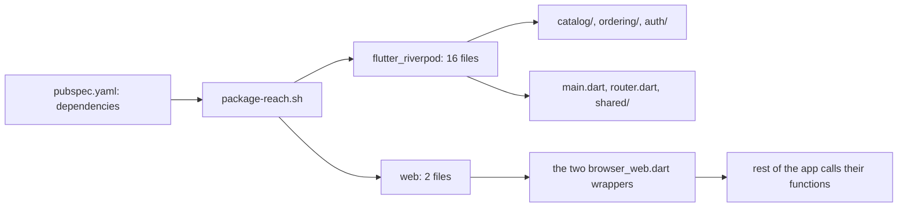

## Bạn cần biết trước

- [[frontend.l4.feature-public-files]] — bạn biết code của DonHang.App nằm trong ba feature `catalog/`, `ordering/` và `auth/`, code dùng chung nằm trong `shared/` và `design/`, cùng với `main.dart` và `router.dart`.
- [[design.l4.over-abstraction]] — bạn biết một abstraction chỉ đáng có khi lý do của nó tồn tại hôm nay, không phải một lý do có thể đến sau này.
- [[management.l3.vendor-lock-in]] — bạn biết cái giá để rời bỏ một thứ tăng lên theo mỗi chỗ code dùng nó.
- [[frontend.l2.overriding-providers-in-tests]] — bạn biết một widget test có thể cho provider một giá trị cố định bằng `ProviderScope(overrides: […])`.

## Tình huống

Đang ở stage-4. Trong một buổi họp kế hoạch, một developer đề xuất chuyển DonHang.App sang một thư viện state khác mà họ từng dùng ở công ty cũ. "Chỉ là một dòng trong `pubspec.yaml`," họ nói, "giống như đổi `http` thôi." Một developer khác đáp rằng trước hết app nên bọc mọi thư viện bên ngoài trong interface của riêng mình, để lần đổi nào sau này cũng rẻ. Nghe cả hai đều hợp lý, và buổi họp thành cuộc tranh luận thư viện nào tốt hơn. Không ai trong phòng biết sẽ có bao nhiêu file phải sửa. Làm sao đọc ra cái giá để thay một thư viện, trước khi ai đó bắt đầu cãi về nó?

## Khái niệm cốt lõi

- độ phủ của một dependency — số file Dart dưới `lib/` import nó. Thay dependency đó nghĩa là sửa từng file trong số này.
- thư viện toàn app — thư viện có độ phủ trùm mọi feature, vì nó quyết định cách mọi màn hình đọc và thay đổi dữ liệu. Với DonHang.App, đó là Riverpod.
- lớp bọc — các hàm hoặc interface của chính app bao quanh một thư viện, để chỉ các file của lớp bọc import thư viện đó. Adapter là một dạng lớp bọc.
- thay từng feature một — chuyển lần lượt từng feature sang thư viện mới, cả cũ lẫn mới cùng nằm trong `pubspec.yaml` cho tới khi feature cuối cùng chuyển xong.

## Cơ chế hoạt động



`pubspec.yaml` là file nơi một app Flutter liệt kê các package nó dùng. `package-reach.sh` lấy các tên dưới `dependencies:` của file này. Script bỏ qua `dev_dependencies:`, nơi chứa các package chỉ test và công cụ dùng, như `flutter_test` và `flutter_lints`. Với mỗi tên, script liệt kê các file dưới `lib/` có dòng `import` hoặc `export` nhắc tới package đó, rồi in ra số lượng, lớn nhất trước.

Trong tình huống trên, con số đáng quan tâm là độ phủ của `flutter_riverpod`: 16 file, trong cả ba feature và trong `main.dart`, `router.dart` và `shared/`. Chỉ `flutter` phủ rộng hơn, 20 file. Script gắn nhãn `(Flutter SDK)` cho nó vì nó đi kèm chính Flutter, nên không ai tính chuyện thay nó. `http`, thư viện mà developer kia đem ra so sánh, phủ 3 file.

Khoảng cách đó không phải do code tình cờ viết như vậy. Thư viện state quyết định cách mọi màn hình đọc dữ liệu và cách một thay đổi tới được các màn hình hiển thị nó, nên feature nào cũng import nó. Chọn thư viện state là quyết định cho cả app, và được cân bằng những câu hỏi như: test có thay được giá trị của provider không, thay đổi đi tới màn hình ra sao, và nhóm đã biết thư viện này chưa.

`web` nằm ở đầu kia. Nó chỉ phủ hai file `browser_web.dart`, và cả hai đều là lớp bọc: phần còn lại của app gọi các hàm của chúng và không bao giờ import `package:web`. Thay `web` chỉ chạm tới hai file đó.

Vậy câu hỏi của buổi họp có câu trả lời là một con số, đọc được trước khi cuộc tranh luận bắt đầu. Thư viện có độ phủ nhỏ thì thay rẻ. Thư viện toàn app thì thay từng feature một, như một phần việc có kế hoạch.

## Trong hệ thống Đơn Hàng

Phép đo, lấy từ `package-reach.sh`:

```bash file=scripts/frontend/package-reach.sh tag=stage-4 lines=15-28
# lesson: frontend.l4.library-reach
# For each package, the files under lib/ with an import or export line of
# package:<name>/, leaving out lib/l10n/, which gen-l10n writes. Replacing
# a package means touching every one of these files.
echo "Files under lib/ (without lib/l10n/) that import each dependency:"
for package in $packages; do
  files=$(grep -rlE "^(import|export) +'package:$package/" lib --include='*.dart' | grep -v '^lib/l10n/' | LC_ALL=C sort || true)
  count=$(grep -c . <<< "$files" || true)
  label=$package
  grep -qx "$package" <<< "$sdk" && label="$package (Flutter SDK)"
  line=$(printf '%3d  %s' "$count" "$label")
  if [ "$count" -gt 0 ] && [ "$count" -le 3 ]; then line="$line: $(paste -sd ' ' <<< "$files")"; fi
  echo "$line"
done | LC_ALL=C sort -k1,1nr -k2,2
```

```text output=true
Files under lib/ (without lib/l10n/) that import each dependency:
 20  flutter (Flutter SDK)
 16  flutter_riverpod
  6  go_router
  3  http: lib/features/auth/keycloak_sign_in.dart lib/features/ordering/orders_api.dart lib/shared/api_client.dart
  2  web: lib/features/auth/browser_web.dart lib/shared/browser_web.dart
  1  crypto: lib/features/auth/keycloak_sign_in.dart
  1  flutter_web_plugins (Flutter SDK): lib/main.dart
  0  cupertino_icons
  0  flutter_localizations (Flutter SDK)
  0  intl
```

Dòng 21 là toàn bộ phép đo: mọi file dưới `lib/` có một dòng bắt đầu bằng `import` hoặc `export` nhắc tới `package:<name>/`, trừ `lib/l10n/`, thư mục do `gen-l10n` viết chứ không phải người. `$packages` và `$sdk`, gán ở phía trên đoạn trích, giữ các tên dưới `dependencies:` và các tên đi kèm Flutter. Dòng 26 in tên file khi có từ ba file trở xuống, còn dòng 28 sắp xếp theo số lượng, nên dependency tốn kém nhất đứng đầu.

Trong output, `http` liệt kê ba file của nó, còn `web` liệt kê hai file, cả hai đều là `browser_web.dart`.

Một trong hai file đó:

```dart file=DonHang.App/lib/shared/browser_web.dart tag=stage-4 lines=3-21
// lesson: frontend.l4.library-reach
// One of the two files in lib/ that import package:web, both wrappers
// around the browser; the rest of the app calls these functions instead.
import 'package:web/web.dart' as web;

import 'local_store.dart';

LocalStore createLocalStore() => BrowserLocalStore();

class BrowserLocalStore implements LocalStore {
  @override
  String? read(String key) => web.window.localStorage.getItem(key);

  @override
  void write(String key, String value) => web.window.localStorage.setItem(key, value);

  @override
  void remove(String key) => web.window.localStorage.removeItem(key);
}
```

`BrowserLocalStore` implement `LocalStore` của chính app, và mỗi method gọi đúng một lần vào `web.window.localStorage`. Code cần lưu dữ liệu thì xin một `LocalStore` và không hề thấy `package:web`. Ngoài đoạn trích, `browser.dart` export file này khi có `dart.library.js_interop`, điều kiện đúng khi app được build cho trình duyệt. Ngược lại, nó export `browser_stub.dart`, nơi `createLocalStore()` trả về một store giữ giá trị trong bộ nhớ. Phần còn lại của app gọi `createLocalStore()` mà không biết mình nhận file nào. Nên lớp bọc này có lý do ngay hôm nay: đã có sẵn hai cách hiện thực.

## Đánh đổi

| Cách làm | Các file import thư viện | Thay nó thì chạm tới | Tốn gì hôm nay | Hợp với |
|---|---|---|---|---|
| Bọc trong một hai file (`web`) | hai file `browser_web.dart` | hai file đó | vài hàm, thêm một bản giữ trong bộ nhớ khi không chạy trên web | thư viện dùng cho một việc hẹp, như truy cập trình duyệt |
| Dùng trực tiếp ở chỗ cần (`flutter_riverpod`, đã chọn) | 16, trong mọi feature | mọi feature, lần lượt từng cái | không tốn thêm gì, nhóm đọc thẳng tài liệu của thư viện | thư viện quyết định cách mọi màn hình hoạt động |
| Giấu sau các interface của chính app | chỉ các lớp bọc | các lớp bọc, nếu thư viện mới khớp hình dạng của chúng | `ref.watch` riêng của app, cơ chế override riêng cho test, và một method mới mỗi khi một màn hình cần thêm thứ gì | hiếm khi, chỉ khi có lý do ngay lúc này, như đã cần sẵn một thư viện thứ hai |

Dòng thứ ba là đề xuất của developer kia áp vào Riverpod. Màn hình gọi `ref.watch` để đọc giá trị của provider và build lại khi giá trị đổi, còn sáu file test dưới `test/` cho provider giá trị cố định bằng `overrides`. Lớp bọc sẽ phải cung cấp cả hai thứ đó, nghĩa là app phải tự viết và tự giữ một thư viện state nhỏ của riêng mình. Thay vào đó, DonHang.App chủ động chấp nhận độ phủ của `flutter_riverpod`.

## Bạn sẽ chọn gì nếu…

…một form cần package định dạng số điện thoại, chỉ một file dùng? Import thẳng. Độ phủ của nó là 1, nên sau này thay chỉ tốn một file, còn lớp bọc sẽ tốn nhiều hơn phần nó tiết kiệm.

…nhóm quyết định rời Riverpod? Chuyển mỗi pull request một feature, test của từng bước đều pass, trong khi cả hai thư viện vẫn nằm trong `pubspec.yaml`. Chạy `package-reach.sh` sau mỗi bước và nhìn con số của `flutter_riverpod` giảm dần. Một pull request đổi cả ba feature cùng lúc sẽ xung đột với mọi thay đổi khác trên các file đó suốt thời gian nó còn mở, nên nhóm hoặc phải tạm dừng phần việc kia, hoặc phải gỡ xung đột bằng tay.

…một developer muốn thêm thư viện state thứ hai chỉ cho một màn hình mới, vì họ quen nó hơn? Độ phủ của nó sẽ là 1, nhưng lựa chọn này là của cả app: hai cách đọc dữ liệu trong cùng một app. Hãy quyết định nó như một câu hỏi cho toàn app, cân theo test, cách thay đổi đi tới màn hình và những gì nhóm đã biết, chứ không phải theo sự tiện lợi của một màn hình.

## Senior hay nhầm rằng…

- **"Sau này đổi thư viện state chỉ là refactor nhỏ, giống như đổi HTTP client."** → Thực ra `http` phủ 3 file, còn `flutter_riverpod` phủ 16 file khắp mọi feature, chưa kể các test override provider. Lần đổi này thay cách từng màn hình đọc dữ liệu, không phải một lời gọi. Bạn sẽ nhận ra khi một ước lượng một ngày biến thành pull request chạm vào mọi thư mục dưới `lib/features/` và gần hết `test/`.
- **"Thư viện bên thứ ba nào cũng nên bọc trong interface của mình, để thay cái nào cũng rẻ."** → Thực ra lớp bọc chỉ rẻ khi thư viện làm một việc hẹp, như `web`. Với thư viện mà màn hình nào cũng dùng, lớp bọc phải sao chép lại những gì các màn hình dùng, và bản sao đó thành một thư viện phải giữ. Bạn sẽ nhận ra khi lớp bọc mọc thêm một method mỗi lần một màn hình cần thứ mà thư viện vốn đã có.
- **"Thư viện state phổ biến nhất là lựa chọn đúng cho mọi app."** → Thực ra lựa chọn được cân theo chính app này: test override provider, cách thay đổi đi tới màn hình, và những gì nhóm biết. Một thư viện người khác thích vẫn có thể trượt một trong các tiêu chí đó ở đây. Bạn sẽ nhận ra khi một đề xuất chuyển thư viện lấy độ phổ biến làm lý do mà không nói gì về test hay về nhóm.

## Thử ngay (3 phút)

1. Trong repo Đơn Hàng ở `stage-4`, chạy `scripts/frontend/package-reach.sh` từ thư mục gốc của repo.
2. Sau đó chạy `grep -rlE "^import 'package:flutter_riverpod/" DonHang.App/test` để xem test nào import thư viện này.

Kết quả mong đợi: script in dòng tiêu đề và mười dòng dependency như ở trên, với `flutter_riverpod` là 16, còn `grep` liệt kê sáu file test.

<details><summary>Gợi ý đáp án</summary>

Script chỉ đếm `lib/`, nên sáu file test là phần cộng thêm vào 16 file kia. Mở bất kỳ file nào trong số đó, bạn sẽ thấy `overrides` cho provider giá trị cố định, nên thay `flutter_riverpod` cũng có nghĩa là viết lại cách các test đó cấp dữ liệu cho code. Không file nào trong `test/` import `package:web`: test chạy không cần trình duyệt, và test nào chạm tới phần lưu trữ thì cho `localStoreProvider`, provider trao `LocalStore` cho code, một store trong bộ nhớ.

</details>

## Liên hệ

- [[frontend.l2.riverpod-providers]] — thư viện mà bài này đo độ phủ, và vì sao màn hình đọc nó qua `ref`.
- [[frontend.l2.overriding-providers-in-tests]] — bài cần trước: các override trong test mà lớp bọc sẽ phải sao chép.
- [[design.l2.adapter-pattern]] — `BrowserLocalStore` là một adapter nhỏ. Bài này nói khi nào nó đáng viết.
- [[design.l4.over-abstraction]] — cùng quy tắc áp cho thư viện bên ngoài: bọc khi có lý do hôm nay, không phải lý do có thể có.
- [[management.l3.vendor-lock-in]] — độ phủ chính là lock-in vào một thư viện, đếm bằng số file.
- [[devops.l3.automated-dependency-updates]] — Dependabot đề xuất cập nhật cho từng thư viện, còn độ phủ cho biết rời bỏ nó tốn bao nhiêu.
- [[frontend.l4.backend-for-frontend]] — bài tiếp theo: app có cần một server riêng đứng giữa nó và API hay không.

## Tóm tắt 5 dòng

1. Thay một thư viện tốn bằng phần code import nó, nên hãy đếm phần code đó trước khi tranh luận.
2. Ở stage-4, `package-reach.sh` in ra, với mỗi dependency trong `pubspec.yaml`, có bao nhiêu file dưới `lib/` import nó.
3. `flutter_riverpod` phủ 16 file trong mọi feature, nhiều hơn mọi package bên ngoài khác, còn `web` chỉ phủ hai lớp bọc.
4. Thư viện state quyết định cách mọi màn hình đọc dữ liệu, nên DonHang.App chấp nhận độ phủ của nó thay vì giấu nó sau các interface.
5. Thư viện toàn app được thay từng feature một, cũ và mới chạy song song cho tới khi feature cuối cùng chuyển xong.
