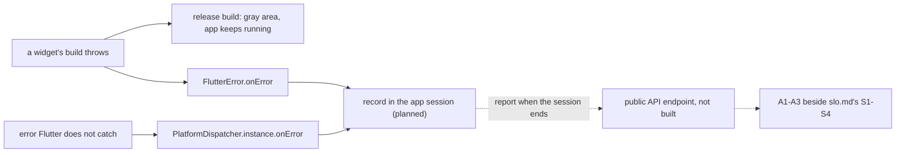

## Before you start

- [[backend.l4.service-level-indicators]] — you know an SLI counts good events among valid ones, and that `DonHang.Api` counts only the requests that reach it.
- [[frontend.l3.profile-mode]] — you know profile mode finds which phase of a frame is slow, on the machine where you run it.
- [[frontend.l3.syncing-the-queue]] — you know an order can wait in DonHang.App's offline queue until a trigger sends it and the API answers.

## The situation

It is stage-4. A shop owner forwards a customer's screenshot of DonHang.App: part of the order screen is a plain gray block, while the rest of the app still responds. The API answered every request normally; production has no Prometheus yet, and on staging every SLI in `slo.md` is above its target. You open the same screen in profile mode on your laptop, and it draws quickly with no error. The server looks healthy, your machine shows nothing wrong, and still a customer met a broken screen that no number recorded. How can the team learn what customers' devices actually go through, and what should it count?

## Core concepts

- lab measurement — a number taken on the team's own machine, browser and network, such as a profile-mode recording or the bundle size from `scripts/frontend/web-bundle.sh`.
- **real-user monitoring (RUM)** — collecting measurements from real customers' devices while they use the app, such as how long the first screen took to appear and which errors happened.
- uncaught error — an error that no code of the app catches where it happens, so it ends in one of the framework's error handlers.
- app session — in Đơn Hàng's design, one opening of DonHang.App, until its browser tab is closed or hidden.
- **crash-free sessions** — the share of app sessions that end without any uncaught error.

## How it works



In the situation above, a widget's `build` threw an error. In a release build, Flutter shows a gray area in place of the widget that failed and keeps running the rest of the app. That is kind to the customer but hides the failure. The app does not close, and no failed request reaches the API, so the server's SLIs have nothing to count.

The app's own code does not catch the error, but Flutter does. Errors it catches during build, layout and paint go to `FlutterError.onError`. Errors that Flutter does not catch itself, such as one from an asynchronous call a button starts, go to `PlatformDispatcher.instance.onError` instead. By default the first writes the error to the device's log and the second only prints it; either way the error stays on the customer's device, where the team never looks. An app that wants to see these errors sets both handlers, typically in `main`.

Real-user monitoring turns those handlers into numbers. Each handler records the error in the current app session, and when the session ends the app sends one report for it. The report would go to a new public endpoint of the API, not built yet, and crash-free sessions would become A1 in `app-experience.md`, next to `slo.md`'s S1–S4. Counted over many sessions, the reports give crash-free sessions: if 1,000 sessions end and 5 of them had an uncaught error, the value is 99.5%. The name says crash, but the gray area counts too, because that session had an uncaught error even though the app never closed.

The same reports can carry timings measured on the customer's browser, such as time to the first screen, which no laptop can stand in for. Lab measurements still find slow code; real-user numbers say what customers met.

## In the Đơn Hàng system

The plan, from `docs/design/app-experience.md` (written in Vietnamese):

```markdown file=docs/design/app-experience.md tag=stage-4 lines=5-29
### Đo ở phòng lab và đo trên máy khách

Đội đã đo app ở phòng lab: chạy ở profile mode trên máy của đội để tìm code
chậm, và xem kích thước bundle bằng
`scripts/frontend/web-bundle.sh`. Các số đó đo trên máy, trình duyệt và mạng
của đội. Chúng không nói app chạy thế nào trên điện thoại, trình duyệt và
đường mạng của khách, nơi máy yếu hơn, mạng chậm hơn và lỗi xảy ra mà đội
không thấy.

Đo trên máy khách là thu số đo từ máy của khách thật trong lúc họ dùng app.
Lỗi trên máy khách có thể không bao giờ tới server: ở bản release, một widget
mà `build` ném lỗi hiện thành một vùng xám, phần còn lại của app vẫn chạy, nên
khách gặp một màn hình hỏng mà API vẫn trả lời bình thường.

### Chỉ số phía app

| Chỉ số | Tên | Định nghĩa | Mục tiêu |
|---|---|---|---|
| A1 | Phiên không có lỗi | Tỉ lệ phiên kết thúc mà không có lỗi nào không được bắt | 99,5% phiên trong 28 ngày (giả định) |
| A2 | Thời gian tới màn hình đầu tiên | Từ lúc trình duyệt bắt đầu tải trang tới khi app vẽ màn hình đầu tiên, trên trình duyệt của khách | Percentile 75 dưới 3 giây, percentile 95 dưới 6 giây (giả định) |
| A3 | Đơn kẹt trong hàng đợi offline | Số đơn trong hàng đợi offline chưa tới được API sau 30 phút kể từ lúc đặt | Dưới 0,1% số đơn đặt (giả định) |

Ba chỉ số đặt cạnh các SLI của server trong `slo.md`: S1–S4 đo những request
đã tới API, A1–A3 đo những gì xảy ra trước đó, trên máy khách. Một đơn kẹt
trong hàng đợi (A3) không bao giờ thành request hỏng ở S1.
```

The first section says lab numbers, from profile mode and `web-bundle.sh` on the team's machine, browser and network, say nothing about customers' devices. The second paragraph names the situation's case: a widget whose `build` throws becomes a gray area in release, and the API keeps answering normally.

The table defines three app-side measures. A1 is crash-free sessions, aimed at 99.5% of sessions over 28 days. A2 is the time from the browser starting to load the app until the app draws its first screen, with targets for the 75th and 95th percentiles. A3 counts orders still in the offline queue 30 minutes after they were placed. Every target is marked as an assumption; outside this excerpt, the document says the team resets them after the first 28 days of real numbers.

The last paragraph is why these sit beside `slo.md`: S1–S4 measure requests that reached the API, while A1–A3 measure what happened before, on the device. An order stuck in the queue never becomes a failed request in S1.

How the numbers would be collected, and what is missing:

```markdown file=docs/design/app-experience.md tag=stage-4 lines=34-54
### Cách thu dự kiến

- Lỗi: Flutter đưa lỗi nó bắt trong lúc build, layout và paint tới
  `FlutterError.onError`, và lỗi ngoài các callback đó tới
  `PlatformDispatcher.instance.onError`. App gán cả hai trong `main.dart`, ghi
  lỗi vào phiên hiện tại rồi vẫn để Flutter xử lý như cũ.
- Phiên: mỗi lần mở app là một phiên, có một id ngẫu nhiên, không gắn với
  khách; khi phiên kết thúc (trang bị đóng hay ẩn) app gửi một báo cáo cho
  phiên đó: có lỗi hay không, thời gian tới màn hình đầu tiên, số đơn đang
  chờ trong hàng đợi và tuổi của đơn cũ nhất.
- Báo cáo đi tới một endpoint công khai mới của API. Endpoint đó cần giới hạn
  tải riêng, vì ai cũng gọi được nó.

### Khoảng trống

- Stage-4 chưa thu gì: không có code thu số đo trong app, không có endpoint
  nhận báo cáo.
- Giới hạn tải trong `Program.cs` không đổi ở stage-4; endpoint nhận báo cáo
  chờ tới khi có giới hạn cho nó.
- Cho tới khi app gửi số đo, các SLI của server trong `slo.md` là những số duy
  nhất đội theo dõi; lỗi chỉ xảy ra trên máy khách vẫn không ai thấy.
```

"Cách thu dự kiến" (planned collection) sets both handlers in `main.dart`; each records the error in the current session and then lets Flutter handle it as before. A session is one opening of the app with a random id not tied to the customer. When the browser tab is closed or hidden, the app sends one report: whether there was an error, the time to the first screen, how many orders wait in the queue, and the age of the oldest. The reports go to a new public endpoint of the API, which needs its own rate limit because anyone can call it.

"Khoảng trống" (gaps) is the honest part. At stage-4 nothing is collected: no measuring code in the app, no endpoint for reports. The rate limits in `Program.cs` are unchanged, and the endpoint waits until it has a limit of its own. Until the app sends numbers, the server's SLIs in `slo.md` are the only numbers the team watches, and errors that happen only on customers' devices stay unseen.

## Trade-offs

| What the team watches | Sees | Misses | Cost to add |
|---|---|---|---|
| Lab measurements only | which code is slow, how big the bundle is | every customer's device, network and error | none, already in place |
| Server SLIs (stage-4 today, with lab) | requests that reached the API, good or bad | gray areas, slow first screens, orders stuck in the queue | none, already in place |
| Server SLIs plus the app's own reports (the plan) | A1–A3 next to S1–S4 | errors in a session that never sends its report | code in `main.dart`, one public endpoint with its own rate limit |

The plan does not replace either row above it. Lab measurements still show where to fix, server SLIs still show what the API did, and the reports add the part only the device knows.

## What would you choose if…

…customers keep sending screenshots of gray areas, but the team has time for only one measure this month? Start with A1. Errors are the failures nobody sees today, and the two handlers already catch them; timings can follow.

…the endpoint for reports is ready, but no rate limit for it is? Keep it closed. The document makes the endpoint wait for its limit, since anyone could flood an open endpoint. Until then, read the server's SLIs knowing what they cannot show.

…a release makes the bundle larger, and you want to know whether customers' first screen got slower? `web-bundle.sh` shows the size grew, which is a lab signal of direction. Only A2, measured on customers' browsers, says whether the 75th and 95th percentiles moved.

## Seniors often assume…

- **"If the server meets its SLOs, customers are having a good experience."** → Actually S1–S4 count only requests that reached the API, as `slo.md` states. A gray area or an order stuck in the queue never becomes a failed request. You notice this when a customer reports a broken screen on a day every SLI is green.
- **"Measuring the app on a fast developer laptop tells you how it feels for customers."** → Actually a lab measurement runs on the team's machine, browser and network, and finds slow code there. Many customers' devices are weaker and their networks slower than the team's, as `app-experience.md` notes, which is why A2 is measured on their browsers. You notice this when a screen that draws at once on your laptop is the one customers call slow.
- **"An error that does not close the app is not worth counting."** → Actually a gray area means a screen the customer could not use, and A1 counts that session as failed. Because the app keeps running, nobody reports a crash, so only the handlers record it. You notice this when customers stop using one screen and no number the team watches has moved.

## Try it (3 minutes)

1. In the Đơn Hàng repository at `stage-4`, run `grep -rnE "FlutterError\.onError|PlatformDispatcher" DonHang.App/lib docs/design`.
2. Note which directory each line comes from, then say what the result means for A1 today.

Expected result: two lines, both from `docs/design/app-experience.md`, and none from `DonHang.App/lib`.

<details><summary>Suggested answer</summary>

Only the plan names the two handlers; no file of the app sets them. So at stage-4 a build error in release becomes a gray area that goes only to the device's log, and A1 cannot be measured. That matches the document's gaps section: the server's SLIs are the only numbers the team watches.

</details>

## Connections

- [[backend.l4.service-level-indicators]] — prerequisite: the server-side SLIs that A1–A3 sit beside, and the reason they cannot see the device.
- [[backend.l4.service-level-objectives]] — the same idea of a target over a window, applied here to app-side measures that are still assumptions.
- [[devops.l2.histograms-and-percentiles]] — why A2 sets targets for the 75th and 95th percentiles instead of an average.
- [[frontend.l3.offline-order-queue]] — the queue whose stuck orders A3 counts, which the server never sees as failed requests.
- [[frontend.l3.profile-mode]] — the lab measurement this lesson keeps for finding slow code, but not for judging customers' experience.

## Five-line summary

1. Customers' experience is measured on their devices, because the team's machine and the server's SLIs cannot see what happens there.
2. Real-user monitoring collects measurements from real customers' devices while they use the app, such as errors and time to first screen.
3. In a release build, a widget whose `build` throws shows a gray area while the app keeps running, so the failure can go unnoticed.
4. Flutter routes errors it catches to `FlutterError.onError` and others to `PlatformDispatcher.instance.onError`; an app sets both to see them.
5. Crash-free sessions sits beside `slo.md`'s SLIs in `app-experience.md`, but at stage-4 the app collects nothing yet.
