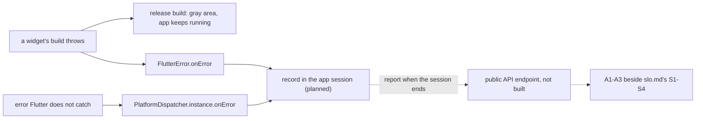

## Bạn cần biết trước

- [[backend.l4.service-level-indicators]] — bạn biết một SLI đếm số sự kiện tốt trong số sự kiện hợp lệ, và `DonHang.Api` chỉ đếm những request tới được nó.
- [[frontend.l3.profile-mode]] — bạn biết profile mode tìm ra giai đoạn nào của khung hình bị chậm, trên chính máy bạn chạy nó.
- [[frontend.l3.syncing-the-queue]] — bạn biết một đơn có thể nằm chờ trong hàng đợi offline của DonHang.App tới khi có tác nhân gửi nó đi và API trả lời.

## Tình huống

Đang ở stage-4. Một chủ shop chuyển tiếp ảnh chụp màn hình DonHang.App từ một khách: một phần màn hình đặt đơn chỉ là khối xám trơn, trong khi phần còn lại của app vẫn phản hồi. API đã trả lời mọi request bình thường. Production chưa có Prometheus, còn trên staging mọi SLI trong `slo.md` đều trên mục tiêu. Bạn mở đúng màn hình đó ở profile mode trên laptop của mình, và nó vẽ nhanh, không lỗi gì. Server trông khỏe, máy bạn không cho thấy gì sai, vậy mà một khách vẫn gặp màn hình hỏng và không con số nào ghi lại. Làm sao để đội biết máy của khách thật sự gặp những gì, và nên đếm cái gì?

## Khái niệm cốt lõi

- số đo ở phòng lab — con số lấy trên máy, trình duyệt và mạng của chính đội, như một bản ghi ở profile mode hay kích thước bundle từ `scripts/frontend/web-bundle.sh`.
- **real-user monitoring (RUM)** (thu số đo từ máy của khách thật khi họ dùng app, thay vì đo trên máy của đội) — thu số đo từ máy của khách thật trong lúc họ dùng app, như màn hình đầu tiên mất bao lâu mới hiện ra và đã có những lỗi nào.
- lỗi không được bắt — lỗi mà không đoạn code nào của app bắt ngay tại chỗ nó xảy ra, nên nó rơi vào một trong các handler lỗi của framework.
- phiên dùng app — theo thiết kế của Đơn Hàng, một lần mở DonHang.App, cho tới khi tab trình duyệt bị đóng hoặc bị ẩn.
- **tỉ lệ phiên không lỗi** (crash-free sessions) — tỉ lệ phiên dùng app kết thúc mà không gặp lỗi nào không được bắt.

## Cơ chế hoạt động



Trong tình huống trên, `build` của một widget đã ném lỗi. Ở bản build release, Flutter hiện một vùng xám thay cho widget bị lỗi và vẫn chạy phần còn lại của app. Như vậy dễ chịu cho khách nhưng giấu mất chỗ hỏng. App không đóng, không request lỗi nào tới API, nên các SLI của server chẳng có gì để đếm.

Code của app không bắt lỗi này, nhưng Flutter thì có. Lỗi Flutter bắt trong lúc build, layout và paint đi tới `FlutterError.onError`. Lỗi mà chính Flutter không bắt, như lỗi từ một lời gọi bất đồng bộ do một nút bấm khởi động, thì đi tới `PlatformDispatcher.instance.onError`. Mặc định, handler thứ nhất ghi lỗi vào log của thiết bị, còn handler thứ hai chỉ in nó ra. Dù theo đường nào, lỗi cũng nằm lại trên máy khách, nơi đội không bao giờ nhìn tới. App muốn thấy các lỗi này thì gán cả hai handler, thường là trong `main`.

Real-user monitoring biến các handler đó thành con số. Mỗi handler ghi lỗi vào phiên dùng app hiện tại, và khi phiên kết thúc, app gửi một báo cáo cho phiên đó. Báo cáo sẽ đi tới một endpoint công khai mới của API, hiện chưa xây, và tỉ lệ phiên không lỗi sẽ thành A1 trong `app-experience.md`, cạnh S1–S4 của `slo.md`. Đếm trên nhiều phiên, các báo cáo cho ra tỉ lệ phiên không lỗi: nếu 1.000 phiên kết thúc và 5 phiên trong đó có lỗi không được bắt, giá trị là 99,5%. Tên tiếng Anh có chữ "crash", tức app bị đóng, nhưng vùng xám cũng bị tính, vì phiên đó có lỗi không được bắt dù app chưa hề đóng.

Cùng các báo cáo ấy có thể mang theo thời gian đo trên trình duyệt của khách, như thời gian tới màn hình đầu tiên, thứ không laptop nào đo thay được. Số đo ở phòng lab vẫn tìm ra code chậm. Số đo từ người dùng thật cho biết khách đã gặp gì.

## Trong hệ thống Đơn Hàng

Kế hoạch, trong `docs/design/app-experience.md` (viết bằng tiếng Việt):

```markdown file=docs/design/app-experience.md tag=stage-4 lines=5-29
### Đo ở phòng lab và đo trên máy khách

Đội đã đo app ở phòng lab: chạy ở profile mode trên máy của đội để tìm code
chậm, và xem kích thước bundle bằng
`scripts/frontend/web-bundle.sh`. Các số đó đo trên máy, trình duyệt và mạng
của đội. Chúng không nói app chạy thế nào trên điện thoại, trình duyệt và
đường mạng của khách, nơi máy yếu hơn, mạng chậm hơn và lỗi xảy ra mà đội
không thấy.

Đo trên máy khách là thu số đo từ máy của khách thật trong lúc họ dùng app.
Lỗi trên máy khách có thể không bao giờ tới server: ở bản release, một widget
mà `build` ném lỗi hiện thành một vùng xám, phần còn lại của app vẫn chạy, nên
khách gặp một màn hình hỏng mà API vẫn trả lời bình thường.

### Chỉ số phía app

| Chỉ số | Tên | Định nghĩa | Mục tiêu |
|---|---|---|---|
| A1 | Phiên không có lỗi | Tỉ lệ phiên kết thúc mà không có lỗi nào không được bắt | 99,5% phiên trong 28 ngày (giả định) |
| A2 | Thời gian tới màn hình đầu tiên | Từ lúc trình duyệt bắt đầu tải trang tới khi app vẽ màn hình đầu tiên, trên trình duyệt của khách | Percentile 75 dưới 3 giây, percentile 95 dưới 6 giây (giả định) |
| A3 | Đơn kẹt trong hàng đợi offline | Số đơn trong hàng đợi offline chưa tới được API sau 30 phút kể từ lúc đặt | Dưới 0,1% số đơn đặt (giả định) |

Ba chỉ số đặt cạnh các SLI của server trong `slo.md`: S1–S4 đo những request
đã tới API, A1–A3 đo những gì xảy ra trước đó, trên máy khách. Một đơn kẹt
trong hàng đợi (A3) không bao giờ thành request hỏng ở S1.
```

Phần đầu nói các số đo ở phòng lab, từ profile mode và `web-bundle.sh` trên máy, trình duyệt và mạng của đội, không nói được gì về máy của khách. Đoạn thứ hai gọi tên đúng trường hợp trong tình huống: một widget có `build` ném lỗi thành vùng xám ở bản release, và API vẫn trả lời bình thường.

Bảng định nghĩa ba chỉ số phía app. A1 là tỉ lệ phiên không lỗi, nhắm 99,5% phiên trong 28 ngày. A2 là thời gian từ lúc trình duyệt bắt đầu tải app tới khi app vẽ màn hình đầu tiên, có mục tiêu cho percentile 75 và percentile 95. A3 đếm những đơn vẫn nằm trong hàng đợi offline 30 phút sau khi được đặt. Mục tiêu nào cũng được ghi là giả định. Ngoài đoạn trích, tài liệu nói đội sẽ đặt lại chúng sau 28 ngày đầu tiên có số thật.

Đoạn cuối giải thích vì sao chúng đặt cạnh `slo.md`: S1–S4 đo những request đã tới API, còn A1–A3 đo những gì xảy ra trước đó, trên máy khách. Một đơn kẹt trong hàng đợi không bao giờ thành request lỗi ở S1.

Số đo sẽ được thu thế nào, và còn thiếu gì:

```markdown file=docs/design/app-experience.md tag=stage-4 lines=34-54
### Cách thu dự kiến

- Lỗi: Flutter đưa lỗi nó bắt trong lúc build, layout và paint tới
  `FlutterError.onError`, và lỗi ngoài các callback đó tới
  `PlatformDispatcher.instance.onError`. App gán cả hai trong `main.dart`, ghi
  lỗi vào phiên hiện tại rồi vẫn để Flutter xử lý như cũ.
- Phiên: mỗi lần mở app là một phiên, có một id ngẫu nhiên, không gắn với
  khách; khi phiên kết thúc (trang bị đóng hay ẩn) app gửi một báo cáo cho
  phiên đó: có lỗi hay không, thời gian tới màn hình đầu tiên, số đơn đang
  chờ trong hàng đợi và tuổi của đơn cũ nhất.
- Báo cáo đi tới một endpoint công khai mới của API. Endpoint đó cần giới hạn
  tải riêng, vì ai cũng gọi được nó.

### Khoảng trống

- Stage-4 chưa thu gì: không có code thu số đo trong app, không có endpoint
  nhận báo cáo.
- Giới hạn tải trong `Program.cs` không đổi ở stage-4; endpoint nhận báo cáo
  chờ tới khi có giới hạn cho nó.
- Cho tới khi app gửi số đo, các SLI của server trong `slo.md` là những số duy
  nhất đội theo dõi; lỗi chỉ xảy ra trên máy khách vẫn không ai thấy.
```

"Cách thu dự kiến" gán cả hai handler trong `main.dart`. Mỗi handler ghi lỗi vào phiên hiện tại rồi để Flutter xử lý như trước. Một phiên là một lần mở app, có id ngẫu nhiên không gắn với khách. Khi tab trình duyệt bị đóng hoặc bị ẩn, app gửi một báo cáo: có lỗi hay không, thời gian tới màn hình đầu tiên, bao nhiêu đơn đang chờ trong hàng đợi, và đơn cũ nhất đã chờ bao lâu. Báo cáo đi tới một endpoint công khai mới của API, endpoint này cần rate limit riêng vì ai cũng gọi được nó.

"Khoảng trống" là phần thẳng thắn. Ở stage-4 chưa thu gì cả: app không có code đo, API không có endpoint nhận báo cáo. Các rate limit trong `Program.cs` không đổi, và endpoint phải chờ tới khi có rate limit của riêng nó. Cho tới khi app gửi số đo, các SLI của server trong `slo.md` là những con số duy nhất đội theo dõi, và lỗi chỉ xảy ra trên máy khách vẫn không ai thấy.

## Đánh đổi

| Đội theo dõi gì | Thấy | Bỏ sót | Chi phí thêm vào |
|---|---|---|---|
| Chỉ số đo ở phòng lab | code nào chậm, bundle lớn cỡ nào | máy, mạng và lỗi của mọi khách | không, đã có sẵn |
| SLI của server (stage-4 hiện nay, cùng số đo lab) | các request đã tới API, tốt hay xấu | vùng xám, màn hình đầu tiên chậm, đơn kẹt trong hàng đợi | không, đã có sẵn |
| SLI của server cộng báo cáo từ chính app (kế hoạch) | A1–A3 cạnh S1–S4 | lỗi trong phiên không bao giờ gửi được báo cáo | code trong `main.dart`, một endpoint công khai có rate limit riêng |

Kế hoạch không thay thế dòng nào phía trên nó. Số đo lab vẫn chỉ ra chỗ cần sửa, SLI của server vẫn cho thấy API đã làm gì, còn báo cáo thêm vào phần chỉ thiết bị mới biết.

## Bạn sẽ chọn gì nếu…

…khách cứ gửi ảnh chụp vùng xám, nhưng tháng này đội chỉ đủ thời gian cho một chỉ số? Bắt đầu với A1. Lỗi là những chỗ hỏng hôm nay không ai thấy, và hai handler vốn đã bắt được chúng. Thời gian có thể làm sau.

…endpoint nhận báo cáo đã sẵn sàng, nhưng rate limit cho nó thì chưa? Giữ nó đóng. Tài liệu bắt endpoint chờ rate limit của nó, vì ai cũng có thể dội request vào một endpoint mở. Trong lúc chờ, đọc SLI của server và nhớ rằng chúng không cho thấy được những gì.

…một bản phát hành làm bundle lớn hơn, và bạn muốn biết màn hình đầu tiên của khách có chậm đi không? `web-bundle.sh` cho thấy kích thước đã tăng, một tín hiệu lab về chiều hướng. Chỉ A2, đo trên trình duyệt của khách, mới cho biết percentile 75 và percentile 95 có dịch chuyển hay không.

## Senior hay nhầm rằng…

- **"Nếu server đạt SLO, khách đang có trải nghiệm tốt."** → Thực ra S1–S4 chỉ đếm những request đã tới API, như `slo.md` ghi rõ. Một vùng xám hay một đơn kẹt trong hàng đợi không bao giờ thành request lỗi. Bạn sẽ nhận ra khi một khách báo màn hình hỏng đúng vào ngày mọi SLI đều xanh.
- **"Đo app trên laptop nhanh của developer là biết khách cảm thấy thế nào."** → Thực ra số đo ở phòng lab chạy trên máy, trình duyệt và mạng của đội, và tìm code chậm ở đó. Nhiều máy của khách yếu hơn và mạng chậm hơn của đội, như `app-experience.md` ghi, nên A2 được đo trên trình duyệt của họ. Bạn sẽ nhận ra khi chính màn hình vẽ tức thì trên laptop của bạn lại là màn hình khách chê chậm.
- **"Lỗi không làm đóng app thì không đáng đếm."** → Thực ra vùng xám là một màn hình khách không dùng được, và A1 tính phiên đó là hỏng. Vì app vẫn chạy, không ai báo crash, nên chỉ các handler ghi lại được nó. Bạn sẽ nhận ra khi khách thôi dùng một màn hình mà không con số nào đội theo dõi nhúc nhích.

## Thử ngay (3 phút)

1. Trong repo Đơn Hàng ở `stage-4`, chạy `grep -rnE "FlutterError\.onError|PlatformDispatcher" DonHang.App/lib docs/design`.
2. Ghi lại mỗi dòng đến từ thư mục nào, rồi nói kết quả đó có ý nghĩa gì với A1 hôm nay.

Kết quả mong đợi: hai dòng, cả hai từ `docs/design/app-experience.md`, không dòng nào từ `DonHang.App/lib`.

<details><summary>Gợi ý đáp án</summary>

Chỉ kế hoạch nhắc tên hai handler, không file nào của app gán chúng. Vậy ở stage-4, một lỗi build ở bản release thành vùng xám và chỉ đi vào log của thiết bị, còn A1 không đo được. Điều đó khớp với phần khoảng trống của tài liệu: SLI của server là những con số duy nhất đội theo dõi.

</details>

## Liên hệ

- [[backend.l4.service-level-indicators]] — bài cần trước: các SLI phía server mà A1–A3 đặt cạnh, và lý do chúng không nhìn thấy thiết bị.
- [[backend.l4.service-level-objectives]] — cùng ý tưởng mục tiêu trong một cửa sổ thời gian, ở đây áp cho các chỉ số phía app vẫn còn là giả định.
- [[devops.l2.histograms-and-percentiles]] — vì sao A2 đặt mục tiêu cho percentile 75 và percentile 95 thay vì giá trị trung bình.
- [[frontend.l3.offline-order-queue]] — hàng đợi có những đơn kẹt mà A3 đếm, thứ server không bao giờ thấy là request lỗi.
- [[frontend.l3.profile-mode]] — cách đo ở phòng lab mà bài này giữ lại để tìm code chậm, nhưng không dùng để đánh giá trải nghiệm của khách.

## Tóm tắt 5 dòng

1. Trải nghiệm của khách được đo trên máy của khách, vì máy của đội và SLI của server không thấy những gì xảy ra ở đó.
2. Real-user monitoring thu số đo từ máy của khách thật trong lúc họ dùng app, như lỗi và thời gian tới màn hình đầu tiên.
3. Ở bản build release, một widget có `build` ném lỗi hiện thành vùng xám trong khi app vẫn chạy, nên chỗ hỏng có thể không ai để ý.
4. Flutter đưa lỗi nó bắt tới `FlutterError.onError` và các lỗi khác tới `PlatformDispatcher.instance.onError`, app gán cả hai thì mới thấy được chúng.
5. Trong `app-experience.md`, tỉ lệ phiên không lỗi đặt cạnh các SLI của `slo.md`, nhưng ở stage-4 app vẫn chưa thu gì.
