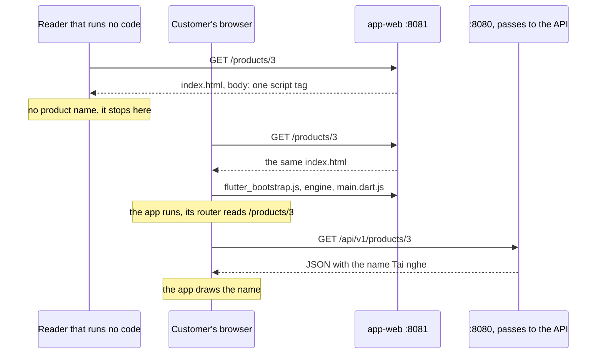

## Before you start

- [[frontend.l4.client-technology-drivers]] — you know ADR `0017` keeps one Flutter code base and lists pages that do not suit search engines as one of its costs.
- [[frontend.l2.deep-links]] — you know `/products/3` opens the product screen from its address alone, because app-web answers plain paths with `index.html`.
- [[frontend.l1.html-css-js-roles]] — you know HTML carries a page's content and JavaScript is the part that changes a page after it has loaded.

## The situation

A shop owner writes to the team: people who search the web for the shop's headphones never land on its Đơn Hàng page, yet the page works on every phone. You open `http://localhost:8081/products/3` and the screen shows the product's name, `Tai nghe`.

Then you open the browser's page source, the HTML the server sent, and search it for `Tai nghe`. Nothing. No name, only a comment and a script tag. The screen and the HTML disagree. Where does the product name come from, and what does a reader that takes only the HTML get?

## Core concepts

- the HTML the server sends — the response body for a page's address; every reader gets it first, before any code runs, and the browser's page source shows it.
- the app's start page — DonHang.App's `index.html`, which app-web sends for every path that is not a real file; its body only loads the app.
- a reader that runs no code — any program that reads the HTML and stops there, running none of the code the page loads, such as `curl`, this lesson's script or the page source view.
- **server-side rendering (SSR)** — the server builds, for each request, HTML that already contains the page's text, so a reader gets that text without running any code; here rendering means building the HTML, not drawing pixels.
- a hand-written HTML page — a file such as `www/index.html` whose text is typed into the file, so every reader gets the text too, as long as nobody needs it to change per request.

## How it works



In the situation above, two readers ask app-web for `/products/3`. app-web has no file at that path, so its `index.html` fallback (the `try_files` line in its config file, `deploy/app-web/Caddyfile`) answers with the app's start page. Both readers get the same HTML, and its body holds one script tag, for `flutter_bootstrap.js`.

A reader that runs no code stops at that point. `curl`, the page source view and the lesson's script all read this HTML and find no product. To index a page, a search engine records which words it contains, so people can find the page by those words. If a search engine takes only this HTML, it records no product name for `/products/3`.

The customer's browser goes on. It runs the script, downloads Flutter's engine and `main.dart.js` (the app's own code, compiled to JavaScript), and starts the app. The app's router reads `/products/3` from the address bar, and the product screen asks `:8080` for `/api/v1/products/3`; the server there passes the request to the API. Only when the JSON arrives does the app draw `Tai nghe`. The name was never in the HTML; it came from the API, through code the browser ran.

Server-side rendering turns this around. The server reads the product before it answers, and the HTML it sends already says `Tai nghe`. Every reader gets the name in the first response, whether or not it runs code. The hand-written `www/index.html` on `:8080` gets the same result a simpler way: its text is typed into the file.

Flutter's own docs say Flutter web's output does not align with what search engines need to index. For static, document-like content, one of the options they recommend is HTML, kept apart from the Flutter app that holds the main experience. ADR `0017` follows that line.

## In the Đơn Hàng system

The script asks both servers the way a reader that runs no code would:

```bash file=scripts/frontend/what-the-server-sends.sh tag=stage-4 lines=6-29
# lesson: frontend.l4.pages-for-search
# The name of product 3 as the API gives it, then the page app-web answers
# for /products/3: the app's index.html, whose body only loads the app.
name=$(curl --silent --show-error --fail http://localhost:8080/api/v1/products/3 |
  sed -n 's/.*"name":"\([^"]*\)".*/\1/p')
echo "Product 3 in the API: $name"
echo
echo "GET http://localhost:8081/products/3, the <body> app-web sends:"
html=$(curl --silent --show-error --fail http://localhost:8081/products/3 | tr -d '\r')
sed -n '/<body>/,/<\/body>/p' <<< "$html"
echo
if grep -qF "$name" <<< "$html"; then
  echo "product name in the HTML: yes"
else
  echo "product name in the HTML: no"
fi

# lesson: frontend.l4.pages-for-search
# The hand-written page on :8080 for comparison: its text is in the HTML
# itself, before any script runs. Tags removed, one line of text each.
echo
echo "GET http://localhost:8080/, the text in its HTML:"
curl --silent --show-error --fail http://localhost:8080/ | tr -d '\r' |
  sed -n '/<body>/,/<\/body>/p' | sed 's/<[^>]*>//g; s/^ *//' | grep -v '^$'
```

```text output=true
Product 3 in the API: Tai nghe

GET http://localhost:8081/products/3, the <body> app-web sends:
<body>
...
  <script src="flutter_bootstrap.js" async></script>
</body>

product name in the HTML: no

GET http://localhost:8080/, the text in its HTML:
Đơn Hàng
Trang tĩnh của phòng lab stage-0.
Đăng nhập
Trang có cache
Chuyển hướng
```

The first part takes the name from the API, then searches app-web's answer for that exact text. The `...` stands for a comment Flutter wrote into `index.html` when the project was created; after it, the body holds only the script tag. The verdict line is the whole lesson in one word: `no`.

The second part reads the hand-written page on `:8080`. With the tags stripped, its text is all there, because nothing has to run to produce it.

What ADR `0017` decides about pages for search:

```markdown file=docs/adr/0017-giu-mot-ma-flutter-cho-moi-nen-tang.md tag=stage-4 lines=51-55
- Output của Flutter web không hợp với việc máy tìm kiếm lập chỉ mục: HTML mà
  `app-web` trả cho một trang sản phẩm không chứa tên sản phẩm
  (`scripts/frontend/what-the-server-sends.sh`). Nếu cửa hàng cần trang sản
  phẩm công khai cho máy tìm kiếm, các trang đó làm bằng HTML dựng từ server,
  tách khỏi app, và được quyết trong một ADR riêng. Đặt hàng vẫn ở trong app.
```

The consequence repeats Flutter's docs and points to the script above as evidence. It then splits the problem: if shops need public product pages for search engines, those pages are HTML built on the server, apart from the app, and get an ADR of their own. Ordering stays in the Flutter app. ADR `0017` does not build those pages; it only says which technology they would use.

## Trade-offs

| Option for a public product page | Product name in the HTML sent | Kept in step with product data by | Ordering and offline queue | Cost |
|---|---|---|---|---|
| The Flutter app's page (now) | no; it appears after the app runs | the app, which reads the API | in the same app | nothing extra; does not suit search engines |
| Hand-written HTML file per product | yes | a person, each time a product changes, in 1,000 shops | elsewhere, in the app | grows with every product and every shop |
| HTML built on the server per request (SSR) | yes | the server, reading the same data the API serves | elsewhere, in the app | a second way to show a product, built and run apart from the app; its own ADR |

No row wins every column. The app's page costs nothing until search matters. A hand-written file suits text that rarely changes, such as the lab page on `:8080`, and fails for a catalogue that changes daily. Server-built pages give every reader the name, and the price is a second piece of software that shows products.

## What would you choose if…

…customers only reach a shop's products through links the shop sends them in chat? Nobody searches, so the cost in the ADR never bites. Keep the app's page and build nothing.

…many shops ask for product pages that search engines can index? Write the separate ADR that `0017` promises. Weigh server-built product pages, apart from the app, with each page linking to the app's address for that product so the customer orders there as a deep link.

…a shop wants a help page with its opening hours and return rules? That text is static and document-like, a case where Flutter's docs list HTML as an option. A hand-written page, served like `www/index.html`, is enough.

## Seniors often assume…

- **"A search engine sees a Flutter web page the same way a customer does."** → Actually every reader first gets the same `index.html`, which holds no product. The customer sees `Tai nghe` only because the browser runs the app's code and the app calls the API. Flutter's docs say the result does not align with what search engines need to index. You notice this when a shop reports that its products never appear in search results, while the same pages look fine on every phone.
- **"If the product name is on the screen, it was in the HTML the server sent."** → Actually the screen shows what the app drew after it ran, and the HTML only loads the app. You notice this when `curl` or the browser's page source for `/products/3` shows a script tag and no product, as `what-the-server-sends.sh` reports.
- **"Every page of the system has to be built with the same technology."** → Actually ADR `0017` splits by purpose: ordering stays in the Flutter app, and public pages for search would be HTML built on the server, under a separate ADR. Flutter's docs suggest a similar split for landing, marketing and help content. You notice this when a proposal to rewrite the whole app gives search as its only reason.

## Try it (3 minutes)

1. With the Đơn Hàng system running (`scripts/up.sh`), open `http://localhost:8081/products/3` in a browser and wait for the product screen.
2. Open the browser's page source and search it for `Tai nghe`.

Expected result: the screen shows `Tai nghe`, the page source finds no match, and its `<body>` holds only a comment and the `flutter_bootstrap.js` script tag.

## Connections

- [[frontend.l4.client-technology-drivers]] — this lesson opens up the second cost that ADR `0017` accepted there.
- [[frontend.l2.deep-links]] — the same `index.html` fallback that lets `/products/3` open the right screen is why every product address sends the same HTML.
- [[frontend.l1.the-dom]] — the same idea at page scale: code changes the page after load, and here code builds the whole page.
- [[frontend.l3.web-bundle-size]] — the other cost on the browser side: what the browser downloads before the app can draw anything.
- [[frontend.l1.html-css-js-roles]] — the hand-written page this lesson compares against, where HTML alone carries the text.

## Five-line summary

1. A Flutter web page's HTML holds no product text; the text appears only after the browser runs the app and the app calls the API.
2. For `/products/3`, app-web sends `index.html`, whose body only loads the app, so a reader that runs no code finds no product.
3. Server-side rendering builds HTML with the page's text for each request; a hand-written file such as `www/index.html` carries its text directly.
4. Flutter's docs say its web output does not align with what search engines need to index, and list HTML as one option for document pages.
5. ADR `0017` keeps ordering in the Flutter app and leaves public product pages to server-built HTML, decided in a separate ADR.
