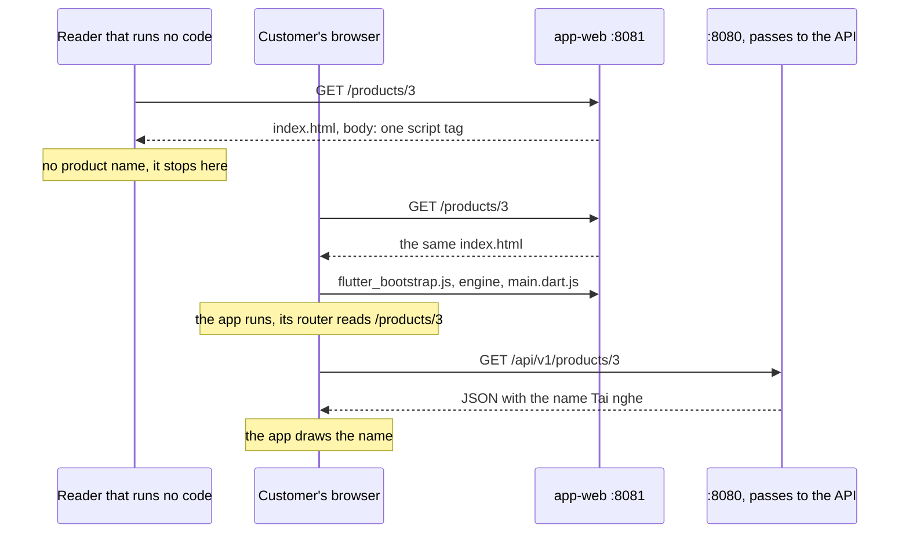

## Bạn cần biết trước

- [[frontend.l4.client-technology-drivers]] — bạn biết ADR `0017` giữ một mã nguồn Flutter và ghi các trang không hợp với máy tìm kiếm là một trong những chi phí của nó.
- [[frontend.l2.deep-links]] — bạn biết `/products/3` mở được màn hình sản phẩm chỉ từ địa chỉ, vì app-web trả `index.html` cho các đường dẫn thường.
- [[frontend.l1.html-css-js-roles]] — bạn biết HTML mang nội dung của trang, còn JavaScript là phần thay đổi trang sau khi trang đã tải xong.

## Tình huống

Một chủ cửa hàng nhắn cho team: người ta tìm tai nghe của cửa hàng trên web mà không bao giờ tới được trang Đơn Hàng của cửa hàng, dù trang chạy tốt trên mọi điện thoại. Bạn mở `http://localhost:8081/products/3` và màn hình hiện tên sản phẩm, `Tai nghe`.

Rồi bạn mở mã nguồn trang trong trình duyệt, tức HTML mà server gửi về, và tìm `Tai nghe` trong đó. Không có. Không có tên, chỉ có một comment và một thẻ script. Màn hình và HTML nói hai điều khác nhau. Tên sản phẩm từ đâu ra, và một bên đọc chỉ lấy HTML thì nhận được gì?

## Khái niệm cốt lõi

- HTML server gửi về — body của response cho địa chỉ của một trang. Bên đọc nào cũng nhận nó trước tiên, trước khi bất kỳ code nào chạy, và mã nguồn trang trong trình duyệt hiện đúng nó.
- trang khởi động của app — `index.html` của DonHang.App, file mà app-web gửi cho mọi đường dẫn không phải file có thật. Body của nó chỉ tải app.
- bên đọc không chạy code — chương trình nào đọc HTML rồi dừng ở đó, không chạy chút code nào mà trang tải, chẳng hạn `curl`, script của bài này hay chế độ xem mã nguồn trang.
- **server-side rendering (SSR)** (server dựng cho mỗi request một trang HTML đã chứa sẵn nội dung, đọc được mà không cần chạy code) — với mỗi request, server dựng HTML đã có sẵn chữ của trang, nên bên đọc nhận được chữ đó mà không phải chạy code nào. "Rendering" ở đây là dựng HTML, không phải vẽ pixel.
- trang HTML viết tay — một file như `www/index.html` mà chữ được gõ thẳng vào file, nên bên đọc nào cũng nhận được chữ, miễn là không ai cần nó đổi theo từng request.

## Cơ chế hoạt động



Trong tình huống trên, hai bên đọc cùng hỏi app-web `/products/3`. app-web không có file nào ở đường dẫn đó, nên phần dự phòng `index.html` của nó (dòng `try_files` trong file cấu hình `deploy/app-web/Caddyfile`) trả về trang khởi động của app. Cả hai nhận cùng một HTML, và body của nó chỉ có một thẻ script, cho `flutter_bootstrap.js`.

Bên đọc không chạy code dừng ở đây. `curl`, chế độ xem mã nguồn trang và script của bài đều đọc HTML này và không thấy sản phẩm nào. Để lập chỉ mục một trang, máy tìm kiếm ghi lại trang đó chứa những chữ nào, để người ta tìm thấy trang bằng các chữ ấy. Nếu máy tìm kiếm chỉ lấy HTML này, nó không ghi được tên sản phẩm nào cho `/products/3`.

Trình duyệt của khách thì đi tiếp. Nó chạy script, tải engine của Flutter và `main.dart.js` (code của chính app, đã biên dịch sang JavaScript), rồi khởi động app. Router của app đọc `/products/3` từ thanh địa chỉ, và màn hình sản phẩm hỏi `:8080` lấy `/api/v1/products/3`. Server ở đó chuyển request sang API. Chỉ khi JSON về tới, app mới vẽ `Tai nghe`. Cái tên chưa bao giờ nằm trong HTML. Nó đến từ API, qua code mà trình duyệt chạy.

Server-side rendering đảo ngược chuyện này. Server đọc sản phẩm trước khi trả lời, và HTML gửi đi đã ghi sẵn `Tai nghe`. Bên đọc nào cũng nhận được tên ngay trong response đầu tiên, dù có chạy code hay không. Trang viết tay `www/index.html` trên `:8080` đạt cùng kết quả theo cách đơn giản hơn: chữ được gõ sẵn trong file.

Chính tài liệu của Flutter nói output của Flutter web không hợp với những gì máy tìm kiếm cần để lập chỉ mục. Với nội dung tĩnh, dạng tài liệu, một trong các lựa chọn họ khuyên là HTML, tách khỏi app Flutter, nơi giữ trải nghiệm chính. ADR `0017` đi theo hướng đó.

## Trong hệ thống Đơn Hàng

Script hỏi cả hai server theo đúng cách một bên đọc không chạy code sẽ hỏi:

```bash file=scripts/frontend/what-the-server-sends.sh tag=stage-4 lines=6-29
# lesson: frontend.l4.pages-for-search
# The name of product 3 as the API gives it, then the page app-web answers
# for /products/3: the app's index.html, whose body only loads the app.
name=$(curl --silent --show-error --fail http://localhost:8080/api/v1/products/3 |
  sed -n 's/.*"name":"\([^"]*\)".*/\1/p')
echo "Product 3 in the API: $name"
echo
echo "GET http://localhost:8081/products/3, the <body> app-web sends:"
html=$(curl --silent --show-error --fail http://localhost:8081/products/3 | tr -d '\r')
sed -n '/<body>/,/<\/body>/p' <<< "$html"
echo
if grep -qF "$name" <<< "$html"; then
  echo "product name in the HTML: yes"
else
  echo "product name in the HTML: no"
fi

# lesson: frontend.l4.pages-for-search
# The hand-written page on :8080 for comparison: its text is in the HTML
# itself, before any script runs. Tags removed, one line of text each.
echo
echo "GET http://localhost:8080/, the text in its HTML:"
curl --silent --show-error --fail http://localhost:8080/ | tr -d '\r' |
  sed -n '/<body>/,/<\/body>/p' | sed 's/<[^>]*>//g; s/^ *//' | grep -v '^$'
```

```text output=true
Product 3 in the API: Tai nghe

GET http://localhost:8081/products/3, the <body> app-web sends:
<body>
...
  <script src="flutter_bootstrap.js" async></script>
</body>

product name in the HTML: no

GET http://localhost:8080/, the text in its HTML:
Đơn Hàng
Trang tĩnh của phòng lab stage-0.
Đăng nhập
Trang có cache
Chuyển hướng
```

Phần đầu lấy tên từ API, rồi tìm đúng chuỗi đó trong câu trả lời của app-web. Dấu `...` thay cho một comment mà Flutter ghi vào `index.html` lúc tạo project. Sau comment đó, body chỉ còn thẻ script. Dòng kết luận gói cả bài trong một chữ: `no`.

Phần thứ hai đọc trang viết tay trên `:8080`. Bỏ hết thẻ đi, chữ của nó vẫn còn đủ, vì không cần chạy gì để có chúng.

ADR `0017` quyết định gì về các trang cho máy tìm kiếm:

```markdown file=docs/adr/0017-giu-mot-ma-flutter-cho-moi-nen-tang.md tag=stage-4 lines=51-55
- Output của Flutter web không hợp với việc máy tìm kiếm lập chỉ mục: HTML mà
  `app-web` trả cho một trang sản phẩm không chứa tên sản phẩm
  (`scripts/frontend/what-the-server-sends.sh`). Nếu cửa hàng cần trang sản
  phẩm công khai cho máy tìm kiếm, các trang đó làm bằng HTML dựng từ server,
  tách khỏi app, và được quyết trong một ADR riêng. Đặt hàng vẫn ở trong app.
```

Hệ quả này nhắc lại tài liệu của Flutter và dẫn script ở trên làm bằng chứng. Sau đó nó tách bài toán: nếu cửa hàng cần trang sản phẩm công khai cho máy tìm kiếm, các trang đó là HTML dựng trên server, tách khỏi app, và có ADR riêng. Đặt hàng vẫn ở trong app Flutter. ADR `0017` không làm các trang đó, nó chỉ nói chúng sẽ dùng công nghệ nào.

## Đánh đổi

| Phương án cho trang sản phẩm công khai | Tên sản phẩm trong HTML gửi đi | Ai giữ trang khớp với dữ liệu sản phẩm | Đặt hàng và hàng đợi offline | Chi phí |
|---|---|---|---|---|
| Trang của app Flutter (hiện tại) | không, chỉ hiện sau khi app chạy | app, vốn đọc từ API | ngay trong app đó | không tốn thêm gì, nhưng không hợp với máy tìm kiếm |
| Mỗi sản phẩm một file HTML viết tay | có | một người, mỗi lần sản phẩm đổi, ở 1.000 cửa hàng | ở chỗ khác, trong app | tăng theo từng sản phẩm và từng cửa hàng |
| HTML dựng trên server cho mỗi request (SSR) | có | server, đọc cùng dữ liệu mà API trả | ở chỗ khác, trong app | thêm cách thứ hai để hiện sản phẩm, build và chạy tách khỏi app, kèm ADR riêng |

Không hàng nào thắng ở mọi cột. Trang của app không tốn gì cho tới khi tìm kiếm trở nên quan trọng. File viết tay hợp với chữ ít khi đổi, như trang lab trên `:8080`, và hỏng với một danh mục sản phẩm đổi mỗi ngày. Trang dựng trên server cho mọi bên đọc thấy tên, và cái giá là thêm một phần mềm thứ hai hiển thị sản phẩm.

## Bạn sẽ chọn gì nếu…

…khách chỉ tới sản phẩm của cửa hàng qua link mà cửa hàng gửi trong chat? Không ai tìm kiếm, nên chi phí ghi trong ADR không bao giờ thành vấn đề. Giữ trang của app và không làm gì thêm.

…nhiều cửa hàng đòi trang sản phẩm mà máy tìm kiếm lập chỉ mục được? Viết ADR riêng mà `0017` đã hứa. Cân nhắc trang sản phẩm dựng trên server, tách khỏi app, mỗi trang có link tới địa chỉ của sản phẩm đó trong app, để khách đặt hàng ở đó qua deep link.

…một cửa hàng muốn trang trợ giúp ghi giờ mở cửa và quy định đổi trả? Chữ đó tĩnh và mang dạng tài liệu, đúng trường hợp tài liệu của Flutter liệt kê HTML là một lựa chọn. Một trang viết tay, phục vụ giống `www/index.html`, là đủ.

## Senior hay nhầm rằng…

- **"Máy tìm kiếm thấy trang Flutter web giống hệt như khách thấy."** → Thực ra bên đọc nào cũng nhận trước tiên cùng một `index.html`, không chứa sản phẩm nào. Khách thấy `Tai nghe` chỉ vì trình duyệt chạy code của app và app gọi API. Tài liệu của Flutter nói kết quả đó không hợp với những gì máy tìm kiếm cần để lập chỉ mục. Bạn sẽ nhận ra khi một cửa hàng báo sản phẩm của họ không bao giờ hiện trong kết quả tìm kiếm, trong khi cùng các trang đó vẫn hiện tốt trên mọi điện thoại.
- **"Tên sản phẩm có trên màn hình thì nó đã có trong HTML server gửi về."** → Thực ra màn hình hiện những gì app vẽ sau khi chạy, còn HTML chỉ tải app. Bạn sẽ nhận ra khi `curl` hay mã nguồn trang của `/products/3` trong trình duyệt chỉ có một thẻ script mà không có sản phẩm nào, đúng như `what-the-server-sends.sh` báo.
- **"Mọi trang của hệ thống phải làm bằng cùng một công nghệ."** → Thực ra ADR `0017` tách theo mục đích: đặt hàng ở lại trong app Flutter, còn các trang công khai cho máy tìm kiếm sẽ là HTML dựng trên server, theo một ADR riêng. Tài liệu của Flutter gợi ý cách tách tương tự cho nội dung trang giới thiệu, tiếp thị và trợ giúp. Bạn sẽ nhận ra khi một đề xuất viết lại toàn bộ app chỉ đưa ra đúng một lý do là tìm kiếm.

## Thử ngay (3 phút)

1. Khi hệ thống Đơn Hàng đang chạy (`scripts/up.sh`), mở `http://localhost:8081/products/3` trong trình duyệt và chờ màn hình sản phẩm hiện ra.
2. Mở mã nguồn trang trong trình duyệt và tìm `Tai nghe`.

Kết quả mong đợi: màn hình hiện `Tai nghe`, mã nguồn trang không tìm thấy kết quả nào, và `<body>` của nó chỉ có một comment cùng thẻ script `flutter_bootstrap.js`.

## Liên hệ

- [[frontend.l4.client-technology-drivers]] — bài này mở rộng chi phí thứ hai mà ADR `0017` đã chấp nhận ở đó.
- [[frontend.l2.deep-links]] — chính phần dự phòng `index.html` giúp `/products/3` mở đúng màn hình cũng là lý do mọi địa chỉ sản phẩm nhận cùng một HTML.
- [[frontend.l1.the-dom]] — cùng ý tưởng ở quy mô cả trang: code thay đổi trang sau khi tải, và ở đây code dựng nên toàn bộ trang.
- [[frontend.l3.web-bundle-size]] — chi phí còn lại phía trình duyệt: những gì trình duyệt phải tải trước khi app vẽ được bất cứ thứ gì.
- [[frontend.l1.html-css-js-roles]] — trang viết tay mà bài này đem ra so, nơi chỉ HTML thôi đã mang đủ chữ.

## Tóm tắt 5 dòng

1. HTML của một trang Flutter web không chứa chữ nào về sản phẩm, chữ chỉ hiện sau khi trình duyệt chạy app và app gọi API.
2. Với `/products/3`, app-web gửi `index.html`, body chỉ để tải app, nên bên đọc không chạy code không thấy sản phẩm nào.
3. Server-side rendering dựng cho mỗi request một HTML có sẵn chữ của trang, còn một file viết tay như `www/index.html` mang chữ trực tiếp.
4. Tài liệu của Flutter nói output web của nó không hợp với những gì máy tìm kiếm cần để lập chỉ mục, và liệt kê HTML là một lựa chọn cho trang dạng tài liệu.
5. ADR `0017` giữ phần đặt hàng trong app Flutter và để trang sản phẩm công khai cho HTML dựng trên server, quyết trong một ADR riêng.
