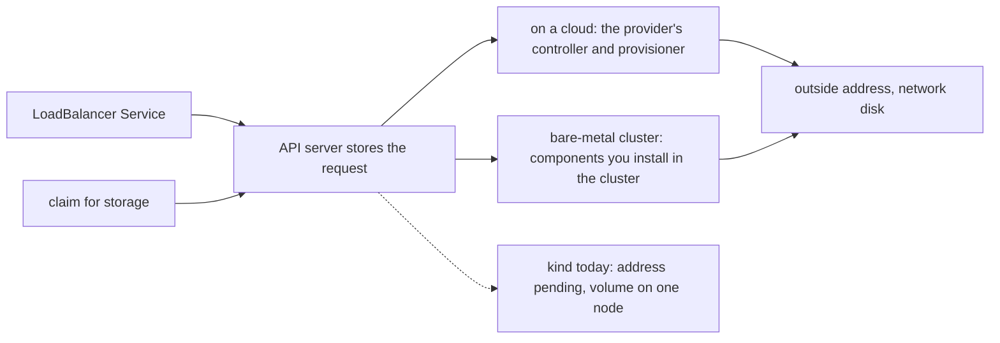

## Before you start

- [[k8s.l3.service-types]] — a LoadBalancer Service asks a controller for an outside address, and on kind nothing answers, so `EXTERNAL-IP` stays `<pending>`.
- [[k8s.l2.storage-classes]] — kind's default StorageClass, `standard`, creates each volume as a folder on one node, and only Pods on that node can use it.
- [[k8s.l3.cni-plugins]] — kind's nodes are Docker containers on one Docker network, and plain routes between their addresses carry Pod traffic.

## The situation

A large customer asks whether Đơn Hàng could run on machines in its own server room, with no cloud anywhere. You think back to `donhang`: in `service-types.sh`, `echo-loadbalancer` asked for an outside address and still showed `<pending>` ten seconds later. In `storage-class.sh`, the claim `data` got a volume that lives in a folder on one worker, and a new Pod using it, `writer`, stayed `Pending` while that worker took no new Pods. Both manifests were valid, and the API server accepted both. The part that turns each request into something real was missing or tied to one node. Who does that part on a cloud, and who does it when the machines are your own?

## Core concepts

- Request object — here, an object that asks for something outside itself: a LoadBalancer Service asks for an outside address, a claim asks for storage.
- Network disk — storage that lives outside every node and is reached over the network, so it can be attached to the node a Pod moves to.
- **bare-metal cluster** — a Kubernetes cluster on machines you run yourself, physical or virtual, with no cloud provider's components handing out outside addresses or network disks.
- The `kind` network — the Docker network named `kind` that kind attaches every node container to unless told otherwise.

## How it works



In the situation above, both manifests are request objects. The API server stores each one and leaves fulfilling it to another component that watches for it. For a LoadBalancer Service that component is a controller, a control loop that watches one kind of object; for a claim it is the provisioner its StorageClass names. On a cloud, the provider supplies both.

Its controller sees `echo-loadbalancer`, sets up a load balancer outside the cluster (something with an outside address that forwards connections into the cluster) and writes that address into the Service's status, the part that reports what exists, shown as `EXTERNAL-IP`. Its provisioner, usually named by the default StorageClass a cloud cluster comes with, creates a network disk for the claim. When the Pod moves to another node, the disk can be attached there, within limits the provider sets, such as staying in one zone.

A bare-metal cluster accepts the same manifests, but no provider supplies those components. Until you install components inside the cluster that do each job, a LoadBalancer Service waits at `<pending>`, and a claim gets only what the StorageClasses already in the cluster can do, if there are any.

kind shows both gaps, the dashed arrow in the diagram: the request is stored but nothing fully answers it. Nothing gives `echo-loadbalancer` an address. The `standard` class keeps each volume on the node where it was created.

Every node container gets an address on the `kind` network, `172.22.0.x` in the captured runs; it stands in for a server room's network in this module.

Whatever you install in a bare-metal cluster takes over part of what the provider ran for you. Its upgrades, its failures and its capacity, such as how many addresses it can give, become your team's to run.

## In the Đơn Hàng system

```yaml file=deploy/k8s/kind-config.yaml tag=stage-3 lines=1-14
# lesson: k8s.l1.cluster-nodes-and-control-plane
# The kind cluster scripts/k8s/cluster-up.sh creates: one control-plane node
# and two worker nodes. kind runs each node as a Docker container on this
# machine; every node runs the same node image, pinned by its digest to
# Kubernetes 1.34 (v1.34.11), the version this course teaches.
kind: Cluster
apiVersion: kind.x-k8s.io/v1alpha4
nodes:
  - role: control-plane
    image: kindest/node:v1.34.11@sha256:44e222ee2132dab25ff87301682f89eb82c7880ea3a1bf543bfe9708fd08d67d
  - role: worker
    image: kindest/node:v1.34.11@sha256:44e222ee2132dab25ff87301682f89eb82c7880ea3a1bf543bfe9708fd08d67d
  - role: worker
    image: kindest/node:v1.34.11@sha256:44e222ee2132dab25ff87301682f89eb82c7880ea3a1bf543bfe9708fd08d67d
```

This is the whole description of `donhang`: three machines, played by containers. Nothing in it names a network, so kind attaches all three node containers to the `kind` network. Nothing in it asks for outside addresses or for disks either. The cluster gets only what kind installs on its own, among it the CNI plugin kindnet and the `standard` StorageClass. A bare-metal cluster starts in the same place: machines, a network between them, and Kubernetes, with nothing that hands out addresses or disks beyond the nodes.

```yaml file=deploy/k8s/lessons/echo-loadbalancer.yaml tag=stage-3 lines=1-17
# lesson: k8s.l3.service-types
# The same Pods behind a LoadBalancer Service. It is a NodePort Service that
# also asks for an outside address; without a controller to hand one out,
# EXTERNAL-IP stays <pending>. No externalTrafficPolicy is given, so it is
# Cluster.
apiVersion: v1
kind: Service
metadata:
  name: echo-loadbalancer
  namespace: network-lessons
spec:
  type: LoadBalancer
  selector:
    app: echo-ip
  ports:
    - port: 80
      targetPort: 8080
```

`type: LoadBalancer` is the whole request. The manifest does not say who answers it, so the same file works on a cloud and on your own machines; only the component behind it differs. On a cloud the provider's controller answers. On `donhang`, nothing answers until the next lesson installs a component that does. The last two comment lines are about a setting a later lesson in this module explains.

## Seniors often assume…

- **"Kubernetes itself hands out outside addresses and network disks, and a cloud only supplies the machines."** → Actually Kubernetes stores the request and leaves it to a controller or provisioner, which on a cloud the provider supplies. You notice this when `echo-loadbalancer` stays `<pending>` on `donhang`, whose machines work fine.
- **"LoadBalancer Services cannot be used at all outside a cloud."** → Actually any component in the cluster that watches LoadBalancer Services and writes an address into their status can answer them. You notice this in the next lesson, when `echo-loadbalancer` gets an address from the `kind` network on `donhang` itself.
- **"A cluster that works on a cloud behaves the same when moved to a bank's own machines."** → Actually the manifests apply unchanged, but each request is only as good as the component behind it there. You notice this when Services wait at `<pending>`, or a database's claim gets a volume that stays on one node.

## Try it (3 minutes)

From the root of the Đơn Hàng repository, with Docker running and kind and `kubectl` installed on your machine:

1. Run `scripts/k8s/cluster-up.sh`. If the cluster `donhang` already exists, it says so.
2. Run `docker network inspect kind --format '{{range .Containers}}{{.Name}} {{end}}'`. It prints the name of every container attached to the `kind` network.
3. Run `kubectl get storageclass`.

Expected result: step 2 prints `donhang-control-plane`, `donhang-worker` and `donhang-worker2` in some order; other containers attached to the `kind` network, such as nodes of other kind clusters you have running, may appear too. Step 3 shows a line starting `standard (default)` with the provisioner `rancher.io/local-path`, the class that keeps each volume on one node. Neither output names any component for outside addresses; the only provisioner is `rancher.io/local-path`.

## Connections

- [[k8s.l3.metallb-address-pools]] — the fix for the first gap: a component inside `donhang` that hands out outside addresses from the `kind` network.
- [[k8s.l3.replicated-volumes]] — the answer to the second gap: storage that keeps copies of each volume on several nodes.
- [[k8s.l2.database-in-the-cluster]] — where the second gap costs most: a database in the cluster holds the only copy of its data on its volume.
- [[k8s.l1.cluster-nodes-and-control-plane]] — the same cluster seen from your machine: each node a Docker container, here all on one Docker network.

## Five-line summary

1. Kubernetes stores a request for an outside address or for storage; on a cloud, the provider's components fulfil it.
2. On a bare-metal cluster, until you install components, a LoadBalancer Service waits and a claim gets only what existing StorageClasses, if any, can do.
3. kind shows both gaps: `echo-loadbalancer` stays `<pending>`, and a `standard` volume stays on the node where it was created.
4. kind's node containers share the Docker network `kind`, which stands in for your own machines' network in this module.
5. Whatever replaces the cloud's part is your team's to run: its upgrades, its failures and its capacity.
