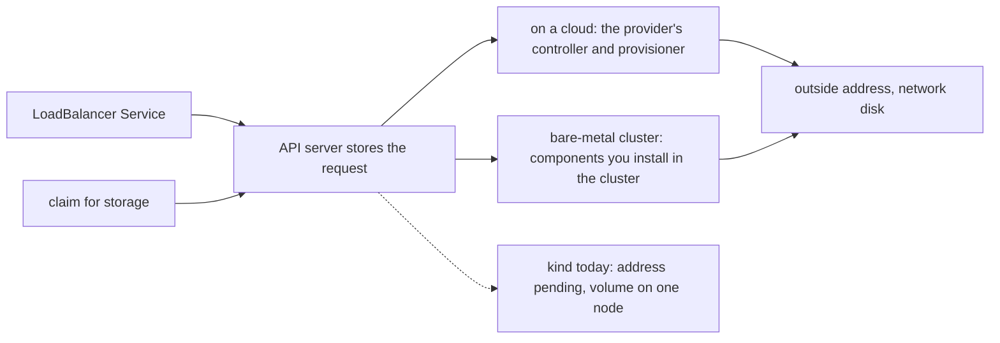

## Bạn cần biết trước

- [[k8s.l3.service-types]] — LoadBalancer Service xin một controller cấp địa chỉ ngoài. Trên kind không ai trả lời, nên `EXTERNAL-IP` cứ ở `<pending>`.
- [[k8s.l2.storage-classes]] — StorageClass mặc định của kind, `standard`, tạo mỗi volume thành một thư mục trên một node, và chỉ Pod trên node đó dùng được.
- [[k8s.l3.cni-plugins]] — các node của kind là container Docker trên cùng một Docker network, và các route thông thường giữa địa chỉ của chúng chở traffic của Pod.

## Tình huống

Một khách hàng lớn hỏi liệu Đơn Hàng có chạy được trên máy trong phòng server của chính họ, không dính tới cloud nào. Bạn nhớ lại `donhang`: trong `service-types.sh`, `echo-loadbalancer` xin một địa chỉ ngoài và mười giây sau vẫn hiện `<pending>`. Trong `storage-class.sh`, claim `data` nhận một volume nằm trong một thư mục trên một worker, và một Pod mới dùng nó, `writer`, cứ ở `Pending` khi worker đó không nhận Pod mới. Cả hai manifest đều hợp lệ, và API server nhận cả hai. Phần biến mỗi yêu cầu thành thứ có thật thì thiếu, hoặc bị gắn vào một node. Trên cloud ai làm phần đó, và khi máy là của bạn thì ai làm?

## Khái niệm cốt lõi

- Object yêu cầu — ở đây là object xin một thứ nằm ngoài chính nó: LoadBalancer Service xin địa chỉ ngoài, claim xin chỗ lưu trữ.
- Ổ đĩa mạng — chỗ lưu trữ nằm ngoài mọi node và được truy cập qua mạng, nên gắn được vào node mà Pod chuyển tới.
- **bare-metal cluster** (cluster chạy trên máy thật hoặc ảo do bạn tự vận hành, không có cloud cấp địa chỉ ngoài hay ổ đĩa mạng) — cluster Kubernetes trên các máy bạn tự vận hành, máy thật hay máy ảo, không có thành phần nào của nhà cung cấp cloud cấp địa chỉ ngoài hay ổ đĩa mạng.
- Mạng `kind` — Docker network tên `kind` mà kind gắn mọi container node vào, trừ khi được chỉ định khác.

## Cơ chế hoạt động



Trong tình huống trên, cả hai manifest đều là object yêu cầu. API server lưu từng object và để một thành phần khác, đang theo dõi object đó, đáp ứng nó. Với LoadBalancer Service, thành phần ấy là một controller, tức một vòng điều khiển theo dõi một loại object. Với claim, đó là provisioner mà StorageClass của claim chỉ định. Trên cloud, nhà cung cấp lo cả hai.

Controller của nhà cung cấp thấy `echo-loadbalancer`, dựng một load balancer bên ngoài cluster (thứ có địa chỉ ngoài và chuyển kết nối vào cluster), rồi ghi địa chỉ đó vào status của Service, phần báo lại những gì đang tồn tại, hiện ở cột `EXTERNAL-IP`. Provisioner của nhà cung cấp, thường được chỉ định bởi StorageClass mặc định đi kèm cluster trên cloud, tạo một ổ đĩa mạng cho claim. Khi Pod chuyển sang node khác, ổ đĩa có thể gắn vào node đó, trong giới hạn nhà cung cấp đặt ra, chẳng hạn phải ở cùng một zone.

Bare-metal cluster nhận đúng những manifest đó, nhưng không có nhà cung cấp nào lo các thành phần kia. Chừng nào bạn chưa cài vào cluster các thành phần làm từng việc, LoadBalancer Service còn chờ ở `<pending>`, và claim chỉ nhận được những gì các StorageClass sẵn có trong cluster làm được, nếu có StorageClass nào.

kind cho thấy cả hai chỗ hổng, chính là mũi tên nét đứt trong sơ đồ: yêu cầu được lưu nhưng không gì đáp ứng trọn vẹn. Không gì cấp địa chỉ cho `echo-loadbalancer`. Class `standard` giữ mỗi volume trên node nơi nó được tạo.

Mỗi container node nhận một địa chỉ trên mạng `kind`, là `172.22.0.x` trong các lần chạy đã ghi lại. Trong module này, mạng đó đóng vai mạng của một phòng server.

Bất cứ thứ gì bạn cài vào bare-metal cluster đều nhận lại một phần việc trước đây nhà cung cấp chạy giúp bạn. Nâng cấp, sự cố và sức chứa của nó, chẳng hạn cấp được bao nhiêu địa chỉ, trở thành việc team bạn phải vận hành.

## Trong hệ thống Đơn Hàng

```yaml file=deploy/k8s/kind-config.yaml tag=stage-3 lines=1-14
# lesson: k8s.l1.cluster-nodes-and-control-plane
# The kind cluster scripts/k8s/cluster-up.sh creates: one control-plane node
# and two worker nodes. kind runs each node as a Docker container on this
# machine; every node runs the same node image, pinned by its digest to
# Kubernetes 1.34 (v1.34.11), the version this course teaches.
kind: Cluster
apiVersion: kind.x-k8s.io/v1alpha4
nodes:
  - role: control-plane
    image: kindest/node:v1.34.11@sha256:44e222ee2132dab25ff87301682f89eb82c7880ea3a1bf543bfe9708fd08d67d
  - role: worker
    image: kindest/node:v1.34.11@sha256:44e222ee2132dab25ff87301682f89eb82c7880ea3a1bf543bfe9708fd08d67d
  - role: worker
    image: kindest/node:v1.34.11@sha256:44e222ee2132dab25ff87301682f89eb82c7880ea3a1bf543bfe9708fd08d67d
```

Đây là toàn bộ mô tả của `donhang`: ba máy, do container đóng vai. Không chỗ nào nhắc tới mạng, nên kind gắn cả ba container node vào mạng `kind`. Cũng không chỗ nào xin địa chỉ ngoài hay ổ đĩa. Cluster chỉ có những gì kind tự cài, trong đó có CNI plugin kindnet và StorageClass `standard`. Bare-metal cluster cũng bắt đầu từ đúng chỗ đó: các máy, một mạng nối chúng, và Kubernetes, không có gì cấp địa chỉ hay ổ đĩa ngoài phạm vi các node.

```yaml file=deploy/k8s/lessons/echo-loadbalancer.yaml tag=stage-3 lines=1-17
# lesson: k8s.l3.service-types
# The same Pods behind a LoadBalancer Service. It is a NodePort Service that
# also asks for an outside address; without a controller to hand one out,
# EXTERNAL-IP stays <pending>. No externalTrafficPolicy is given, so it is
# Cluster.
apiVersion: v1
kind: Service
metadata:
  name: echo-loadbalancer
  namespace: network-lessons
spec:
  type: LoadBalancer
  selector:
    app: echo-ip
  ports:
    - port: 80
      targetPort: 8080
```

`type: LoadBalancer` là toàn bộ yêu cầu. Manifest không nói ai trả lời nó, nên cùng một file chạy được trên cloud lẫn trên máy của bạn. Chỉ thành phần đứng sau là khác. Trên cloud, controller của nhà cung cấp trả lời. Trên `donhang`, không ai trả lời cho tới khi bài sau cài một thành phần làm việc đó. Hai dòng comment cuối nói về một thiết lập mà một bài sau trong module này giải thích.

## Senior hay nhầm rằng…

- **"Chính Kubernetes cấp địa chỉ ngoài và ổ đĩa mạng, cloud chỉ cung cấp máy."** → Thực ra Kubernetes lưu yêu cầu rồi để một controller hoặc provisioner xử lý, và trên cloud thì nhà cung cấp lo phần đó. Bạn sẽ nhận ra khi `echo-loadbalancer` cứ ở `<pending>` trên `donhang`, dù máy của nó chạy bình thường.
- **"Ngoài cloud thì hoàn toàn không dùng được LoadBalancer Service."** → Thực ra bất kỳ thành phần nào trong cluster theo dõi LoadBalancer Service và ghi địa chỉ vào status của chúng đều trả lời được. Bạn sẽ nhận ra ở bài sau, khi `echo-loadbalancer` nhận một địa chỉ từ mạng `kind` ngay trên `donhang`.
- **"Cluster chạy được trên cloud thì chuyển sang máy riêng của ngân hàng cũng chạy y như vậy."** → Thực ra manifest apply được nguyên vẹn, nhưng mỗi yêu cầu chỉ tốt bằng thành phần đứng sau nó ở nơi mới. Bạn sẽ nhận ra khi các Service chờ ở `<pending>`, hoặc claim của một database nhận volume chỉ nằm trên một node.

## Thử ngay (3 phút)

Ở thư mục gốc của repo Đơn Hàng, khi Docker đang chạy và máy bạn đã cài kind cùng `kubectl`:

1. Chạy `scripts/k8s/cluster-up.sh`. Nếu cluster `donhang` đã có, script sẽ báo vậy.
2. Chạy `docker network inspect kind --format '{{range .Containers}}{{.Name}} {{end}}'`. Lệnh in tên mọi container đang gắn vào mạng `kind`.
3. Chạy `kubectl get storageclass`.

Kết quả mong đợi: bước 2 in `donhang-control-plane`, `donhang-worker` và `donhang-worker2`, thứ tự bất kỳ. Các container khác gắn vào mạng `kind`, chẳng hạn node của những cluster kind khác bạn đang chạy, cũng có thể hiện ra. Bước 3 hiện một dòng bắt đầu bằng `standard (default)` với provisioner `rancher.io/local-path`, class giữ mỗi volume trên một node. Không output nào nhắc tới thành phần cấp địa chỉ ngoài, và provisioner duy nhất là `rancher.io/local-path`.

## Liên hệ

- [[k8s.l3.metallb-address-pools]] — cách lấp chỗ hổng thứ nhất: một thành phần bên trong `donhang` cấp địa chỉ ngoài lấy từ mạng `kind`.
- [[k8s.l3.replicated-volumes]] — lời đáp cho chỗ hổng thứ hai: chỗ lưu trữ giữ bản sao của mỗi volume trên nhiều node.
- [[k8s.l2.database-in-the-cluster]] — nơi chỗ hổng thứ hai đắt nhất: database trong cluster giữ bản dữ liệu duy nhất của nó trên volume.
- [[k8s.l1.cluster-nodes-and-control-plane]] — cùng cluster đó nhìn từ máy bạn: mỗi node là một container Docker, ở đây tất cả trên cùng một Docker network.

## Tóm tắt 5 dòng

1. Kubernetes lưu yêu cầu xin địa chỉ ngoài hay chỗ lưu trữ. Trên cloud, các thành phần của nhà cung cấp đáp ứng yêu cầu đó.
2. Trên bare-metal cluster, chừng nào bạn chưa cài thành phần, LoadBalancer Service còn chờ và claim chỉ nhận được những gì StorageClass sẵn có, nếu có, làm được.
3. kind cho thấy cả hai chỗ hổng: `echo-loadbalancer` cứ ở `<pending>`, còn volume `standard` nằm yên trên node nơi nó được tạo.
4. Các container node của kind dùng chung Docker network `kind`, mạng đóng vai mạng nối các máy của bạn trong module này.
5. Thứ gì thay phần việc của cloud thì team bạn phải vận hành nó: nâng cấp, sự cố và sức chứa của nó.
