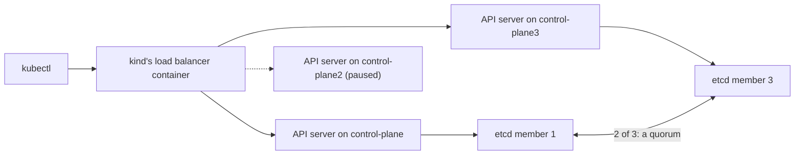

## Before you start

- [[k8s.l3.highly-available-entry-point]] — a part whose failure alone stops the system is a single point of failure; this lesson finds one in the control plane.
- [[k8s.l1.control-plane-components]] — the API server keeps every object in etcd, and the other components work only through the API server.
- [[k8s.l1.kubectl-and-the-api-server]] — every `kubectl` command is a request to the API server at the address your kubeconfig names.
- [[k8s.l3.service-types]] — a NodePort Service answers on every node; this lesson calls `echo-ip` that way while the control plane is stopped.

## The situation

The Ingress controller now survives the loss of any one worker of `donhang`. You show the customer the plan for their three machines, and they point at the node list: `donhang` has one control-plane node, `donhang-control-plane`. What if that machine stops?

You freeze it with `docker pause` and run `kubectl get nodes` with a ten-second timeout, and it fails. Yet `echo-ip` still answers on its node port. The applications kept running, but you can no longer change anything in the cluster. Adding control-plane nodes looks like the fix. How many does the control plane need, and how many of them can fail before it stops answering?

## Core concepts

- Highly available control plane — a control plane whose API server, etcd and other components run on several nodes, so that no one node is a single point of failure.
- etcd member — one running copy of etcd that holds all of the cluster's data; in `donhang-ha`, each control-plane node runs one member.
- **etcd quorum** — a majority of etcd's members, more than half of them; etcd accepts a change only once a quorum has it, so three members keep working with one stopped, and stop with two.
- API server address — the one address in the kubeconfig that clients call; with several API servers, it is a load balancer's address, and the load balancer passes each request to one of them.

## How it works



In the situation above, `donhang-control-plane` is a single point of failure. The API server, etcd and kube-scheduler run only there. While it is paused, the kubelets on the workers keep their containers running and the node port keeps forwarding, so `echo-ip` answers. But no request reaches an API server, so nothing can be read or changed.

A highly available control plane runs those components on several nodes. `kind-ha-config.yaml` asks kind for three control-plane nodes, the cluster `donhang-ha`, each with its own API server and etcd member. Clients still need one address, so kind adds a load balancer container in front of the three API servers and writes its address into the kubeconfig. On your own machines you provide that address; this lesson does not cover how.

The three members hold the same data, and etcd accepts a change only once a quorum has it. In the diagram `control-plane2` is paused; its etcd member, paused too, is left out, and the dashed arrow marks its silent API server. Two of three members remain, a majority, so etcd keeps answering. The load balancer passes requests to the other two API servers, and `kubectl get nodes` works.

Pause a second node and one member is left. One of three is no majority. A lone member cannot tell whether the others accepted newer changes, so it can neither commit a change nor confirm the latest data the API server needs. That API server's container still runs, yet `kubectl` requests time out or fail with an error.

A majority of four is three, so four members also survive only one failure, as three do. Five need three and survive two. This is why a control plane whose etcd members run on its own nodes uses an odd number of nodes.

## In the Đơn Hàng system

```yaml file=deploy/k8s/kind-ha-config.yaml tag=stage-3 lines=1-15
# lesson: k8s.l3.control-plane-ha
# The cluster donhang-ha that scripts/k8s/control-plane-ha.sh creates and
# deletes: three control-plane nodes, each running the API server, etcd,
# the scheduler and the controller manager, and no worker. With more than
# one control-plane node, kind also starts a load balancer container in
# front of the API servers. Same node image as kind-config.yaml.
kind: Cluster
apiVersion: kind.x-k8s.io/v1alpha4
nodes:
  - role: control-plane
    image: kindest/node:v1.34.11@sha256:44e222ee2132dab25ff87301682f89eb82c7880ea3a1bf543bfe9708fd08d67d
  - role: control-plane
    image: kindest/node:v1.34.11@sha256:44e222ee2132dab25ff87301682f89eb82c7880ea3a1bf543bfe9708fd08d67d
  - role: control-plane
    image: kindest/node:v1.34.11@sha256:44e222ee2132dab25ff87301682f89eb82c7880ea3a1bf543bfe9708fd08d67d
```

Three entries with `role: control-plane` and none with `role: worker`: that is the whole difference from the `donhang` cluster. The load balancer is not listed here; kind adds it by itself because there is more than one control-plane node. Every node uses the same image, pinned by digest, as `donhang`. The controller manager in the comment is one more control-plane component; this lesson does not need it.

```bash file=scripts/k8s/control-plane-ha.sh tag=stage-3 lines=59-83
echo "\$ docker pause donhang-ha-control-plane2"
docker pause donhang-ha-control-plane2 >/dev/null
paused+=(donhang-ha-control-plane2)
# The load balancer stops sending requests to the paused API server once
# its health checks fail, a few seconds later.
echo "\$ kubectl --kubeconfig $ha_config get nodes"
for try in $(seq 10); do
  if out=$(ha get nodes -o custom-columns=NAME:.metadata.name 2>/dev/null); then echo "$out"; break; fi
  [ "$try" = 10 ] && echo "failed"
  sleep 3
done
echo

# lesson: k8s.l3.control-plane-ha
# Two of three paused: one etcd member is no majority. Its API server still
# runs, but cannot read or write etcd, so every request fails.
echo "\$ docker pause donhang-ha-control-plane3"
docker pause donhang-ha-control-plane3 >/dev/null
paused+=(donhang-ha-control-plane3)
sleep 15
echo "\$ kubectl --kubeconfig $ha_config get nodes"
result=failed
for _ in 1 2 3; do ha get nodes >/dev/null 2>&1 && result=answered; done
echo "$result (three tries)"
echo "API server containers running on donhang-ha-control-plane: $(docker exec donhang-ha-control-plane crictl ps --name kube-apiserver --state running -q | wc -l)"
```

```text output=true
$ docker pause donhang-control-plane
$ kubectl get nodes --request-timeout=10s
failed
$ docker exec donhang-lb-client wget -qO- http://<donhang-worker's address>:<echo-nodeport's node port>
echo-ip-...-... saw 172.22.0.3
$ docker unpause donhang-control-plane

$ kind create cluster --name donhang-ha --config deploy/k8s/kind-ha-config.yaml --kubeconfig secrets/donhang-ha.kubeconfig
$ kubectl --kubeconfig secrets/donhang-ha.kubeconfig get nodes
NAME                        STATUS
donhang-ha-control-plane    Ready
donhang-ha-control-plane2   Ready
donhang-ha-control-plane3   Ready
$ docker ps --filter name=donhang-ha --format '{{.Names}}'
donhang-ha-control-plane
donhang-ha-control-plane2
donhang-ha-control-plane3
donhang-ha-external-load-balancer
the kubeconfig's API server: https://127.0.0.1:...

$ docker pause donhang-ha-control-plane2
$ kubectl --kubeconfig secrets/donhang-ha.kubeconfig get nodes
NAME
donhang-ha-control-plane
donhang-ha-control-plane2
donhang-ha-control-plane3

$ docker pause donhang-ha-control-plane3
$ kubectl --kubeconfig secrets/donhang-ha.kubeconfig get nodes
failed (three tries)
API server containers running on donhang-ha-control-plane: 1

$ kind delete cluster --name donhang-ha
Deleting cluster "donhang-ha" ...
```

`ha`, defined earlier in the script, runs `kubectl` with `donhang-ha`'s kubeconfig from `secrets/` and a 15-second request timeout. With one node paused, the script retries up to ten times, three seconds apart, because the first requests after a pause can fail; its comment gives the load balancer's health checks as the reason. The listing still shows `control-plane2`: its Node object is stored in etcd, which still has a quorum. With two paused, the script waits, tries three times and fails each time. `crictl ps`, a command inside a kind node that lists the containers the kubelet started there, then counts one running API server container in the last node.

Only the two pause steps come from the shown lines; the rest of the capture comes from other parts of the script. Its first lines run on `donhang`: with its only control-plane node paused, `kubectl` fails while `echo-ip` answers through `donhang-lb-client`, a container on kind's Docker network, calling the node port of the Service `echo-nodeport`. The kubeconfig's address is a port on your own machine that leads to the load balancer container; the capture masks the port number, which changes from run to run.

## Seniors often assume…

- **"The applications stop when the control plane goes down."** → Actually the kubelets keep the containers on their nodes running, and Services keep forwarding to them; what stops is every read and change through the API server. You notice this when `kubectl` times out while `echo-ip` still answers, as in the first lines of the capture.
- **"The control plane keeps working as long as any one API server is up."** → Actually every API server keeps its objects in etcd, and etcd answers only while a quorum of its members runs. You notice this at the end of `control-plane-ha.sh`: one API server container is running, and `kubectl get nodes` failed three times.
- **"Four control-plane nodes survive more failures than three."** → Actually four etcd members need three for a quorum, so they survive one failure, like three; the fourth only adds a machine that can fail. You notice this when you count the majority before buying a fourth machine: surviving two failures takes five members.

## Try it (3 minutes)

From the root of the Đơn Hàng repository, with Docker Desktop running, the `donhang` cluster from the earlier lessons running and enough Docker memory for three more kind nodes:

1. Run `scripts/k8s/control-plane-ha.sh`. It sets up `echo-ip`, MetalLB and `donhang-lb-client` first if they are missing.
2. Read the line after each `kubectl` command, then the last two lines before `kind delete cluster`.

Expected result: with `donhang-control-plane` paused, `kubectl` prints `failed` while `echo-ip` answers. `docker ps` lists three control-plane containers and `donhang-ha-external-load-balancer`. With one node paused, `get nodes` lists all three names; with two paused, it prints `failed (three tries)` and one running API server container. The script unpauses every node and deletes `donhang-ha` at the end, even when it stops early.

## Connections

- [[k8s.l3.highly-available-entry-point]] — the same question one level up, for the entry point that carries outside traffic.
- [[k8s.l1.cluster-nodes-and-control-plane]] — where `donhang`'s single control-plane node first appeared; this lesson removes that single point of failure.
- [[k8s.l3.metallb-layer2-mode]] — one address that moves between nodes for a Service; the API servers need their own address in front of them, which on your own machines you provide.
- [[k8s.l3.kubeadm]] — the next module reads how the control plane on each such node is built.
- [[k8s.l3.etcd-snapshots]] — what a quorum does not protect: every member holds the same data, so losing the data itself needs a saved copy.

## Five-line summary

1. A highly available control plane keeps accepting changes only while a majority of its etcd members, a quorum, is running.
2. With its only control-plane node down, a cluster keeps running its Pods, but no `kubectl` request succeeds and nothing changes.
3. kind builds `donhang-ha` from three control-plane nodes and puts a load balancer container in front of their API servers.
4. Three members survive one stopped node; with two stopped, the remaining API server runs but every request fails.
5. Four members need three for a quorum and survive only one failure, so control planes with one member per node use odd numbers.
