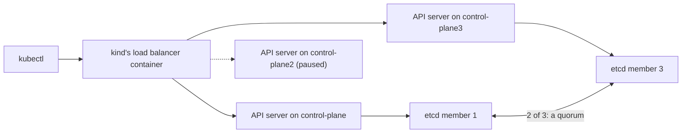

## Bạn cần biết trước

- [[k8s.l3.highly-available-entry-point]] — thành phần mà chỉ riêng nó hỏng cũng làm cả hệ thống ngừng là điểm lỗi duy nhất. Bài này tìm ra một điểm như thế trong control plane.
- [[k8s.l1.control-plane-components]] — API server lưu mọi object trong etcd, và các thành phần khác chỉ làm việc thông qua API server.
- [[k8s.l1.kubectl-and-the-api-server]] — mỗi lệnh `kubectl` là một request tới API server, ở địa chỉ mà kubeconfig ghi.
- [[k8s.l3.service-types]] — NodePort Service trả lời trên mọi node. Bài này gọi `echo-ip` theo cách đó trong lúc control plane bị dừng.

## Tình huống

Ingress controller giờ đã sống qua việc mất bất kỳ một worker nào của `donhang`. Bạn trình bày với khách hàng kế hoạch cho ba máy của họ, và họ chỉ vào danh sách node: `donhang` chỉ có một node control plane, `donhang-control-plane`. Nếu máy đó dừng thì sao?

Bạn đóng băng nó bằng `docker pause` rồi chạy `kubectl get nodes` với thời gian chờ mười giây, và lệnh thất bại. Thế nhưng `echo-ip` vẫn trả lời trên node port của nó. Ứng dụng vẫn chạy, nhưng bạn không còn thay đổi được gì trong cluster. Thêm node control plane có vẻ là cách sửa. Control plane cần bao nhiêu node, và bao nhiêu node trong số đó được phép hỏng trước khi nó ngừng trả lời?

## Khái niệm cốt lõi

- Control plane có tính sẵn sàng cao — control plane có API server, etcd và các thành phần khác chạy trên nhiều node, để không node nào là điểm lỗi duy nhất.
- etcd member — một bản etcd đang chạy, giữ toàn bộ dữ liệu của cluster. Trong `donhang-ha`, mỗi node control plane chạy một member.
- **etcd quorum** (Quá nửa số member etcd; chỉ khi đủ quorum etcd mới nhận thay đổi, nên 3 member chịu được 1 member hỏng) — đa số member của etcd, tức hơn một nửa. etcd chỉ nhận một thay đổi khi quorum đã có nó, nên ba member vẫn chạy khi dừng một, và ngừng khi dừng hai.
- Địa chỉ API server — địa chỉ duy nhất trong kubeconfig mà client gọi tới. Khi có nhiều API server, đó là địa chỉ của một load balancer, và load balancer chuyển mỗi request tới một trong số chúng.

## Cơ chế hoạt động



Trong tình huống trên, `donhang-control-plane` là điểm lỗi duy nhất. API server, etcd và kube-scheduler chỉ chạy ở đó. Khi node này bị pause, kubelet trên các worker vẫn giữ container chạy và node port vẫn chuyển tiếp, nên `echo-ip` trả lời. Nhưng không request nào tới được API server, nên không đọc hay thay đổi được gì.

Control plane có tính sẵn sàng cao chạy các thành phần đó trên nhiều node. `kind-ha-config.yaml` yêu cầu kind tạo ba node control plane, thành cluster `donhang-ha`, mỗi node có API server và etcd member riêng. Client vẫn cần một địa chỉ, nên kind thêm một container load balancer đứng trước ba API server và ghi địa chỉ của nó vào kubeconfig. Trên máy của riêng bạn, bạn tự cung cấp địa chỉ đó. Bài này không bàn cách làm.

Ba member giữ cùng một dữ liệu, và etcd chỉ nhận một thay đổi khi quorum đã có nó. Trong sơ đồ, `control-plane2` bị pause. etcd member của nó cũng bị pause nên đứng ngoài, còn mũi tên nét đứt chỉ API server im lặng của nó. Còn lại hai trên ba member, là đa số, nên etcd vẫn trả lời. Load balancer chuyển request tới hai API server còn lại, và `kubectl get nodes` chạy được.

Pause thêm node thứ hai thì chỉ còn một member. Một trên ba không phải đa số. Một member đơn lẻ không biết các member khác đã nhận thay đổi mới hơn hay chưa, nên nó không commit được thay đổi nào, cũng không xác nhận được dữ liệu mới nhất mà API server cần. Container API server đó vẫn chạy, nhưng request của `kubectl` hết thời gian chờ hoặc thất bại với một lỗi.

Đa số của bốn là ba, nên bốn member cũng chỉ chịu được một node hỏng, giống ba member. Năm member cần ba và chịu được hai. Đó là lý do control plane đặt etcd member trên chính các node của nó thì dùng số node lẻ.

## Trong hệ thống Đơn Hàng

```yaml file=deploy/k8s/kind-ha-config.yaml tag=stage-3 lines=1-15
# lesson: k8s.l3.control-plane-ha
# The cluster donhang-ha that scripts/k8s/control-plane-ha.sh creates and
# deletes: three control-plane nodes, each running the API server, etcd,
# the scheduler and the controller manager, and no worker. With more than
# one control-plane node, kind also starts a load balancer container in
# front of the API servers. Same node image as kind-config.yaml.
kind: Cluster
apiVersion: kind.x-k8s.io/v1alpha4
nodes:
  - role: control-plane
    image: kindest/node:v1.34.11@sha256:44e222ee2132dab25ff87301682f89eb82c7880ea3a1bf543bfe9708fd08d67d
  - role: control-plane
    image: kindest/node:v1.34.11@sha256:44e222ee2132dab25ff87301682f89eb82c7880ea3a1bf543bfe9708fd08d67d
  - role: control-plane
    image: kindest/node:v1.34.11@sha256:44e222ee2132dab25ff87301682f89eb82c7880ea3a1bf543bfe9708fd08d67d
```

Ba mục `role: control-plane` và không mục `role: worker` nào: đó là toàn bộ khác biệt so với cluster `donhang`. Load balancer không có trong danh sách này. kind tự thêm nó vì có nhiều hơn một node control plane. Mọi node dùng cùng image với `donhang`, ghim theo digest. Controller manager trong comment là thêm một thành phần control plane nữa, bài này không cần tới nó.

```bash file=scripts/k8s/control-plane-ha.sh tag=stage-3 lines=59-83
echo "\$ docker pause donhang-ha-control-plane2"
docker pause donhang-ha-control-plane2 >/dev/null
paused+=(donhang-ha-control-plane2)
# The load balancer stops sending requests to the paused API server once
# its health checks fail, a few seconds later.
echo "\$ kubectl --kubeconfig $ha_config get nodes"
for try in $(seq 10); do
  if out=$(ha get nodes -o custom-columns=NAME:.metadata.name 2>/dev/null); then echo "$out"; break; fi
  [ "$try" = 10 ] && echo "failed"
  sleep 3
done
echo

# lesson: k8s.l3.control-plane-ha
# Two of three paused: one etcd member is no majority. Its API server still
# runs, but cannot read or write etcd, so every request fails.
echo "\$ docker pause donhang-ha-control-plane3"
docker pause donhang-ha-control-plane3 >/dev/null
paused+=(donhang-ha-control-plane3)
sleep 15
echo "\$ kubectl --kubeconfig $ha_config get nodes"
result=failed
for _ in 1 2 3; do ha get nodes >/dev/null 2>&1 && result=answered; done
echo "$result (three tries)"
echo "API server containers running on donhang-ha-control-plane: $(docker exec donhang-ha-control-plane crictl ps --name kube-apiserver --state running -q | wc -l)"
```

```text output=true
$ docker pause donhang-control-plane
$ kubectl get nodes --request-timeout=10s
failed
$ docker exec donhang-lb-client wget -qO- http://<donhang-worker's address>:<echo-nodeport's node port>
echo-ip-...-... saw 172.22.0.3
$ docker unpause donhang-control-plane

$ kind create cluster --name donhang-ha --config deploy/k8s/kind-ha-config.yaml --kubeconfig secrets/donhang-ha.kubeconfig
$ kubectl --kubeconfig secrets/donhang-ha.kubeconfig get nodes
NAME                        STATUS
donhang-ha-control-plane    Ready
donhang-ha-control-plane2   Ready
donhang-ha-control-plane3   Ready
$ docker ps --filter name=donhang-ha --format '{{.Names}}'
donhang-ha-control-plane
donhang-ha-control-plane2
donhang-ha-control-plane3
donhang-ha-external-load-balancer
the kubeconfig's API server: https://127.0.0.1:...

$ docker pause donhang-ha-control-plane2
$ kubectl --kubeconfig secrets/donhang-ha.kubeconfig get nodes
NAME
donhang-ha-control-plane
donhang-ha-control-plane2
donhang-ha-control-plane3

$ docker pause donhang-ha-control-plane3
$ kubectl --kubeconfig secrets/donhang-ha.kubeconfig get nodes
failed (three tries)
API server containers running on donhang-ha-control-plane: 1

$ kind delete cluster --name donhang-ha
Deleting cluster "donhang-ha" ...
```

`ha`, định nghĩa ở phần trước của script, chạy `kubectl` với kubeconfig của `donhang-ha` trong `secrets/` và thời gian chờ request 15 giây. Khi một node bị pause, script thử lại tối đa mười lần, mỗi lần cách nhau ba giây, vì các request đầu tiên sau lệnh pause có thể thất bại. Comment của script nói lý do là health check của load balancer. Danh sách vẫn hiện `control-plane2`: Node object của nó nằm trong etcd, mà etcd vẫn còn quorum. Khi hai node bị pause, script chờ, thử ba lần và lần nào cũng thất bại. Sau đó `crictl ps`, lệnh chạy bên trong một node kind để liệt kê các container mà kubelet đã khởi động ở đó, đếm được một container API server đang chạy trên node cuối cùng.

Chỉ hai bước pause đến từ các dòng được trích, phần còn lại của bản ghi đến từ những chỗ khác trong script. Các dòng đầu chạy trên `donhang`: khi node control plane duy nhất bị pause, `kubectl` thất bại còn `echo-ip` vẫn trả lời qua `donhang-lb-client`, một container trên mạng Docker của kind, gọi tới node port của Service `echo-nodeport`. Địa chỉ trong kubeconfig là một port trên máy của bạn, dẫn tới container load balancer. Bản ghi che số port, vốn thay đổi mỗi lần chạy.

## Senior hay nhầm rằng…

- **"Control plane sập thì ứng dụng cũng dừng."** → Thực ra kubelet vẫn giữ các container trên node của nó chạy, và Service vẫn chuyển tiếp tới chúng. Thứ dừng lại là mọi thao tác đọc và thay đổi qua API server. Bạn sẽ nhận ra khi `kubectl` hết thời gian chờ trong khi `echo-ip` vẫn trả lời, như ở các dòng đầu của bản ghi.
- **"Control plane vẫn chạy chừng nào còn một API server sống."** → Thực ra API server nào cũng lưu object trong etcd, và etcd chỉ trả lời khi quorum member của nó còn chạy. Bạn sẽ nhận ra ở cuối `control-plane-ha.sh`: một container API server đang chạy, vậy mà `kubectl get nodes` thất bại cả ba lần.
- **"Bốn node control plane chịu được nhiều node hỏng hơn ba."** → Thực ra bốn etcd member cần ba để có quorum, nên chỉ chịu được một node hỏng, giống ba member. Node thứ tư chỉ thêm một máy có thể hỏng. Bạn sẽ nhận ra khi đếm đa số trước lúc mua máy thứ tư: muốn chịu được hai node hỏng thì cần năm member.

## Thử ngay (3 phút)

Ở thư mục gốc của repo Đơn Hàng, khi Docker Desktop đang chạy, cluster `donhang` từ các bài trước đang chạy và Docker còn đủ bộ nhớ cho thêm ba node kind:

1. Chạy `scripts/k8s/control-plane-ha.sh`. Nếu chưa có `echo-ip`, MetalLB và `donhang-lb-client`, script dựng chúng trước.
2. Đọc dòng ngay sau mỗi lệnh `kubectl`, rồi hai dòng cuối trước `kind delete cluster`.

Kết quả mong đợi: khi `donhang-control-plane` bị pause, `kubectl` in `failed` trong khi `echo-ip` vẫn trả lời. `docker ps` liệt kê ba container control plane và `donhang-ha-external-load-balancer`. Khi một node bị pause, `get nodes` liệt kê cả ba tên. Khi hai node bị pause, lệnh in `failed (three tries)` và một container API server đang chạy. Script unpause mọi node và xóa `donhang-ha` khi kết thúc, kể cả khi dừng giữa chừng.

## Liên hệ

- [[k8s.l3.highly-available-entry-point]] — cùng câu hỏi đó ở tầng trên, cho điểm vào mang traffic từ ngoài.
- [[k8s.l1.cluster-nodes-and-control-plane]] — nơi node control plane duy nhất của `donhang` xuất hiện lần đầu. Bài này gỡ bỏ điểm lỗi duy nhất đó.
- [[k8s.l3.metallb-layer2-mode]] — một địa chỉ chuyển giữa các node cho một Service. Các API server cần địa chỉ riêng đứng trước chúng, và trên máy của riêng bạn, bạn tự cung cấp địa chỉ đó.
- [[k8s.l3.kubeadm]] — module sau đọc cách control plane trên mỗi node như vậy được dựng lên.
- [[k8s.l3.etcd-snapshots]] — thứ quorum không bảo vệ: mọi member giữ cùng một dữ liệu, nên mất chính dữ liệu thì cần một bản sao đã lưu.

## Tóm tắt 5 dòng

1. Control plane có tính sẵn sàng cao chỉ tiếp tục nhận thay đổi khi đa số etcd member của nó, tức quorum, còn chạy.
2. Khi node control plane duy nhất dừng, cluster vẫn chạy các Pod, nhưng không request `kubectl` nào thành công và không gì thay đổi được.
3. kind dựng `donhang-ha` từ ba node control plane và đặt một container load balancer trước các API server của chúng.
4. Ba member chịu được một node dừng. Khi hai node dừng, API server còn lại vẫn chạy nhưng mọi request đều thất bại.
5. Bốn member cần ba để có quorum và chỉ chịu được một node hỏng, nên control plane có một member trên mỗi node dùng số node lẻ.
