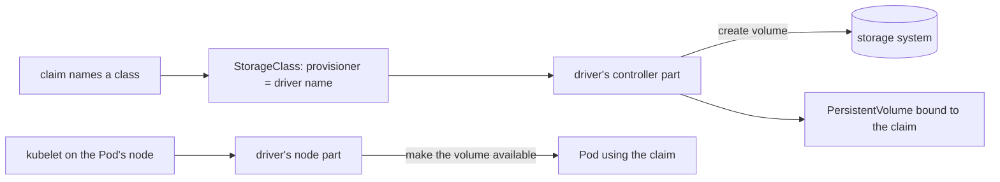

## Before you start

- [[k8s.l3.clusters-without-a-cloud]] — on your own machines, a claim gets only what the installed StorageClasses can do; this lesson shows how a storage system gets installed.
- [[k8s.l2.storage-classes]] — a StorageClass names a provisioner that creates volumes when claims ask; here you look at who that provisioner is.
- [[k8s.l2.scheduled-backups]] — dumps count as a backup only once copied off the cluster; this lesson measures volume snapshots against that rule.

## The situation

The customer who wants Đơn Hàng on three machines of their own adds one requirement: the database's data must live on their storage system, not on one node's disk. Their storage team says the system "ships a CSI driver". On staging, the `db` StatefulSet keeps PostgreSQL's data on a claim from kind's `standard` class, whose provisioner makes a folder on one node. Kubernetes was not built with the customer's storage system in mind, and you have no plan to build your own Kubernetes. How does a storage system that Kubernetes knows nothing about create volumes for Đơn Hàng's claims?

## Core concepts

- **CSI driver** — the software a storage vendor ships to follow the Container Storage Interface (CSI), the standard way for a storage system to plug into Kubernetes; installed in a cluster, it lets claims get volumes from that system.
- Controller part — the driver's Pods that serve the whole cluster and ask the storage system to create and delete volumes.
- Node part — the driver's Pod, usually one on every node, which the kubelet asks to make a volume available to the Pods on that node.
- CSIDriver object — a cluster-wide object through which a CSI driver usually describes itself, named with the driver name a StorageClass gives in `provisioner`; `kubectl get csidrivers` lists these objects.
- **volume snapshot** — a record of a volume's content at one moment, made through a CSI driver that supports it and usually kept in the same storage system; a new claim can start from it.

## How it works



In the situation above, the customer's CSI driver is the piece that would replace `rancher.io/local-path`. Kubernetes does not talk to this storage system itself. It speaks one interface, CSI, and the driver turns those calls into the storage system's own commands. So a new storage system needs no change to Kubernetes: you install its driver into the running cluster, like an application, if the cluster runs a release the driver supports.

The diagram follows one claim. The claim names a StorageClass, and the StorageClass names its driver in `provisioner`. The driver's controller part sees a claim for that class, asks the storage system for a new volume, and creates a PersistentVolume for it, bound to the claim. If the driver supports it, a class can instead wait for the first Pod using the claim, as `standard` does; the controller part then creates the volume at that point. When the claim goes and the reclaim policy is `Delete`, the controller part deletes the volume the same way.

When a Pod using the claim is placed on a node, the kubelet there turns to the driver's node part on that node. The node part mounts the volume on that node and makes it available inside the Pod's containers. It usually runs on every node because a Pod with a claim may land on any of them.

Snapshots go through the same driver. If the driver supports them and the cluster has the extra snapshot pieces installed alongside Kubernetes, the storage system records a volume's content at one moment, and a new claim can name that snapshot as its source. With many drivers the snapshot stays in the same storage system as the volume, so it is lost with that storage system.

## In the Đơn Hàng system

```bash file=scripts/k8s/csi.sh tag=stage-3 lines=9-20
# lesson: k8s.l3.csi-drivers
# A StorageClass names the driver that creates its volumes: provisioner.
show kubectl get storageclasses -o custom-columns=NAME:.metadata.name,PROVISIONER:.provisioner
echo

# lesson: k8s.l3.csi-drivers
# rancher.io/local-path is kind's own provisioner, one Pod that creates
# folders on the nodes. A CSI driver registers itself with a CSIDriver
# object; this cluster has none.
show kubectl get pods -n local-path-storage -o custom-columns=POD:.metadata.name,NODE:.spec.nodeName
echo "\$ kubectl get csidrivers"
kubectl get csidrivers 2>&1
```

```text output=true
$ kubectl get storageclasses -o custom-columns=NAME:.metadata.name,PROVISIONER:.provisioner
NAME       PROVISIONER
standard   rancher.io/local-path

$ kubectl get pods -n local-path-storage -o custom-columns=POD:.metadata.name,NODE:.spec.nodeName
POD                              NODE
local-path-provisioner-...-...   donhang-control-plane
$ kubectl get csidrivers
No resources found
```

The script runs against `donhang`, the three-node kind cluster of this module. `show`, which prints a command before running it, comes from `scripts/lib/network-lessons.sh`, outside the excerpt. The first table reads the `provisioner` field of every StorageClass: `standard`, the class staging's claims get by default, names `rancher.io/local-path`. The second shows what that name stands for: one Pod, here on the control-plane node, in the namespace `local-path-storage`; how it gets folders made on the workers does not matter here.

The last command is printed with `echo` instead of `show`, and `2>&1` makes its message appear in the output with the rest. It finds no CSIDriver object: no CSI driver in this cluster has described itself the usual way. A CSI driver would also usually run a node part on each node, and here one Pod runs on one node. Both clues point the same way.

So `provisioner` can name a provisioner that is not a CSI driver, like kind's. On the customer's machines, the replicated storage system of the next lesson installs its own CSI driver and a StorageClass whose `provisioner` names that driver. Đơn Hàng's claims then ask for that class by name in `storageClassName`, as they now get `standard` without naming it.

## Seniors often assume…

- **"Every StorageClass provisioner is a CSI driver."** → Actually `provisioner` only names whatever creates the volumes, and some provisioners work without CSI, like kind's `rancher.io/local-path`. Features that Kubernetes offers only through CSI, such as volume snapshots, then do not exist for that class. You notice this when `kubectl get csidrivers` shows no CSIDriver object with the name a class gives as its provisioner.
- **"A volume snapshot is as good as a backup."** → Actually the snapshot is usually kept by the same storage system as its volume. If that system fails, the snapshots kept in it go with the volumes, so off-cluster copies such as the dumps `db-backup.sh` copies to `backups/staging/` are still needed. You notice this when a recovery plan lists what a lost storage system takes with it, and the snapshots are on that list.
- **"Adding a new storage system means changing or rebuilding Kubernetes."** → Actually its CSI driver installs into a running cluster as Pods and objects, and a new StorageClass names it; Kubernetes itself is not rebuilt, as long as the cluster runs a release the driver supports. You notice this when a storage vendor's install steps apply manifests or a chart to an existing cluster, with no step that touches the control plane's software.

## Try it (3 minutes)

From the root of the Đơn Hàng repository, with Docker Desktop running and the `donhang` cluster from the earlier lessons running:

1. Run `scripts/k8s/csi.sh`.
2. Compare the `PROVISIONER` column with the result of `kubectl get csidrivers`.

Expected result: `standard` lists `rancher.io/local-path` as its provisioner, one `local-path-provisioner` Pod runs in `local-path-storage`, and `kubectl get csidrivers` prints `No resources found`.

## Connections

- [[k8s.l3.replicated-volumes]] — the next step: a storage system whose CSI driver keeps copies of each volume on several nodes.
- [[k8s.l3.cni-plugins]] — the same pattern for the network: Kubernetes defines an interface, and a plugin installed with the cluster fills it.
- [[k8s.l2.reclaim-policy]] — decides what the driver's controller part does with a volume when its claim is deleted.
- [[k8s.l2.scheduled-backups]] — the off-cluster copy that a volume snapshot does not replace.

## Five-line summary

1. A CSI driver lets a storage system plug into a Kubernetes cluster through one standard interface, without changing Kubernetes.
2. The driver usually runs as Pods: a controller part creates and deletes volumes, and a part on every node makes them available to Pods.
3. A StorageClass names its driver in `provisioner`; kind's `standard` uses `rancher.io/local-path`, which is not a CSI driver.
4. A new storage system installs its driver and a StorageClass naming it; claims then ask for that class by name.
5. A volume snapshot usually stays in the same storage system as its volume, so it does not replace a backup kept elsewhere.
