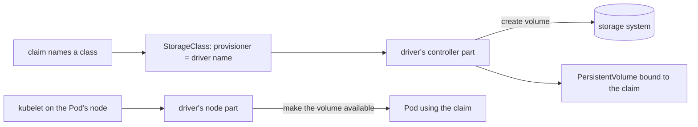

## Bạn cần biết trước

- [[k8s.l3.clusters-without-a-cloud]] — trên máy của chính bạn, claim chỉ nhận được những gì các StorageClass đã cài làm được. Bài này cho thấy một hệ lưu trữ được cài vào như thế nào.
- [[k8s.l2.storage-classes]] — StorageClass chỉ định một provisioner, thành phần tạo volume khi có claim xin. Ở đây bạn xem provisioner đó là ai.
- [[k8s.l2.scheduled-backups]] — bản dump chỉ tính là backup khi đã được chép ra ngoài cluster. Bài này đặt volume snapshot cạnh quy tắc đó.

## Tình huống

Khách hàng muốn chạy Đơn Hàng trên ba máy của riêng họ đưa thêm một yêu cầu: dữ liệu của database phải nằm trên hệ lưu trữ của họ, không nằm trên ổ đĩa của một node. Team lưu trữ bên họ nói hệ thống "có sẵn CSI driver". Trên staging, StatefulSet `db` giữ dữ liệu PostgreSQL trên một claim thuộc class `standard` của kind, và provisioner của class này tạo một thư mục trên một node. Kubernetes không được làm ra với hệ lưu trữ của khách hàng trong đầu, còn bạn thì không định tự làm một bản Kubernetes riêng. Vậy một hệ lưu trữ mà Kubernetes không hề biết tới tạo volume cho các claim của Đơn Hàng bằng cách nào?

## Khái niệm cốt lõi

- **CSI driver** (thành phần theo chuẩn Container Storage Interface, cho một hệ lưu trữ tạo và gắn volume trong cluster) — phần mềm nhà cung cấp hệ lưu trữ đưa ra để tuân theo Container Storage Interface (CSI), cách chuẩn để một hệ lưu trữ cắm vào Kubernetes. Khi được cài vào cluster, nó cho claim nhận volume từ hệ lưu trữ đó.
- Phần controller — các Pod của driver phục vụ cả cluster, xin hệ lưu trữ tạo và xóa volume.
- Phần node — Pod của driver, thường mỗi node một cái, được kubelet nhờ đưa một volume tới các Pod trên node đó dùng.
- Object CSIDriver — object cấp cluster mà CSI driver thường dùng để tự mô tả, mang đúng tên driver mà StorageClass ghi ở `provisioner`. `kubectl get csidrivers` liệt kê các object này.
- **volume snapshot** (bản chụp nội dung một volume tại một thời điểm, nằm trong cùng hệ lưu trữ, dùng để tạo claim mới) — bản ghi nội dung một volume tại một thời điểm, tạo qua một CSI driver có hỗ trợ và thường được giữ trong cùng hệ lưu trữ. Một claim mới có thể bắt đầu từ nó.

## Cơ chế hoạt động



Trong tình huống trên, CSI driver của khách hàng là thứ sẽ thay chỗ `rancher.io/local-path`. Kubernetes không tự nói chuyện với hệ lưu trữ này. Nó chỉ nói một giao diện là CSI, và driver chuyển các lời gọi đó thành lệnh riêng của hệ lưu trữ. Nhờ vậy, thêm một hệ lưu trữ mới không cần sửa gì trong Kubernetes: bạn cài driver của nó vào cluster đang chạy như cài một ứng dụng, miễn cluster chạy bản Kubernetes mà driver hỗ trợ.

Sơ đồ đi theo một claim. Claim chỉ định một StorageClass, và StorageClass ghi tên driver của nó ở `provisioner`. Phần controller của driver thấy một claim thuộc class đó, xin hệ lưu trữ một volume mới, rồi tạo một PersistentVolume cho volume ấy và gắn với claim. Nếu driver hỗ trợ, class có thể chờ tới khi Pod đầu tiên dùng claim xuất hiện, như `standard` vẫn làm. Lúc đó phần controller mới tạo volume. Khi claim bị xóa và reclaim policy là `Delete`, phần controller xóa volume theo đúng đường đó.

Khi một Pod dùng claim được xếp lên một node, kubelet ở node đó tìm tới phần node của driver trên chính node ấy. Phần node mount volume lên node rồi đưa nó vào các container của Pod. Phần này thường chạy trên mọi node, vì Pod có claim có thể rơi vào bất kỳ node nào.

Snapshot cũng đi qua cùng driver. Nếu driver hỗ trợ và cluster đã cài thêm các thành phần snapshot bên cạnh Kubernetes, hệ lưu trữ sẽ ghi lại nội dung của volume tại một thời điểm, và một claim mới có thể lấy snapshot đó làm nguồn. Với nhiều driver, snapshot nằm cùng hệ lưu trữ với volume, nên mất hệ lưu trữ là mất luôn snapshot.

## Trong hệ thống Đơn Hàng

```bash file=scripts/k8s/csi.sh tag=stage-3 lines=9-20
# lesson: k8s.l3.csi-drivers
# A StorageClass names the driver that creates its volumes: provisioner.
show kubectl get storageclasses -o custom-columns=NAME:.metadata.name,PROVISIONER:.provisioner
echo

# lesson: k8s.l3.csi-drivers
# rancher.io/local-path is kind's own provisioner, one Pod that creates
# folders on the nodes. A CSI driver registers itself with a CSIDriver
# object; this cluster has none.
show kubectl get pods -n local-path-storage -o custom-columns=POD:.metadata.name,NODE:.spec.nodeName
echo "\$ kubectl get csidrivers"
kubectl get csidrivers 2>&1
```

```text output=true
$ kubectl get storageclasses -o custom-columns=NAME:.metadata.name,PROVISIONER:.provisioner
NAME       PROVISIONER
standard   rancher.io/local-path

$ kubectl get pods -n local-path-storage -o custom-columns=POD:.metadata.name,NODE:.spec.nodeName
POD                              NODE
local-path-provisioner-...-...   donhang-control-plane
$ kubectl get csidrivers
No resources found
```

Script chạy trên `donhang`, cluster kind ba node của module này. `show` in một lệnh ra trước khi chạy nó, và hàm này nằm trong `scripts/lib/network-lessons.sh`, ngoài đoạn trích. Bảng đầu đọc trường `provisioner` của mọi StorageClass: `standard`, class mà claim trên staging nhận mặc định, ghi `rancher.io/local-path`. Bảng thứ hai cho thấy cái tên đó là gì: một Pod duy nhất, ở đây nằm trên node control-plane, trong namespace `local-path-storage`. Nó làm cách nào để thư mục được tạo trên các worker thì không quan trọng ở bài này.

Lệnh cuối được in bằng `echo` thay vì `show`, và `2>&1` đưa thông báo của nó vào output cùng phần còn lại. Lệnh không tìm thấy object CSIDriver nào: không CSI driver nào trong cluster này tự mô tả theo cách thường gặp. CSI driver cũng thường chạy một phần node trên mỗi node, còn ở đây chỉ có một Pod trên một node. Hai dấu hiệu cùng chỉ về một hướng.

Như vậy `provisioner` có thể ghi tên một provisioner không phải CSI driver, như provisioner của kind. Trên máy của khách hàng, hệ lưu trữ có bản sao ở bài sau cài CSI driver riêng của nó cùng một StorageClass có `provisioner` ghi tên driver đó. Khi ấy các claim của Đơn Hàng xin class đó bằng tên trong `storageClassName`, giống như bây giờ chúng nhận `standard` mà không cần ghi tên.

## Senior hay nhầm rằng…

- **"Provisioner nào của StorageClass cũng là CSI driver."** → Thực ra `provisioner` chỉ ghi tên thứ tạo volume, và có những provisioner chạy không cần CSI, như `rancher.io/local-path` của kind. Những tính năng Kubernetes chỉ cung cấp qua CSI, chẳng hạn volume snapshot, khi đó không có với class ấy. Bạn sẽ nhận ra khi `kubectl get csidrivers` không có object CSIDriver nào mang cái tên mà class ghi làm provisioner.
- **"Volume snapshot tốt ngang một bản backup."** → Thực ra snapshot thường được giữ bởi chính hệ lưu trữ chứa volume của nó. Nếu hệ đó hỏng, các snapshot bên trong mất theo volume, nên vẫn cần bản chép ngoài cluster, như các bản dump mà `db-backup.sh` chép vào `backups/staging/`. Bạn sẽ nhận ra khi một kế hoạch khôi phục liệt kê những gì sẽ mất theo hệ lưu trữ, và snapshot có tên trong danh sách đó.
- **"Thêm một hệ lưu trữ mới nghĩa là phải sửa hoặc build lại Kubernetes."** → Thực ra CSI driver của nó cài vào cluster đang chạy dưới dạng Pod và object, rồi một StorageClass mới ghi tên nó. Bản thân Kubernetes không phải build lại, miễn cluster chạy bản mà driver hỗ trợ. Bạn sẽ nhận ra khi các bước cài của nhà cung cấp hệ lưu trữ chỉ apply manifest hoặc một chart lên cluster có sẵn, không bước nào động tới phần mềm của control plane.

## Thử ngay (3 phút)

Ở thư mục gốc của repo Đơn Hàng, khi Docker Desktop đang chạy và cluster `donhang` từ các bài trước đang chạy:

1. Chạy `scripts/k8s/csi.sh`.
2. So cột `PROVISIONER` với kết quả của `kubectl get csidrivers`.

Kết quả mong đợi: `standard` ghi `rancher.io/local-path` làm provisioner, một Pod `local-path-provisioner` chạy trong `local-path-storage`, và `kubectl get csidrivers` in `No resources found`.

## Liên hệ

- [[k8s.l3.replicated-volumes]] — bước tiếp theo: một hệ lưu trữ có CSI driver giữ bản sao của mỗi volume trên nhiều node.
- [[k8s.l3.cni-plugins]] — cùng một khuôn cho mạng: Kubernetes định nghĩa giao diện, và một plugin cài cùng cluster lấp vào đó.
- [[k8s.l2.reclaim-policy]] — quyết định phần controller của driver làm gì với volume khi claim của nó bị xóa.
- [[k8s.l2.scheduled-backups]] — bản chép ngoài cluster mà volume snapshot không thay được.

## Tóm tắt 5 dòng

1. CSI driver cho một hệ lưu trữ cắm vào cluster Kubernetes qua một giao diện chuẩn duy nhất, không phải sửa Kubernetes.
2. Driver thường chạy dưới dạng Pod: phần controller tạo và xóa volume, còn một phần trên mỗi node đưa volume tới Pod dùng.
3. StorageClass ghi tên driver của nó ở `provisioner`. Class `standard` của kind dùng `rancher.io/local-path`, thứ không phải CSI driver.
4. Một hệ lưu trữ mới cài driver của nó cùng một StorageClass ghi tên driver đó, rồi claim xin class ấy bằng tên.
5. Volume snapshot thường nằm cùng hệ lưu trữ với volume, nên không thay được bản backup giữ ở nơi khác.
