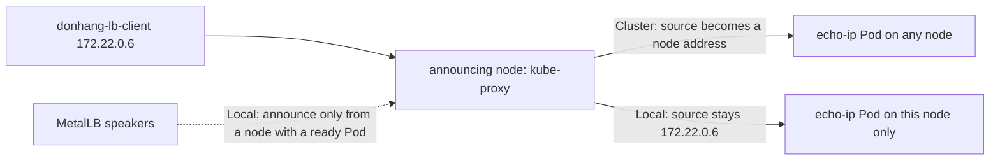

## Before you start

- [[k8s.l3.metallb-layer2-mode]] — one node's speaker answers ARP for a Service address, and kube-proxy on that node forwards each connection to a ready Pod on any node.
- [[k8s.l3.pod-network-model]] — between Pods nothing rewrites addresses, so a server sees its caller's own address; this lesson shows where traffic from outside the cluster differs.

## The situation

The customer's network team wants Đơn Hàng's logs to name the address of each caller, and a limit per caller is on their list. Before promising either, you check what a Pod sees on `donhang`. The client container `donhang-lb-client` has the address `172.22.0.6` on the Docker network that the cluster's nodes are also on. It calls `echo-loadbalancer`, and `echo-ip` answers `saw 172.22.0.4`: an address on the same network, but not the caller's. If every caller looked like one of a few such addresses, a limit per caller would throttle all of them together. Where does the client's address go, and what does it cost to keep it?

## Core concepts

- Source address — the sender's IP address, which arrives with a connection's data; replies go back to it, and `echo-ip` prints it after `saw`.
- Outside traffic — connections from outside the cluster that reach a Service through its node port or its LoadBalancer address, here from `donhang-lb-client`.
- **external traffic policy** — the Service field `externalTrafficPolicy`: `Cluster`, the default, lets a node send outside traffic to the Service's Pods on any node; `Local` allows only the Pods on that node.
- Announcing node — in layer 2 mode, the node whose speaker answers ARP for a Service's address, so it receives all of that address's traffic.

## How it works



In the situation above, `donhang-lb-client` connects to `echo-loadbalancer`'s address and the announcing node receives the connection. The cluster has two nodes that run Pods, `donhang-worker` and `donhang-worker2`, and `echo-ip` runs one Pod on each. The Service has no `externalTrafficPolicy`, so it is `Cluster`: the node replaces the source address of every outside connection with one of its own, whichever Pod it picks. Because of that, a reply from the Pod on the other node goes back through the announcing node, which returns it to the client. `echo-ip` prints a node's address, `172.22.0.4`, instead of the client's.

With `Local`, kube-proxy on a node sends outside traffic only to the Service's Pods on that same node. No connection crosses to another node, nothing replaces the source address, and `echo-ip` prints the client's own `172.22.0.6`.

The rule has a consequence. A node with no ready Pod of a `Local` Service has nowhere to send the traffic, and it drops such connections. MetalLB's speakers therefore announce the address only from nodes that run a ready Pod of the Service. In layer 2 mode just one of those nodes announces at a time, so only its Pods receive outside traffic. With `Local`, the `echo-ip` Pod on the non-announcing node receives none of it.

That is the trade. Choose `Local` when the application must see clients' addresses, for logs or limits per client, and runs Pods on several nodes, so another node can announce if one Pod goes away. Otherwise `Cluster` spreads load more evenly, at the price of hiding the client.

## In the Đơn Hàng system

```yaml file=deploy/k8s/lessons/echo-loadbalancer-local.yaml tag=stage-3 lines=1-16
# lesson: k8s.l3.external-traffic-policy
# echo-loadbalancer with one change: Local. A node sends outside traffic only
# to echo-ip Pods on that same node and keeps the client's address.
apiVersion: v1
kind: Service
metadata:
  name: echo-loadbalancer-local
  namespace: network-lessons
spec:
  type: LoadBalancer
  externalTrafficPolicy: Local
  selector:
    app: echo-ip
  ports:
    - port: 80
      targetPort: 8080
```

This Service selects the same `echo-ip` Pods as `echo-loadbalancer`; apart from its name, its only change is line 11, `externalTrafficPolicy: Local`. `echo-loadbalancer.yaml` sets no `externalTrafficPolicy`, so it gets `Cluster`. Because both Services front the same two Pods, any difference you see between them comes from the policy alone. MetalLB gives each Service its own address from `lab-pool`.

```bash file=scripts/k8s/external-traffic-policy.sh tag=stage-3 lines=19-36
# lesson: k8s.l3.external-traffic-policy
# Cluster: the receiving node may pass the connection to a Pod on another
# node and puts its own address in place of the client's. Local: the
# client's own address arrives.
for svc in echo-loadbalancer echo-loadbalancer-local; do
  echo "\$ docker exec donhang-lb-client wget -qO- http://<$svc's address>"
  lb_get "$(lb_ip "$svc")"
done
echo

# lesson: k8s.l3.external-traffic-policy
# Ten calls to each: with Cluster both Pods answer; with Local only the Pod
# on the announcing node does, though echo-ip runs on both workers.
for svc in echo-loadbalancer echo-loadbalancer-local; do
  ip=$(lb_ip "$svc")
  pods=$(for _ in $(seq 10); do lb_get "$ip"; done | awk '{ print $1 }' | sort -u | wc -l)
  echo "$svc (announced by $(lb_node "$svc")): 10 calls, Pods that answered: $pods"
done
```

```text output=true
$ kubectl apply -f deploy/k8s/lessons/echo-loadbalancer-local.yaml
service/echo-loadbalancer-local unchanged
$ kubectl get services echo-loadbalancer echo-loadbalancer-local -n network-lessons -o custom-columns=NAME:.metadata.name,EXTERNAL-IP:.status.loadBalancer.ingress[0].ip,POLICY:.spec.externalTrafficPolicy
NAME                      EXTERNAL-IP      POLICY
echo-loadbalancer         172.22.255.202   Cluster
echo-loadbalancer-local   172.22.255.200   Local
the client container's address: 172.22.0.6

$ docker exec donhang-lb-client wget -qO- http://<echo-loadbalancer's address>
echo-ip-...-... saw 172.22.0.4
$ docker exec donhang-lb-client wget -qO- http://<echo-loadbalancer-local's address>
echo-ip-...-... saw 172.22.0.6

echo-loadbalancer (announced by donhang-worker2): 10 calls, Pods that answered: 2
echo-loadbalancer-local (announced by donhang-worker2): 10 calls, Pods that answered: 1

$ kubectl scale deployment echo-ip -n network-lessons --replicas=1
deployment.apps/echo-ip scaled
the echo-ip Pod runs on donhang-worker; echo-loadbalancer-local is announced by donhang-worker
```

The first loop calls each Service once from `donhang-lb-client`. The second calls each ten times, keeps the first word of every answer, the Pod's name, and counts the distinct names. `lb_ip`, `lb_get` and `lb_node` come from `scripts/lib/network-lessons.sh`, outside the excerpt; `lb_node` names the node whose hardware address the client learned for the Service's address.

The `kubectl apply`, `kubectl get` and client-address lines come from before the excerpt; the `kubectl scale` line and the line after it come from after it. In the capture, `Cluster` reports `172.22.0.4` and `Local` reports the client's `172.22.0.6`. Both addresses are announced by `donhang-worker2`, yet only the `Cluster` Service reaches both Pods. After the script scales `echo-ip` to one replica, the `Local` address is announced by the node that runs the remaining Pod. A line near the top of the script, outside the excerpt, scales `echo-ip` back to two replicas whenever the script exits. The capture masks the random part of Pod names; in your run the two nodes may swap.

## Seniors often assume…

- **"Pods always see the real address of a client outside the cluster."** → Actually, with the default `Cluster`, the receiving node replaces the source address with one of its own, so a reply from a Pod on another node returns through it. You notice this when logs or a limit per client see only a few addresses, all of them nodes', while many clients call.
- **"`Local` only makes traffic faster, with no downside."** → Actually, keeping traffic on the receiving node also means no other node's Pods get any, and in layer 2 mode only one node receives. You notice this when one Pod's request count climbs while the Pod on the other node stays idle, as in `Pods that answered: 1`.
- **"Any node can still accept traffic for a `Local` Service, even with none of its Pods."** → Actually such a node has no Pod to send it to and drops it, so MetalLB's speakers do not announce the address from it. You notice this when you scale to one replica: the address is then announced from the node that runs the remaining Pod, even if another node announced it before.

## Try it (3 minutes)

From the root of the Đơn Hàng repository, with Docker Desktop running and the `donhang` cluster from the earlier lessons running:

1. Run `scripts/k8s/external-traffic-policy.sh`. If MetalLB's pool or `donhang-lb-client` is missing, it runs `metallb-pool.sh` first.
2. Compare the line `the client container's address` with the two `saw` lines, then read the two `Pods that answered` lines.

Expected result: the `echo-loadbalancer` answer shows an address other than the client's, and the `echo-loadbalancer-local` answer shows the client's own address. `Pods that answered` is usually `2` for `echo-loadbalancer` and always `1` for `echo-loadbalancer-local`. With `Cluster`, kube-proxy picks a Pod for each call, so ten calls can all land on one Pod; a `1` there is not a failure. The last line names the same node twice.

## Connections

- [[k8s.l3.metallb-layer2-mode]] — the step before: one node announces an address; this lesson changes which nodes may announce it.
- [[k8s.l3.pod-network-model]] — the contrast: inside the Pod network nothing rewrites addresses; outside traffic under `Cluster` is where that stops.
- [[k8s.l3.highly-available-entry-point]] — the next lesson: why a `Local` Service survives a node failure only when its Pods run on more than one node.
- [[backend.l3.rate-limiting]] — the application's side: a limit per client address works only if the Pod receives each client's own address.
- [[backend.l1.structured-logging]] — where the client address ends up: a log field that is useful only when it holds the caller's address.

## Five-line summary

1. `externalTrafficPolicy: Local` keeps the client's address by sending outside traffic only to Pods on the receiving node, so nodes without a ready Pod get none.
2. With `Cluster`, the default, the receiving node replaces the client's address with its own and may forward to another node's Pod.
3. MetalLB's speakers announce a `Local` Service's address only from nodes that run a ready Pod of it.
4. In layer 2 mode with `Local`, only the announcing node's Pods get outside traffic, so load no longer spreads over other nodes' Pods.
5. Choose `Local` when the application needs clients' addresses and runs Pods on several nodes; otherwise `Cluster` spreads load more evenly.
