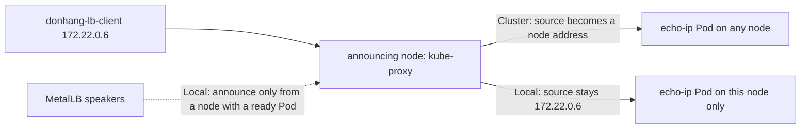

## Bạn cần biết trước

- [[k8s.l3.metallb-layer2-mode]] — speaker của một node trả lời ARP cho địa chỉ của Service, và kube-proxy trên node đó chuyển mỗi kết nối tới một Pod sẵn sàng ở bất kỳ node nào.
- [[k8s.l3.pod-network-model]] — giữa các Pod không ai viết lại địa chỉ, nên server thấy đúng địa chỉ của bên gọi. Bài này cho thấy traffic từ ngoài cluster khác ở chỗ nào.

## Tình huống

Team mạng của khách hàng muốn log của Đơn Hàng ghi địa chỉ của từng bên gọi, và giới hạn theo từng bên gọi cũng nằm trong danh sách của họ. Trước khi hứa điều nào, bạn kiểm tra xem một Pod trên `donhang` thấy gì. Container client `donhang-lb-client` có địa chỉ `172.22.0.6` trên mạng Docker mà các node của cluster cũng nằm trên đó. Nó gọi `echo-loadbalancer`, và `echo-ip` trả lời `saw 172.22.0.4`: một địa chỉ trên cùng mạng, nhưng không phải của bên gọi. Nếu mọi bên gọi đều hiện ra như một trong vài địa chỉ kiểu này, giới hạn theo từng bên gọi sẽ chặn tất cả cùng lúc. Địa chỉ của client đi đâu mất, và giữ được nó thì phải trả giá gì?

## Khái niệm cốt lõi

- Địa chỉ nguồn — địa chỉ IP của bên gửi, đi kèm dữ liệu của một kết nối. Câu trả lời được gửi về địa chỉ này, và `echo-ip` in nó ra sau chữ `saw`.
- Traffic từ ngoài — kết nối từ ngoài cluster tới một Service qua node port hoặc địa chỉ LoadBalancer của nó, ở đây là từ `donhang-lb-client`.
- **external traffic policy** (Trường của Service: Cluster chuyển traffic ngoài tới Pod ở mọi node, Local chỉ tới Pod cùng node và giữ IP client) — trường `externalTrafficPolicy` của Service. `Cluster`, giá trị mặc định, cho phép một node gửi traffic từ ngoài tới Pod của Service trên bất kỳ node nào. `Local` chỉ cho phép tới các Pod trên chính node đó.
- Node đang quảng bá — ở layer 2 mode, node có speaker trả lời ARP cho địa chỉ của một Service, nên node này nhận toàn bộ traffic của địa chỉ đó.

## Cơ chế hoạt động



Trong tình huống trên, `donhang-lb-client` kết nối tới địa chỉ của `echo-loadbalancer`, và node đang quảng bá nhận kết nối. Cluster có hai node chạy Pod là `donhang-worker` và `donhang-worker2`, mỗi node chạy một Pod `echo-ip`. Service không khai báo `externalTrafficPolicy`, nên nó là `Cluster`: với mọi kết nối từ ngoài, node thay địa chỉ nguồn bằng một địa chỉ của chính nó, dù chọn Pod nào. Nhờ vậy, câu trả lời từ Pod trên node kia đi ngược qua node đang quảng bá, rồi node này trả về cho client. `echo-ip` in ra địa chỉ của một node, `172.22.0.4`, chứ không phải của client.

Với `Local`, kube-proxy trên một node chỉ gửi traffic từ ngoài tới các Pod của Service trên chính node đó. Không kết nối nào sang node khác, không ai thay địa chỉ nguồn, và `echo-ip` in đúng địa chỉ `172.22.0.6` của client.

Quy tắc này kéo theo một hệ quả. Node không có Pod sẵn sàng nào của một Service `Local` thì không có chỗ để gửi traffic, và nó bỏ những kết nối đó. Vì thế các speaker của MetalLB chỉ quảng bá địa chỉ từ những node có chạy Pod sẵn sàng của Service. Ở layer 2 mode, mỗi lúc chỉ một trong các node đó quảng bá, nên chỉ Pod của node ấy nhận traffic từ ngoài. Với `Local`, Pod `echo-ip` trên node không quảng bá không nhận được chút traffic nào.

Đó là cái giá phải đổi. Chọn `Local` khi ứng dụng cần thấy địa chỉ của client, cho log hoặc giới hạn theo từng client, và chạy Pod trên nhiều node, để node khác có thể quảng bá nếu một Pod mất đi. Ngược lại, `Cluster` chia tải đều hơn, đổi lại là che mất client.

## Trong hệ thống Đơn Hàng

```yaml file=deploy/k8s/lessons/echo-loadbalancer-local.yaml tag=stage-3 lines=1-16
# lesson: k8s.l3.external-traffic-policy
# echo-loadbalancer with one change: Local. A node sends outside traffic only
# to echo-ip Pods on that same node and keeps the client's address.
apiVersion: v1
kind: Service
metadata:
  name: echo-loadbalancer-local
  namespace: network-lessons
spec:
  type: LoadBalancer
  externalTrafficPolicy: Local
  selector:
    app: echo-ip
  ports:
    - port: 80
      targetPort: 8080
```

Service này chọn cùng các Pod `echo-ip` với `echo-loadbalancer`. Ngoài tên, thay đổi duy nhất là dòng 11, `externalTrafficPolicy: Local`. `echo-loadbalancer.yaml` không đặt `externalTrafficPolicy`, nên nhận `Cluster`. Vì hai Service đứng trước cùng hai Pod, mọi khác biệt bạn thấy giữa chúng đều chỉ do policy. MetalLB cấp cho mỗi Service một địa chỉ riêng trong `lab-pool`.

```bash file=scripts/k8s/external-traffic-policy.sh tag=stage-3 lines=19-36
# lesson: k8s.l3.external-traffic-policy
# Cluster: the receiving node may pass the connection to a Pod on another
# node and puts its own address in place of the client's. Local: the
# client's own address arrives.
for svc in echo-loadbalancer echo-loadbalancer-local; do
  echo "\$ docker exec donhang-lb-client wget -qO- http://<$svc's address>"
  lb_get "$(lb_ip "$svc")"
done
echo

# lesson: k8s.l3.external-traffic-policy
# Ten calls to each: with Cluster both Pods answer; with Local only the Pod
# on the announcing node does, though echo-ip runs on both workers.
for svc in echo-loadbalancer echo-loadbalancer-local; do
  ip=$(lb_ip "$svc")
  pods=$(for _ in $(seq 10); do lb_get "$ip"; done | awk '{ print $1 }' | sort -u | wc -l)
  echo "$svc (announced by $(lb_node "$svc")): 10 calls, Pods that answered: $pods"
done
```

```text output=true
$ kubectl apply -f deploy/k8s/lessons/echo-loadbalancer-local.yaml
service/echo-loadbalancer-local unchanged
$ kubectl get services echo-loadbalancer echo-loadbalancer-local -n network-lessons -o custom-columns=NAME:.metadata.name,EXTERNAL-IP:.status.loadBalancer.ingress[0].ip,POLICY:.spec.externalTrafficPolicy
NAME                      EXTERNAL-IP      POLICY
echo-loadbalancer         172.22.255.202   Cluster
echo-loadbalancer-local   172.22.255.200   Local
the client container's address: 172.22.0.6

$ docker exec donhang-lb-client wget -qO- http://<echo-loadbalancer's address>
echo-ip-...-... saw 172.22.0.4
$ docker exec donhang-lb-client wget -qO- http://<echo-loadbalancer-local's address>
echo-ip-...-... saw 172.22.0.6

echo-loadbalancer (announced by donhang-worker2): 10 calls, Pods that answered: 2
echo-loadbalancer-local (announced by donhang-worker2): 10 calls, Pods that answered: 1

$ kubectl scale deployment echo-ip -n network-lessons --replicas=1
deployment.apps/echo-ip scaled
the echo-ip Pod runs on donhang-worker; echo-loadbalancer-local is announced by donhang-worker
```

Vòng lặp đầu gọi mỗi Service một lần từ `donhang-lb-client`. Vòng lặp thứ hai gọi mỗi Service mười lần, giữ từ đầu tiên của mỗi câu trả lời, tức tên Pod, rồi đếm số tên khác nhau. `lb_ip`, `lb_get` và `lb_node` đến từ `scripts/lib/network-lessons.sh`, ngoài đoạn trích. `lb_node` cho biết tên node có địa chỉ phần cứng mà client đã học được cho địa chỉ của Service.

Các dòng `kubectl apply`, `kubectl get` và dòng địa chỉ client đến từ phần trước đoạn trích. Dòng `kubectl scale` và dòng sau nó đến từ phần sau. Trong bản ghi, `Cluster` báo `172.22.0.4`, còn `Local` báo đúng `172.22.0.6` của client. Cả hai địa chỉ đều do `donhang-worker2` quảng bá, nhưng chỉ Service `Cluster` tới được cả hai Pod. Sau khi script scale `echo-ip` xuống một replica, địa chỉ `Local` được quảng bá từ node đang chạy Pod còn lại. Một dòng gần đầu script, ngoài đoạn trích, scale `echo-ip` về lại hai replica mỗi khi script kết thúc. Bản ghi che phần ngẫu nhiên trong tên Pod. Ở lần chạy của bạn, hai node có thể đổi chỗ cho nhau.

## Senior hay nhầm rằng…

- **"Pod luôn thấy địa chỉ thật của client ở ngoài cluster."** → Thực ra với `Cluster` mặc định, node nhận kết nối thay địa chỉ nguồn bằng một địa chỉ của chính nó, nên câu trả lời từ Pod trên node khác quay về qua node này. Bạn sẽ nhận ra khi log hoặc giới hạn theo từng client chỉ thấy vài địa chỉ, toàn là địa chỉ của node, trong khi có rất nhiều client đang gọi.
- **"`Local` chỉ làm traffic nhanh hơn, không có mặt trái nào."** → Thực ra giữ traffic trên node nhận cũng có nghĩa là Pod của các node khác không nhận được gì, và ở layer 2 mode chỉ một node nhận. Bạn sẽ nhận ra khi số request của một Pod tăng dần còn Pod trên node kia nằm im, như `Pods that answered: 1`.
- **"Node nào cũng vẫn nhận được traffic cho một Service `Local`, kể cả khi không có Pod nào của nó."** → Thực ra node như vậy không có Pod nào để gửi tới và bỏ traffic đi, nên các speaker của MetalLB không quảng bá địa chỉ từ node đó. Bạn sẽ nhận ra khi scale xuống một replica: địa chỉ khi đó được quảng bá từ node chạy Pod còn lại, dù trước đó một node khác đang quảng bá.

## Thử ngay (3 phút)

Ở thư mục gốc của repo Đơn Hàng, khi Docker Desktop đang chạy và cluster `donhang` từ các bài trước đang chạy:

1. Chạy `scripts/k8s/external-traffic-policy.sh`. Nếu chưa có dải địa chỉ của MetalLB hoặc `donhang-lb-client`, script chạy `metallb-pool.sh` trước.
2. So dòng `the client container's address` với hai dòng `saw`, rồi đọc hai dòng `Pods that answered`.

Kết quả mong đợi: câu trả lời của `echo-loadbalancer` ghi một địa chỉ khác địa chỉ của client, còn câu trả lời của `echo-loadbalancer-local` ghi đúng địa chỉ của client. `Pods that answered` thường là `2` với `echo-loadbalancer` và luôn là `1` với `echo-loadbalancer-local`. Với `Cluster`, kube-proxy chọn Pod cho từng lời gọi, nên cả mười lời gọi có thể rơi vào cùng một Pod. Số `1` ở đó không phải lỗi. Dòng cuối ghi cùng một tên node hai lần.

## Liên hệ

- [[k8s.l3.metallb-layer2-mode]] — bước trước: một node quảng bá một địa chỉ. Bài này thay đổi những node nào được phép quảng bá nó.
- [[k8s.l3.pod-network-model]] — điểm đối lập: bên trong mạng Pod không ai viết lại địa chỉ, còn traffic từ ngoài dưới `Cluster` là chỗ điều đó không còn đúng.
- [[k8s.l3.highly-available-entry-point]] — bài tiếp theo: vì sao một Service `Local` chỉ sống sót khi một node hỏng nếu Pod của nó chạy trên nhiều hơn một node.
- [[backend.l3.rate-limiting]] — phía ứng dụng: giới hạn theo địa chỉ từng client chỉ đúng khi Pod nhận được địa chỉ thật của từng client.
- [[backend.l1.structured-logging]] — nơi địa chỉ client được ghi lại: một field trong log chỉ có ích khi nó chứa địa chỉ của bên gọi.

## Tóm tắt 5 dòng

1. `externalTrafficPolicy: Local` giữ địa chỉ của client bằng cách chỉ gửi traffic từ ngoài tới Pod trên node nhận, nên node không có Pod sẵn sàng không nhận gì.
2. Với `Cluster`, giá trị mặc định, node nhận thay địa chỉ của client bằng địa chỉ của chính nó và có thể chuyển tiếp tới Pod của node khác.
3. Các speaker của MetalLB chỉ quảng bá địa chỉ của một Service `Local` từ những node có chạy Pod sẵn sàng của Service đó.
4. Ở layer 2 mode với `Local`, chỉ Pod của node đang quảng bá nhận traffic từ ngoài, nên tải không còn được chia sang Pod của các node khác.
5. Chọn `Local` khi ứng dụng cần địa chỉ của client và chạy Pod trên nhiều node. Ngược lại, `Cluster` chia tải đều hơn.
