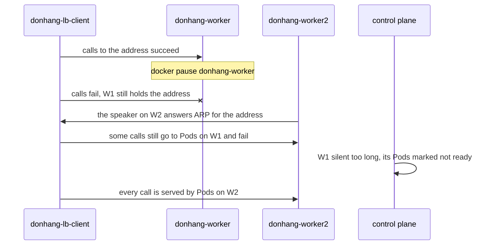

## Before you start

- [[k8s.l3.external-traffic-policy]] — a LoadBalancer address enters through one announcing node, and kube-proxy there decides which Pods receive the traffic.
- [[k8s.l2.ingress]] — Traefik, an Ingress controller, carries out Ingress rules; this lesson runs two of its Pods and routes `echo-ip` through them.
- [[k8s.l2.helm-releases]] — `helm upgrade --install` installs a chart as a release with your values; `traefik-ha.sh` installs Traefik that way.
- [[k8s.l1.deployments]] — a Deployment keeps a number of replicas running; this lesson decides where they run.

## The situation

The customer wants Đơn Hàng on three machines of their own, with MetalLB in front, as in the earlier lessons. Before you agree, you read how staging installs its Ingress controller. `apps/traefik.yaml` sets no number of replicas, so the chart runs one Traefik Pod, which is all staging's single node needs. On the customer's machines that Pod would sit on one node, and every outside request would pass through it. You know that MetalLB moves an address when its node stops, but if that node held the only Traefik Pod, the address arrives where nothing answers. What does the entry point need to keep serving when any one node fails?

## Core concepts

- **single point of failure** — a part whose failure alone stops the whole system; behind MetalLB, a Traefik with one Pod is one, because losing its node stops all outside traffic.
- **high availability** — designing a system to keep serving when one part fails, by removing every single point of failure; here, two or more Traefik Pods on different nodes behind one address that layer 2 mode moves.
- **topology spread constraint** — a rule in a Pod template that makes the scheduler spread matching Pods over the values of a node label, such as one per node; with `DoNotSchedule`, it places a Pod only where the counts per value stay within `maxSkew` of the lowest.

## How it works



In the situation above, the fix has two parts. `donhang` has one control-plane node and two workers, the nodes that run ordinary Pods. Traefik runs two replicas, and a topology spread constraint places them on different workers. A LoadBalancer Service gives both one address from MetalLB's pool. One worker's speaker announces it, and kube-proxy there sends each connection to a ready Traefik Pod, on that node or the other (the Service keeps the default `externalTrafficPolicy: Cluster`).

The diagram follows the lab's failure. `donhang`'s nodes are Docker containers, so `traefik-ha.sh` freezes the announcing worker with `docker pause`, like a machine that stops answering. For a moment the client still sends to it, so calls fail. The speaker on `donhang-worker2` then announces the address: the failover of the layer 2 lesson.

Calls can still fail after that. The control plane has not yet given up on the paused node, so it still lists that node's Traefik and `echo-ip` Pods as ready, and some connections go to them and time out. Only after hearing nothing from the node for a while does it mark those Pods not ready; then the Pods on `donhang-worker2` serve every call.

So high availability here means the entry point recovers by itself after a gap, not that no request fails. Without the second Pod, the moved address leads nowhere; without MetalLB, the two Pods share no address to move. While one replica is down, the other carries all the traffic, so its resource requests should cover the whole load. The kubelet sets aside only the request; above it, a replica gets spare room on its node only if other Pods leave some.

## In the Đơn Hàng system

```yaml file=deploy/k8s/lessons/traefik-ha-values.yaml tag=stage-3 lines=5-25
deployment:
  replicas: 2
# maxSkew 1 with DoNotSchedule: the scheduler never puts a Pod where it
# would make one node hold two more than another, so two replicas land on
# two nodes. Honor: the control-plane node, which takes no such Pods, does
# not count.
topologySpreadConstraints:
  - maxSkew: 1
    topologyKey: kubernetes.io/hostname
    whenUnsatisfiable: DoNotSchedule
    nodeTaintsPolicy: Honor
    labelSelector:
      matchLabels:
        app.kubernetes.io/name: traefik
# lesson: k8s.l3.highly-available-entry-point
# Each replica must carry all the traffic while the other is down, so its
# requests are sized for the whole load, not for half of it.
resources:
  requests:
    cpu: 200m
    memory: 128Mi
```

These are values of Traefik's chart, which copies them into its Deployment's Pod template. `topologyKey: kubernetes.io/hostname` names a label the kubelet sets on every node to its hostname, which in kind is the node's name, so each node is one place to spread over. `maxSkew: 1` means no node may hold more than one matching Pod above the node with the fewest, and `DoNotSchedule` leaves a Pod `Pending` rather than break that rule. `labelSelector` counts only Traefik's Pods. The control-plane node is marked so that ordinary Pods are not placed on it, and `nodeTaintsPolicy: Honor` makes the constraint skip nodes marked that way. Further down the file, outside the excerpt, `ingressClass` names this Traefik `traefik-ha` and `service.spec.type` makes its Service a LoadBalancer.

```bash file=scripts/k8s/traefik-ha.sh tag=stage-3 lines=34-51
# lesson: k8s.l3.highly-available-entry-point
# One worker stops: the one that announces the address, so it has to move.
# A call every second: some fail, until MetalLB has moved the address and
# the control plane has marked the stopped node's Pods not ready (its
# Traefik and its echo-ip), then every call succeeds again.
node=$(lb_node_ip "$ip")
echo "\$ docker pause $node"
docker pause "$node" >/dev/null
paused=$node
start=$SECONDS ok=0 failed=0 streak=0
while [ "$streak" -lt 20 ]; do
  if lb_get "$ip" 2 >/dev/null; then ok=$((ok + 1)); streak=$((streak + 1)); else failed=$((failed + 1)); streak=0; last_fail=$((SECONDS - start)); fi
  [ $((SECONDS - start)) -gt 300 ] && { echo "calls still failing after 300 s" >&2; exit 1; }
  sleep 1
done
echo "calls: $((ok + failed)), failed: $failed, the last one about ${last_fail:-0} s after the pause; then 20 in a row succeeded"
show kubectl get node "$node" -o custom-columns=NODE:.metadata.name,READY:.status.conditions[-1].status
echo "the address is announced by $(lb_node_ip "$ip")"
```

```text output=true
$ helm upgrade --install traefik-ha traefik --repo https://traefik.github.io/charts --version 41.6.1 \
    -n ha-lessons --create-namespace -f deploy/k8s/lessons/traefik-ha-values.yaml --wait
NAME: traefik-ha
STATUS: deployed
REVISION: 2
$ kubectl get pods -n ha-lessons -o custom-columns=POD:.metadata.name,NODE:.spec.nodeName
POD                  NODE
traefik-ha-...-...   donhang-worker...
traefik-ha-...-...   donhang-worker...
$ kubectl get service traefik-ha -n ha-lessons
NAME         TYPE           CLUSTER-IP   EXTERNAL-IP      PORT(S)                  AGE
traefik-ha   LoadBalancer   ...          172.22.255.201   80:.../TCP,443:.../TCP   ...

$ kubectl apply -f deploy/k8s/lessons/echo-ingress.yaml
ingress.networking.k8s.io/echo-ip unchanged
$ docker exec donhang-lb-client wget -qO- http://<traefik-ha's address>
echo-ip-...-... saw ...

$ docker pause donhang-worker
calls: ... s after the pause; then 20 in a row succeeded
$ kubectl get node donhang-worker -o custom-columns=NODE:.metadata.name,READY:.status.conditions[-1].status
NODE             READY
donhang-worker   Unknown
the address is announced by donhang-worker2
$ docker unpause donhang-worker
```

`lb_node_ip` finds the worker whose hardware address the client container learned for the address, so the script pauses the announcing node. It, `lb_get` and `show`, which prints a command before running it, come from `scripts/lib/network-lessons.sh`, outside the excerpt. The loop calls, waits one second and calls again, each call with a two-second timeout, and stops after 20 successes in a row.

The capture's lines before the pause come from earlier in the script: the Helm release, its two Pods, the Service's `EXTERNAL-IP`, and one call through `echo-ingress.yaml`. That Ingress of class `traefik-ha` sends every path to `echo-ip`, the app from the earlier network lessons whose Pods reply with their name and the address they saw. The capture masks the counts, which change from run to run, and the node names, which may swap. `READY` reads `Unknown`: the control plane has stopped hearing from the node.

## Seniors often assume…

- **"A Deployment with two replicas always runs them on two different nodes."** → Actually, without a constraint the scheduler only prefers to spread them, and it does not move Pods that are already running. Both can land on one node, for example when the other lacks room for their requests. You notice this when both replicas show the same node, and stopping that node takes the service down anyway.
- **"A highly available entry point means no request fails when a node dies."** → Actually calls fail until MetalLB moves the address and the control plane marks the lost node's Pods not ready; high availability shortens the outage to that gap. You notice this in `traefik-ha.sh`: `failed` is above zero with two spread replicas.
- **"MetalLB alone makes the entry point highly available."** → Actually MetalLB moves only the address. If the only Traefik Pod was on the failed node, calls keep failing for as long as no Traefik Pod is ready on a running node. You notice this when a cluster runs one Traefik replica: its node stops, the address moves, yet calls fail.

## Try it (3 minutes)

From the root of the Đơn Hàng repository, with Docker Desktop running and the `donhang` cluster from the earlier lessons running:

1. Run `scripts/k8s/traefik-ha.sh`. If MetalLB's pool or `donhang-lb-client` is missing, it runs `metallb-pool.sh` first.
2. Read the `POD NODE` table, then the `calls:` line and the two lines after it.

Expected result: the two `traefik-ha` Pods run on two different workers. `failed` is above 0, and 20 calls in a row then succeed. The paused node's `READY` reads `Unknown`, and the line `the address is announced by …` names the other worker. The script unpauses the node at the end, even when it stops early.

## Connections

- [[k8s.l3.metallb-layer2-mode]] — the step before: MetalLB moves the address; this lesson makes sure something answers where it lands.
- [[k8s.l3.control-plane-ha]] — the same question one level down, for the control plane.
- [[k8s.l2.charts-through-argo-cd]] — where staging's Traefik comes from; staging keeps its one replica on its one node.
- [[k8s.l2.gateway-api]] — the routing staging puts in front of Traefik; the controller Pods behind it still must survive a node.
- [[backend.l3.graceful-degradation]] — the caller's side of the gap: serving less instead of failing outright while the entry point recovers.

## Five-line summary

1. An entry point survives a node failure only when its controller has ready replicas on other nodes behind one address that can move.
2. A single point of failure is a part whose failure alone stops the system, like a one-Pod Ingress controller behind MetalLB.
3. A topology spread constraint on `kubernetes.io/hostname` with `maxSkew: 1` and `DoNotSchedule` places two replicas on two nodes when it schedules them.
4. When a node stops, calls fail until MetalLB moves the address and the control plane marks that node's Pods not ready.
5. While one replica is down the other carries all traffic, so size each replica's requests for the whole load.
