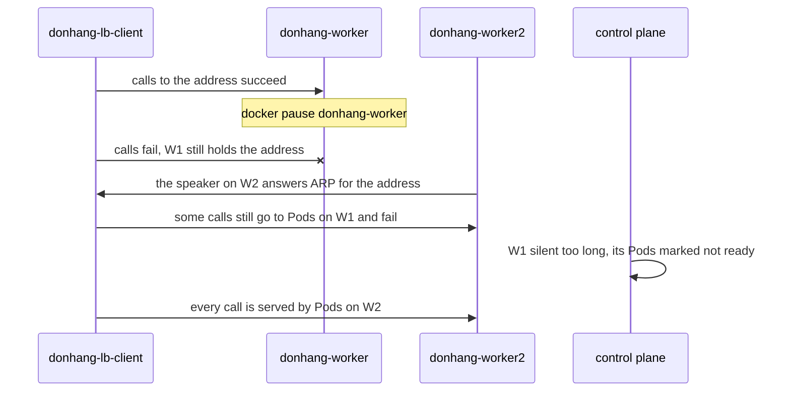

## Bạn cần biết trước

- [[k8s.l3.external-traffic-policy]] — địa chỉ LoadBalancer đi vào qua một node đang quảng bá, và kube-proxy trên node đó quyết định Pod nào nhận traffic.
- [[k8s.l2.ingress]] — Traefik, một Ingress controller, thực thi các rule của Ingress. Bài này chạy hai Pod Traefik và cho `echo-ip` đi qua chúng.
- [[k8s.l2.helm-releases]] — `helm upgrade --install` cài một chart thành một release với values của bạn. `traefik-ha.sh` cài Traefik theo cách đó.
- [[k8s.l1.deployments]] — Deployment giữ cho một số replica luôn chạy. Bài này quyết định chúng chạy ở đâu.

## Tình huống

Khách hàng muốn chạy Đơn Hàng trên ba máy của riêng họ, có MetalLB đứng trước, như ở các bài trước. Trước khi nhận lời, bạn xem staging cài Ingress controller thế nào. `apps/traefik.yaml` không đặt số replica, nên chart chạy một Pod Traefik, vừa đủ cho một node duy nhất của staging. Trên máy của khách hàng, Pod đó sẽ nằm trên một node, và mọi request từ ngoài đều đi qua nó. Bạn biết MetalLB chuyển địa chỉ sang node khác khi node của nó dừng. Nhưng nếu node đó giữ Pod Traefik duy nhất, địa chỉ chuyển tới nơi không ai trả lời. Điểm vào cần gì để vẫn phục vụ khi bất kỳ một node nào hỏng?

## Khái niệm cốt lõi

- **điểm lỗi duy nhất** (single point of failure) — thành phần mà chỉ riêng nó hỏng cũng đủ làm cả hệ thống ngừng chạy. Sau MetalLB, một Traefik chỉ có một Pod là điểm lỗi duy nhất, vì mất node của nó là mất toàn bộ traffic từ ngoài.
- **tính sẵn sàng cao** (high availability) — thiết kế để hệ thống vẫn phục vụ khi một thành phần hỏng, bằng cách bỏ mọi điểm lỗi duy nhất. Ở đây là hai Pod Traefik trở lên, trên các node khác nhau, đứng sau một địa chỉ mà layer 2 mode chuyển được.
- **topology spread constraint** (Luật trong Pod template bắt scheduler rải các Pod giống nhau đều qua node hoặc vùng, lệch tối đa maxSkew) — một luật trong Pod template, bắt scheduler rải các Pod khớp điều kiện qua các giá trị của một label trên node, chẳng hạn mỗi node một Pod. Với `DoNotSchedule`, scheduler chỉ đặt Pod ở nơi số Pod của mỗi giá trị không vượt số thấp nhất quá `maxSkew`.

## Cơ chế hoạt động



Với tình huống trên, cách sửa có hai phần. `donhang` có một node control plane và hai worker, là các node chạy Pod thông thường. Traefik chạy hai replica, và một topology spread constraint đặt chúng lên hai worker khác nhau. Một Service LoadBalancer cho cả hai chung một địa chỉ trong dải của MetalLB. Speaker của một worker quảng bá địa chỉ đó, và kube-proxy trên node ấy gửi mỗi kết nối tới một Pod Traefik sẵn sàng, ở chính node đó hoặc node kia (Service giữ mặc định `externalTrafficPolicy: Cluster`).

Sơ đồ đi theo đúng sự cố trong lab. Các node của `donhang` là container Docker, nên `traefik-ha.sh` đóng băng worker đang quảng bá bằng `docker pause`, giống một máy bỗng ngừng trả lời. Trong chốc lát, client vẫn gửi tới node đó, nên các lời gọi thất bại. Sau đó speaker trên `donhang-worker2` quảng bá địa chỉ: chính là failover ở bài layer 2.

Đến đây lời gọi vẫn có thể thất bại. Control plane chưa bỏ cuộc với node bị pause, nên vẫn coi Pod Traefik và Pod `echo-ip` trên node đó là sẵn sàng. Một số kết nối đi tới chúng và hết thời gian chờ. Chỉ khi không nghe gì từ node một lúc, control plane mới đánh dấu các Pod đó là chưa sẵn sàng. Từ lúc ấy, các Pod trên `donhang-worker2` phục vụ mọi lời gọi.

Vậy tính sẵn sàng cao ở đây nghĩa là điểm vào tự hồi phục sau một khoảng gián đoạn, chứ không phải không request nào thất bại. Thiếu Pod thứ hai, địa chỉ chuyển đi cũng chẳng dẫn tới đâu. Thiếu MetalLB, hai Pod không có địa chỉ chung nào để chuyển. Trong lúc một replica chết, replica kia gánh toàn bộ traffic, nên resource request của nó nên đủ cho cả tải. Kubelet chỉ giữ chỗ đúng bằng request. Vượt quá mức đó, replica chỉ có thêm tài nguyên nếu các Pod khác trên node còn chừa lại.

## Trong hệ thống Đơn Hàng

```yaml file=deploy/k8s/lessons/traefik-ha-values.yaml tag=stage-3 lines=5-25
deployment:
  replicas: 2
# maxSkew 1 with DoNotSchedule: the scheduler never puts a Pod where it
# would make one node hold two more than another, so two replicas land on
# two nodes. Honor: the control-plane node, which takes no such Pods, does
# not count.
topologySpreadConstraints:
  - maxSkew: 1
    topologyKey: kubernetes.io/hostname
    whenUnsatisfiable: DoNotSchedule
    nodeTaintsPolicy: Honor
    labelSelector:
      matchLabels:
        app.kubernetes.io/name: traefik
# lesson: k8s.l3.highly-available-entry-point
# Each replica must carry all the traffic while the other is down, so its
# requests are sized for the whole load, not for half of it.
resources:
  requests:
    cpu: 200m
    memory: 128Mi
```

Đây là values của chart Traefik, chart chép chúng vào Pod template của Deployment. `topologyKey: kubernetes.io/hostname` chỉ tới một label mà kubelet gắn lên mọi node, mang hostname của node. Trong kind, đó là tên node, nên mỗi node là một chỗ để rải Pod. `maxSkew: 1` nghĩa là không node nào được giữ nhiều hơn node ít nhất quá một Pod khớp điều kiện, và `DoNotSchedule` để Pod ở trạng thái `Pending` chứ không phá luật đó. `labelSelector` chỉ đếm các Pod của Traefik. Node control plane được đánh dấu để Pod thông thường không bị đặt lên nó, và `nodeTaintsPolicy: Honor` khiến constraint bỏ qua những node bị đánh dấu như vậy. Ở phần dưới của file, ngoài đoạn trích, `ingressClass` đặt tên Traefik này là `traefik-ha`, còn `service.spec.type` biến Service của nó thành LoadBalancer.

```bash file=scripts/k8s/traefik-ha.sh tag=stage-3 lines=34-51
# lesson: k8s.l3.highly-available-entry-point
# One worker stops: the one that announces the address, so it has to move.
# A call every second: some fail, until MetalLB has moved the address and
# the control plane has marked the stopped node's Pods not ready (its
# Traefik and its echo-ip), then every call succeeds again.
node=$(lb_node_ip "$ip")
echo "\$ docker pause $node"
docker pause "$node" >/dev/null
paused=$node
start=$SECONDS ok=0 failed=0 streak=0
while [ "$streak" -lt 20 ]; do
  if lb_get "$ip" 2 >/dev/null; then ok=$((ok + 1)); streak=$((streak + 1)); else failed=$((failed + 1)); streak=0; last_fail=$((SECONDS - start)); fi
  [ $((SECONDS - start)) -gt 300 ] && { echo "calls still failing after 300 s" >&2; exit 1; }
  sleep 1
done
echo "calls: $((ok + failed)), failed: $failed, the last one about ${last_fail:-0} s after the pause; then 20 in a row succeeded"
show kubectl get node "$node" -o custom-columns=NODE:.metadata.name,READY:.status.conditions[-1].status
echo "the address is announced by $(lb_node_ip "$ip")"
```

```text output=true
$ helm upgrade --install traefik-ha traefik --repo https://traefik.github.io/charts --version 41.6.1 \
    -n ha-lessons --create-namespace -f deploy/k8s/lessons/traefik-ha-values.yaml --wait
NAME: traefik-ha
STATUS: deployed
REVISION: 2
$ kubectl get pods -n ha-lessons -o custom-columns=POD:.metadata.name,NODE:.spec.nodeName
POD                  NODE
traefik-ha-...-...   donhang-worker...
traefik-ha-...-...   donhang-worker...
$ kubectl get service traefik-ha -n ha-lessons
NAME         TYPE           CLUSTER-IP   EXTERNAL-IP      PORT(S)                  AGE
traefik-ha   LoadBalancer   ...          172.22.255.201   80:.../TCP,443:.../TCP   ...

$ kubectl apply -f deploy/k8s/lessons/echo-ingress.yaml
ingress.networking.k8s.io/echo-ip unchanged
$ docker exec donhang-lb-client wget -qO- http://<traefik-ha's address>
echo-ip-...-... saw ...

$ docker pause donhang-worker
calls: ... s after the pause; then 20 in a row succeeded
$ kubectl get node donhang-worker -o custom-columns=NODE:.metadata.name,READY:.status.conditions[-1].status
NODE             READY
donhang-worker   Unknown
the address is announced by donhang-worker2
$ docker unpause donhang-worker
```

`lb_node_ip` tìm worker có địa chỉ phần cứng mà container client đã học được cho địa chỉ của Service, nhờ vậy script pause đúng node đang quảng bá. Hàm này, `lb_get` và `show` (in lệnh ra trước khi chạy) đến từ `scripts/lib/network-lessons.sh`, ngoài đoạn trích. Vòng lặp gọi, chờ một giây rồi gọi tiếp, mỗi lời gọi có thời gian chờ hai giây, và dừng sau 20 lần thành công liên tiếp.

Các dòng trước lệnh pause trong bản ghi đến từ phần trước của script: release Helm, hai Pod của nó, `EXTERNAL-IP` của Service, và một lời gọi qua `echo-ingress.yaml`. Ingress này có class `traefik-ha` và gửi mọi path tới `echo-ip`, ứng dụng từ các bài mạng trước, có Pod trả lời bằng tên của nó và địa chỉ nó thấy. Bản ghi che các con số, vốn thay đổi mỗi lần chạy, và tên node, vốn có thể đổi chỗ cho nhau. `READY` ghi `Unknown`: control plane đã không còn nghe được gì từ node.

## Senior hay nhầm rằng…

- **"Deployment có hai replica thì luôn chạy chúng trên hai node khác nhau."** → Thực ra khi không có constraint, scheduler chỉ ưu tiên rải chúng ra, và nó không di chuyển các Pod đang chạy. Cả hai có thể nằm trên một node, chẳng hạn khi node kia không đủ chỗ cho request của chúng. Bạn sẽ nhận ra khi cả hai replica hiện cùng một node, và dừng node đó vẫn làm sập service.
- **"Điểm vào có tính sẵn sàng cao nghĩa là không request nào thất bại khi một node chết."** → Thực ra lời gọi vẫn thất bại cho tới khi MetalLB chuyển địa chỉ và control plane đánh dấu các Pod của node đã mất là chưa sẵn sàng. Tính sẵn sàng cao rút ngắn sự cố xuống còn khoảng gián đoạn đó. Bạn sẽ nhận ra trong `traefik-ha.sh`: `failed` lớn hơn 0 dù có hai replica đã được rải ra.
- **"Chỉ cần MetalLB là điểm vào có tính sẵn sàng cao."** → Thực ra MetalLB chỉ chuyển địa chỉ. Nếu Pod Traefik duy nhất nằm trên node hỏng, lời gọi tiếp tục thất bại chừng nào chưa có Pod Traefik nào sẵn sàng trên một node đang chạy. Bạn sẽ nhận ra khi cluster chạy một replica Traefik: node của nó dừng, địa chỉ đã chuyển, vậy mà lời gọi vẫn thất bại.

## Thử ngay (3 phút)

Ở thư mục gốc của repo Đơn Hàng, khi Docker Desktop đang chạy và cluster `donhang` từ các bài trước đang chạy:

1. Chạy `scripts/k8s/traefik-ha.sh`. Nếu chưa có dải địa chỉ của MetalLB hoặc `donhang-lb-client`, script chạy `metallb-pool.sh` trước.
2. Đọc bảng `POD NODE`, rồi dòng `calls:` và hai dòng sau nó.

Kết quả mong đợi: hai Pod `traefik-ha` chạy trên hai worker khác nhau. `failed` lớn hơn 0, sau đó 20 lời gọi liên tiếp thành công. `READY` của node bị pause ghi `Unknown`, và dòng `the address is announced by …` ghi tên worker còn lại. Script unpause node khi kết thúc, kể cả khi dừng giữa chừng.

## Liên hệ

- [[k8s.l3.metallb-layer2-mode]] — bước trước: MetalLB chuyển địa chỉ. Bài này bảo đảm có thứ trả lời ở nơi địa chỉ chuyển tới.
- [[k8s.l3.control-plane-ha]] — cùng câu hỏi đó ở tầng dưới, cho control plane.
- [[k8s.l2.charts-through-argo-cd]] — nơi Traefik của staging đến từ. Staging giữ một replica trên node duy nhất của nó.
- [[k8s.l2.gateway-api]] — phần định tuyến mà staging đặt trước Traefik. Các Pod controller đứng sau nó vẫn phải sống sót khi mất một node.
- [[backend.l3.graceful-degradation]] — phía bên gọi trong khoảng gián đoạn: phục vụ ít hơn thay vì thất bại hẳn trong lúc điểm vào hồi phục.

## Tóm tắt 5 dòng

1. Điểm vào chỉ sống qua việc mất một node khi controller của nó có replica sẵn sàng trên các node khác, đứng sau một địa chỉ chuyển được.
2. Điểm lỗi duy nhất là thành phần mà chỉ riêng nó hỏng cũng làm hệ thống ngừng, như một Ingress controller một Pod sau MetalLB.
3. Topology spread constraint trên `kubernetes.io/hostname` với `maxSkew: 1` và `DoNotSchedule` đặt hai replica lên hai node khi xếp lịch cho chúng.
4. Khi một node dừng, lời gọi thất bại cho tới khi MetalLB chuyển địa chỉ và control plane đánh dấu các Pod của node đó là chưa sẵn sàng.
5. Trong lúc một replica chết, replica kia gánh toàn bộ traffic, nên hãy đặt request của mỗi replica đủ cho cả tải.
