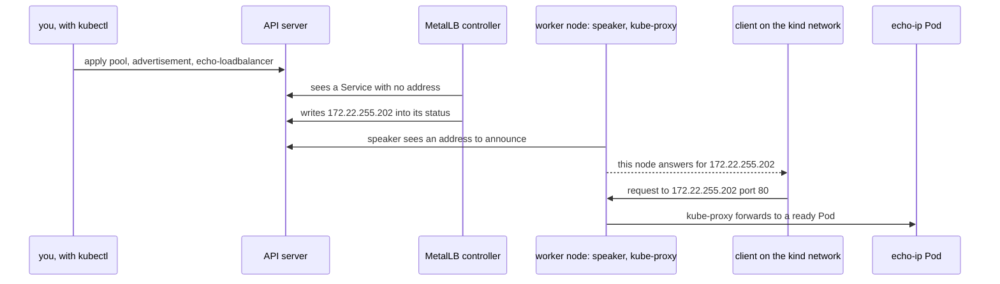

## Before you start

- [[k8s.l3.clusters-without-a-cloud]] — on a bare-metal cluster nothing answers a LoadBalancer Service until you install a component, and kind's nodes share the Docker network `kind`.
- [[k8s.l3.service-types]] — a LoadBalancer Service is a NodePort Service that also asks a controller for an outside address, shown as `EXTERNAL-IP`.
- [[devops.l1.docker-networks]] — containers on the same Docker network reach each other by address, while programs on your own machine cannot.

## The situation

The customer with its own server room answers your question about which addresses to use: its network team can set aside twenty addresses on the network its servers share, for Đơn Hàng's entry points. On `donhang`, `echo-loadbalancer` still shows `<pending>` under `EXTERNAL-IP`. Something has to choose one for each LoadBalancer Service, write it where `kubectl` shows it, and make a request sent to it arrive at a node. Nothing in the cluster knows those twenty addresses exist, or that it may use them. What do you install in the cluster, and what do you tell it, so that `echo-loadbalancer` gets one of those addresses and answers on it?

## Core concepts

- **MetalLB** — software you install into a bare-metal cluster that gives LoadBalancer Services addresses from pools you define and makes the network deliver each address to a node.
- MetalLB's controller — one Pod that watches LoadBalancer Services, picks an unused address from a pool for each and writes it into the Service's status.
- Speaker — the MetalLB Pod on every node; on a node allowed to announce, it makes that node answer for a Service's address on the network.
- `IPAddressPool` — a MetalLB object listing the addresses the controller may hand out.
- `L2Advertisement` — a MetalLB object choosing which pools' addresses the speakers announce on the nodes' own network; the L2 in its name stands for the announcing method of the next lesson.

## How it works



In the situation above, the twenty addresses become an `IPAddressPool`, and MetalLB is the component that hands them out. It runs as two parts, both Pods in the namespace `metallb-system`.

The controller watches LoadBalancer Services through the API server. You apply the pool, the advertisement and `echo-loadbalancer`, which has no address yet. The controller picks an unused one from the pool, `172.22.255.202` in the lab run, and writes it into the Service's status, so `EXTERNAL-IP` stops showing `<pending>`. The controller never touches a request; it only tracks which addresses are taken.

A speaker runs on every node. Once an address is written, the speakers make one node answer for it on the nodes' network, if an `L2Advertisement` covers its pool. To other machines it looks as if that node also has the address, so they send packets for it there. Which node, and how, is the next lesson. Nodes labelled `node.kubernetes.io/exclude-from-external-load-balancers`, on `donhang` the control-plane node, do not announce.

From there the path is the one a node port uses: kube-proxy on the node forwards the connection to a ready Pod, on that node or another. MetalLB is not in that path. The Service keeps its cluster IP and its node port; the outside address is one more way in.

The pool is the part MetalLB cannot work out by itself. For the announcements an `L2Advertisement` asks for, its addresses must be on the nodes' own network, or no machine there would send to a node, and nothing else may use them. MetalLB cannot see what other machines use, so on a real network you reserve the range with whoever hands out addresses there.

## In the Đơn Hàng system

MetalLB gets into `donhang` through `scripts/k8s/metallb-install.sh`. It applies `deploy/metallb/metallb-native.yaml`, a pinned copy of the manifest MetalLB's project publishes for version 0.15.3, which also adds MetalLB's own kinds of objects such as `IPAddressPool` to the cluster. The script then waits until the controller and every speaker are ready. Its captured run shows one controller and three speakers, one per node, the control-plane node included; a second command lists that node as the only one carrying the exclusion label.

```yaml file=deploy/k8s/lessons/metallb-pool.yaml tag=stage-3 lines=7-26
apiVersion: metallb.io/v1beta1
kind: IPAddressPool
metadata:
  name: lab-pool
  namespace: metallb-system
spec:
  addresses:
    - x.y.255.200-x.y.255.250
---
# lesson: k8s.l3.metallb-address-pools
# Without an L2Advertisement naming the pool, addresses are handed out but
# no speaker announces them: nothing on the network would reach them.
apiVersion: metallb.io/v1beta1
kind: L2Advertisement
metadata:
  name: lab-pool
  namespace: metallb-system
spec:
  ipAddressPools:
    - lab-pool
```

Both objects live in `metallb-system`, next to MetalLB's Pods, and both are named `lab-pool`. `addresses` takes a range written `first-last`; this one holds the 51 addresses ending in `.200` to `.250`. The `L2Advertisement` lists `lab-pool` under `ipAddressPools`; its comment says what happens without it.

`x.y` is not an address. The comment above these lines, outside the excerpt, says `metallb-pool.sh` replaces it with the first two numbers of the range of addresses Docker hands out on the `kind` network. That puts the pool far above the addresses Docker gave the nodes in the lab run (`172.22.0.x`).

```bash file=scripts/k8s/metallb-pool.sh tag=stage-3 lines=18-42
sed "s/x\.y\./$prefix./g" deploy/k8s/lessons/metallb-pool.yaml | kubectl apply -f -
show kubectl get ipaddresspools -n metallb-system
echo

# lesson: k8s.l3.metallb-address-pools
# echo-loadbalancer gets an address from the pool, and keeps its cluster
# IP and node port.
kubectl apply -f deploy/k8s/lessons/echo-loadbalancer.yaml >/dev/null
for _ in $(seq 60); do
  [ -n "$(kubectl get service echo-loadbalancer -n network-lessons -o jsonpath='{.status.loadBalancer.ingress[0].ip}')" ] && break
  sleep 1
done
show kubectl get service echo-loadbalancer -n network-lessons
lb_ip=$(kubectl get service echo-loadbalancer -n network-lessons -o jsonpath='{.status.loadBalancer.ingress[0].ip}')
echo

# lesson: k8s.l3.metallb-address-pools
# Docker Desktop does not route this machine to the network kind, so the
# call comes from a container attached to it, as any machine on a real
# network could call.
docker rm -f donhang-lb-client >/dev/null 2>&1 || true
echo "\$ docker run -d --name donhang-lb-client --network kind caddy:2.10.0 sleep infinity"
docker run -d --name donhang-lb-client --network kind caddy:2.10.0 sleep infinity >/dev/null
echo "\$ docker exec donhang-lb-client wget -qO- http://$lb_ip"
docker exec donhang-lb-client wget -T 5 -qO- "http://$lb_ip"
```

```text output=true
the network kind: 172.22.0.0/16
$ sed 's/x\.y\./172.22./g' deploy/k8s/lessons/metallb-pool.yaml | kubectl apply -f -
ipaddresspool.metallb.io/lab-pool created
l2advertisement.metallb.io/lab-pool created
$ kubectl get ipaddresspools -n metallb-system
NAME       AUTO ASSIGN   AVOID BUGGY IPS   ADDRESSES
lab-pool   true          false             ["172.22.255.200-172.22.255.250"]

$ kubectl get service echo-loadbalancer -n network-lessons
NAME                TYPE           CLUSTER-IP   EXTERNAL-IP      PORT(S)      AGE
echo-loadbalancer   LoadBalancer   ...          172.22.255.202   80:.../TCP   ...

$ docker run -d --name donhang-lb-client --network kind caddy:2.10.0 sleep infinity
$ docker exec donhang-lb-client wget -qO- http://172.22.255.202
echo-ip-...-... saw 172.22.0.3
```

The first line of the excerpt is the whole trick: `sed` turns `x.y.` into those two numbers, read with `docker network inspect kind` a few lines earlier, outside the excerpt, and pipes the result to `kubectl apply`. The output shows the range as `172.22.0.0/16`, Docker's way of writing every address that starts `172.22.`, so the pool becomes `172.22.255.200-172.22.255.250`. The loop then reads the address from the Service's status once a second, up to 60 times; `show` prints a command, then runs it.

`echo-loadbalancer` gets `172.22.255.202`, and `CLUSTER-IP` and the node port in `PORT(S)` are still there, masked in the capture. The last lines start a `caddy:2.10.0` container on the `kind` network, since Docker Desktop does not connect your machine to that network. Inside it, `wget`, a program that sends an HTTP request and prints the reply, calls the address. The reply names the Pod that answered and the address it saw the call come from, which a later lesson in this module explains.

## Seniors often assume…

- **"MetalLB is a load balancer that every request passes through, like a cloud's."** → Actually MetalLB only picks the address and makes one node answer for it; requests reach that node, and kube-proxy forwards them as it does for a node port. You notice this when you look in `IPAddressPool` and `L2Advertisement` for timeouts or balancing rules and find only addresses and where to announce them.
- **"MetalLB finds free addresses on the network by itself."** → Actually it hands out only what an `IPAddressPool` lists, and it cannot see which addresses other machines use. You notice this when a machine is later given an address from the pool: two machines now claim that address on the network, and calls to that Service may reach the other machine instead.
- **"A LoadBalancer address is reachable from anywhere, like a public cloud address."** → Actually it is an address on the nodes' own network, reachable from machines on that network and from networks connected so their packets can reach it. You notice this when the call from `donhang-lb-client` works but your own browser, on a machine Docker Desktop does not connect to `kind`, gets no answer.

## Try it (3 minutes)

From the root of the Đơn Hàng repository, with Docker Desktop running, kind and `kubectl` installed, and the `donhang` cluster from the earlier lessons running:

1. Run `scripts/k8s/metallb-install.sh`. If MetalLB is already installed, `kubectl apply` reports `unchanged` instead of `created`.
2. Run `scripts/k8s/metallb-pool.sh` and note the address under `EXTERNAL-IP`.
3. Open `http://` followed by that address in a browser on your machine.

Expected result: step 1 lists one controller and three speakers, one on each of `donhang-control-plane`, `donhang-worker` and `donhang-worker2`, all ready (`true`), then `node/donhang-control-plane` alone. In step 2, `EXTERNAL-IP` ends in a number from `.255.200` to `.255.250` after the first two numbers of your `kind` network, and the last line starts with `echo-ip-`. Step 3 does not load a page: the address answers only on the `kind` network.

## Connections

- [[k8s.l3.metallb-layer2-mode]] — the next step: which node answers for the address, how, and what happens when that node stops.
- [[k8s.l3.clusters-without-a-cloud]] — the gap this lesson fills: the first of the two jobs a cloud provider did.
- [[k8s.l3.service-types]] — the same Service one layer down: the cluster IP and node port the new address leads into.
- [[k8s.l2.ingress]] — what one such address can lead to when many HTTP Services should share a single entry point instead of one address each.
- [[foundation.l1.ip-and-ports]] — the idea underneath: an address is reachable only from networks that lead to it.

## Five-line summary

1. MetalLB gives LoadBalancer Services addresses from a pool you own: its controller picks one, and speakers make a node answer for it.
2. `metallb-install.sh` applies a pinned copy of MetalLB's published manifest and waits for the controller and one speaker per node.
3. An `IPAddressPool` lists addresses on the nodes' own network that nothing else uses; MetalLB cannot find free ones by itself.
4. `metallb-pool.sh` fills the pool from the `kind` network's range and adds an `L2Advertisement`, without which no speaker announces the addresses.
5. `echo-loadbalancer` then gets an `EXTERNAL-IP`, keeps its cluster IP and node port, and answers callers on the `kind` network.
