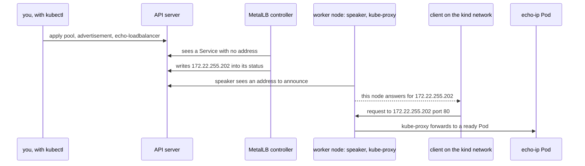

## Bạn cần biết trước

- [[k8s.l3.clusters-without-a-cloud]] — trên bare-metal cluster, không ai trả lời LoadBalancer Service cho tới khi bạn cài một thành phần làm việc đó, và các node của kind dùng chung Docker network `kind`.
- [[k8s.l3.service-types]] — LoadBalancer Service là NodePort Service còn xin một controller cấp địa chỉ ngoài, hiện ở cột `EXTERNAL-IP`.
- [[devops.l1.docker-networks]] — các container trên cùng một Docker network gọi được nhau qua địa chỉ, còn chương trình trên chính máy bạn thì không.

## Tình huống

Khách hàng có phòng server riêng trả lời câu hỏi của bạn về địa chỉ nên dùng: team mạng của họ dành được hai mươi địa chỉ trên mạng mà các server dùng chung, làm lối vào cho Đơn Hàng. Trên `donhang`, `echo-loadbalancer` vẫn hiện `<pending>` ở cột `EXTERNAL-IP`. Phải có thứ gì đó chọn một địa chỉ cho mỗi LoadBalancer Service, ghi nó vào chỗ `kubectl` hiển thị, và làm cho request gửi tới địa chỉ đó đến được một node. Trong cluster chưa có gì biết hai mươi địa chỉ ấy tồn tại, hay biết mình được phép dùng chúng. Bạn cài gì vào cluster, và khai gì cho nó, để `echo-loadbalancer` nhận một trong các địa chỉ đó và trả lời trên địa chỉ ấy?

## Khái niệm cốt lõi

- **MetalLB** (Phần mềm chạy trong cluster tự vận hành, cấp địa chỉ từ dải bạn khai cho LoadBalancer Service và quảng bá ra mạng) — phần mềm bạn cài vào bare-metal cluster, cấp cho LoadBalancer Service địa chỉ lấy từ các dải bạn khai, và làm cho mạng chuyển mỗi địa chỉ tới một node.
- Controller của MetalLB — một Pod theo dõi các LoadBalancer Service, chọn cho mỗi Service một địa chỉ chưa dùng trong dải và ghi nó vào status của Service.
- Speaker — Pod của MetalLB trên mỗi node. Trên node được phép quảng bá, speaker làm cho node đó trả lời thay cho địa chỉ của Service trên mạng.
- `IPAddressPool` — object của MetalLB liệt kê các địa chỉ controller được phép cấp.
- `L2Advertisement` — object của MetalLB chọn những dải nào được speaker quảng bá trên chính mạng của các node. Chữ L2 trong tên chỉ cách quảng bá mà bài sau sẽ giải thích.

## Cơ chế hoạt động



Trong tình huống trên, hai mươi địa chỉ trở thành một `IPAddressPool`, và MetalLB là thành phần cấp phát chúng. MetalLB chạy thành hai phần, đều là Pod trong namespace `metallb-system`.

Controller theo dõi các LoadBalancer Service qua API server. Bạn apply dải địa chỉ, advertisement và `echo-loadbalancer`, lúc này chưa có địa chỉ. Controller chọn một địa chỉ chưa dùng trong dải, là `172.22.255.202` trong lần chạy lab, rồi ghi vào status của Service, nên `EXTERNAL-IP` thôi hiện `<pending>`. Controller không bao giờ chạm vào request nào. Nó chỉ theo dõi địa chỉ nào đã có chủ.

Mỗi node chạy một speaker. Khi địa chỉ đã được ghi, các speaker làm cho một node trả lời thay cho địa chỉ đó trên mạng của các node, nếu có một `L2Advertisement` bao dải chứa nó. Với các máy khác, trông như node ấy có thêm địa chỉ này, nên chúng gửi packet cho địa chỉ đó tới node ấy. Node nào, và bằng cách nào, là chuyện của bài sau. Các node gắn label `node.kubernetes.io/exclude-from-external-load-balancers` không quảng bá. Trên `donhang`, đó là node control-plane.

Từ đó trở đi, đường đi giống hệt đường của node port: kube-proxy trên node chuyển kết nối tới một Pod sẵn sàng, trên node đó hoặc node khác. MetalLB không nằm trên đường đi này. Service vẫn giữ cluster IP và node port, địa chỉ ngoài chỉ là thêm một lối vào.

Dải địa chỉ là phần MetalLB không tự suy ra được. Với kiểu quảng bá mà `L2Advertisement` yêu cầu, các địa chỉ trong dải phải nằm trên chính mạng của các node, nếu không thì không máy nào trên mạng đó gửi tới một node, và không thứ gì khác được dùng chúng. MetalLB không thấy được máy khác đang dùng địa chỉ nào, nên trên mạng thật, bạn giữ chỗ dải địa chỉ với người cấp địa chỉ ở mạng đó.

## Trong hệ thống Đơn Hàng

MetalLB vào `donhang` qua `scripts/k8s/metallb-install.sh`. Script apply `deploy/metallb/metallb-native.yaml`, bản sao cố định của manifest mà dự án MetalLB công bố cho phiên bản 0.15.3. Manifest này cũng thêm vào cluster các loại object riêng của MetalLB như `IPAddressPool`. Sau đó script chờ tới khi controller và mọi speaker sẵn sàng. Lần chạy đã ghi lại cho thấy một controller và ba speaker, mỗi node một speaker, kể cả node control-plane. Một lệnh thứ hai liệt kê node đó là node duy nhất mang label loại trừ.

```yaml file=deploy/k8s/lessons/metallb-pool.yaml tag=stage-3 lines=7-26
apiVersion: metallb.io/v1beta1
kind: IPAddressPool
metadata:
  name: lab-pool
  namespace: metallb-system
spec:
  addresses:
    - x.y.255.200-x.y.255.250
---
# lesson: k8s.l3.metallb-address-pools
# Without an L2Advertisement naming the pool, addresses are handed out but
# no speaker announces them: nothing on the network would reach them.
apiVersion: metallb.io/v1beta1
kind: L2Advertisement
metadata:
  name: lab-pool
  namespace: metallb-system
spec:
  ipAddressPools:
    - lab-pool
```

Cả hai object nằm trong `metallb-system`, cạnh các Pod của MetalLB, và cùng tên `lab-pool`. `addresses` nhận một dải viết dạng `first-last`. Dải này gồm 51 địa chỉ, có đuôi từ `.200` tới `.250`. `L2Advertisement` liệt kê `lab-pool` dưới `ipAddressPools`, và comment của nó nói điều gì xảy ra nếu thiếu object này.

`x.y` không phải địa chỉ. Comment phía trên các dòng này, nằm ngoài đoạn trích, nói rằng `metallb-pool.sh` thay nó bằng hai số đầu của dải địa chỉ mà Docker cấp trên mạng `kind`. Nhờ vậy dải nằm cao hẳn so với các địa chỉ Docker đã cấp cho node trong lần chạy lab (`172.22.0.x`).

```bash file=scripts/k8s/metallb-pool.sh tag=stage-3 lines=18-42
sed "s/x\.y\./$prefix./g" deploy/k8s/lessons/metallb-pool.yaml | kubectl apply -f -
show kubectl get ipaddresspools -n metallb-system
echo

# lesson: k8s.l3.metallb-address-pools
# echo-loadbalancer gets an address from the pool, and keeps its cluster
# IP and node port.
kubectl apply -f deploy/k8s/lessons/echo-loadbalancer.yaml >/dev/null
for _ in $(seq 60); do
  [ -n "$(kubectl get service echo-loadbalancer -n network-lessons -o jsonpath='{.status.loadBalancer.ingress[0].ip}')" ] && break
  sleep 1
done
show kubectl get service echo-loadbalancer -n network-lessons
lb_ip=$(kubectl get service echo-loadbalancer -n network-lessons -o jsonpath='{.status.loadBalancer.ingress[0].ip}')
echo

# lesson: k8s.l3.metallb-address-pools
# Docker Desktop does not route this machine to the network kind, so the
# call comes from a container attached to it, as any machine on a real
# network could call.
docker rm -f donhang-lb-client >/dev/null 2>&1 || true
echo "\$ docker run -d --name donhang-lb-client --network kind caddy:2.10.0 sleep infinity"
docker run -d --name donhang-lb-client --network kind caddy:2.10.0 sleep infinity >/dev/null
echo "\$ docker exec donhang-lb-client wget -qO- http://$lb_ip"
docker exec donhang-lb-client wget -T 5 -qO- "http://$lb_ip"
```

```text output=true
the network kind: 172.22.0.0/16
$ sed 's/x\.y\./172.22./g' deploy/k8s/lessons/metallb-pool.yaml | kubectl apply -f -
ipaddresspool.metallb.io/lab-pool created
l2advertisement.metallb.io/lab-pool created
$ kubectl get ipaddresspools -n metallb-system
NAME       AUTO ASSIGN   AVOID BUGGY IPS   ADDRESSES
lab-pool   true          false             ["172.22.255.200-172.22.255.250"]

$ kubectl get service echo-loadbalancer -n network-lessons
NAME                TYPE           CLUSTER-IP   EXTERNAL-IP      PORT(S)      AGE
echo-loadbalancer   LoadBalancer   ...          172.22.255.202   80:.../TCP   ...

$ docker run -d --name donhang-lb-client --network kind caddy:2.10.0 sleep infinity
$ docker exec donhang-lb-client wget -qO- http://172.22.255.202
echo-ip-...-... saw 172.22.0.3
```

Dòng đầu của đoạn trích là toàn bộ mẹo: `sed` đổi `x.y.` thành hai số kia, đọc bằng `docker network inspect kind` vài dòng phía trên, ngoài đoạn trích, rồi chuyển kết quả qua pipe cho `kubectl apply`. Output cho thấy dải là `172.22.0.0/16`, cách Docker viết mọi địa chỉ bắt đầu bằng `172.22.`, nên dải địa chỉ trở thành `172.22.255.200-172.22.255.250`. Sau đó vòng lặp đọc địa chỉ từ status của Service mỗi giây một lần, tối đa 60 lần. `show` in một lệnh ra rồi chạy nó.

`echo-loadbalancer` nhận `172.22.255.202`, còn `CLUSTER-IP` và node port trong `PORT(S)` vẫn ở đó, chỉ bị che trong bản ghi. Mấy dòng cuối khởi động một container `caddy:2.10.0` trên mạng `kind`, vì Docker Desktop không nối máy bạn vào mạng đó. Bên trong container, `wget`, chương trình gửi một HTTP request và in phản hồi, gọi tới địa chỉ này. Phản hồi cho biết tên Pod đã trả lời và địa chỉ mà Pod thấy lời gọi đến từ đó, điều một bài sau trong module này giải thích.

## Senior hay nhầm rằng…

- **"MetalLB là load balancer mà mọi request đều đi qua, giống của cloud."** → Thực ra MetalLB chỉ chọn địa chỉ và làm cho một node trả lời thay cho địa chỉ đó. Request tới node ấy, và kube-proxy chuyển tiếp chúng như với node port. Bạn sẽ nhận ra khi tìm timeout hay quy tắc cân bằng tải trong `IPAddressPool` và `L2Advertisement`, và chỉ thấy địa chỉ cùng nơi quảng bá chúng.
- **"MetalLB tự tìm địa chỉ còn trống trên mạng."** → Thực ra MetalLB chỉ cấp những gì `IPAddressPool` liệt kê, và không thấy được máy khác đang dùng địa chỉ nào. Bạn sẽ nhận ra khi về sau một máy được cấp một địa chỉ trong dải: lúc đó hai máy cùng nhận địa chỉ ấy trên mạng, và lời gọi tới Service đó có thể tới nhầm máy kia.
- **"Địa chỉ LoadBalancer gọi được từ bất cứ đâu, như địa chỉ public trên cloud."** → Thực ra đó là địa chỉ trên chính mạng của các node, gọi được từ các máy trên mạng đó và từ những mạng được nối sao cho packet của chúng tới được. Bạn sẽ nhận ra khi lời gọi từ `donhang-lb-client` chạy được, còn trình duyệt trên máy bạn, máy mà Docker Desktop không nối vào `kind`, không nhận được phản hồi.

## Thử ngay (3 phút)

Ở thư mục gốc của repo Đơn Hàng, khi Docker Desktop đang chạy, máy đã cài kind cùng `kubectl`, và cluster `donhang` từ các bài trước đang chạy:

1. Chạy `scripts/k8s/metallb-install.sh`. Nếu MetalLB đã được cài, `kubectl apply` báo `unchanged` thay vì `created`.
2. Chạy `scripts/k8s/metallb-pool.sh` và ghi lại địa chỉ ở cột `EXTERNAL-IP`.
3. Mở `http://` kèm địa chỉ đó trong trình duyệt trên máy bạn.

Kết quả mong đợi: bước 1 liệt kê một controller và ba speaker, mỗi speaker trên một trong `donhang-control-plane`, `donhang-worker` và `donhang-worker2`, tất cả sẵn sàng (`true`), rồi chỉ một dòng `node/donhang-control-plane`. Ở bước 2, `EXTERNAL-IP` có hai số đầu của mạng `kind` trên máy bạn, theo sau là một số từ `.255.200` tới `.255.250`, và dòng cuối bắt đầu bằng `echo-ip-`. Bước 3 không mở được trang nào: địa chỉ này chỉ trả lời trên mạng `kind`.

## Liên hệ

- [[k8s.l3.metallb-layer2-mode]] — bước tiếp theo: node nào trả lời thay cho địa chỉ, bằng cách nào, và chuyện gì xảy ra khi node đó ngừng chạy.
- [[k8s.l3.clusters-without-a-cloud]] — chỗ hổng bài này lấp: việc thứ nhất trong hai việc nhà cung cấp cloud từng làm.
- [[k8s.l3.service-types]] — cùng Service đó nhìn xuống một tầng: cluster IP và node port mà địa chỉ mới dẫn vào.
- [[k8s.l2.ingress]] — một địa chỉ như vậy có thể dẫn tới đâu khi nhiều HTTP Service nên dùng chung một lối vào thay vì mỗi Service một địa chỉ.
- [[foundation.l1.ip-and-ports]] — ý tưởng nằm bên dưới: một địa chỉ chỉ gọi được từ những mạng dẫn tới nó.

## Tóm tắt 5 dòng

1. MetalLB cấp cho LoadBalancer Service địa chỉ từ dải bạn giữ: controller chọn một địa chỉ, và speaker làm cho một node trả lời thay cho nó.
2. `metallb-install.sh` apply bản sao cố định của manifest MetalLB công bố, rồi chờ controller và mỗi node một speaker.
3. `IPAddressPool` liệt kê các địa chỉ trên chính mạng của các node mà không thứ gì khác dùng. MetalLB không tự tìm được địa chỉ trống.
4. `metallb-pool.sh` điền dải từ dải địa chỉ của mạng `kind` và thêm một `L2Advertisement`, thiếu nó thì không speaker nào quảng bá các địa chỉ.
5. Khi đó `echo-loadbalancer` nhận một `EXTERNAL-IP`, vẫn giữ cluster IP và node port, và trả lời những ai gọi từ mạng `kind`.
