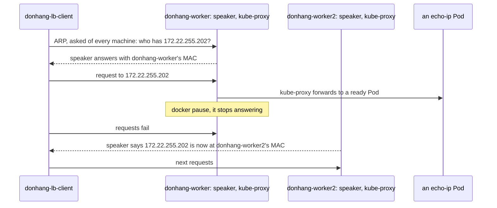

## Before you start

- [[k8s.l3.metallb-address-pools]] — MetalLB's controller gives `echo-loadbalancer` an address from `lab-pool`, and its speakers make one node answer for it.
- [[k8s.l3.kube-proxy]] — kube-proxy on every node turns a Service into rules that send each new connection to one ready Pod.

## The situation

The customer's network team reads your plan for its own machines and asks two questions. If the server that receives traffic for Đơn Hàng's address stops, what do callers see? And does that address spread traffic over all three servers? On `donhang`, `echo-loadbalancer` answers on `172.22.255.202` when `donhang-lb-client` calls it. Yet no node's network card carries that address, and the last lesson only said that "a node" answers for it. Which node receives the traffic for the address, how does a caller find that node, and what happens to calls when it stops?

## Core concepts

- **ARP** — the protocol a machine uses to find who holds an IP address on its own network: it asks every machine there, and the holder answers with its hardware address.
- Hardware (MAC) address — the address of one network card, used to deliver packets between machines on the same network; Docker gives each container on `kind` one.
- Layer 2 mode — the announcing method an `L2Advertisement` asks for: the speakers choose one node per Service address, and only that node's speaker answers ARP for it.
- `ServiceL2Status` — a MetalLB object in `metallb-system` that records which node announces a Service's address.
- **failover** — moving work automatically from a failed component to one that stands by; some requests fail while the switch happens.

## How it works



`donhang-lb-client` knows only the address `172.22.255.202`. To send a packet on the `kind` network it needs a hardware address, so it uses ARP: it asks every machine on the network who has `172.22.255.202`. Every speaker hears the question, including the one on `donhang-worker2`, which the diagram leaves out, but only the speaker on the node chosen for this address answers, with its node's hardware address. In the lab run that node is `donhang-worker`. The client keeps the answer in its ARP table and sends packets there.

The address is set on no network card. The node accepts the packets because kube-proxy there has rules for the Service's outside address, as it has for the cluster IP. kube-proxy then forwards each connection to a ready Pod, on that node or another. So connections spread over Pods, but all traffic for the address enters through one node's network link. The speakers may choose different nodes for different addresses, but never two nodes for one.

Then `docker pause` freezes every process in the `donhang-worker` container, standing in for a machine that dies, and its speaker stops answering. The other speakers notice it is gone, and the one on `donhang-worker2` takes over. It tells the network, without being asked, that the address is now at its node's hardware address. Until a client learns that, its calls still go to the stopped node and fail. That is failover: the address survives the loss of a node, with a gap, and it never shares one address's traffic among nodes.

## In the Đơn Hàng system

```bash file=scripts/k8s/metallb-l2.sh tag=stage-3 lines=16-26
# lesson: k8s.l3.metallb-layer2-mode
# One node's speaker answers ARP for the address: MetalLB records which in
# a ServiceL2Status. The client asked "who has this address?" and learned
# that node's hardware address; the address itself is on no network card.
lb_get "$lb" >/dev/null
node=$(lb_node echo-loadbalancer)
echo "echo-loadbalancer: $lb, announced by $node"
show kubectl get servicel2statuses -n metallb-system -o custom-columns=SERVICE:.status.serviceName,NODE:.status.node
echo "MAC of $node: $(mac_of "$node")"
echo "the client's ARP entry for $lb: $(arp_of "$lb")"
echo
```

`$lb` holds the address the script read from the Service earlier. `lb_get` calls it once from `donhang-lb-client`, so the client has an ARP entry for it, asking with ARP if it had none. `lb_node` names the node whose hardware address the client's ARP table holds for the address. `show` prints a command before running it; here `kubectl get servicel2statuses` shows MetalLB's own record of the same choice. `mac_of` asks Docker for a node container's hardware address on `kind`, and `arp_of` reads the client's ARP table from `/proc/net/arp`. These helpers, `show` included, come from `scripts/lib/network-lessons.sh`, outside the excerpt.

```bash file=scripts/k8s/metallb-l2.sh tag=stage-3 lines=28-47
# lesson: k8s.l3.metallb-layer2-mode
# The announcing node stops: its container is paused. The client keeps
# calling, once a second, until its ARP entry names another node: the other
# speakers noticed and one of them announced the address from its node.
old_mac=$(arp_of "$lb")
echo "\$ docker pause $node"
docker pause "$node" >/dev/null
paused=$node
start=$SECONDS
calls=0 failed=0
while [ "$(arp_of "$lb")" = "$old_mac" ]; do
  calls=$((calls + 1))
  lb_get "$lb" 1 >/dev/null || failed=$((failed + 1))
  [ $((SECONDS - start)) -gt 120 ] && { echo "the address did not move in 120 s" >&2; exit 1; }
  sleep 1
done
new_mac=$(arp_of "$lb")
new=$(lb_node echo-loadbalancer)
echo "after about $((SECONDS - start)) s and $calls calls ($failed failed): the client's ARP entry for $lb is $new_mac, the MAC of $new"
echo
```

```text output=true
echo-loadbalancer: 172.22.255.202, announced by donhang-worker
$ kubectl get servicel2statuses -n metallb-system -o custom-columns=SERVICE:.status.serviceName,NODE:.status.node
SERVICE                   NODE
echo-loadbalancer-local   donhang-worker...
echo-loadbalancer         donhang-worker...
traefik-ha                donhang-worker...
MAC of donhang-worker: ...
the client's ARP entry for 172.22.255.202: ...

$ docker pause donhang-worker
after about ... failed): the client's ARP entry for 172.22.255.202 is ..., the MAC of donhang-worker2

$ docker unpause donhang-worker
```

The paused node's speaker and kube-proxy stop with it. The loop calls the address, allowing each call one second, waits one second, and repeats, counting failures until the client's ARP entry changes. After 120 seconds it gives up. Lines after the excerpt unpause the node and wait until it is ready again, and a `trap` near the top unpauses it even if the script fails.

In the capture, `donhang-worker` announces `172.22.255.202` first and `donhang-worker2` after the pause. The control-plane node never announces: it carries the label `node.kubernetes.io/exclude-from-external-load-balancers`, which the speakers honor. The capture masks values that change between runs: hardware addresses, the seconds and the call counts, and the end of the node names in the table; in your run the rows may name different workers. The other two `servicel2statuses` rows are Services of other lessons in this module, present on `donhang` when the capture ran.

MetalLB has one other mode. It announces addresses to the network's routers, the devices that pass packets between networks, instead of answering ARP, and a router can then spread the traffic for one address over several nodes. The `kind` network has no such router, so this module uses layer 2 mode only.

## Seniors often assume…

- **"Layer 2 mode spreads incoming traffic across all the nodes."** → Actually one node receives all traffic for an address, because only its speaker answers ARP; kube-proxy then spreads connections over Pods, but every byte crosses that node's link first. You notice this when the client's ARP table holds a single hardware address for `172.22.255.202`, and when, under load, that node's network link fills first, while the other nodes receive only the connections it forwards to their Pods.
- **"The address moves to another node instantly, with no failed connections."** → Actually the other speakers first have to notice that the node stopped, and clients keep sending to the old hardware address until they learn the new one. You notice this when the `failed` count in `metallb-l2.sh` is above zero, or when callers of a real service see errors for a short time after a node dies.
- **"MetalLB adds the address to a network card of the chosen node."** → Actually the speaker only answers ARP for it, and kube-proxy's rules on the node accept the packets. You notice this when you list the announcing node's addresses while debugging and `172.22.255.202` is not among them, yet calls to it work.

## Try it (3 minutes)

From the root of the Đơn Hàng repository, with Docker Desktop running and the `donhang` cluster from the earlier lessons running:

1. Run `scripts/k8s/metallb-l2.sh`. If the pool or `donhang-lb-client` is missing, it runs `metallb-pool.sh` first.
2. Compare the `MAC of` line with the line for the client's ARP entry, then read the line starting `after about`.

Expected result: the first line names `donhang-worker` or `donhang-worker2`, never `donhang-control-plane`, and the two hardware addresses below the table are equal. The `after about` line names the other worker and a different hardware address, and its `failed` count may be above zero. The last line is `$ docker unpause` followed by the paused node's name.

## Connections

- [[k8s.l3.metallb-address-pools]] — the step before: where the address comes from; this lesson is how the network reaches it.
- [[k8s.l3.kube-proxy]] — what happens after the announcing node: the same rules that serve a cluster IP spread connections over Pods.
- [[k8s.l3.external-traffic-policy]] — the next lesson: which nodes may announce when a Service keeps client addresses, and what that does to the spread.
- [[k8s.l3.pod-network-model]] — the network kube-proxy forwards into once traffic is inside the announcing node, since the Pod it picks may run on another node.
- [[backend.l3.graceful-degradation]] — the application's side of failover: deciding in advance what callers do during the seconds a dependency is unreachable.

## Five-line summary

1. In layer 2 mode, one node's speaker answers ARP for a Service address, so all its traffic enters through that node.
2. ARP finds who holds an IP address on one network: every machine is asked, and the holder answers with its hardware address.
3. The address is on no network card; kube-proxy's rules on the announcing node accept it and forward each connection to a ready Pod.
4. When that node stops, another speaker announces the address from its own node; calls in the gap can fail, so this is failover.
5. MetalLB's other mode announces to routers, which can spread one address over nodes; the lab has no router, so it uses layer 2.
