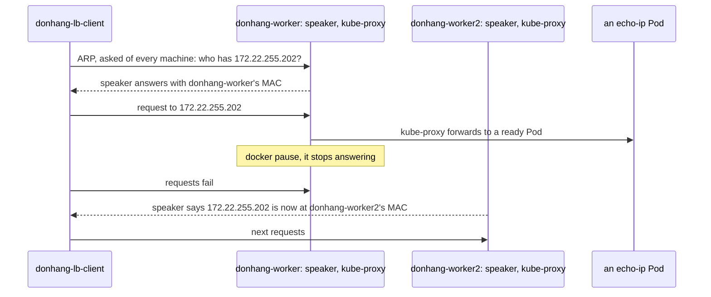

## Bạn cần biết trước

- [[k8s.l3.metallb-address-pools]] — controller của MetalLB cấp cho `echo-loadbalancer` một địa chỉ trong `lab-pool`, và các speaker làm cho một node trả lời thay cho địa chỉ đó.
- [[k8s.l3.kube-proxy]] — kube-proxy trên mỗi node biến một Service thành các quy tắc, gửi mỗi kết nối mới tới một Pod sẵn sàng.

## Tình huống

Team mạng của khách hàng đọc kế hoạch bạn viết cho các máy của họ và hỏi hai câu. Nếu server nhận traffic cho địa chỉ của Đơn Hàng ngừng chạy, bên gọi sẽ thấy gì? Và địa chỉ đó có chia traffic ra cả ba server không? Trên `donhang`, `echo-loadbalancer` trả lời trên `172.22.255.202` khi `donhang-lb-client` gọi tới. Thế nhưng không card mạng nào của các node mang địa chỉ đó, và bài trước chỉ nói "một node" trả lời thay cho nó. Node nào nhận traffic của địa chỉ này, bên gọi tìm ra node đó bằng cách nào, và lời gọi ra sao khi node đó ngừng?

## Khái niệm cốt lõi

- **ARP** (Giao thức một máy hỏi cả mạng cục bộ xem IP nào thuộc địa chỉ phần cứng (MAC) nào) — giao thức một máy dùng để tìm xem ai đang giữ một địa chỉ IP trên chính mạng của mình: nó hỏi mọi máy trên mạng đó, và máy giữ địa chỉ trả lời bằng địa chỉ phần cứng của mình.
- Địa chỉ phần cứng (MAC) — địa chỉ của một card mạng, dùng để chuyển packet giữa các máy trên cùng một mạng. Docker cấp cho mỗi container trên `kind` một địa chỉ như vậy.
- Layer 2 mode — cách quảng bá mà một `L2Advertisement` yêu cầu: các speaker chọn một node cho mỗi địa chỉ Service, và chỉ speaker của node đó trả lời ARP cho địa chỉ ấy.
- `ServiceL2Status` — object của MetalLB trong `metallb-system`, ghi lại node nào đang quảng bá địa chỉ của một Service.
- **failover** (Tự chuyển việc từ thành phần hỏng sang thành phần dự phòng, trong lúc chuyển, một số request vẫn lỗi) — tự động chuyển việc từ một thành phần bị hỏng sang một thành phần đang chờ sẵn. Trong lúc chuyển, một số request sẽ lỗi.

## Cơ chế hoạt động



`donhang-lb-client` chỉ biết địa chỉ `172.22.255.202`. Để gửi packet trên mạng `kind`, client cần một địa chỉ phần cứng, nên nó dùng ARP: hỏi mọi máy trên mạng xem ai giữ `172.22.255.202`. Speaker nào cũng nghe câu hỏi, kể cả speaker trên `donhang-worker2` mà sơ đồ không vẽ, nhưng chỉ speaker trên node được chọn cho địa chỉ này trả lời, bằng địa chỉ phần cứng của node mình. Trong lần chạy lab, node đó là `donhang-worker`. Client lưu câu trả lời vào bảng ARP và gửi packet tới đó.

Địa chỉ này không gắn trên card mạng nào. Node nhận packet là nhờ kube-proxy trên node có quy tắc cho địa chỉ ngoài của Service, giống như quy tắc cho cluster IP. Sau đó kube-proxy chuyển mỗi kết nối tới một Pod sẵn sàng, trên node đó hoặc node khác. Vậy kết nối được chia ra các Pod, nhưng mọi traffic của địa chỉ đều đi vào qua đường mạng của một node. Các speaker có thể chọn node khác nhau cho các địa chỉ khác nhau, nhưng không bao giờ chọn hai node cho một địa chỉ.

Tiếp theo, `docker pause` đóng băng mọi process trong container `donhang-worker`, đóng vai một máy bị chết, và speaker của nó thôi trả lời. Các speaker khác nhận ra speaker đó đã mất, và speaker trên `donhang-worker2` nhận lại phần việc. Nó tự báo cho cả mạng, không đợi ai hỏi, rằng địa chỉ giờ nằm ở địa chỉ phần cứng của node nó. Cho tới khi client biết điều đó, lời gọi của client vẫn tới node đã ngừng và bị lỗi. Đó là failover: địa chỉ vẫn sống khi mất một node, kèm một khoảng hở, và traffic của một địa chỉ không bao giờ được chia cho nhiều node.

## Trong hệ thống Đơn Hàng

```bash file=scripts/k8s/metallb-l2.sh tag=stage-3 lines=16-26
# lesson: k8s.l3.metallb-layer2-mode
# One node's speaker answers ARP for the address: MetalLB records which in
# a ServiceL2Status. The client asked "who has this address?" and learned
# that node's hardware address; the address itself is on no network card.
lb_get "$lb" >/dev/null
node=$(lb_node echo-loadbalancer)
echo "echo-loadbalancer: $lb, announced by $node"
show kubectl get servicel2statuses -n metallb-system -o custom-columns=SERVICE:.status.serviceName,NODE:.status.node
echo "MAC of $node: $(mac_of "$node")"
echo "the client's ARP entry for $lb: $(arp_of "$lb")"
echo
```

`$lb` giữ địa chỉ mà script đã đọc từ Service ở phía trên. `lb_get` gọi địa chỉ đó một lần từ `donhang-lb-client`, để client có một dòng ARP cho nó, hỏi bằng ARP nếu chưa có. `lb_node` cho biết tên node có địa chỉ phần cứng nằm trong bảng ARP của client ứng với địa chỉ này. `show` in một lệnh ra rồi chạy nó. Ở đây `kubectl get servicel2statuses` cho thấy bản ghi riêng của MetalLB về cùng lựa chọn đó. `mac_of` hỏi Docker địa chỉ phần cứng của một container node trên `kind`, còn `arp_of` đọc bảng ARP của client từ `/proc/net/arp`. Các hàm hỗ trợ này, kể cả `show`, đến từ `scripts/lib/network-lessons.sh`, ngoài đoạn trích.

```bash file=scripts/k8s/metallb-l2.sh tag=stage-3 lines=28-47
# lesson: k8s.l3.metallb-layer2-mode
# The announcing node stops: its container is paused. The client keeps
# calling, once a second, until its ARP entry names another node: the other
# speakers noticed and one of them announced the address from its node.
old_mac=$(arp_of "$lb")
echo "\$ docker pause $node"
docker pause "$node" >/dev/null
paused=$node
start=$SECONDS
calls=0 failed=0
while [ "$(arp_of "$lb")" = "$old_mac" ]; do
  calls=$((calls + 1))
  lb_get "$lb" 1 >/dev/null || failed=$((failed + 1))
  [ $((SECONDS - start)) -gt 120 ] && { echo "the address did not move in 120 s" >&2; exit 1; }
  sleep 1
done
new_mac=$(arp_of "$lb")
new=$(lb_node echo-loadbalancer)
echo "after about $((SECONDS - start)) s and $calls calls ($failed failed): the client's ARP entry for $lb is $new_mac, the MAC of $new"
echo
```

```text output=true
echo-loadbalancer: 172.22.255.202, announced by donhang-worker
$ kubectl get servicel2statuses -n metallb-system -o custom-columns=SERVICE:.status.serviceName,NODE:.status.node
SERVICE                   NODE
echo-loadbalancer-local   donhang-worker...
echo-loadbalancer         donhang-worker...
traefik-ha                donhang-worker...
MAC of donhang-worker: ...
the client's ARP entry for 172.22.255.202: ...

$ docker pause donhang-worker
after about ... failed): the client's ARP entry for 172.22.255.202 is ..., the MAC of donhang-worker2

$ docker unpause donhang-worker
```

Speaker và kube-proxy của node bị pause ngừng theo node. Vòng lặp gọi địa chỉ, cho mỗi lời gọi một giây, chờ một giây rồi lặp lại, đếm số lần lỗi cho tới khi dòng ARP của client đổi. Sau 120 giây, vòng lặp bỏ cuộc. Các dòng sau đoạn trích unpause node và chờ tới khi node sẵn sàng lại, còn một `trap` gần đầu script unpause node kể cả khi script lỗi.

Trong bản ghi, `donhang-worker` quảng bá `172.22.255.202` trước, và `donhang-worker2` quảng bá sau khi pause. Node control-plane không bao giờ quảng bá: node này mang label `node.kubernetes.io/exclude-from-external-load-balancers`, và các speaker tôn trọng label đó. Bản ghi che những giá trị thay đổi giữa các lần chạy: địa chỉ phần cứng, số giây và số lời gọi, cùng phần cuối tên node trong bảng. Ở lần chạy của bạn, các dòng có thể ghi tên worker khác. Hai dòng `servicel2statuses` còn lại là Service của các bài khác trong module này, đã có trên `donhang` lúc ghi bản chạy.

MetalLB còn một mode khác. Thay vì trả lời ARP, mode đó quảng bá địa chỉ cho router của mạng, thiết bị chuyển packet giữa các mạng, và router khi đó có thể chia traffic của một địa chỉ ra nhiều node. Mạng `kind` không có router như vậy, nên module này chỉ dùng layer 2 mode.

## Senior hay nhầm rằng…

- **"Layer 2 mode chia traffic đi vào ra mọi node."** → Thực ra một node nhận mọi traffic của một địa chỉ, vì chỉ speaker của node đó trả lời ARP. kube-proxy sau đó chia kết nối ra các Pod, nhưng từng byte đều đi qua đường mạng của node ấy trước. Bạn sẽ nhận ra khi bảng ARP của client chỉ giữ một địa chỉ phần cứng cho `172.22.255.202`, và khi tải cao, đường mạng của node đó đầy trước, còn các node khác chỉ nhận những kết nối nó chuyển tới Pod của chúng.
- **"Địa chỉ chuyển sang node khác ngay lập tức, không kết nối nào lỗi."** → Thực ra các speaker khác phải nhận ra node đã ngừng trước, và client vẫn gửi tới địa chỉ phần cứng cũ cho tới khi biết địa chỉ mới. Bạn sẽ nhận ra khi số `failed` trong `metallb-l2.sh` lớn hơn 0, hoặc khi bên gọi một service thật thấy lỗi trong một lúc ngắn sau khi một node chết.
- **"MetalLB gắn địa chỉ vào một card mạng của node được chọn."** → Thực ra speaker chỉ trả lời ARP cho địa chỉ đó, còn quy tắc của kube-proxy trên node nhận packet. Bạn sẽ nhận ra khi đang debug, liệt kê địa chỉ của node đang quảng bá mà không thấy `172.22.255.202`, dù lời gọi tới địa chỉ đó vẫn chạy.

## Thử ngay (3 phút)

Ở thư mục gốc của repo Đơn Hàng, khi Docker Desktop đang chạy và cluster `donhang` từ các bài trước đang chạy:

1. Chạy `scripts/k8s/metallb-l2.sh`. Nếu chưa có dải địa chỉ hoặc `donhang-lb-client`, script chạy `metallb-pool.sh` trước.
2. So dòng `MAC of` với dòng về dòng ARP của client, rồi đọc dòng bắt đầu bằng `after about`.

Kết quả mong đợi: dòng đầu ghi `donhang-worker` hoặc `donhang-worker2`, không bao giờ là `donhang-control-plane`, và hai địa chỉ phần cứng bên dưới bảng giống nhau. Dòng `after about` ghi tên worker còn lại và một địa chỉ phần cứng khác, số `failed` có thể lớn hơn 0. Dòng cuối là `$ docker unpause` kèm tên node đã bị pause.

## Liên hệ

- [[k8s.l3.metallb-address-pools]] — bước trước: địa chỉ từ đâu ra. Bài này là cách mạng tìm tới nó.
- [[k8s.l3.kube-proxy]] — điều xảy ra sau node đang quảng bá: chính các quy tắc phục vụ cluster IP chia kết nối ra các Pod.
- [[k8s.l3.external-traffic-policy]] — bài tiếp theo: những node nào được quảng bá khi một Service giữ địa chỉ của client, và điều đó ảnh hưởng ra sao tới cách chia traffic.
- [[k8s.l3.pod-network-model]] — mạng mà kube-proxy chuyển traffic vào sau khi traffic đã vào node đang quảng bá, vì Pod được chọn có thể chạy trên node khác.
- [[backend.l3.graceful-degradation]] — phía ứng dụng của failover: quyết định trước bên gọi làm gì trong mấy giây một dependency không gọi được.

## Tóm tắt 5 dòng

1. Ở layer 2 mode, speaker của một node trả lời ARP cho một địa chỉ Service, nên mọi traffic của địa chỉ đó đi vào qua node ấy.
2. ARP tìm xem ai giữ một địa chỉ IP trên một mạng: mọi máy đều được hỏi, và máy giữ địa chỉ trả lời bằng địa chỉ phần cứng của mình.
3. Địa chỉ không gắn trên card mạng nào. Quy tắc của kube-proxy trên node đang quảng bá nhận nó và chuyển mỗi kết nối tới một Pod sẵn sàng.
4. Khi node đó ngừng, một speaker khác quảng bá địa chỉ từ node của mình. Lời gọi trong khoảng hở có thể lỗi, nên đây là failover.
5. Mode còn lại của MetalLB quảng bá cho router, router có thể chia một địa chỉ ra nhiều node. Lab không có router nên dùng layer 2.
