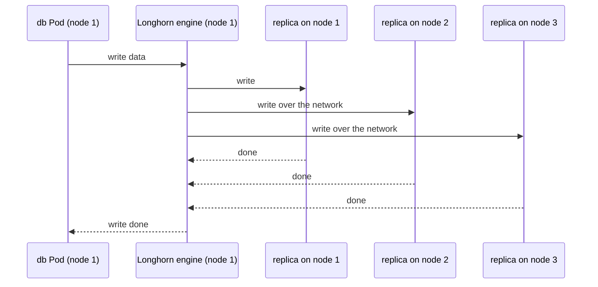

## Before you start

- [[k8s.l3.csi-drivers]] — a storage system plugs into the cluster through its CSI driver and a StorageClass naming it; this lesson reads one such system.
- [[k8s.l2.database-in-the-cluster]] — staging's `db` and `rabbitmq` each hold the only copy of some data on a claim; this lesson asks what protects that copy.
- [[backend.l3.read-replicas]] — PostgreSQL can keep its own copies on other servers; here you weigh that against copies kept by the storage underneath. A standby is such a replica, kept on another server so it can take over when the primary fails.

## The situation

The customer's three machines have only their own local disks; there is no storage system to buy. On staging, the `db` StatefulSet keeps PostgreSQL's data on a claim from kind's `standard` class, which is a folder on one node's disk. You picture that machine's disk failing on the customer's site: the orders are on it, and the `db` Pod has nowhere else to find them. Someone suggests replicated storage, which "keeps the data on all three machines". How can a volume built from the nodes' own disks outlive the node it was written on?

## Core concepts

- **Longhorn** — a storage system that runs inside the cluster, turns disk space on the cluster's own nodes into volumes and keeps a copy of each volume on several nodes; it installs its own CSI driver.
- Replica — one full copy of a Longhorn volume, stored on one node's disk; the volume's StorageClass sets how many it gets with `numberOfReplicas`.
- Engine — the Longhorn process for one volume, on the node where its Pod runs, that receives the Pod's reads and writes and sends each write on to the replicas.
- iSCSI initiator — software on a node that lets it use a disk offered over the network; Longhorn's engine, in its default form, needs it on every node.

## How it works



In the situation above, the `db` claim would get a Longhorn volume with three replicas, one per machine. PostgreSQL writes to its volume; on node 1 that write reaches the volume's engine. The engine sends it to every healthy replica, two of them over the network, and tells PostgreSQL the write is done only when all of them have it. A replica that stops answering, for example because its node failed, is marked unhealthy; the engine stops waiting for it and writes go on to the others. The cost is time: each write also waits for the replicas on other nodes, across the network, before PostgreSQL hears it is done, so every write takes longer than the same write would take if it only had to reach the node's own disk.

Now node 1 fails. With kind's `standard` class, the volume is a folder on that node, and the claim can be used only there. Kubernetes does not replace a StatefulSet Pod on a failed node by itself: someone deletes the stuck Pod (Longhorn has a setting to do it, off by default). Once the `db` Pod is replaced on node 2, it gets the same volume there: a new engine starts on node 2 and works with the two replicas left. Longhorn then rebuilds the missing replica from a healthy one, on a node that does not already hold a replica of this volume. On exactly three nodes with three replicas there is no such node, so the volume runs with two copies until node 1 returns or a fourth node joins.

Longhorn needs software on every node, including an iSCSI initiator for the engine's default form. The lab does not set this up on kind's nodes, so this lesson reads the StorageClass instead of installing Longhorn.

## In the Đơn Hàng system

```yaml file=deploy/k8s/bare-metal/longhorn-storageclass.yaml tag=stage-3 lines=1-17
# lesson: k8s.l3.replicated-volumes
# Read, not installed: Longhorn 1.9 needs an iSCSI initiator on every node,
# which kind's nodes lack. A claim that names this class gets a Longhorn
# volume: three replicas, each on a different node's disk; a write counts
# as done once every healthy replica has it.
apiVersion: storage.k8s.io/v1
kind: StorageClass
metadata:
  name: longhorn-replicated
# Longhorn's CSI driver, installed with Longhorn itself.
provisioner: driver.longhorn.io
reclaimPolicy: Delete
volumeBindingMode: Immediate
allowVolumeExpansion: true
parameters:
  # How many copies of each volume, on as many nodes.
  numberOfReplicas: "3"
```

The file is never applied: it shows what a claim on the customer's machines would ask for. `provisioner` names `driver.longhorn.io`, Longhorn's CSI driver, so a claim naming `longhorn-replicated` in `storageClassName` gets a Longhorn volume instead of a folder. `numberOfReplicas: "3"` sets three copies of each volume; on three machines that means one per machine. `volumeBindingMode: Immediate` creates the volume as soon as the claim exists, before any Pod uses it, and `allowVolumeExpansion: true` lets a claim of this class be made larger later; neither plays a part in replication.

Look at `reclaimPolicy: Delete`. When the claim is deleted, Longhorn deletes the volume, and that means every replica at once. Replication guards against a disk or a node failing, not against a mistake made through Kubernetes.

Which claims would use this class? Đơn Hàng's `db` and `rabbitmq` StatefulSets each keep one copy of their data, so a replicated volume adds the copies they lack. A PostgreSQL that already streams its changes to a standby is different: the standby has its own volume and its own copy, so replicated volumes under both would mostly add slower writes. Staging stays on `standard`, because the lab does not set kind's nodes up for Longhorn.

## Seniors often assume…

- **"A replicated volume makes backups unnecessary."** → Actually every replica lives in the same cluster and receives the same writes. A deleted claim, a bad `UPDATE` or a lost cluster reaches all three copies at once, so dumps copied off the cluster are still needed. You notice this when someone deletes a claim of class `longhorn-replicated` and no replica is left to recover from.
- **"A volume replicated over the network writes as fast as a local disk."** → Actually each write counts as done only when every healthy replica has it, and two of them are reached over the network, so each write also waits on it. You notice this when PostgreSQL's commits take longer on the replicated volume than they did on a node's local disk, though the database and its load are the same.
- **"A database with its own replication should also sit on replicated volumes."** → Actually a PostgreSQL that streams to a standby already keeps a second copy on another server, with its own volume. Adding three replicas under each copies the same data many times and slows every write. Replicated volumes add most to stores that keep one copy, like `db` and `rabbitmq` on staging; under a database whose team already fails over to a standby, they mostly add copies and write time. You notice this when you count the copies of one row across the primary, the standby and their replicas.

## Try it (3 minutes)

Think it through with the StorageClass above, on the customer's three machines, with the `db` claim using `longhorn-replicated`:

1. Node 3 loses its disk. Where are the copies of the `db` volume, and does PostgreSQL keep accepting writes?
2. An hour later, someone runs a `DELETE` without a `WHERE` clause on `orders`. Which copy still has the orders?

Expected result: you can name, for each event, how many copies remain and which one you would restore from.

<details><summary>Suggested answer</summary>

1. Two replicas remain, on nodes 1 and 2, and writes go on to those two. Longhorn cannot rebuild the third copy on a node that has no replica of this volume, because there is none, so the volume stays at two copies until node 3 is back or a fourth node joins.
2. None of the replicas: the `DELETE` reached every copy the moment it was written. Only a backup kept off the cluster, taken before that hour, still has the orders.

</details>

## Connections

- [[k8s.l3.csi-drivers]] — the mechanism this lesson uses: Longhorn plugs in through its CSI driver, `driver.longhorn.io`.
- [[k8s.l2.statefulsets]] — gives each Pod its own claim; Longhorn changes where that claim's data lives, not how the StatefulSet works.
- [[k8s.l2.staging-keeps-its-data]] — the `standard` volumes staging keeps, which live on one node and which this lesson's class would replace on the customer's machines.
- [[backend.l3.read-replicas]] — the other way to keep copies: in the database itself, which makes replicated volumes underneath mostly redundant.
- [[devops.l3.rpo-and-rto]] — replicas shorten recovery from a lost node, but only a backup elsewhere sets how much data a mistake can cost.

## Five-line summary

1. Longhorn keeps a copy of each volume, a replica, on several nodes' disks, so the volume survives losing one node.
2. A write counts as done only when every healthy replica has it, so each write also waits on the network.
3. Once the failed node's stuck Pod is deleted, its replacement uses the same volume on another node; Longhorn rebuilds the missing replica where it can.
4. Replicated volumes fit stores that keep one copy, like `db` and `rabbitmq`; a database with its own standby gains little.
5. All replicas share one cluster and every write, so deletions, bad writes and a lost cluster still need backups elsewhere.
