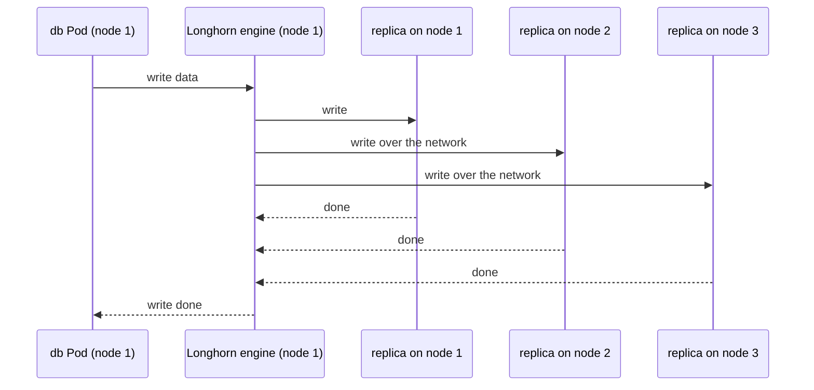

## Bạn cần biết trước

- [[k8s.l3.csi-drivers]] — một hệ lưu trữ cắm vào cluster qua CSI driver của nó và một StorageClass ghi tên driver đó. Bài này đọc một hệ như vậy.
- [[k8s.l2.database-in-the-cluster]] — trên staging, `db` và `rabbitmq` mỗi bên giữ bản duy nhất của một phần dữ liệu trên một claim. Bài này hỏi thứ gì bảo vệ bản đó.
- [[backend.l3.read-replicas]] — PostgreSQL có thể tự giữ bản sao trên các server khác. Ở đây bạn đặt cách đó cạnh bản sao do tầng lưu trữ bên dưới giữ. Standby là một replica như thế, đặt trên server khác để thay chỗ khi primary hỏng.

## Tình huống

Ba máy của khách hàng chỉ có ổ đĩa riêng của từng máy, và không có hệ lưu trữ nào để mua. Trên staging, StatefulSet `db` giữ dữ liệu PostgreSQL trên một claim thuộc class `standard` của kind, tức một thư mục trên ổ đĩa của một node. Bạn hình dung ổ đĩa của máy đó hỏng ở chỗ khách hàng: các đơn hàng nằm trên nó, và Pod `db` không còn chỗ nào khác để tìm chúng. Có người đề xuất dùng lưu trữ có bản sao, thứ "giữ dữ liệu trên cả ba máy". Vậy làm sao một volume dựng từ chính ổ đĩa của các node lại sống lâu hơn node mà nó được ghi lên?

## Khái niệm cốt lõi

- **Longhorn** (hệ lưu trữ chạy trong cluster, dùng đĩa của các node và giữ bản sao mỗi volume trên nhiều node) — hệ lưu trữ chạy ngay trong cluster, biến dung lượng đĩa trên các node của cluster thành volume và giữ bản sao của mỗi volume trên nhiều node. Nó tự cài CSI driver của mình.
- Replica — một bản sao đầy đủ của một volume Longhorn, nằm trên ổ đĩa của một node. StorageClass của volume quyết định có bao nhiêu bản bằng `numberOfReplicas`.
- Engine — tiến trình Longhorn của một volume, chạy trên node có Pod dùng volume đó. Nó nhận các lần đọc và ghi của Pod và chuyển mỗi lần ghi tới các replica.
- iSCSI initiator — phần mềm trên một node cho phép node dùng một ổ đĩa được cung cấp qua mạng. Engine của Longhorn, ở dạng mặc định, cần nó trên mọi node.

## Cơ chế hoạt động



Trong tình huống trên, claim `db` sẽ nhận một volume Longhorn có ba replica, mỗi máy một bản. PostgreSQL ghi vào volume của nó, và trên node 1 lần ghi đó tới engine của volume. Engine gửi nó tới mọi replica còn khỏe, trong đó hai bản phải đi qua mạng, và chỉ báo PostgreSQL ghi xong khi tất cả đã nhận. Replica nào ngừng trả lời, chẳng hạn vì node của nó hỏng, sẽ bị đánh dấu là không khỏe. Engine thôi chờ nó và tiếp tục ghi vào các bản còn lại. Cái giá là thời gian: mỗi lần ghi còn phải chờ các replica trên node khác, qua mạng, rồi PostgreSQL mới được báo xong. Vì vậy lần ghi nào cũng lâu hơn so với khi nó chỉ cần tới ổ đĩa của chính node.

Giờ node 1 hỏng. Với class `standard` của kind, volume là một thư mục trên node đó, và claim chỉ dùng được ở đó. Kubernetes không tự thay một Pod của StatefulSet đang nằm trên node hỏng: phải có người xóa Pod bị kẹt (Longhorn có một thiết lập làm thay bước này, mặc định tắt). Khi Pod `db` được thay trên node 2, nó nhận lại đúng volume ấy ở đó: một engine mới khởi động trên node 2 và làm việc với hai replica còn lại. Sau đó Longhorn dựng lại replica bị thiếu từ một bản còn khỏe, trên một node chưa giữ replica nào của volume này. Với đúng ba node và ba replica thì không có node nào như vậy, nên volume chạy với hai bản cho tới khi node 1 quay lại hoặc có node thứ tư tham gia.

Longhorn cần cài phần mềm trên mọi node, trong đó có iSCSI initiator cho dạng mặc định của engine. Lab không cài thứ này lên các node của kind, nên bài này đọc StorageClass thay vì cài Longhorn.

## Trong hệ thống Đơn Hàng

```yaml file=deploy/k8s/bare-metal/longhorn-storageclass.yaml tag=stage-3 lines=1-17
# lesson: k8s.l3.replicated-volumes
# Read, not installed: Longhorn 1.9 needs an iSCSI initiator on every node,
# which kind's nodes lack. A claim that names this class gets a Longhorn
# volume: three replicas, each on a different node's disk; a write counts
# as done once every healthy replica has it.
apiVersion: storage.k8s.io/v1
kind: StorageClass
metadata:
  name: longhorn-replicated
# Longhorn's CSI driver, installed with Longhorn itself.
provisioner: driver.longhorn.io
reclaimPolicy: Delete
volumeBindingMode: Immediate
allowVolumeExpansion: true
parameters:
  # How many copies of each volume, on as many nodes.
  numberOfReplicas: "3"
```

File này không bao giờ được apply: nó cho thấy một claim trên máy của khách hàng sẽ xin gì. `provisioner` ghi `driver.longhorn.io`, CSI driver của Longhorn, nên claim nào ghi `longhorn-replicated` ở `storageClassName` sẽ nhận một volume Longhorn thay vì một thư mục. `numberOfReplicas: "3"` đặt ba bản sao cho mỗi volume, và trên ba máy thì nghĩa là mỗi máy một bản. `volumeBindingMode: Immediate` tạo volume ngay khi claim xuất hiện, trước khi có Pod nào dùng nó. `allowVolumeExpansion: true` cho phép sau này nới rộng claim thuộc class này. Hai trường đó không đóng vai trò gì trong sao chép.

Hãy nhìn `reclaimPolicy: Delete`. Khi claim bị xóa, Longhorn xóa volume, nghĩa là xóa mọi replica cùng lúc. Bản sao chống lại ổ đĩa hay node hỏng, không chống lại một thao tác nhầm qua Kubernetes.

Claim nào sẽ dùng class này? StatefulSet `db` và `rabbitmq` của Đơn Hàng mỗi bên chỉ giữ một bản dữ liệu, nên volume có bản sao bù đúng những bản chúng còn thiếu. Một PostgreSQL đã stream thay đổi sang standby thì khác: standby có volume riêng và bản dữ liệu riêng, nên đặt volume có bản sao dưới cả hai chủ yếu chỉ làm ghi chậm hơn. Staging vẫn dùng `standard`, vì lab không chuẩn bị các node của kind cho Longhorn.

## Senior hay nhầm rằng…

- **"Volume có bản sao thì không cần backup nữa."** → Thực ra mọi replica nằm trong cùng một cluster và nhận cùng những lần ghi. Một claim bị xóa, một câu `UPDATE` sai hay mất cả cluster đều chạm tới cả ba bản cùng lúc, nên vẫn cần các bản dump chép ra ngoài cluster. Bạn sẽ nhận ra khi có người xóa một claim thuộc class `longhorn-replicated` và không còn replica nào để khôi phục.
- **"Volume sao chép qua mạng ghi nhanh ngang ổ đĩa cục bộ."** → Thực ra mỗi lần ghi chỉ tính là xong khi mọi replica còn khỏe đã nhận, và hai trong số đó phải đi qua mạng, nên lần ghi nào cũng phải chờ mạng. Bạn sẽ nhận ra khi các commit của PostgreSQL trên volume có bản sao lâu hơn so với trên ổ đĩa cục bộ của một node, dù database và tải vẫn như cũ.
- **"Database đã tự sao chép thì cũng nên đặt trên volume có bản sao."** → Thực ra một PostgreSQL stream sang standby đã giữ bản thứ hai trên một server khác, với volume riêng. Thêm ba replica dưới mỗi bên là chép cùng dữ liệu nhiều lần và làm mọi lần ghi chậm đi. Volume có bản sao có ích nhất cho những nơi lưu trữ chỉ giữ một bản, như `db` và `rabbitmq` trên staging. Dưới một database mà team đã failover sang standby được, chúng chủ yếu chỉ thêm bản sao và thời gian ghi. Bạn sẽ nhận ra khi đếm số bản của một dòng dữ liệu qua primary, standby và các replica của chúng.

## Thử ngay (3 phút)

Hãy suy nghĩ với StorageClass ở trên, trên ba máy của khách hàng, khi claim `db` dùng `longhorn-replicated`:

1. Node 3 mất ổ đĩa. Các bản sao của volume `db` nằm ở đâu, và PostgreSQL có tiếp tục nhận ghi không?
2. Một giờ sau, có người chạy `DELETE` không có mệnh đề `WHERE` trên `orders`. Bản nào vẫn còn các đơn hàng?

Kết quả mong đợi: với mỗi sự kiện, bạn nói được còn bao nhiêu bản và bạn sẽ khôi phục từ bản nào.

<details><summary>Gợi ý đáp án</summary>

1. Còn hai replica, trên node 1 và node 2, và các lần ghi tiếp tục vào hai bản đó. Longhorn không dựng lại được bản thứ ba trên một node chưa có replica nào của volume này, vì không có node như thế, nên volume giữ hai bản cho tới khi node 3 quay lại hoặc có node thứ tư tham gia.
2. Không replica nào cả: lệnh `DELETE` tới mọi bản ngay lúc được ghi. Chỉ một bản backup giữ ngoài cluster, lấy trước giờ đó, mới còn các đơn hàng.

</details>

## Liên hệ

- [[k8s.l3.csi-drivers]] — cơ chế bài này dùng: Longhorn cắm vào qua CSI driver của nó, `driver.longhorn.io`.
- [[k8s.l2.statefulsets]] — cho mỗi Pod một claim riêng. Longhorn đổi chỗ dữ liệu của claim đó nằm, không đổi cách StatefulSet hoạt động.
- [[k8s.l2.staging-keeps-its-data]] — các volume `standard` mà staging giữ, nằm trên một node, và là thứ class của bài này sẽ thay trên máy của khách hàng.
- [[backend.l3.read-replicas]] — cách giữ bản sao còn lại: ngay trong database, khiến volume có bản sao bên dưới phần lớn là thừa.
- [[devops.l3.rpo-and-rto]] — replica rút ngắn thời gian khôi phục khi mất một node, nhưng chỉ bản backup ở nơi khác mới quyết định một thao tác nhầm làm mất bao nhiêu dữ liệu.

## Tóm tắt 5 dòng

1. Longhorn giữ một bản sao của mỗi volume, gọi là replica, trên ổ đĩa của nhiều node, nên volume sống sót khi mất một node.
2. Một lần ghi chỉ tính là xong khi mọi replica còn khỏe đã nhận, nên lần ghi nào cũng phải chờ mạng.
3. Khi Pod bị kẹt trên node hỏng được xóa, Pod thay thế dùng lại đúng volume đó trên node khác, và Longhorn dựng lại replica bị thiếu khi có chỗ.
4. Volume có bản sao hợp với nơi lưu trữ chỉ giữ một bản, như `db` và `rabbitmq`. Database đã có standby riêng thì được lợi rất ít.
5. Mọi replica chung một cluster và chung mọi lần ghi, nên xóa nhầm, ghi sai hay mất cluster vẫn cần backup ở nơi khác.
