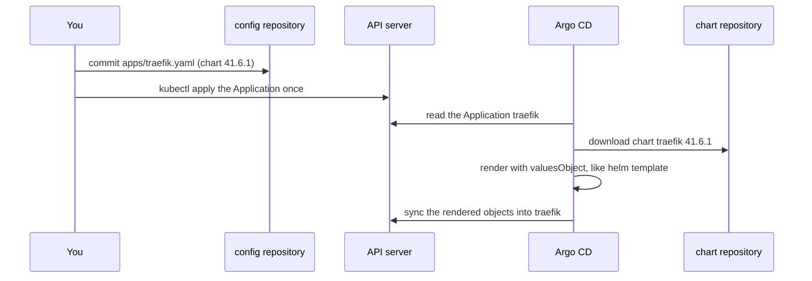

## Before you start

- [[k8s.l2.helm-releases]] — you installed the `web` chart with `helm install` and went back with `helm rollback`; here a chart reaches the cluster without either command.
- [[devops.l3.self-heal]] — Argo CD undoes changes made by hand to the objects it syncs; that includes the objects rendered from a chart.
- [[devops.l3.argo-cd-applications]] — an Application tells Argo CD what goes where; here its source is a chart instead of a repository folder.

## The situation

Đơn Hàng's api on `donhang-staging` answers only inside the cluster. The next lessons route requests from your machine into it, and the program that will do that is Traefik, a reverse proxy. Traefik's own project packages it as a Helm chart, so you will not write its manifests yourself. You could run `helm install` as in the last lesson, but then staging would hold something no commit describes, and the next person would learn about it only by asking you. You also want to see what a newer chart would change before anyone moves to it. How do you install a chart someone else publishes so that staging still changes only through a commit?

## Core concepts

- Chart repository — an HTTP server where a chart's publisher keeps packaged chart versions, from which Helm or Argo CD downloads a chart by name and version.
- Chart version — the `version` field of a chart's `Chart.yaml` (the file that names and numbers the chart); it numbers the package itself, here `41.6.1`.
- `appVersion` — a separate field of `Chart.yaml` naming the version of the software the chart installs, here Traefik `v3.7.13`; it is not tied to the chart version.
- `targetRevision` — in an Application whose source is a chart, the chart version Argo CD downloads.
- `valuesObject` — values written inside the Application, which Argo CD hands to Helm when it renders the chart.
- `helm show values` and `helm template` — two commands that read a chart without installing it: the first prints its `values.yaml` for the version you name, every key with its default; the second renders it into plain manifests and prints them, creating no release.

## How it works



In the situation above, installing Traefik starts with a commit: `apps/traefik.yaml` goes into the config repository, and you apply it once with `kubectl`. Its source names a chart repository, the chart `traefik` and the chart version `41.6.1`, not a folder of manifests.

Argo CD reads the Application, downloads that chart version and renders it with the Application's values. Argo CD uses Helm only for this step, as `helm template` does. The output is plain manifests, which Argo CD syncs into the namespace `traefik` like any folder of the config repository.

Because Helm never installed anything, it recorded nothing: no release, no history Secret. `helm list --all-namespaces` shows no `traefik`. Moving to another chart version is a commit that changes `targetRevision`, and going back is a revert of that commit: a new commit that undoes its changes, while the old commit stays in history. Argo CD reads the Application from the API server, not from the config repository, so a commit to `apps/traefik.yaml` changes nothing until someone applies the file. No Application syncs the `apps/` folder itself, so after either commit you apply it again.

The chart's own `values.yaml` holds every default. The Application lists only the keys Đơn Hàng changes; every other key keeps the chart's default.

The pin decides when anything changes, and one chart version can change many objects at once. Rendering the old and the new version with the same values and diffing the output shows those changes before Argo CD applies them.

## In the Đơn Hàng system

```yaml file=deploy/gitops/config-repo/apps/traefik.yaml tag=stage-3 lines=1-24
# lesson: k8s.l2.charts-through-argo-cd
# Traefik, from the chart its own project publishes: a chart repository, a
# chart name and an exact chart version. 41.6.1 is the chart's version; the
# Traefik it installs is the chart's appVersion (v3.7.13 for this one).
apiVersion: argoproj.io/v1alpha1
kind: Application
metadata:
  name: traefik
  namespace: argocd
spec:
  project: default
  source:
    repoURL: https://traefik.github.io/charts
    chart: traefik
    targetRevision: 41.6.1
    # lesson: k8s.l2.charts-through-argo-cd
    # Only the values Đơn Hàng changes; every other key keeps the chart's
    # default (helm show values traefik/traefik --version 41.6.1 lists them).
    helm:
      valuesObject:
        # Route by Gateway API objects too, not only by Ingress objects.
        providers:
          kubernetesGateway:
            enabled: true
```

The comment at the top separates two numbers: `41.6.1` on line 15 is the chart version that `targetRevision` pins, and the Traefik it installs is the chart's `appVersion`, `v3.7.13`. `repoURL` and `chart` say where the chart comes from; the comment's `traefik/traefik` is the same chart as `traefik --repo <chart repository>` in the script. Lines 19–24 begin the values Đơn Hàng changes: the first lets Traefik follow a second kind of routing object besides its default one; the comment names both, and the next two lessons introduce them. Below the excerpt, the file sets four more values, five in all, as the script's comment counts. They stop the chart from creating a routing object of its own, because Đơn Hàng writes its own in a later lesson, and fix the two ports where requests from your machine reach the cluster. Near its end, the file turns on automated sync with self-heal and prune.

```bash file=scripts/k8s/traefik-install.sh tag=stage-3 lines=41-61
# Argo CD rendered the chart like helm template: there is no Helm release,
# and the helm command cannot upgrade or roll back what Argo CD synced.
echo "== Helm releases in the cluster"
show helm list --all-namespaces
echo

# The keys the chart accepts, each with its default: the Application above
# sets five of them.
echo "== helm show values: $(command helm show values traefik --repo "$chart_repo" --version 41.6.1 | grep -c '^[a-zA-Z]') top-level keys, $(command helm show values traefik --repo "$chart_repo" --version 41.6.1 | wc -l) lines"
echo

# lesson: k8s.l2.charts-through-argo-cd
# Review before a chart version changes: render the version before the pin
# and the pinned one with the same values, and diff. Each line below is one
# change of the rendered manifests, with how often it occurs.
values=$(mktemp)
kubectl create --dry-run=client -f "$config_repo/apps/traefik.yaml" -o jsonpath='{.spec.source.helm.valuesObject}' > "$values"
render() { command helm template traefik traefik --repo "$chart_repo" --version "$1" -n traefik -f "$values"; }
echo "== helm template 41.4.0 against 41.6.1"
diff <(render 41.4.0) <(render 41.6.1) | grep '^[<>]' | sed -E 's/^([<>]) +/\1 /' | sort | uniq -c || true
rm -f "$values"
```

```text output=true
...
== Helm releases in the cluster
$ helm list --all-namespaces
NAME	NAMESPACE	REVISION	UPDATED	STATUS	CHART	APP VERSION

== helm show values: 56 top-level keys, 1697 lines

== helm template 41.4.0 against 41.6.1
      8 < helm.sh/chart: traefik-41.4.0
      1 < image: docker.io/traefik:v3.7.12
      8 > helm.sh/chart: traefik-41.6.1
      1 > image: docker.io/traefik:v3.7.13
```

Above the excerpt, the script sets `chart_repo` to the chart repository and points `helm` at `donhang-staging`; `show` prints a command before running it. `helm list --all-namespaces` prints only its header: Traefik runs in the cluster, yet Helm has no release anywhere. The chart's `values.yaml` has 56 top-level keys in 1,697 lines, against the few the Application sets.

The last part reads the Application's `valuesObject` into a temporary file with `kubectl create --dry-run=client`, which prints the object instead of sending it to the cluster. It then renders chart `41.4.0`, the version staging would run before moving the pin to `41.6.1`, and `41.6.1` with those values, and diffs them. Lines marked `<` come from `41.4.0`, lines marked `>` from `41.6.1`, and `uniq -c` counts each: the label `helm.sh/chart` changes in 8 places, and the image moves from `v3.7.12` to `v3.7.13`.

## Seniors often assume…

- **"A chart that Argo CD installed can still be upgraded or rolled back with the `helm` command."** → Actually Argo CD rendered the chart and synced plain manifests, so Helm holds no release to upgrade or roll back, because Helm records a release only when Helm itself installs a chart, and here it never did. A change made to those objects by hand is undone by self-heal. You notice this when `helm list --all-namespaces` shows no `traefik`.
- **"Copying the chart's whole `values.yaml` into the repository is the safest way to configure it."** → Actually a copy puts 1,697 lines of defaults in your file, so a reviewer cannot tell the few keys you meant to change from the rest, and a default that a newer chart version changes stays at your copy's old value. You notice this when someone asks what Đơn Hàng changes in Traefik and the answer needs a line-by-line comparison of two long files. A full copy does show every value in one place; when you need that, `helm show values` at the pinned version prints it without keeping it in Git.
- **"The chart version tells you which version of the software runs."** → Actually the chart version numbers the package, and the software's version is the chart's `appVersion`, a separate field. Chart `41.6.1` installs Traefik `v3.7.13`, and chart `41.4.0` rendered `v3.7.12`. You notice this when the Application says `41.6.1` and the render of that chart uses an image tagged `v3.7.13`.

## Try it (3 minutes)

With `donhang-staging` running, run `scripts/k8s/traefik-install.sh`. It downloads the chart and waits for Argo CD, so it can take a few minutes beyond the 3 in the heading. Then look at the last line of its output.

Expected result: the script prints the lines shown above, after earlier lines showing the Application applied and Argo CD reporting `traefik: Synced, Healthy`. The last line is the `>` image line, `docker.io/traefik:v3.7.13`: the Application pins chart `41.6.1`, and the software it runs carries the chart's `appVersion`.

## Connections

- [[k8s.l2.helm-releases]] — the contrast: the same kind of chart, but installed by Argo CD, so the release and the revisions from that lesson do not exist here.
- [[devops.l3.rollback-by-revert]] — the way back that replaces `helm rollback` for a chart Argo CD installed: a revert commit.
- [[devops.l3.pinning-by-content]] — a stricter pin than this lesson's: `targetRevision` names a chart version, not a hash of the chart's content.
- [[devops.l3.automated-dependency-updates]] — the same problem for other pinned inputs: a pin never updates itself, so each move of a pin is a change someone reviews, as the diff here does.

## Five-line summary

1. Argo CD renders a chart itself and syncs plain manifests, so Helm keeps no release and every change goes through a commit.
2. `apps/traefik.yaml` names a chart repository, a chart and an exact chart version, which is not the Traefik version it installs (`appVersion`).
3. The Application holds only the values Đơn Hàng changes; `helm show values` at the pinned version lists every key with its default.
4. `helm list` shows no Traefik release, so moving or going back is a commit to `targetRevision`, not `helm upgrade` or `helm rollback`.
5. Before moving the pin, render the old and the new chart version with the same values and diff them, as `traefik-install.sh` does.
