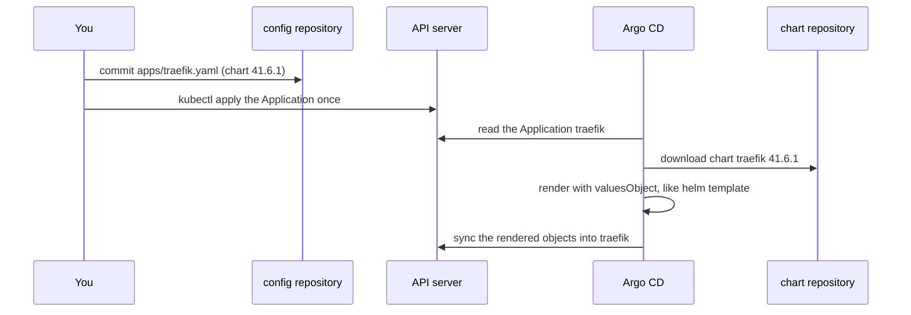

## Bạn cần biết trước

- [[k8s.l2.helm-releases]] — bạn đã cài chart `web` bằng `helm install` và quay lui bằng `helm rollback`. Ở bài này, chart lên cluster mà không cần lệnh nào trong hai lệnh đó.
- [[devops.l3.self-heal]] — Argo CD hoàn tác những thay đổi làm bằng tay trên các object nó sync, kể cả các object render ra từ một chart.
- [[devops.l3.argo-cd-applications]] — một Application cho Argo CD biết cái gì đi vào đâu. Ở đây source của nó là một chart thay vì một thư mục trong repo.

## Tình huống

Api của Đơn Hàng trên `donhang-staging` chỉ trả lời từ bên trong cluster. Các bài tiếp theo sẽ đưa request từ máy bạn vào tới nó, và chương trình làm việc đó là Traefik, một reverse proxy. Chính dự án Traefik đóng gói nó thành Helm chart, nên bạn không tự viết manifest cho nó. Bạn có thể chạy `helm install` như bài trước, nhưng khi đó staging sẽ chứa một thứ không commit nào mô tả, và người sau chỉ biết tới nó khi hỏi bạn. Bạn cũng muốn thấy một chart mới hơn sẽ đổi những gì trước khi có ai chuyển sang nó. Làm sao cài một chart do người khác phát hành mà staging vẫn chỉ thay đổi qua commit?

## Khái niệm cốt lõi

- Chart repository — một HTTP server nơi bên phát hành chart giữ các chart version đã đóng gói. Helm hoặc Argo CD tải chart từ đó theo tên và version.
- Chart version — trường `version` trong `Chart.yaml` của chart (file đặt tên và đánh số chart). Nó đánh số chính cái gói, ở đây là `41.6.1`.
- `appVersion` — một trường khác của `Chart.yaml`, ghi version của phần mềm mà chart cài, ở đây là Traefik `v3.7.13`. Nó không gắn với chart version.
- `targetRevision` — trong một Application có source là chart, đây là chart version mà Argo CD tải về.
- `valuesObject` — các values viết ngay trong Application, Argo CD đưa chúng cho Helm khi render chart.
- `helm show values` và `helm template` — hai lệnh đọc một chart mà không cài nó. Lệnh đầu in `values.yaml` của version bạn chỉ định, đủ mọi key kèm giá trị mặc định. Lệnh sau render chart thành manifest thuần rồi in ra, không tạo release nào.

## Cơ chế hoạt động



Trong tình huống trên, cài Traefik bắt đầu bằng một commit: `apps/traefik.yaml` vào repo cấu hình, và bạn apply nó một lần bằng `kubectl`. Source của nó ghi một chart repository, chart `traefik` và chart version `41.6.1`, chứ không phải một thư mục manifest.

Argo CD đọc Application, tải đúng chart version đó và render nó với values của Application. Argo CD chỉ dùng Helm cho bước này, giống như `helm template`. Kết quả là manifest thuần, và Argo CD sync chúng vào namespace `traefik` như với bất kỳ thư mục nào của repo cấu hình.

Vì Helm chưa từng cài gì, nó không ghi lại gì: không release, không Secret lịch sử. `helm list --all-namespaces` không có `traefik`. Chuyển sang chart version khác là một commit đổi `targetRevision`, còn quay lại là revert commit đó: một commit mới hoàn tác thay đổi của nó, trong khi commit cũ vẫn nằm trong lịch sử. Argo CD đọc Application từ API server chứ không từ repo cấu hình, nên commit vào `apps/traefik.yaml` không đổi gì cho tới khi có người apply file. Không Application nào sync chính thư mục `apps/`, nên sau mỗi commit như vậy bạn phải apply lại.

`values.yaml` của chart giữ mọi giá trị mặc định. Application chỉ liệt kê những key Đơn Hàng thay đổi, mọi key khác giữ mặc định của chart.

Cái ghim quyết định khi nào có thay đổi, và một chart version có thể đổi nhiều object cùng lúc. Render version cũ và version mới với cùng values rồi diff kết quả sẽ cho bạn thấy những thay đổi đó trước khi Argo CD apply chúng.

## Trong hệ thống Đơn Hàng

```yaml file=deploy/gitops/config-repo/apps/traefik.yaml tag=stage-3 lines=1-24
# lesson: k8s.l2.charts-through-argo-cd
# Traefik, from the chart its own project publishes: a chart repository, a
# chart name and an exact chart version. 41.6.1 is the chart's version; the
# Traefik it installs is the chart's appVersion (v3.7.13 for this one).
apiVersion: argoproj.io/v1alpha1
kind: Application
metadata:
  name: traefik
  namespace: argocd
spec:
  project: default
  source:
    repoURL: https://traefik.github.io/charts
    chart: traefik
    targetRevision: 41.6.1
    # lesson: k8s.l2.charts-through-argo-cd
    # Only the values Đơn Hàng changes; every other key keeps the chart's
    # default (helm show values traefik/traefik --version 41.6.1 lists them).
    helm:
      valuesObject:
        # Route by Gateway API objects too, not only by Ingress objects.
        providers:
          kubernetesGateway:
            enabled: true
```

Comment ở đầu file tách hai con số: `41.6.1` ở dòng 15 là chart version mà `targetRevision` ghim, còn Traefik được cài là `appVersion` của chart, `v3.7.13`. `repoURL` và `chart` cho biết chart lấy từ đâu. `traefik/traefik` trong comment chính là chart `traefik --repo <chart repository>` trong script. Dòng 19–24 mở đầu phần values Đơn Hàng thay đổi: giá trị đầu tiên cho Traefik theo dõi thêm một loại object định tuyến thứ hai ngoài loại mặc định. Comment ghi tên cả hai loại, và hai bài tiếp theo sẽ giới thiệu chúng. Bên dưới đoạn trích, file đặt thêm bốn values nữa, tổng cộng năm, đúng như comment trong script đếm. Chúng ngăn chart tự tạo một object định tuyến riêng, vì Đơn Hàng sẽ tự viết object đó ở một bài sau, và cố định hai port nơi request từ máy bạn đi vào cluster. Gần cuối, file bật sync tự động kèm self-heal và prune.

```bash file=scripts/k8s/traefik-install.sh tag=stage-3 lines=41-61
# Argo CD rendered the chart like helm template: there is no Helm release,
# and the helm command cannot upgrade or roll back what Argo CD synced.
echo "== Helm releases in the cluster"
show helm list --all-namespaces
echo

# The keys the chart accepts, each with its default: the Application above
# sets five of them.
echo "== helm show values: $(command helm show values traefik --repo "$chart_repo" --version 41.6.1 | grep -c '^[a-zA-Z]') top-level keys, $(command helm show values traefik --repo "$chart_repo" --version 41.6.1 | wc -l) lines"
echo

# lesson: k8s.l2.charts-through-argo-cd
# Review before a chart version changes: render the version before the pin
# and the pinned one with the same values, and diff. Each line below is one
# change of the rendered manifests, with how often it occurs.
values=$(mktemp)
kubectl create --dry-run=client -f "$config_repo/apps/traefik.yaml" -o jsonpath='{.spec.source.helm.valuesObject}' > "$values"
render() { command helm template traefik traefik --repo "$chart_repo" --version "$1" -n traefik -f "$values"; }
echo "== helm template 41.4.0 against 41.6.1"
diff <(render 41.4.0) <(render 41.6.1) | grep '^[<>]' | sed -E 's/^([<>]) +/\1 /' | sort | uniq -c || true
rm -f "$values"
```

```text output=true
...
== Helm releases in the cluster
$ helm list --all-namespaces
NAME	NAMESPACE	REVISION	UPDATED	STATUS	CHART	APP VERSION

== helm show values: 56 top-level keys, 1697 lines

== helm template 41.4.0 against 41.6.1
      8 < helm.sh/chart: traefik-41.4.0
      1 < image: docker.io/traefik:v3.7.12
      8 > helm.sh/chart: traefik-41.6.1
      1 > image: docker.io/traefik:v3.7.13
```

Phía trên đoạn trích, script đặt `chart_repo` thành chart repository và trỏ `helm` tới `donhang-staging`. `show` in lệnh ra trước khi chạy. `helm list --all-namespaces` chỉ in dòng tiêu đề: Traefik đang chạy trong cluster, vậy mà Helm không có release nào ở đâu cả. `values.yaml` của chart có 56 key cấp cao nhất trong 1.697 dòng, so với vài key mà Application đặt.

Phần cuối đọc `valuesObject` của Application vào một file tạm bằng `kubectl create --dry-run=client`, lệnh này in object ra thay vì gửi nó lên cluster. Sau đó script render chart `41.4.0`, version staging sẽ chạy trước khi dời cái ghim sang `41.6.1`, và render `41.6.1` với cùng values đó, rồi diff hai kết quả. Dòng có dấu `<` đến từ `41.4.0`, dòng có dấu `>` từ `41.6.1`, và `uniq -c` đếm từng dòng: label `helm.sh/chart` đổi ở 8 chỗ, còn image chuyển từ `v3.7.12` sang `v3.7.13`.

## Senior hay nhầm rằng…

- **"Chart do Argo CD cài vẫn upgrade hay rollback được bằng lệnh `helm`."** → Thực ra Argo CD đã render chart và sync manifest thuần, nên Helm không giữ release nào để upgrade hay rollback, vì Helm chỉ ghi release khi chính Helm cài chart, mà ở đây nó chưa từng cài. Thay đổi làm bằng tay trên các object đó sẽ bị self-heal hoàn tác. Bạn sẽ nhận ra khi `helm list --all-namespaces` không có `traefik`.
- **"Chép nguyên `values.yaml` của chart vào repo là cách cấu hình an toàn nhất."** → Thực ra bản chép đưa 1.697 dòng giá trị mặc định vào file, nên người review không phân biệt được vài key bạn định đổi với phần còn lại, và một giá trị mặc định mà chart version mới thay đổi sẽ kẹt ở giá trị cũ trong bản chép. Bạn sẽ nhận ra khi có người hỏi Đơn Hàng đổi gì ở Traefik và câu trả lời cần so từng dòng giữa hai file dài. Bản chép đầy đủ đúng là cho thấy mọi giá trị ở một chỗ. Khi bạn cần điều đó, `helm show values` ở version đang ghim in ra được mà không phải giữ nó trong Git.
- **"Chart version cho biết phần mềm đang chạy là version nào."** → Thực ra chart version đánh số cái gói, còn version của phần mềm là `appVersion` của chart, một trường riêng. Chart `41.6.1` cài Traefik `v3.7.13`, còn chart `41.4.0` render ra `v3.7.12`. Bạn sẽ nhận ra khi Application ghi `41.6.1` mà kết quả render chart đó lại dùng image có tag `v3.7.13`.

## Thử ngay (3 phút)

Khi `donhang-staging` đang chạy, chạy `scripts/k8s/traefik-install.sh`. Script tải chart và chờ Argo CD, nên có thể mất thêm vài phút ngoài 3 phút ở tiêu đề. Sau đó xem dòng cuối của output.

Kết quả mong đợi: script in ra các dòng như trên, sau những dòng trước đó cho thấy Application đã được apply và Argo CD báo `traefik: Synced, Healthy`. Dòng cuối là dòng image có dấu `>`, `docker.io/traefik:v3.7.13`: Application ghim chart `41.6.1`, còn phần mềm nó chạy mang `appVersion` của chart.

## Liên hệ

- [[k8s.l2.helm-releases]] — để đối chiếu: cùng một loại chart, nhưng do Argo CD cài, nên release và các revision ở bài đó không tồn tại ở đây.
- [[devops.l3.rollback-by-revert]] — cách quay lui thay cho `helm rollback` với chart do Argo CD cài: một commit revert.
- [[devops.l3.pinning-by-content]] — cách ghim chặt hơn cách trong bài này: `targetRevision` ghi một chart version, không phải hash nội dung của chart.
- [[devops.l3.automated-dependency-updates]] — cùng bài toán với các đầu vào được ghim khác: cái ghim không bao giờ tự cập nhật, nên mỗi lần dời ghim là một thay đổi có người review, như phần diff ở đây.

## Tóm tắt 5 dòng

1. Argo CD tự render chart và sync manifest thuần, nên Helm không có release, và mọi thay đổi đều đi qua một commit.
2. `apps/traefik.yaml` ghi một chart repository, một chart và một chart version chính xác, khác với version Traefik mà nó cài (`appVersion`).
3. Application chỉ chứa các values Đơn Hàng thay đổi. `helm show values` ở version đang ghim liệt kê mọi key kèm giá trị mặc định.
4. `helm list` không có release Traefik nào, nên chuyển version hay quay lại đều là commit vào `targetRevision`, không phải `helm upgrade` hay `helm rollback`.
5. Trước khi dời cái ghim, render chart version cũ và mới với cùng values rồi diff chúng, như `traefik-install.sh` làm.
