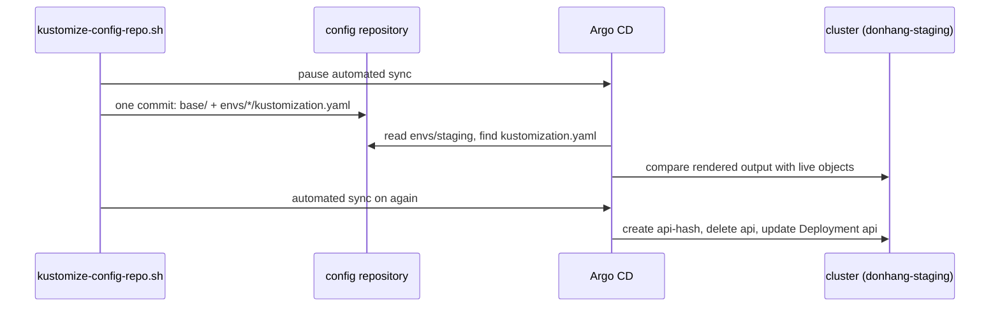

## Before you start

- [[k8s.l2.kustomize-overlays]] — the layout this lesson moves to: one base of plain manifests and a small overlay per environment.
- [[k8s.l2.charts-through-argo-cd]] — Argo CD renders a source itself before it syncs; here the source becomes a Kustomize overlay instead of a chart.
- [[devops.l3.verifying-before-deploy]] — the verified tag and digest that promotion writes; after the move they go into an overlay's `images` entry.

## The situation

The previous lesson built a base and two overlays under `deploy/gitops/config-repo-kustomize/`, but Argo CD still syncs the old layout. In the config repository, `envs/staging` and `envs/production` each hold a full copy of every manifest, and the Application `staging` applies every commit to that folder automatically. The api is serving requests in staging right now. You want the running repository on the new layout. A careless move could delete objects or restart services you did not mean to touch. How do you switch a config repository that Argo CD is syncing to a base and overlays, and know beforehand what will change in the cluster?

## Core concepts

- Base and overlays — the layout from the previous lesson: `base/` lists every manifest once, and each folder under `envs/` lists the base and adds only what differs.
- Tool detection — when an Application names no tool, Argo CD chooses how to turn a folder into manifests from the files it finds there; a `kustomization.yaml` means Kustomize.
- Rendered output — the plain manifests Kustomize builds from an overlay; it is what Argo CD compares with the cluster and applies.
- `kubeconform` — a tool that checks Kubernetes manifests against the schema of each kind for a given Kubernetes version.

## How it works



When an Application names no tool, Argo CD chooses how to turn its folder into manifests from the files it finds there: a `kustomization.yaml` means Kustomize, and a folder of plain manifests is applied as it is. `apps/staging.yaml` names no tool, so it keeps working when `envs/staging` gains a `kustomization.yaml`.

`kustomize-config-repo.sh` first pauses automated sync, to read Argo CD's comparison first, then makes the move one commit. The config repository is a separate Git repository on the cluster's Git server; the script edits a local copy of it and writes each `kustomization.yaml` from `deploy/gitops/config-repo-kustomize/` in Đơn Hàng's repository, leaving out files the config repository does not hold yet, then pushes the commit back. Staging's manifests move into `base/` unchanged, except `api-configmap.yaml`, which the base now generates. Production's full copies are deleted; no Application in this cluster syncs `envs/production`, so nothing running changes there.

Argo CD renders the overlay and compares the result with the live objects. Three differ: the old ConfigMap `api`, which the render no longer contains; the generated one, `api-` plus a hash; and the api Deployment, whose reference now names the generated ConfigMap. Every other object renders as it already runs.

Turning automated sync back on applies the commit. `apps/staging.yaml` also lets Argo CD delete objects the commit no longer contains, so the old ConfigMap goes, the new one is created, and the changed Pod template rolls the api Pods once.

From then on, promotion is one edit to an `images` entry in `envs/production/kustomization.yaml`. A change meant for every environment, such as a new probe, is made once in the base. Equally, one wrong change to the base reaches every environment the next time it syncs.

## In the Đơn Hàng system

```bash file=scripts/k8s/kustomize-config-repo.sh tag=stage-3 lines=39-53
# Argo CD's automated sync is paused for a moment, to read what it finds
# different before it syncs. The Application itself needs no change:
# Argo CD renders envs/staging with Kustomize as soon as it finds a
# kustomization.yaml there.
kubectl patch application staging -n argocd --type merge -p '{"spec":{"syncPolicy":{"automated":null}}}' >/dev/null
config_commit kustomize-config-repo.sh "envs/: a Kustomize base and an overlay per environment"
app_refresh
for _ in $(seq 120); do
  [ "$(kubectl get application staging -n argocd -o jsonpath='{.status.sync.revision}')" = "$(config_head --verify)" ] && break
  sleep 1
done
echo
echo "== what Argo CD finds different in staging, before syncing"
kubectl get application staging -n argocd \
  -o jsonpath='{range .status.resources[?(@.status=="OutOfSync")]}{.kind} {.name}{"\n"}{end}' | sort
```

```text output=true
...
== what Argo CD finds different in staging, before syncing
ConfigMap api
ConfigMap api-...
Deployment api

staging: Synced, Healthy
== after the sync
the api's ConfigMap: api-...
new ReplicaSets of the api: 1
...
```

`kubectl patch` sets the Application's `automated` field to `null`, which turns automated sync off. `config_commit` commits and pushes to the config repository, and `app_refresh` asks Argo CD to compare now instead of waiting for its next periodic check of the repository. The loop waits until the Application's sync revision equals the new commit's id, which `config_head --verify` prints. The last command lists every object Argo CD marks `OutOfSync`: only the three above; `...` stands for the hash.

After the excerpt, the script applies `apps/staging.yaml` again, which turns automated sync back on, deletions included, and waits for `Synced, Healthy`. One ConfigMap is left, the generated one, and the api got exactly one new ReplicaSet: its Pods rolled once.

```yaml file=.github/workflows/ci.yml tag=stage-3 lines=337-352
      # lesson: k8s.l2.config-repo-overlays
      # A mistake in the base or in a patch shows only in the rendered
      # manifests, so every overlay is rendered and the output validated.
      # The SealedSecrets an overlay lists exist only in the config
      # repository: here they are empty stand-ins.
      - name: Render each Kustomize overlay and validate it
        if: hashFiles('deploy/gitops/config-repo-kustomize/envs/*/kustomization.yaml') != ''
        run: |
          for overlay in deploy/gitops/config-repo-kustomize/envs/*/; do
            for name in $(grep -o 'sealed-[a-z-]*[.]yaml' "$overlay/kustomization.yaml"); do
              [ -f "$overlay/$name" ] || : > "$overlay/$name"
            done
            echo "== $overlay"
            kubectl kustomize "$overlay" | docker run --rm -i "$KUBECONFORM" \
              -strict -summary -kubernetes-version 1.34.0 -
          done
```

This step in Đơn Hàng's CI runs only when some overlay has a `kustomization.yaml`, and loops over every folder under `envs/`. It creates an empty file for each SealedSecret the overlay lists, renders the overlay with `kubectl kustomize`, and pipes the output into `kubeconform`, run as a container from the image `$KUBECONFORM` names. The `-` at the end makes `kubeconform` read the manifests from the pipe, and `-strict` rejects fields the schema does not know. No single file shows the finished objects, so the check runs on what an overlay builds. It checks the layout kept in Đơn Hàng's own repository; a commit made directly in the config repository is not checked by it.

Đơn Hàng keeps overlays for its own manifests, which it installs twice with few differences, and uses charts for software others maintain, such as Traefik, the Ingress controller it installs from its project's chart. A team that installs its own app many times with many settings, or ships it to others, may package it as a chart instead: the chart's values file is where it lists the settings it expects people to change.

## Seniors often assume…

- **"Switching to Kustomize means changing every Argo CD Application to point at a new tool."** → Actually Argo CD decides how to render a folder from the files in it when the Application names no tool, so an Application that names `envs/staging` keeps working when that folder gains a `kustomization.yaml`. You notice this when the conversion commit touches nothing under `apps/` and Argo CD still reports `staging: Synced, Healthy`.
- **"Overlays remove every way for environments to drift apart."** → Actually an overlay can patch fields of any object the base builds, and each overlay names its own images. The layout makes the differences small and visible, not impossible. You notice this when the diff of both renders shows more than the replica count, such as a patch added only to production or an `images` entry that still names an older digest.
- **"A team has to pick Helm or Kustomize for everything in its cluster."** → Actually each Application renders its own source, so one cluster can mix them. Đơn Hàng installs Traefik from a pinned chart and its own services from overlays. You notice this when `apps/traefik.yaml` names a chart repository while `apps/staging.yaml` names a folder of the config repository.

## Try it (3 minutes)

1. From the repository root, run `kubectl kustomize deploy/gitops/config-repo-kustomize/envs/production | grep 'image: .*/donhang-api[:@]'` and note the digest in the printed line.
2. In `deploy/gitops/config-repo-kustomize/envs/production/kustomization.yaml`, change the last character of the `digest` on line 24, run the same command again, then undo the edit with `git checkout -- deploy/gitops/config-repo-kustomize/envs/production/kustomization.yaml`.

Expected result: the first run prints one line, the api's image, and it contains `sha256:4f05…83d`, the digest on line 24. After your edit, that line contains the changed digest: the overlay's `images` entry, not the base, sets which image production runs, and nothing was applied.

## Connections

- [[k8s.l2.kustomize-overlays]] — the layout this lesson puts into the running config repository.
- [[devops.l3.promoting-between-environments]] — the same promotion, now one edit to an `images` entry instead of a full copy of the manifests.
- [[devops.l3.argo-cd-applications]] — the Application that keeps naming `envs/staging` while the folder's contents change shape.
- [[k8s.l2.charts-through-argo-cd]] — the other source Argo CD renders itself: a chart for software Đơn Hàng does not write.
- [[devops.l3.verifying-before-deploy]] — where the tag and digest in production's `images` entry come from.

## Five-line summary

1. A running config repository moves to a base and overlays in one commit, with no change to the Argo CD Application.
2. An Application naming no tool gets Kustomize when its folder holds a `kustomization.yaml`; pausing automated sync lets you read the difference first.
3. In staging only the api's ConfigMap, now generated with a hash, and the api Deployment change, so the api Pods roll once.
4. Promotion becomes one `images` edit; a base change reaches every environment, so CI renders each overlay of Đơn Hàng's copy and runs `kubeconform`.
5. Đơn Hàng uses overlays for its own manifests and charts for software others maintain; one cluster can mix both.
