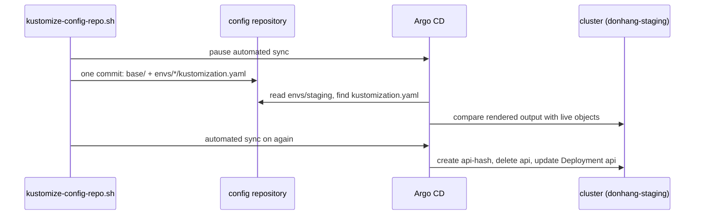

## Bạn cần biết trước

- [[k8s.l2.kustomize-overlays]] — cấu trúc mà bài này chuyển sang: một base gồm các manifest thường và một overlay nhỏ cho mỗi môi trường.
- [[k8s.l2.charts-through-argo-cd]] — Argo CD tự render một nguồn trước khi sync. Ở đây nguồn đó là một overlay của Kustomize thay vì một chart.
- [[devops.l3.verifying-before-deploy]] — tag và digest đã xác minh mà promotion ghi vào. Sau khi chuyển, chúng nằm trong mục `images` của một overlay.

## Tình huống

Bài trước đã dựng một base và hai overlay trong `deploy/gitops/config-repo-kustomize/`, nhưng Argo CD vẫn sync theo cấu trúc cũ. Trong repo cấu hình, `envs/staging` và `envs/production` mỗi thư mục giữ một bản đầy đủ của mọi manifest, và Application `staging` tự động apply mọi commit vào thư mục đó. Lúc này api đang phục vụ request trên staging. Bạn muốn repo đang chạy chuyển sang cấu trúc mới. Chuyển ẩu thì có thể xóa mất object hoặc restart những service bạn không định đụng tới. Làm sao chuyển một repo cấu hình mà Argo CD đang sync sang base và overlay, và biết trước những gì sẽ thay đổi trong cluster?

## Khái niệm cốt lõi

- Base và overlay — cấu trúc từ bài trước: `base/` liệt kê mỗi manifest một lần, còn mỗi thư mục dưới `envs/` ghi base rồi chỉ thêm phần khác.
- Nhận diện công cụ — khi Application không ghi công cụ nào, Argo CD dựa vào các file tìm thấy trong thư mục để chọn cách biến thư mục đó thành manifest. Có `kustomization.yaml` nghĩa là dùng Kustomize.
- Output đã render — các manifest thường mà Kustomize dựng từ một overlay. Đây là thứ Argo CD so với cluster và apply.
- `kubeconform` — công cụ kiểm tra manifest Kubernetes theo schema của từng kind ở một phiên bản Kubernetes cho trước.

## Cơ chế hoạt động



Khi Application không ghi công cụ nào, Argo CD dựa vào các file tìm thấy trong thư mục để chọn cách biến thư mục đó thành manifest: có `kustomization.yaml` thì dùng Kustomize, còn thư mục chỉ chứa manifest thường thì được apply nguyên như vậy. `apps/staging.yaml` không ghi công cụ nào, nên vẫn chạy được khi `envs/staging` có thêm `kustomization.yaml`.

`kustomize-config-repo.sh` tạm dừng sync tự động trước, để đọc kết quả so sánh của Argo CD trước đã, rồi gói cả lần chuyển vào một commit. Repo cấu hình là một repo Git riêng trên Git server của cluster. Script sửa một bản sao cục bộ của repo đó, ghi từng `kustomization.yaml` lấy từ `deploy/gitops/config-repo-kustomize/` trong repo của Đơn Hàng, bỏ qua những file repo cấu hình chưa có, rồi push commit trở lại. Các manifest của staging chuyển vào `base/` nguyên vẹn, trừ `api-configmap.yaml`, vì giờ base tự sinh ConfigMap này. Các bản đầy đủ của production bị xóa. Không Application nào trong cluster này sync `envs/production`, nên không có gì đang chạy ở đó bị thay đổi.

Argo CD render overlay và so kết quả với các object đang chạy. Có ba object khác nhau. Một là ConfigMap cũ `api`, không còn trong output render. Hai là ConfigMap mới sinh, tên là `api-` cộng với hash. Ba là Deployment của api, vì chỗ tham chiếu của nó giờ ghi tên ConfigMap mới sinh. Mọi object khác render ra đúng như đang chạy.

Bật lại sync tự động thì commit được apply. `apps/staging.yaml` còn cho phép Argo CD xóa những object không còn trong commit, nên ConfigMap cũ bị xóa, ConfigMap mới được tạo, và Pod template đã đổi khiến các Pod của api được thay một lượt.

Từ đó trở đi, promotion chỉ là sửa một mục `images` trong `envs/production/kustomization.yaml`. Một thay đổi dành cho mọi môi trường, như thêm một probe, chỉ cần làm một lần trong base. Ngược lại, một thay đổi sai trong base cũng tới mọi môi trường ở lần sync kế tiếp.

## Trong hệ thống Đơn Hàng

```bash file=scripts/k8s/kustomize-config-repo.sh tag=stage-3 lines=39-53
# Argo CD's automated sync is paused for a moment, to read what it finds
# different before it syncs. The Application itself needs no change:
# Argo CD renders envs/staging with Kustomize as soon as it finds a
# kustomization.yaml there.
kubectl patch application staging -n argocd --type merge -p '{"spec":{"syncPolicy":{"automated":null}}}' >/dev/null
config_commit kustomize-config-repo.sh "envs/: a Kustomize base and an overlay per environment"
app_refresh
for _ in $(seq 120); do
  [ "$(kubectl get application staging -n argocd -o jsonpath='{.status.sync.revision}')" = "$(config_head --verify)" ] && break
  sleep 1
done
echo
echo "== what Argo CD finds different in staging, before syncing"
kubectl get application staging -n argocd \
  -o jsonpath='{range .status.resources[?(@.status=="OutOfSync")]}{.kind} {.name}{"\n"}{end}' | sort
```

```text output=true
...
== what Argo CD finds different in staging, before syncing
ConfigMap api
ConfigMap api-...
Deployment api

staging: Synced, Healthy
== after the sync
the api's ConfigMap: api-...
new ReplicaSets of the api: 1
...
```

`kubectl patch` đặt field `automated` của Application thành `null`, tức là tắt sync tự động. `config_commit` commit và push lên repo cấu hình, còn `app_refresh` yêu cầu Argo CD so sánh ngay thay vì chờ lần kiểm tra repo định kỳ tiếp theo. Vòng lặp chờ tới khi sync revision của Application bằng id của commit mới, giá trị mà `config_head --verify` in ra. Lệnh cuối liệt kê mọi object Argo CD đánh dấu `OutOfSync`: chỉ có ba object nói trên, và `...` đứng ở chỗ của hash.

Sau đoạn trích, script apply lại `apps/staging.yaml`, bật lại sync tự động kèm cả quyền xóa object, rồi chờ `Synced, Healthy`. Chỉ còn lại một ConfigMap, chính là ConfigMap mới sinh, và api có đúng một ReplicaSet mới: các Pod của api được thay đúng một lượt.

```yaml file=.github/workflows/ci.yml tag=stage-3 lines=337-352
      # lesson: k8s.l2.config-repo-overlays
      # A mistake in the base or in a patch shows only in the rendered
      # manifests, so every overlay is rendered and the output validated.
      # The SealedSecrets an overlay lists exist only in the config
      # repository: here they are empty stand-ins.
      - name: Render each Kustomize overlay and validate it
        if: hashFiles('deploy/gitops/config-repo-kustomize/envs/*/kustomization.yaml') != ''
        run: |
          for overlay in deploy/gitops/config-repo-kustomize/envs/*/; do
            for name in $(grep -o 'sealed-[a-z-]*[.]yaml' "$overlay/kustomization.yaml"); do
              [ -f "$overlay/$name" ] || : > "$overlay/$name"
            done
            echo "== $overlay"
            kubectl kustomize "$overlay" | docker run --rm -i "$KUBECONFORM" \
              -strict -summary -kubernetes-version 1.34.0 -
          done
```

Bước này trong CI của Đơn Hàng chỉ chạy khi có overlay nào đó chứa `kustomization.yaml`, và lặp qua mọi thư mục dưới `envs/`. Mỗi vòng tạo một file rỗng cho từng SealedSecret mà overlay liệt kê, render overlay bằng `kubectl kustomize`, rồi pipe output vào `kubeconform`, chạy dưới dạng container từ image mà `$KUBECONFORM` chỉ tới. Dấu `-` ở cuối khiến `kubeconform` đọc manifest từ pipe, còn `-strict` từ chối những field mà schema không biết. Không file đơn lẻ nào cho thấy các object hoàn chỉnh, nên phép kiểm tra chạy trên thứ overlay dựng ra. Bước này kiểm tra cấu trúc giữ trong repo của chính Đơn Hàng. Commit làm thẳng trong repo cấu hình thì không đi qua bước kiểm tra này.

Đơn Hàng dùng overlay cho manifest của chính mình, thứ được cài hai lần với ít khác biệt, và dùng chart cho phần mềm do người khác bảo trì, như Traefik, Ingress controller mà Đơn Hàng cài từ chart của chính dự án Traefik. Một nhóm cài app của mình nhiều lần với nhiều thiết lập, hoặc giao app cho người khác dùng, có thể đóng gói app thành chart: file values của chart là nơi nhóm liệt kê những thiết lập mà người dùng được phép thay đổi.

## Senior hay nhầm rằng…

- **"Chuyển sang Kustomize nghĩa là phải sửa mọi Application của Argo CD để trỏ tới công cụ mới."** → Thực ra khi Application không ghi công cụ nào, Argo CD dựa vào các file trong thư mục để quyết định cách render, nên một Application ghi `envs/staging` vẫn chạy được khi thư mục đó có thêm `kustomization.yaml`. Bạn sẽ nhận ra khi commit chuyển đổi không đụng tới file nào dưới `apps/` mà Argo CD vẫn báo `staging: Synced, Healthy`.
- **"Overlay loại bỏ mọi khả năng các môi trường lệch nhau."** → Thực ra overlay có thể patch field của bất kỳ object nào base dựng ra, và mỗi overlay tự ghi image của mình. Cấu trúc này làm phần khác nhau nhỏ và dễ thấy, chứ không khiến chúng không thể xảy ra. Bạn sẽ nhận ra khi diff hai lần render cho thấy nhiều thứ hơn số replica, như một patch chỉ thêm cho production hay một mục `images` vẫn ghi digest cũ hơn.
- **"Một nhóm phải chọn Helm hoặc Kustomize cho mọi thứ trong cluster."** → Thực ra mỗi Application render nguồn của riêng nó, nên một cluster có thể dùng cả hai. Đơn Hàng cài Traefik từ một chart đã ghim phiên bản và cài các service của mình từ overlay. Bạn sẽ nhận ra khi `apps/traefik.yaml` ghi một chart repository, còn `apps/staging.yaml` ghi một thư mục trong repo cấu hình.

## Thử ngay (3 phút)

1. Từ thư mục gốc của repo, chạy `kubectl kustomize deploy/gitops/config-repo-kustomize/envs/production | grep 'image: .*/donhang-api[:@]'` và ghi lại digest trong dòng được in ra.
2. Trong `deploy/gitops/config-repo-kustomize/envs/production/kustomization.yaml`, đổi ký tự cuối của `digest` ở dòng 24, chạy lại đúng lệnh trên, rồi hoàn tác bằng `git checkout -- deploy/gitops/config-repo-kustomize/envs/production/kustomization.yaml`.

Kết quả mong đợi: lần chạy đầu in một dòng, là image của api, và dòng đó chứa `sha256:4f05…83d`, tức digest ở dòng 24. Sau khi sửa, dòng đó chứa digest đã đổi: mục `images` của overlay, chứ không phải base, quyết định production chạy image nào, và không có gì được apply.

## Liên hệ

- [[k8s.l2.kustomize-overlays]] — cấu trúc mà bài này đưa vào repo cấu hình đang chạy.
- [[devops.l3.promoting-between-environments]] — vẫn là promotion đó, giờ chỉ là sửa một mục `images` thay vì chép lại bản đầy đủ của các manifest.
- [[devops.l3.argo-cd-applications]] — Application vẫn ghi `envs/staging` trong khi nội dung thư mục đổi hình dạng.
- [[k8s.l2.charts-through-argo-cd]] — nguồn còn lại mà Argo CD tự render: chart cho phần mềm không do Đơn Hàng viết.
- [[devops.l3.verifying-before-deploy]] — nơi tag và digest trong mục `images` của production được tạo ra.

## Tóm tắt 5 dòng

1. Một repo cấu hình đang chạy chuyển sang base và overlay trong một commit, không cần sửa Application của Argo CD.
2. Application không ghi công cụ nào sẽ dùng Kustomize khi thư mục có `kustomization.yaml`, và tạm dừng sync tự động cho bạn đọc phần khác biệt trước.
3. Trên staging chỉ ConfigMap của api, giờ được sinh kèm hash, và Deployment của api thay đổi, nên các Pod của api được thay một lượt.
4. Promotion chỉ còn là một lần sửa `images`. Thay đổi ở base tới mọi môi trường, nên CI render từng overlay trong bản của Đơn Hàng và chạy `kubeconform`.
5. Đơn Hàng dùng overlay cho manifest của mình và chart cho phần mềm người khác bảo trì. Một cluster có thể dùng cả hai.
