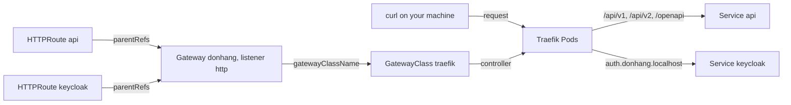

## Before you start

- [[k8s.l2.ingress]] — an Ingress lists routing rules and Traefik, its controller, carries them out; this lesson replaces that Ingress with the routing objects staging keeps.

## The situation

The last lesson's script deleted its Ingress, saying staging routes with another kind of object. Staging needs the routes that Caddy, the reverse proxy in front of the api in Compose, holds there: `/api/v1`, `/api/v2` and `/openapi` to the api, and the host `auth.donhang.localhost` to Keycloak. Two roles will change them, even if one person plays both today: whoever runs the platform decides which ports Traefik opens and adds HTTPS in the next lesson, and the Đơn Hàng team adds a path whenever the api grows one. The Kubernetes page on Ingress also says that API gets no new features. How do you write the entry point once, and let each team attach its own routes to it?

## Core concepts

- **Gateway API** — a family of Kubernetes object kinds for routing requests from outside into the cluster, the successor to Ingress; the kinds are not built into Kubernetes and are installed separately.
- `GatewayClass` — an object naming the controller that handles every Gateway of that class; on staging, the class `traefik` names Traefik.
- **Gateway (Gateway API)** — an object asking the controller of its class for listeners, each a port, a protocol and an optional hostname, where requests from outside come in.
- **HTTPRoute** — an object holding HTTP rules, hosts and paths leading to Services, that takes effect only once it is attached to a Gateway.
- `parentRefs` — the field of an HTTPRoute naming the Gateway it attaches to, and with `sectionName`, one listener of that Gateway.

## How it works



The Ingress API is frozen: Kubernetes keeps it available, with no plans to remove it, but adds nothing to it, and the Kubernetes project recommends Gateway API instead. So Đơn Hàng routes its own traffic with Gateway API, and the last lesson's Ingress stays a lesson manifest.

Gateway API does not come with Kubernetes, and Traefik's install guide has you apply its kinds as a separate step before Traefik. `scripts/k8s/traefik-install.sh` first applies `deploy/gateway-api/standard-install.yaml`, a pinned copy of the project's release `v1.6.2`. That file adds `GatewayClass`, `Gateway`, `HTTPRoute` and other kinds to the API server. Only then does Argo CD install Traefik, with its Gateway API support switched on in `apps/traefik.yaml`. The same Traefik Pods now carry out both kinds of objects, and the chart creates the class `traefik`.

In the diagram, the objects form a chain. The Gateway `donhang` names the class `traefik`, so Traefik takes it. With Traefik, a listener's port must be one Traefik already listens on: `8000` is its HTTP port, so the listener `http` is served there. Each HTTPRoute names that Gateway in `parentRefs`, and Traefik adds the route's rules to that listener. Here there are two: `api` for the api's paths and `keycloak` for the host `auth.donhang.localhost`. A request reaches Traefik, which compares its host and path with those rules and forwards it to a Service.

The split follows the roles Gateway API is modeled on. Whoever runs the platform owns the Gateway: its ports, its protocols and, later, its certificate. Each team can write HTTPRoutes for its own Services without editing the shared entry point. In Đơn Hàng one person writes both, so the split shows only in which object holds what.

## In the Đơn Hàng system

```yaml file=deploy/gitops/config-repo/platform/edge/gateway.yaml tag=stage-3 lines=1-16
# lesson: k8s.l2.gateway-api
# Đơn Hàng's entry point, owned by whoever runs the platform: one Gateway of
# the class traefik, with a listener per port. Each port is one of Traefik's
# own (8000 for HTTP, 8443 for HTTPS); the staging node publishes them on
# this machine as localhost:18080 and localhost:18443.
apiVersion: gateway.networking.k8s.io/v1
kind: Gateway
metadata:
  name: donhang
  namespace: donhang
spec:
  gatewayClassName: traefik
  listeners:
    - name: http
      port: 8000
      protocol: HTTP
```

Line 12 names the class `traefik`. Lines 13–16 ask for one listener named `http` on port `8000`, which the staging node publishes as `18080` on your machine. The listener sets no `hostname`, so it accepts requests for any host and leaves the choice of host to the routes. Below the excerpt, the file adds an HTTPS listener and a rule sending plain-HTTP requests on to HTTPS, both for the next lesson. `scripts/k8s/gateway.sh`, this lesson's script that commits these files to the config repository, cuts the Gateway before them for now.

```yaml file=deploy/gitops/config-repo/platform/edge/httproutes.yaml tag=stage-3 lines=5-29
apiVersion: gateway.networking.k8s.io/v1
kind: HTTPRoute
metadata:
  name: api
  namespace: donhang
spec:
  parentRefs:
    - name: donhang
      sectionName: https
  hostnames:
    - donhang.localhost
  rules:
    - matches:
        - path:
            type: PathPrefix
            value: /api/v1
        - path:
            type: PathPrefix
            value: /api/v2
        - path:
            type: PathPrefix
            value: /openapi
      backendRefs:
        - name: api
          port: 8080
```

Lines 11–13 attach the route to the Gateway `donhang`, and `sectionName` picks one listener by its name. Here it reads `https`, the listener of the next lesson; until then, `gateway.sh` rewrites it to `http` as it commits the file. So staging runs this route with `sectionName: http`, attached to the listener shown above. A request must carry the host `donhang.localhost` and match any one of the three path prefixes to go to port `8080` of the Service `api`: the paths Caddy sends to the api in Compose. Below the excerpt, the file adds a rule for a later lesson and the HTTPRoute `keycloak`, which sends every path on `auth.donhang.localhost` to the Service `keycloak`.

Both files sit in `platform/edge` of the config repository, and the Application `edge-staging` syncs that folder into the namespace `donhang` like any other folder. `gateway.sh` commits them, applies that Application and checks the result. The Gateway reports `PROGRAMMED` `True`: Traefik has set up its listener. The HTTPRoute `api` reports `Accepted=True`, so Traefik took it onto the Gateway, and `ResolvedRefs=True`, so it found the Service the route names. The calls then return `200` for the products, `401` for an order under `/api/v2`, which wants a token, and `200` for the OpenAPI document and for Keycloak. Any other path, such as `/index.html`, gets `404` from Traefik itself.

These rules match only hosts and paths. The HTTPRoute standard goes further: a match can also test request headers, and a rule can list several backends with weights to split traffic between them. With Ingress, the same needs depend on each controller's own annotations, so they change when the controller does.

## Seniors often assume…

- **"Gateway API is a separate gateway product that replaces the Ingress controller."** → Actually Gateway API is a set of object kinds, and a controller still carries them out; on staging it is the same Traefik that acted on the Ingress, because one chart value switched that support on. You notice this when `kubectl get gatewayclasses` shows the class `traefik` with the controller `traefik.io/gateway-controller`, while the namespace `traefik` still holds a single Deployment, `traefik`.
- **"Ingress is deprecated and will be removed from Kubernetes."** → Actually the Ingress API is frozen, not deprecated (deprecated means marked for removal in a later version): it stays fully available, the project has no plans to remove it, and it only gets no new features. You notice this when the last lesson's `kubectl apply` of an Ingress printed `created` with no deprecation warning.
- **"An HTTPRoute routes traffic on its own, without a Gateway to attach to."** → Actually the controller acts on an HTTPRoute only through the Gateway its `parentRefs` names, because that Gateway's listener is where requests come in. You notice this when a route naming a Gateway that does not exist is stored without error, shows no `Accepted=True` in its status, and its paths still get `404`.

## Try it (3 minutes)

With `donhang-staging` running, in the `don-hang` folder:

1. Run `scripts/k8s/gateway.sh`.
2. Run `kubectl get gatewayclasses`.

Expected result: step 1 ends with five calls answering `200`, `401`, `200`, `200` and, for `/index.html`, `404`. Step 2 prints one class, `traefik`, with the controller `traefik.io/gateway-controller` and `ACCEPTED` `True`: the class Traefik's chart created and the Gateway `donhang` names.

## Connections

- [[k8s.l2.ingress]] — the API this one succeeds: the same host-and-path rules, with no separate entry point and every extra left to annotations.
- [[k8s.l2.tls-at-the-gateway]] — next: the HTTPS listener and the redirect below the excerpt of `gateway.yaml`.
- [[backend.l2.api-versioning]] — the reason the HTTPRoute `api` carries both `/api/v1` and `/api/v2`.
- [[devops.l3.argo-cd-applications]] — the kind of object `edge-staging` is, syncing `platform/edge` like any other folder of the config repository.

## Five-line summary

1. Gateway API splits the entry point, a Gateway owned by the platform, from the HTTPRoutes each team attaches to it.
2. The Ingress API is frozen, not removed, and the Kubernetes project recommends Gateway API instead.
3. Gateway API's kinds are installed separately from a pinned release; Traefik carries out both Ingress and Gateway API objects.
4. A GatewayClass names the controller, a Gateway asks it for listeners, and an HTTPRoute attaches to a listener through `parentRefs`.
5. HTTPRoutes match hosts and paths, and in the standard also headers and weighted backends, which Ingress leaves to annotations.
