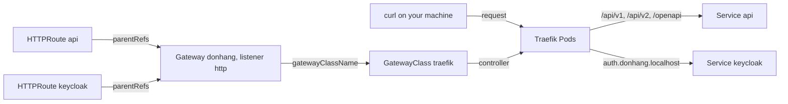

## Bạn cần biết trước

- [[k8s.l2.ingress]] — Ingress liệt kê các luật định tuyến, còn Traefik, controller của nó, thực thi chúng. Bài này thay Ingress đó bằng các object định tuyến mà staging giữ lại.

## Tình huống

Script của bài trước đã xóa Ingress của nó, kèm lời nhắc rằng staging định tuyến bằng một loại object khác. Staging cần đúng những route mà Caddy, reverse proxy đứng trước api trong Compose, đang giữ: `/api/v1`, `/api/v2` và `/openapi` tới api, còn host `auth.donhang.localhost` tới Keycloak. Hai vai trò sẽ sửa các route này, dù hôm nay một người đảm nhận cả hai. Người vận hành nền tảng quyết định Traefik mở những port nào và thêm HTTPS ở bài sau. Nhóm Đơn Hàng thêm một path mỗi khi api có thêm path mới. Trang Kubernetes về Ingress cũng nói API đó không có thêm tính năng mới nào nữa. Làm sao viết điểm vào một lần, rồi để mỗi nhóm tự gắn route của mình vào đó?

## Khái niệm cốt lõi

- **Gateway API** (Bộ kiểu object định tuyến của Kubernetes thay cho Ingress, tách Gateway (điểm vào) khỏi route; phải cài thêm) — một họ kiểu object của Kubernetes dùng để định tuyến request từ ngoài vào cluster, kế thừa Ingress. Các kiểu này không có sẵn trong Kubernetes mà phải cài riêng.
- `GatewayClass` — object ghi controller sẽ xử lý mọi Gateway thuộc class đó. Trên staging, class `traefik` ghi Traefik.
- **Gateway (Gateway API)** (Object Gateway API xin controller mở listener (cổng, giao thức, hostname) làm điểm vào cluster) — object xin controller của class nó mở các listener, nơi request từ ngoài đi vào. Mỗi listener gồm một port, một giao thức và một hostname không bắt buộc.
- **HTTPRoute** (Object Gateway API gắn vào một Gateway, đưa request theo hostname và path tới Service) — object chứa các luật HTTP, gồm host và path dẫn tới Service. Nó chỉ có hiệu lực khi đã gắn vào một Gateway.
- `parentRefs` — trường của HTTPRoute ghi Gateway mà route gắn vào, và khi có thêm `sectionName`, ghi một listener cụ thể của Gateway đó.

## Cơ chế hoạt động



Ingress API đã bị đóng băng: Kubernetes vẫn giữ nó, không có kế hoạch gỡ bỏ, nhưng không thêm gì vào nữa, và dự án Kubernetes khuyên dùng Gateway API thay thế. Vì vậy Đơn Hàng định tuyến traffic của mình bằng Gateway API, còn Ingress ở bài trước chỉ là manifest minh họa.

Gateway API không đi kèm Kubernetes, và hướng dẫn cài đặt của Traefik bắt bạn apply các kiểu object của nó thành một bước riêng, trước Traefik. `scripts/k8s/traefik-install.sh` apply `deploy/gateway-api/standard-install.yaml` trước tiên, đây là bản sao cố định của bản phát hành `v1.6.2` của dự án. File đó thêm `GatewayClass`, `Gateway`, `HTTPRoute` cùng vài kiểu khác vào API server. Chỉ sau đó Argo CD mới cài Traefik, với phần hỗ trợ Gateway API được bật trong `apps/traefik.yaml`. Giờ cùng các Pod Traefik đó thực thi cả hai loại object, và chart tạo ra class `traefik`.

Trong sơ đồ, các object nối thành một chuỗi. Gateway `donhang` ghi class `traefik`, nên Traefik nhận nó. Với Traefik, port của listener phải là port mà Traefik đã nghe sẵn: `8000` là port HTTP của nó, nên listener `http` được phục vụ ở đó. Mỗi HTTPRoute ghi Gateway đó trong `parentRefs`, và Traefik thêm luật của route vào listener ấy. Ở đây có hai route: `api` cho các path của api, và `keycloak` cho host `auth.donhang.localhost`. Request tới Traefik, Traefik so host và path của nó với các luật đó rồi chuyển tiếp tới một Service.

Cách tách này đi theo các vai trò mà Gateway API lấy làm khuôn mẫu. Người vận hành nền tảng sở hữu Gateway: port, giao thức và sau này là certificate của nó. Mỗi nhóm tự viết HTTPRoute cho Service của mình mà không phải sửa điểm vào dùng chung. Ở Đơn Hàng, một người viết cả hai, nên sự phân tách chỉ thể hiện ở chỗ object nào chứa gì.

## Trong hệ thống Đơn Hàng

```yaml file=deploy/gitops/config-repo/platform/edge/gateway.yaml tag=stage-3 lines=1-16
# lesson: k8s.l2.gateway-api
# Đơn Hàng's entry point, owned by whoever runs the platform: one Gateway of
# the class traefik, with a listener per port. Each port is one of Traefik's
# own (8000 for HTTP, 8443 for HTTPS); the staging node publishes them on
# this machine as localhost:18080 and localhost:18443.
apiVersion: gateway.networking.k8s.io/v1
kind: Gateway
metadata:
  name: donhang
  namespace: donhang
spec:
  gatewayClassName: traefik
  listeners:
    - name: http
      port: 8000
      protocol: HTTP
```

Dòng 12 ghi class `traefik`. Dòng 13–16 xin một listener tên `http` trên port `8000`, port mà node staging publish thành `18080` trên máy bạn. Listener không đặt `hostname`, nên nó nhận request cho mọi host và để các route quyết định host. Phía dưới đoạn trích, file thêm một listener HTTPS và một luật chuyển request HTTP thường sang HTTPS, cả hai dành cho bài sau. `scripts/k8s/gateway.sh` là script của bài này, commit các file này vào repo cấu hình. Hiện tại nó cắt Gateway ngay trước hai phần đó.

```yaml file=deploy/gitops/config-repo/platform/edge/httproutes.yaml tag=stage-3 lines=5-29
apiVersion: gateway.networking.k8s.io/v1
kind: HTTPRoute
metadata:
  name: api
  namespace: donhang
spec:
  parentRefs:
    - name: donhang
      sectionName: https
  hostnames:
    - donhang.localhost
  rules:
    - matches:
        - path:
            type: PathPrefix
            value: /api/v1
        - path:
            type: PathPrefix
            value: /api/v2
        - path:
            type: PathPrefix
            value: /openapi
      backendRefs:
        - name: api
          port: 8080
```

Dòng 11–13 gắn route vào Gateway `donhang`, và `sectionName` chọn một listener theo tên. Ở đây nó ghi `https`, listener của bài sau. Tới lúc đó, `gateway.sh` sửa giá trị này thành `http` khi commit file. Vì vậy staging chạy route này với `sectionName: http`, gắn vào listener ở trên. Request phải mang host `donhang.localhost` và khớp một trong ba tiền tố path thì mới tới port `8080` của Service `api`: đúng những path mà Caddy gửi tới api trong Compose. Phía dưới đoạn trích, file thêm một luật cho bài sau và HTTPRoute `keycloak`, route gửi mọi path trên `auth.donhang.localhost` tới Service `keycloak`.

Cả hai file nằm trong `platform/edge` của repo cấu hình, và Application `edge-staging` sync thư mục đó vào namespace `donhang` như mọi thư mục khác. `gateway.sh` commit chúng, apply Application đó rồi kiểm tra kết quả. Gateway báo `PROGRAMMED` `True`: Traefik đã dựng xong listener của nó. HTTPRoute `api` báo `Accepted=True`, tức Traefik đã nhận nó vào Gateway, và `ResolvedRefs=True`, tức Traefik đã tìm thấy Service mà route ghi. Sau đó các lời gọi trả `200` cho danh sách sản phẩm, `401` cho một đơn hàng dưới `/api/v2` vì cần token, và `200` cho tài liệu OpenAPI và cho Keycloak. Mọi path khác, như `/index.html`, nhận `404` do chính Traefik trả.

Các luật này chỉ khớp host và path. Chuẩn HTTPRoute còn đi xa hơn: một điều kiện khớp có thể kiểm tra cả header của request, và một luật có thể liệt kê nhiều backend kèm trọng số để chia traffic giữa chúng. Với Ingress, cùng những nhu cầu đó phụ thuộc vào annotation riêng của từng controller, nên chúng thay đổi khi đổi controller.

## Senior hay nhầm rằng…

- **"Gateway API là một sản phẩm gateway riêng, thay cho Ingress controller."** → Thực ra Gateway API là một bộ kiểu object, và vẫn cần một controller thực thi chúng. Trên staging, đó vẫn là Traefik từng xử lý Ingress, vì chỉ một giá trị trong chart đã bật phần hỗ trợ này. Bạn sẽ nhận ra khi `kubectl get gatewayclasses` hiện class `traefik` với controller `traefik.io/gateway-controller`, trong khi namespace `traefik` vẫn chỉ có một Deployment duy nhất, `traefik`.
- **"Ingress đã deprecated và sẽ bị gỡ khỏi Kubernetes."** → Thực ra Ingress API bị đóng băng chứ không deprecated (deprecated nghĩa là được đánh dấu để gỡ ở một phiên bản sau): nó vẫn dùng đầy đủ được, dự án không có kế hoạch gỡ nó, chỉ là không có thêm tính năng mới. Bạn sẽ nhận ra khi `kubectl apply` một Ingress ở bài trước in `created` mà không kèm cảnh báo deprecated nào.
- **"HTTPRoute tự định tuyến traffic, không cần Gateway nào để gắn vào."** → Thực ra controller chỉ xử lý HTTPRoute thông qua Gateway mà `parentRefs` của nó ghi, vì listener của Gateway đó là nơi request đi vào. Bạn sẽ nhận ra khi một route ghi một Gateway không tồn tại vẫn được lưu mà không báo lỗi, status không có `Accepted=True`, và các path của nó vẫn nhận `404`.

## Thử ngay (3 phút)

Khi `donhang-staging` đang chạy, trong thư mục `don-hang`:

1. Chạy `scripts/k8s/gateway.sh`.
2. Chạy `kubectl get gatewayclasses`.

Kết quả mong đợi: bước 1 kết thúc bằng năm lời gọi trả `200`, `401`, `200`, `200` và `404` cho `/index.html`. Bước 2 in một class, `traefik`, với controller `traefik.io/gateway-controller` và `ACCEPTED` `True`: class mà chart của Traefik tạo ra và Gateway `donhang` ghi tên.

## Liên hệ

- [[k8s.l2.ingress]] — API mà Gateway API kế thừa: cùng các luật host và path, nhưng không có điểm vào riêng và mọi thứ thêm vào đều phó mặc cho annotation.
- [[k8s.l2.tls-at-the-gateway]] — bài tiếp theo: listener HTTPS và luật chuyển hướng nằm dưới đoạn trích của `gateway.yaml`.
- [[backend.l2.api-versioning]] — lý do HTTPRoute `api` mang cả `/api/v1` lẫn `/api/v2`.
- [[devops.l3.argo-cd-applications]] — loại object của `edge-staging`, sync `platform/edge` như mọi thư mục khác của repo cấu hình.

## Tóm tắt 5 dòng

1. Gateway API tách điểm vào, một Gateway do người vận hành nền tảng sở hữu, khỏi các HTTPRoute mà mỗi nhóm gắn vào đó.
2. Ingress API bị đóng băng chứ không bị gỡ, và dự án Kubernetes khuyên dùng Gateway API thay thế.
3. Các kiểu object của Gateway API được cài riêng từ một bản phát hành cố định. Traefik thực thi cả object Ingress lẫn Gateway API.
4. GatewayClass ghi controller, Gateway xin controller mở listener, còn HTTPRoute gắn vào một listener qua `parentRefs`.
5. HTTPRoute khớp host và path, và theo chuẩn còn khớp được header và chia backend theo trọng số, những thứ Ingress để cho annotation.
