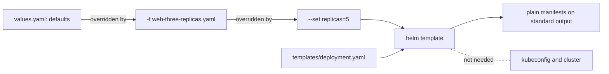

## Before you start

- [[k8s.l1.deploying-don-hang]] — you deployed the backend from plain manifests in `deploy/k8s/`; this lesson produces such manifests from a template instead of writing them out.
- [[devops.l3.promoting-between-environments]] — you saw `envs/staging` and `envs/production` hold full copies that differ in a few values such as replicas and the image tag; a chart keeps one template and moves those values out.
- [[k8s.l1.manifests-and-kubectl-apply]] — you know a manifest's `apiVersion`, `kind`, `metadata` and `spec`; a chart's output is exactly such a manifest.

## The situation

The config repository holds two full copies of every manifest, one for staging and one for production, and they differ only in values such as the replica count and the image tag. Soon you will install software whose own project ships its Kubernetes objects as a Helm chart, not as manifests. To practise, you open `deploy/helm/lessons/web`, a small chart the repository keeps for lessons, and read `templates/deployment.yaml`. It looks like an ordinary Deployment manifest, except that `replicas:` and `image:` hold `{{ ... }}` instead of values, so this file is not what the cluster would receive. Where do the values come from, and how do you see the manifest that would really be applied?

## Core concepts

- **Helm** — a command-line tool that packages Kubernetes manifests as charts, renders charts into manifests and, from the next lesson on, installs them into a cluster.
- **Helm chart** — a folder that packages manifests as templates: `Chart.yaml` gives the chart's name and version, `values.yaml` its default values, and `templates/` the manifests with placeholders.
- Placeholder — a `{{ ... }}` expression in a template, such as `{{ .Values.replicas }}`, that Helm replaces with a value when it renders the chart.
- **values file** — a YAML file whose keys fill a chart's placeholders; `values.yaml` inside the chart holds the defaults, and a file passed with `-f` overrides the keys it sets.
- `helm template` — the command that renders a chart and prints the resulting manifests, without contacting a cluster.

## How it works



In the situation above, the chart is `deploy/helm/lessons/web`. Its `templates/` folder holds `deployment.yaml` and `service.yaml`, and Helm reads them as plain text with placeholders, not as YAML. Each `{{ ... }}` is a placeholder: `{{ .Values.replicas }}` asks for the key `replicas`, and `{{ .Values.image.tag }}` for the key `tag` under `image`. `{{ .Release.Name }}` is the name you give on the command line, here `web`; it becomes the Deployment's name and its `app` label.

In this lesson the values come from three places, each overriding the one before. `values.yaml` in the chart holds the defaults: `replicas: 1` and the image tag `"2.10.0"`. A values file passed with `-f` overrides only the keys it sets; `web-three-replicas.yaml` sets just `replicas: 3`, so the tag keeps its default. `--set key=value` overrides both, one key at a time. One chart with one values file per environment can therefore give staging one replica and production three without a second copy of the template.

`helm template` fills every placeholder and prints plain manifests. It needs no kubeconfig and contacts no API server: the render happens on your machine, so you can read the output, or diff it against the previous render, before anything is applied.

What `helm template` does not do is check the result against what Kubernetes accepts. A placeholder is a hole in text, and whatever text the value holds lands in the hole. Only the rendered output shows what the cluster would receive.

## In the Đơn Hàng system

```yaml file=deploy/helm/lessons/web/templates/deployment.yaml tag=stage-3 lines=5-23
apiVersion: apps/v1
kind: Deployment
metadata:
  name: {{ .Release.Name }}
spec:
  replicas: {{ .Values.replicas }}
  selector:
    matchLabels:
      app: {{ .Release.Name }}
  template:
    metadata:
      labels:
        app: {{ .Release.Name }}
    spec:
      containers:
        - name: web
          image: "{{ .Values.image.repository }}:{{ .Values.image.tag }}"
          ports:
            - containerPort: 80
```

The header comment of this file, above the excerpt, says it is the Deployment of `deploy/k8s/lessons/web-deployment.yaml`, which runs Caddy, a web server, with placeholders. Look at the `replicas:` line and the `image:` line: the replica count and the image tag are no longer written in the file. The image is built from two keys, `image.repository` and `image.tag`, joined by a colon. Next to `templates/`, `Chart.yaml` names the chart `web` with chart version `0.1.0`, and `appVersion: "2.10.0"`, which only records which Caddy version the defaults run. Neither template reads `appVersion`, so changing `image.tag` leaves it as it is.

```bash file=scripts/k8s/helm-template.sh tag=stage-3 lines=20-41
export KUBECONFIG=/nonexistent/kubeconfig
echo "== defaults (values.yaml)"
deployment show helm template web "$chart"
echo
echo "== -f deploy/helm/lessons/web-three-replicas.yaml"
deployment helm template web "$chart" -f deploy/helm/lessons/web-three-replicas.yaml | grep -e 'replicas:' -e 'image:'
echo
echo "== the same, plus --set replicas=5 --set image.tag=2.10.2"
deployment helm template web "$chart" -f deploy/helm/lessons/web-three-replicas.yaml \
  --set replicas=5 --set image.tag=2.10.2 | grep -e 'replicas:' -e 'image:'
echo

# --set changed the render only: values.yaml still holds the defaults.
echo "== values.yaml after both renders"
grep -v '^#' "$chart/values.yaml"
echo

# Templates are text: a value that breaks the YAML is found only by
# rendering, here a replica count that is not a number.
echo "== --set replicas=two"
deployment helm template web "$chart" --set replicas=two | grep 'replicas:'
echo "(helm template printed it; the API server would refuse a Deployment whose replicas is a string)"
```

```text output=true
...
== -f deploy/helm/lessons/web-three-replicas.yaml
  replicas: 3
          image: "caddy:2.10.0"

== the same, plus --set replicas=5 --set image.tag=2.10.2
  replicas: 5
          image: "caddy:2.10.2"

== values.yaml after both renders
replicas: 1
image:
  repository: caddy
  tag: "2.10.0"

== --set replicas=two
  replicas: two
(helm template printed it; the API server would refuse a Deployment whose replicas is a string)
```

The first line points `KUBECONFIG` at a file that does not exist, and every render still works. Two helpers are defined above the excerpt: `show` prints a command before running it, and `deployment` keeps only the rendered Deployment without comment lines. `grep` keeps only the lines that match, here the `replicas:` and `image:` lines; `grep -v '^#'` drops comment lines. `helm template web "$chart"` takes the name first, then the chart folder.

With `-f`, only `replicas` changes; with `--set` on top, both keys change, and `--set` wins over the file. After both renders, `values.yaml` still holds `replicas: 1`. The last render prints `replicas: two` without complaint, although the Deployment API defines `replicas` as an integer, so `two` is not a valid value.

## Seniors often assume…

- **"A Helm chart is a kind of container image, or contains one."** → Actually a chart is a folder of text files: `Chart.yaml`, `values.yaml` and templates. The image appears only as a name in the rendered manifest, and when the Pod starts, the kubelet pulls it from a registry if the node does not already have it. You notice this when `--set image.tag=2.10.2` renders `caddy:2.10.2` while `Chart.yaml` still says `appVersion: "2.10.0"` and no chart file changed.
- **"Rendering a chart needs a connection to a cluster."** → Actually `helm template` renders on your machine and needs no kubeconfig, because filling placeholders needs only the chart and the values. You notice this when `helm-template.sh` renders every variant with `KUBECONFIG` pointing at a file that does not exist.
- **"Values passed with `--set` are written back into the chart's `values.yaml`."** → Actually, with `helm template`, `--set` changes only that render, and the chart's files stay as they were. You notice this when the next render without `--set` shows `replicas: 1` again, and `git status` shows no change under `deploy/helm`.

## Try it (3 minutes)

1. From the repository root, run `helm template web deploy/helm/lessons/web --set image.tag=2.10.2 --show-only templates/deployment.yaml` (`--show-only` prints only the Deployment, not the Service; Helm must be installed).
2. Run `git status --short deploy/helm`.

Expected result: the rendered Deployment shows `replicas: 1` and `image: "caddy:2.10.2"`, with no cluster running or needed. `git status --short deploy/helm` prints nothing: the value changed the render, not the chart.

## Connections

- [[k8s.l2.helm-releases]] — the next lesson: `helm install` renders the same chart and applies the result to a cluster.
- [[devops.l3.tofu-modules]] — the same idea in OpenTofu: a folder written once and called with each caller's own values, as a chart is rendered with each environment's values file.
- [[devops.l3.promoting-between-environments]] — the problem a chart can solve: full copies per environment that differ only in a few values.
- [[k8s.l2.config-repo-overlays]] — explains why Đơn Hàng does not write a chart for itself and uses another way to share manifests between environments.

## Five-line summary

1. A Helm chart is a folder of manifest templates that Helm fills with values to produce plain manifests.
2. `Chart.yaml` names the chart and its version, `values.yaml` holds defaults, and `templates/` holds manifests with `{{ ... }}` placeholders.
3. A values file passed with `-f` overrides the keys it sets, and `--set` overrides both; the chart's files never change.
4. `helm template` renders a chart on your machine without contacting any cluster, so you can read and diff the result first.
5. Templates are text, not YAML: a value of the wrong type can render without complaint, and only the rendered output shows it.
