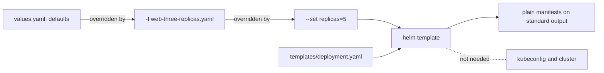

## Bạn cần biết trước

- [[k8s.l1.deploying-don-hang]] — bạn đã deploy backend từ các manifest viết sẵn trong `deploy/k8s/`. Bài này sinh ra những manifest như thế từ một template thay vì viết hết ra.
- [[devops.l3.promoting-between-environments]] — bạn đã thấy `envs/staging` và `envs/production` giữ hai bản đầy đủ, chỉ khác nhau vài giá trị như số replica và image tag. Chart giữ một template và tách các giá trị đó ra ngoài.
- [[k8s.l1.manifests-and-kubectl-apply]] — bạn biết `apiVersion`, `kind`, `metadata` và `spec` của một manifest. Output của chart chính là một manifest như vậy.

## Tình huống

Repo config giữ hai bản đầy đủ của mọi manifest, một cho staging và một cho production, và chúng chỉ khác nhau ở vài giá trị như số replica và image tag. Sắp tới bạn sẽ cài một phần mềm mà chính dự án của nó phát hành các object Kubernetes dưới dạng Helm chart, không phải manifest. Để luyện tay, bạn mở `deploy/helm/lessons/web`, một chart nhỏ mà repo giữ cho các bài học, và đọc `templates/deployment.yaml`. Nó trông như một manifest Deployment bình thường, chỉ khác là `replicas:` và `image:` chứa `{{ ... }}` thay vì giá trị, nên file này không phải thứ cluster sẽ nhận. Giá trị đến từ đâu, và làm sao xem được manifest thật sự sẽ được apply?

## Khái niệm cốt lõi

- **Helm** (Trình quản lý gói cho Kubernetes: render chart thành manifest và cài, nâng cấp, quay lui chúng thành release) — công cụ dòng lệnh đóng gói manifest Kubernetes thành chart, render chart thành manifest và, từ bài sau trở đi, cài chúng vào cluster.
- **Helm chart** (Gói của Helm: thư mục template manifest kèm values mặc định, render ra manifest thật) — một thư mục đóng gói manifest dưới dạng template: `Chart.yaml` ghi tên và version của chart, `values.yaml` giữ giá trị mặc định, còn `templates/` chứa các manifest có chỗ trống cần điền.
- Chỗ trống (placeholder) — một biểu thức `{{ ... }}` trong template, như `{{ .Values.replicas }}`, mà Helm thay bằng một giá trị khi render chart.
- **file values** (values file) — một file YAML có các key điền vào chỗ trống của chart. `values.yaml` trong chart giữ giá trị mặc định, còn file truyền vào bằng `-f` ghi đè những key nó đặt.
- `helm template` — lệnh render một chart và in ra các manifest thu được, không liên lạc với cluster nào.

## Cơ chế hoạt động



Trong tình huống trên, chart là `deploy/helm/lessons/web`. Thư mục `templates/` của nó chứa `deployment.yaml` và `service.yaml`, và Helm đọc chúng như văn bản thuần có chỗ trống, không phải như YAML. Mỗi `{{ ... }}` là một chỗ trống: `{{ .Values.replicas }}` hỏi key `replicas`, còn `{{ .Values.image.tag }}` hỏi key `tag` nằm dưới `image`. `{{ .Release.Name }}` là tên bạn đưa trên dòng lệnh, ở đây là `web`. Nó trở thành tên của Deployment và label `app` của Deployment đó.

Trong bài này, giá trị đến từ ba nơi, nơi sau ghi đè nơi trước. `values.yaml` trong chart giữ giá trị mặc định: `replicas: 1` và image tag `"2.10.0"`. File values truyền bằng `-f` chỉ ghi đè những key nó đặt. `web-three-replicas.yaml` chỉ đặt `replicas: 3`, nên tag giữ giá trị mặc định. `--set key=value` ghi đè cả hai, mỗi lần một key. Nhờ vậy, một chart cùng mỗi môi trường một file values có thể cho staging một replica và production ba replica, mà không cần bản sao thứ hai của template.

`helm template` điền mọi chỗ trống và in ra manifest thuần. Lệnh không cần kubeconfig và không liên lạc với API server nào: render diễn ra ngay trên máy bạn, nên bạn đọc được output, hoặc diff nó với lần render trước, trước khi apply bất cứ thứ gì.

Điều `helm template` không làm là đối chiếu kết quả với những gì Kubernetes chấp nhận. Chỗ trống chỉ là một khoảng trống trong văn bản: giá trị mang văn bản gì thì văn bản đó được đặt vào đúng chỗ ấy. Chỉ output đã render mới cho thấy cluster sẽ nhận gì.

## Trong hệ thống Đơn Hàng

```yaml file=deploy/helm/lessons/web/templates/deployment.yaml tag=stage-3 lines=5-23
apiVersion: apps/v1
kind: Deployment
metadata:
  name: {{ .Release.Name }}
spec:
  replicas: {{ .Values.replicas }}
  selector:
    matchLabels:
      app: {{ .Release.Name }}
  template:
    metadata:
      labels:
        app: {{ .Release.Name }}
    spec:
      containers:
        - name: web
          image: "{{ .Values.image.repository }}:{{ .Values.image.tag }}"
          ports:
            - containerPort: 80
```

Comment đầu file, phía trên đoạn trích, ghi rằng đây là Deployment của `deploy/k8s/lessons/web-deployment.yaml`, chạy Caddy (một web server), nhưng có thêm chỗ trống. Hãy nhìn dòng `replicas:` và dòng `image:`: số replica và image tag không còn nằm sẵn trong file. Image được ghép từ hai key, `image.repository` và `image.tag`, nối bằng dấu hai chấm. Cạnh `templates/`, `Chart.yaml` đặt tên chart là `web` với chart version `0.1.0`, kèm `appVersion: "2.10.0"`, giá trị chỉ ghi lại bản Caddy mà các giá trị mặc định chạy. Không template nào đọc `appVersion`, nên đổi `image.tag` không làm nó thay đổi.

```bash file=scripts/k8s/helm-template.sh tag=stage-3 lines=20-41
export KUBECONFIG=/nonexistent/kubeconfig
echo "== defaults (values.yaml)"
deployment show helm template web "$chart"
echo
echo "== -f deploy/helm/lessons/web-three-replicas.yaml"
deployment helm template web "$chart" -f deploy/helm/lessons/web-three-replicas.yaml | grep -e 'replicas:' -e 'image:'
echo
echo "== the same, plus --set replicas=5 --set image.tag=2.10.2"
deployment helm template web "$chart" -f deploy/helm/lessons/web-three-replicas.yaml \
  --set replicas=5 --set image.tag=2.10.2 | grep -e 'replicas:' -e 'image:'
echo

# --set changed the render only: values.yaml still holds the defaults.
echo "== values.yaml after both renders"
grep -v '^#' "$chart/values.yaml"
echo

# Templates are text: a value that breaks the YAML is found only by
# rendering, here a replica count that is not a number.
echo "== --set replicas=two"
deployment helm template web "$chart" --set replicas=two | grep 'replicas:'
echo "(helm template printed it; the API server would refuse a Deployment whose replicas is a string)"
```

```text output=true
...
== -f deploy/helm/lessons/web-three-replicas.yaml
  replicas: 3
          image: "caddy:2.10.0"

== the same, plus --set replicas=5 --set image.tag=2.10.2
  replicas: 5
          image: "caddy:2.10.2"

== values.yaml after both renders
replicas: 1
image:
  repository: caddy
  tag: "2.10.0"

== --set replicas=two
  replicas: two
(helm template printed it; the API server would refuse a Deployment whose replicas is a string)
```

Dòng đầu tiên trỏ `KUBECONFIG` tới một file không tồn tại, vậy mà lần render nào cũng chạy được. Hai helper được định nghĩa phía trên đoạn trích: `show` in lệnh ra trước khi chạy, còn `deployment` chỉ giữ lại Deployment đã render, bỏ các dòng comment. `grep` chỉ giữ những dòng khớp, ở đây là dòng `replicas:` và dòng `image:`. `grep -v '^#'` thì bỏ các dòng comment. `helm template web "$chart"` nhận tên trước, rồi tới thư mục chart.

Với `-f`, chỉ `replicas` đổi. Thêm `--set` lên trên thì cả hai key đều đổi, và `--set` thắng file. Sau cả hai lần render, `values.yaml` vẫn giữ `replicas: 1`. Lần render cuối in ra `replicas: two` mà không báo lỗi gì, dù Deployment API định nghĩa `replicas` là số nguyên, nên `two` không phải giá trị hợp lệ.

## Senior hay nhầm rằng…

- **"Helm chart là một loại container image, hoặc có chứa image."** → Thực ra chart là một thư mục các file văn bản: `Chart.yaml`, `values.yaml` và các template. Image chỉ xuất hiện dưới dạng một cái tên trong manifest đã render, và khi Pod khởi động, kubelet mới pull image đó từ registry nếu node chưa có sẵn. Bạn sẽ nhận ra khi `--set image.tag=2.10.2` render ra `caddy:2.10.2` trong khi `Chart.yaml` vẫn ghi `appVersion: "2.10.0"` và không file nào của chart thay đổi.
- **"Render một chart cần kết nối tới cluster."** → Thực ra `helm template` render trên máy bạn và không cần kubeconfig, vì điền chỗ trống chỉ cần chart và các giá trị. Bạn sẽ nhận ra khi `helm-template.sh` render mọi biến thể trong lúc `KUBECONFIG` trỏ tới một file không tồn tại.
- **"Giá trị truyền bằng `--set` được ghi ngược vào `values.yaml` của chart."** → Thực ra, với `helm template`, `--set` chỉ đổi lần render đó, các file của chart giữ nguyên. Bạn sẽ nhận ra khi lần render tiếp theo không có `--set` lại hiện `replicas: 1`, và `git status` không thấy thay đổi nào dưới `deploy/helm`.

## Thử ngay (3 phút)

1. Từ thư mục gốc của repo, chạy `helm template web deploy/helm/lessons/web --set image.tag=2.10.2 --show-only templates/deployment.yaml` (`--show-only` chỉ in Deployment, không in Service. Máy cần cài sẵn Helm).
2. Chạy `git status --short deploy/helm`.

Kết quả mong đợi: Deployment đã render hiện `replicas: 1` và `image: "caddy:2.10.2"`, dù không có cluster nào đang chạy và cũng không cần cluster. `git status --short deploy/helm` không in gì: giá trị chỉ đổi lần render, không đổi chart.

## Liên hệ

- [[k8s.l2.helm-releases]] — bài tiếp: `helm install` render cùng chart đó và apply kết quả vào cluster.
- [[devops.l3.tofu-modules]] — cùng ý tưởng trong OpenTofu: một thư mục viết một lần rồi được gọi với giá trị riêng của từng nơi gọi, như chart được render với file values của từng môi trường.
- [[devops.l3.promoting-between-environments]] — vấn đề mà chart có thể giải: mỗi môi trường một bản đầy đủ, chỉ khác nhau vài giá trị.
- [[k8s.l2.config-repo-overlays]] — giải thích vì sao Đơn Hàng không viết chart cho chính nó mà chọn hướng khác để chia sẻ manifest giữa các môi trường.

## Tóm tắt 5 dòng

1. Helm chart là một thư mục template manifest mà Helm điền giá trị vào để sinh ra manifest thuần.
2. `Chart.yaml` đặt tên chart và version của nó, `values.yaml` giữ giá trị mặc định, còn `templates/` chứa manifest có chỗ trống `{{ ... }}`.
3. File values truyền bằng `-f` ghi đè những key nó đặt, `--set` ghi đè cả hai, còn các file của chart không bao giờ đổi.
4. `helm template` render chart trên máy bạn mà không liên lạc với cluster nào, nên bạn đọc và diff được kết quả trước.
5. Template là văn bản, không phải YAML: một giá trị sai kiểu vẫn có thể render mà không báo lỗi, và chỉ output đã render mới cho thấy điều đó.
