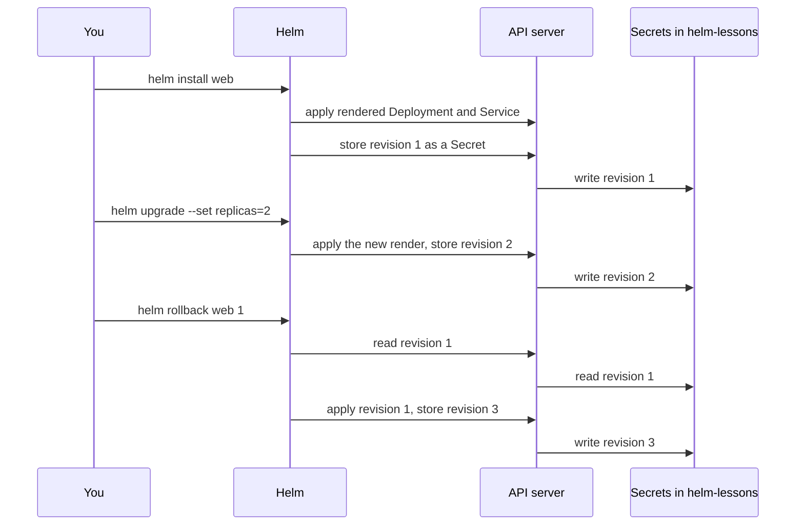

## Before you start

- [[k8s.l2.helm-charts]] — you rendered the `web` chart with `helm template` and overrode its values with `--set`; this lesson applies that render to a cluster.
- [[k8s.l1.rollbacks]] — you brought one Deployment back with `kubectl rollout undo`; Helm offers the same kind of undo for everything a chart created.

## The situation

In the last lesson you only rendered the `web` chart on your machine. Now you put it on `donhang-staging`, in the namespace `helm-lessons`, and a teammate will change it after you. With plain manifests, a bad change meant `kubectl rollout undo` on one Deployment. This chart creates a Deployment and a Service together, and the values behind each change were typed on someone's command line. Next week someone wants the change before last back, and a record of what happened in between. Where does Helm keep a record of each install and change, so that you can go back to an earlier one?

## Core concepts

- **Helm release** — one install of a chart under a name you choose, in one namespace, whose objects Helm tracks and changes together; here the release `web` in `helm-lessons`.
- Revision — a numbered record of one change to a release: the install is revision 1, and each upgrade or rollback adds the next number.
- `helm upgrade` — renders the chart again with the values you give and applies the result to an existing release, as a new revision.
- `helm history` — lists a release's revisions with their status, chart and description.
- `helm rollback` — applies an earlier revision's manifests again, as a new revision.

## How it works



In the situation above, the Helm release is `web` in `helm-lessons`. `helm install web` with the chart folder renders the chart as `helm template` did, applies the Deployment and the Service to the cluster, and records revision 1. The name belongs to that namespace, so every later Helm command about `web` names it with `-n helm-lessons`.

`helm upgrade` renders the chart again, with the values you give this time, and applies the result to the same release as revision 2. `helm history` then lists both: the newest is `deployed`, and the one it replaced is `superseded`.

By default, Helm stores each revision in the cluster as a Secret in the release's namespace, holding that revision's chart and values. A Secret is an object like any other, so Helm writes it through the API server. Nothing about the release stays on the machine that ran the command: anyone allowed to read Secrets in that namespace sees the same history.

`helm rollback web 1` reads revision 1 from its Secret and applies those manifests again. It does not move back down the list: it records a new revision 3, described as a rollback to 1, and revision 2 stays in the history. Like `kubectl rollout undo`, it changes the cluster only; `values.yaml` and your Git repository stay as they were.

`helm uninstall web` deletes the objects of the release and, by default, its history Secrets too, so the release and its record disappear together.

## In the Đơn Hàng system

```bash file=scripts/k8s/helm-release.sh tag=stage-3 lines=22-33
# lesson: k8s.l2.helm-releases
# install renders the chart, applies the result and records revision 1 of
# the release web; upgrade does the same with new values, as revision 2.
echo "\$ helm install web $chart -n helm-lessons --wait"
helm install web "$chart" -n helm-lessons --wait | grep -e '^NAME' -e '^REVISION' -e '^STATUS'
echo "replicas: $(replicas)"
echo "\$ helm upgrade web $chart -n helm-lessons --set replicas=2 --wait"
helm upgrade web "$chart" -n helm-lessons --set replicas=2 --wait | grep -e '^REVISION' -e '^STATUS'
echo "replicas: $(replicas)"
echo
history
echo
```

```text output=true
$ helm install web deploy/helm/lessons/web -n helm-lessons --wait
NAME: web
NAMESPACE: helm-lessons
STATUS: deployed
REVISION: 1
replicas: 1
$ helm upgrade web deploy/helm/lessons/web -n helm-lessons --set replicas=2 --wait
STATUS: deployed
REVISION: 2
replicas: 2

$ helm history web -n helm-lessons
REVISION   STATUS       CHART       DESCRIPTION
1          superseded   web-0.1.0   Install complete
2          deployed     web-0.1.0   Upgrade complete
...
```

Above the excerpt, the script points every `helm` and `kubectl` at `donhang-staging` by selecting the kubeconfig context `kind-donhang-staging`, which is why step 2 of "Try it" passes `--kube-context kind-donhang-staging`. It also sets `chart` to `deploy/helm/lessons/web` and creates the namespace `helm-lessons`. Two of its helpers appear here: `replicas` reads the replica count of the Deployment `web`, and `history` runs `helm history` without the `UPDATED` and `APP VERSION` columns. `--wait` makes each command wait until the release's objects are ready (for uninstall: deleted) before it reports success. Each `grep` keeps only the lines of Helm's longer output that start with `NAME` (which also matches `NAMESPACE`), `REVISION` or `STATUS`. The install gives `replicas: 1`, the default from `values.yaml`; the upgrade with `--set replicas=2` gives 2 and revision 2.

```bash file=scripts/k8s/helm-release.sh tag=stage-3 lines=35-53
# The release's history lives in the cluster: one Secret per revision, in
# the release's namespace, holding that revision's manifests and values.
echo "== Secrets in helm-lessons"
show kubectl get secrets -n helm-lessons -o custom-columns=NAME:.metadata.name,TYPE:.type
echo

# lesson: k8s.l2.helm-releases
# rollback applies revision 1's manifests again, as a new revision 3;
# revision 2 stays in the history. values.yaml and this repository do not
# change: only the cluster does.
show helm rollback web 1 -n helm-lessons --wait
echo "replicas: $(replicas)"
history
echo

# uninstall deletes the release's objects and its history Secrets.
show helm uninstall web -n helm-lessons --wait
echo "== left in helm-lessons"
kubectl get deployments,services,secrets -n helm-lessons 2>&1
```

```text output=true
...
== Secrets in helm-lessons
$ kubectl get secrets -n helm-lessons -o custom-columns=NAME:.metadata.name,TYPE:.type
NAME                        TYPE
sh.helm.release.v1.web.v1   helm.sh/release.v1
sh.helm.release.v1.web.v2   helm.sh/release.v1

$ helm rollback web 1 -n helm-lessons --wait
...
replicas: 1
$ helm history web -n helm-lessons
REVISION   STATUS       CHART       DESCRIPTION
1          superseded   web-0.1.0   Install complete
2          superseded   web-0.1.0   Upgrade complete
3          deployed     web-0.1.0   Rollback to 1

$ helm uninstall web -n helm-lessons --wait
release "web" uninstalled
== left in helm-lessons
No resources found in helm-lessons namespace.
```

`show` prints a command before running it. The two Secrets are the history: one per revision, named after the release `web` and the revision number, with the type `helm.sh/release.v1` marking them as Helm's release records. After the rollback the replica count is 1 again, yet the history has three rows, and revision 2 is still there as `superseded`. The `CHART` column reads `web-0.1.0` in every row, because all three revisions came from the same chart version. After `helm uninstall`, `kubectl` finds no Deployment, no Service and no Secret left in `helm-lessons`.

## Seniors often assume…

- **"`helm rollback` deletes the bad revision from the history."** → Actually a rollback adds a revision that applies an older one's manifests again, and the bad one stays as `superseded`, because a rollback only adds a revision; it removes none. You notice this when `helm history` after `helm rollback web 1` shows revisions 1, 2 and 3, with 3 described as `Rollback to 1`.
- **"Helm keeps track of releases on the laptop that ran `helm install`."** → Actually by default each revision is a Secret in the release's namespace, so the record lives in the cluster. You notice this when `kubectl get secrets -n helm-lessons` lists `sh.helm.release.v1.web.v1` and `v2`, and a teammate whose access to the cluster allows reading those Secrets sees the same `helm history`.
- **"A release and a chart version are the same thing."** → Actually the chart version comes from the chart's `Chart.yaml`, while the release is a name you chose at install time, with revisions that count changes to it. You notice this when the `REVISION` column goes 1, 2, 3 while the `CHART` column stays `web-0.1.0`, because only values changed.

## Try it (3 minutes)

1. With `donhang-staging` running, run `scripts/k8s/helm-release.sh`, then `git status --short deploy/helm`.
2. Run `helm history web -n helm-lessons --kube-context kind-donhang-staging`.

Expected result: the script prints the lines shown above, plus the lines elided as `...`, and `git status --short deploy/helm` prints nothing: the upgrade and the rollback changed only the cluster. `helm history` then fails: `helm uninstall` deleted the release's history Secrets along with its objects, so Helm has no record of `web`.

## Connections

- [[k8s.l2.helm-charts]] — prerequisite: the same chart and the same `--set`, rendered on your machine instead of applied as a release.
- [[k8s.l1.rollbacks]] — the same idea one layer down: `kubectl rollout undo` goes back for one Deployment, `helm rollback` for every object of a release.
- [[devops.l3.rollback-by-revert]] — the opposite approach: under GitOps you roll back by a commit in Git, not by a command against the cluster.
- [[k8s.l2.charts-through-argo-cd]] — the next lesson: how a chart is installed through Argo CD.

## Five-line summary

1. A Helm release is a named install of a chart in one namespace, and every upgrade or rollback adds a numbered revision to it.
2. `helm install` renders and applies a chart as revision 1; each `helm upgrade` applies a new render as the next revision.
3. By default, Helm stores each revision's chart and values in a Secret in the release's namespace, so the history lives in the cluster.
4. `helm rollback` applies an older revision again as a new revision; the bad one stays in `helm history`, and your files stay unchanged.
5. `helm uninstall` deletes the release's objects and, by default, its history Secrets.
