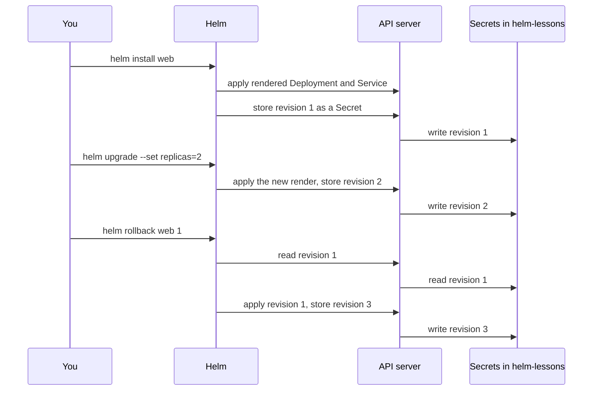

## Bạn cần biết trước

- [[k8s.l2.helm-charts]] — bạn đã render chart `web` bằng `helm template` và ghi đè values của nó bằng `--set`. Bài này đưa kết quả render đó lên cluster.
- [[k8s.l1.rollbacks]] — bạn đã đưa một Deployment về bản cũ bằng `kubectl rollout undo`. Helm có kiểu quay lui tương tự cho mọi thứ một chart tạo ra.

## Tình huống

Ở bài trước, bạn chỉ render chart `web` trên máy mình. Giờ bạn đưa nó lên `donhang-staging`, vào namespace `helm-lessons`, và sau bạn sẽ có một đồng nghiệp sửa nó. Với manifest thuần, một thay đổi hỏng chỉ cần `kubectl rollout undo` trên một Deployment. Chart này tạo cùng lúc một Deployment và một Service, còn values đằng sau mỗi thay đổi lại được gõ trên dòng lệnh của ai đó. Tuần sau, có người muốn quay về bản trước bản gần nhất, kèm một bản ghi những gì đã xảy ra ở giữa. Helm giữ bản ghi của mỗi lần cài và mỗi lần thay đổi ở đâu, để bạn quay về được một lần trước đó?

## Khái niệm cốt lõi

- **Helm release** (Một lần cài chart có tên trong một namespace; mỗi lần upgrade hay rollback thêm một revision) — một lần cài chart dưới cái tên bạn chọn, trong một namespace, mà Helm theo dõi và thay đổi các object của nó cùng nhau. Ở đây là release `web` trong `helm-lessons`.
- Revision — bản ghi có đánh số của một lần thay đổi release: lần cài là revision 1, mỗi lần upgrade hay rollback thêm số kế tiếp.
- `helm upgrade` — render lại chart với các values bạn đưa và apply kết quả vào một release đã có, thành một revision mới.
- `helm history` — liệt kê các revision của release, kèm status, chart và mô tả.
- `helm rollback` — apply lại manifest của một revision cũ, thành một revision mới.

## Cơ chế hoạt động



Trong tình huống trên, Helm release là `web` trong `helm-lessons`. `helm install web` cùng thư mục chart render chart giống như `helm template`, apply Deployment và Service lên cluster, rồi ghi lại revision 1. Cái tên thuộc về namespace đó, nên mọi lệnh Helm về sau liên quan tới `web` đều gọi nó kèm `-n helm-lessons`.

`helm upgrade` render lại chart, lần này với values bạn đưa, rồi apply kết quả vào cùng release đó thành revision 2. Lúc này `helm history` liệt kê cả hai: bản mới nhất là `deployed`, bản bị nó thay thế là `superseded`.

Mặc định, Helm lưu mỗi revision trong cluster dưới dạng một Secret ở namespace của release, chứa chart và values của revision đó. Secret là một object như mọi object khác, nên Helm ghi nó qua API server. Không có gì về release nằm lại trên máy đã chạy lệnh: ai được phép đọc Secret trong namespace đó đều thấy cùng một lịch sử.

`helm rollback web 1` đọc revision 1 từ Secret của nó và apply lại các manifest ấy. Lệnh không lùi xuống trong danh sách: nó ghi một revision 3 mới, mô tả là rollback về 1, còn revision 2 vẫn nằm trong lịch sử. Giống `kubectl rollout undo`, lệnh chỉ đổi cluster. `values.yaml` và repo Git giữ nguyên như cũ.

`helm uninstall web` xóa các object của release và, theo mặc định, xóa luôn các Secret lịch sử, nên release và bản ghi của nó biến mất cùng lúc.

## Trong hệ thống Đơn Hàng

```bash file=scripts/k8s/helm-release.sh tag=stage-3 lines=22-33
# lesson: k8s.l2.helm-releases
# install renders the chart, applies the result and records revision 1 of
# the release web; upgrade does the same with new values, as revision 2.
echo "\$ helm install web $chart -n helm-lessons --wait"
helm install web "$chart" -n helm-lessons --wait | grep -e '^NAME' -e '^REVISION' -e '^STATUS'
echo "replicas: $(replicas)"
echo "\$ helm upgrade web $chart -n helm-lessons --set replicas=2 --wait"
helm upgrade web "$chart" -n helm-lessons --set replicas=2 --wait | grep -e '^REVISION' -e '^STATUS'
echo "replicas: $(replicas)"
echo
history
echo
```

```text output=true
$ helm install web deploy/helm/lessons/web -n helm-lessons --wait
NAME: web
NAMESPACE: helm-lessons
STATUS: deployed
REVISION: 1
replicas: 1
$ helm upgrade web deploy/helm/lessons/web -n helm-lessons --set replicas=2 --wait
STATUS: deployed
REVISION: 2
replicas: 2

$ helm history web -n helm-lessons
REVISION   STATUS       CHART       DESCRIPTION
1          superseded   web-0.1.0   Install complete
2          deployed     web-0.1.0   Upgrade complete
...
```

Phía trên đoạn trích, script trỏ mọi lệnh `helm` và `kubectl` tới `donhang-staging` bằng cách chọn context kubeconfig `kind-donhang-staging`. Đó là lý do bước 2 của "Thử ngay" truyền `--kube-context kind-donhang-staging`. Script cũng đặt `chart` thành `deploy/helm/lessons/web` và tạo namespace `helm-lessons`. Hai helper của nó xuất hiện ở đây: `replicas` đọc số replica của Deployment `web`, còn `history` chạy `helm history` mà bỏ hai cột `UPDATED` và `APP VERSION`. `--wait` khiến mỗi lệnh chờ tới khi các object của release sẵn sàng (với uninstall: đã bị xóa) rồi mới báo thành công. Mỗi `grep` chỉ giữ những dòng trong output dài hơn của Helm bắt đầu bằng `NAME` (khớp cả `NAMESPACE`), `REVISION` hoặc `STATUS`. Lần install cho `replicas: 1`, giá trị mặc định trong `values.yaml`. Lần upgrade với `--set replicas=2` cho 2 và revision 2.

```bash file=scripts/k8s/helm-release.sh tag=stage-3 lines=35-53
# The release's history lives in the cluster: one Secret per revision, in
# the release's namespace, holding that revision's manifests and values.
echo "== Secrets in helm-lessons"
show kubectl get secrets -n helm-lessons -o custom-columns=NAME:.metadata.name,TYPE:.type
echo

# lesson: k8s.l2.helm-releases
# rollback applies revision 1's manifests again, as a new revision 3;
# revision 2 stays in the history. values.yaml and this repository do not
# change: only the cluster does.
show helm rollback web 1 -n helm-lessons --wait
echo "replicas: $(replicas)"
history
echo

# uninstall deletes the release's objects and its history Secrets.
show helm uninstall web -n helm-lessons --wait
echo "== left in helm-lessons"
kubectl get deployments,services,secrets -n helm-lessons 2>&1
```

```text output=true
...
== Secrets in helm-lessons
$ kubectl get secrets -n helm-lessons -o custom-columns=NAME:.metadata.name,TYPE:.type
NAME                        TYPE
sh.helm.release.v1.web.v1   helm.sh/release.v1
sh.helm.release.v1.web.v2   helm.sh/release.v1

$ helm rollback web 1 -n helm-lessons --wait
...
replicas: 1
$ helm history web -n helm-lessons
REVISION   STATUS       CHART       DESCRIPTION
1          superseded   web-0.1.0   Install complete
2          superseded   web-0.1.0   Upgrade complete
3          deployed     web-0.1.0   Rollback to 1

$ helm uninstall web -n helm-lessons --wait
release "web" uninstalled
== left in helm-lessons
No resources found in helm-lessons namespace.
```

`show` in lệnh ra trước khi chạy. Hai Secret chính là lịch sử: mỗi revision một Secret, đặt tên theo release `web` và số revision, với type `helm.sh/release.v1` đánh dấu chúng là bản ghi release của Helm. Sau rollback, số replica lại là 1, nhưng lịch sử có ba dòng, và revision 2 vẫn còn đó với status `superseded`. Cột `CHART` ở mọi dòng đều là `web-0.1.0`, vì cả ba revision đến từ cùng một chart version. Sau `helm uninstall`, `kubectl` không còn thấy Deployment, Service hay Secret nào trong `helm-lessons`.

## Senior hay nhầm rằng…

- **"`helm rollback` xóa revision hỏng khỏi lịch sử."** → Thực ra rollback thêm một revision apply lại manifest của một revision cũ, còn revision hỏng ở lại với status `superseded`, vì rollback chỉ thêm revision chứ không xóa revision nào. Bạn sẽ nhận ra khi `helm history` sau `helm rollback web 1` hiện các revision 1, 2 và 3, trong đó 3 có mô tả `Rollback to 1`.
- **"Helm theo dõi release trên chiếc laptop đã chạy `helm install`."** → Thực ra mặc định mỗi revision là một Secret trong namespace của release, nên bản ghi nằm trong cluster. Bạn sẽ nhận ra khi `kubectl get secrets -n helm-lessons` liệt kê `sh.helm.release.v1.web.v1` và `v2`, và một đồng nghiệp có quyền đọc các Secret đó trên cluster thấy cùng một `helm history`.
- **"Release và chart version là một."** → Thực ra chart version lấy từ `Chart.yaml` của chart, còn release là cái tên bạn chọn lúc cài, kèm các revision đếm số lần nó thay đổi. Bạn sẽ nhận ra khi cột `REVISION` tăng 1, 2, 3 trong khi cột `CHART` vẫn là `web-0.1.0`, vì chỉ values thay đổi.

## Thử ngay (3 phút)

1. Khi `donhang-staging` đang chạy, chạy `scripts/k8s/helm-release.sh`, rồi `git status --short deploy/helm`.
2. Chạy `helm history web -n helm-lessons --kube-context kind-donhang-staging`.

Kết quả mong đợi: script in ra các dòng như trên, cộng thêm những dòng bị lược thành `...`, và `git status --short deploy/helm` không in gì: upgrade và rollback chỉ đổi cluster. Sau đó `helm history` báo lỗi: `helm uninstall` đã xóa các Secret lịch sử của release cùng với các object của nó, nên Helm không còn bản ghi nào về `web`.

## Liên hệ

- [[k8s.l2.helm-charts]] — bài cần học trước: cùng chart và cùng `--set`, nhưng render trên máy bạn thay vì apply thành release.
- [[k8s.l1.rollbacks]] — cùng ý tưởng ở tầng thấp hơn: `kubectl rollout undo` quay lui một Deployment, `helm rollback` quay lui mọi object của một release.
- [[devops.l3.rollback-by-revert]] — hướng ngược lại: với GitOps, bạn quay lui bằng một commit trong Git, không phải bằng một lệnh chạy thẳng vào cluster.
- [[k8s.l2.charts-through-argo-cd]] — bài tiếp: cài một chart thông qua Argo CD.

## Tóm tắt 5 dòng

1. Helm release là một lần cài chart có tên trong một namespace, và mỗi lần upgrade hay rollback thêm vào đó một revision có đánh số.
2. `helm install` render và apply chart thành revision 1. Mỗi `helm upgrade` apply một lần render mới thành revision kế tiếp.
3. Mặc định, Helm lưu chart và values của mỗi revision trong một Secret ở namespace của release, nên lịch sử nằm trong cluster.
4. `helm rollback` apply lại một revision cũ thành revision mới. Revision hỏng vẫn nằm trong `helm history`, còn các file của bạn giữ nguyên.
5. `helm uninstall` xóa các object của release và, theo mặc định, các Secret lịch sử của nó.
