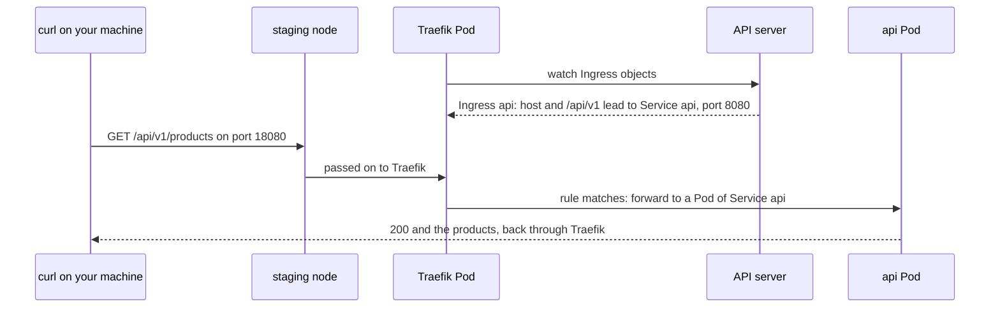

## Before you start

- [[k8s.l2.charts-through-argo-cd]] — Argo CD installed Traefik on `donhang-staging` from its chart; here Traefik starts routing requests.
- [[k8s.l1.service-and-dns]] — Pods reach the api through its Service by name; that name means nothing outside the cluster.
- [[devops.l1.reverse-proxy-basics]] — in Compose, Caddy sits in front of the api as a reverse proxy and decides by path where each request goes.

## The situation

In Compose, `curl http://localhost:8080/api/v1/products` reaches the api because Caddy forwards `/api/v1/*` to it. On `donhang-staging`, the api runs behind the Service `api`. Pods reach it by that name, but your machine cannot: the name and its address exist only inside the cluster. Traefik, installed in the last lesson, is already reachable on port `18080` of your machine. You call `http://ingress.donhang.localhost:18080/api/v1/products` and get `404`, from Traefik itself: Traefik runs and the api runs, yet nothing connects them. Where do you write the rule that sends this path to the api, and what makes the rule take effect?

## Core concepts

- **Kubernetes Ingress** — a Kubernetes object listing HTTP rules for requests from outside the cluster, each rule an optional host and a path leading to a Service and a port.
- **Ingress controller** — a reverse proxy running in the cluster, here Traefik's Pods, that watches Ingress objects and forwards outside requests by their rules.
- `pathType` — how a rule's path is compared with the request's path: `Prefix` matches that path and everything below it, split at each `/`, and `Exact` matches only that path.
- `ingressClassName` — the field of an Ingress naming its class: the name under which one controller in the cluster takes Ingress objects as its own, here `traefik`.
- Annotation — a key-value note in an object's `metadata`; each controller defines its own annotations for settings beyond the basic rules.

## How it works



The missing piece is an Ingress. The api's Service has no `type`, so Kubernetes gives it the type `ClusterIP`, an address that works only inside the cluster. Something inside must accept outside requests and pass them on, Caddy's job in Compose.

An Ingress holds the rules for that job and nothing else. Each rule here names a host and a path, and a request's `Host` header and path must both match. `curl` fills that header from the URL you type, so it carries `ingress.donhang.localhost`. With `pathType: Prefix`, `/api/v1` matches `/api/v1/products`, but not `/api/v1x`.

Writing the Ingress changes nothing by itself. Kubernetes stores it like any other object, but no part of Kubernetes routes by it, and a cluster starts no Ingress controller on its own. On staging, Traefik is the controller: its Pods watch Ingress objects through the API server and turn each rule into routing of their own. Your call on port `18080` lands on the staging node, which passes it to Traefik; the next section shows how. Traefik forwards a match to one of the api's Pods, found through the Service, and answers `404` itself when nothing matches.

Traefik takes this Ingress because its `ingressClassName` is `traefik`, the class Traefik uses on `donhang-staging`; an Ingress naming another class is left to another controller. The basic rules are fields Kubernetes itself defines, so other controllers read them too. Anything more is set with annotations, which each controller names and reads in its own way.

## In the Đơn Hàng system

```yaml file=deploy/k8s/lessons/api-ingress.yaml tag=stage-3 lines=1-22
# lesson: k8s.l2.ingress
# One HTTP rule: a request for the host ingress.donhang.localhost whose path
# starts with /api/v1 goes to port 8080 of the Service api. ingressClassName names
# the controller that should act on it; without a controller, nothing does.
apiVersion: networking.k8s.io/v1
kind: Ingress
metadata:
  name: api
  namespace: donhang
spec:
  ingressClassName: traefik
  rules:
    - host: ingress.donhang.localhost
      http:
        paths:
          - path: /api/v1
            pathType: Prefix
            backend:
              service:
                name: api
                port:
                  number: 8080
```

Lines 12–22 hold one rule: a host, one path with `pathType: Prefix`, and a backend naming the Service `api` and its port `8080`. Line 11 hands the Ingress to Traefik. Nothing in the file says where Traefik runs: the Ingress only describes routing, and the controller supplies the proxy. The host needs no DNS entry: when the script ran, `curl` sent the name `ingress.donhang.localhost` to this machine itself, as the output below shows. This Ingress exists only for this lesson and is not part of the config repository.

```bash file=scripts/k8s/ingress.sh tag=stage-3 lines=13-37
# The api's Service has no type: only Pods inside the cluster can reach it.
show kubectl get service api -n donhang
echo

# lesson: k8s.l2.ingress
# Traefik's Pods already listen on port 18080 of this machine, but without
# a rule they have nowhere to send the request: 404, from Traefik itself.
echo "== GET $url, no Ingress yet"
echo "HTTP $(status)"
echo

# The Ingress names Traefik's class; Traefik watches Ingress objects, sees
# the new rule and forwards matching requests to the Service api.
show kubectl apply -f deploy/k8s/lessons/api-ingress.yaml
echo "\$ kubectl get ingress api -n donhang"
kubectl get ingress api -n donhang -o custom-columns=NAME:.metadata.name,CLASS:.spec.ingressClassName,HOST:.spec.rules[0].host,PATH:.spec.rules[0].http.paths[0].path,SERVICE:.spec.rules[0].http.paths[0].backend.service.name
for _ in $(seq 60); do [ "$(status)" = 200 ] && break; sleep 1; done
echo
echo "== GET $url, with the Ingress"
curl -s -w '\nHTTP %{http_code}\n' "$url" | cut -c1-120
echo

# This Ingress only shows the idea: staging routes with Gateway API
# (scripts/k8s/gateway.sh), so the rule goes again.
show kubectl delete -f deploy/k8s/lessons/api-ingress.yaml
```

```text output=true
$ kubectl get service api -n donhang
NAME   TYPE        CLUSTER-IP   EXTERNAL-IP   PORT(S)    AGE
api    ClusterIP   ...          <none>        8080/TCP   ...

== GET http://ingress.donhang.localhost:18080/api/v1/products, no Ingress yet
HTTP 404

$ kubectl apply -f deploy/k8s/lessons/api-ingress.yaml
ingress.networking.k8s.io/api created
$ kubectl get ingress api -n donhang
NAME   CLASS     HOST                        PATH      SERVICE
api    traefik   ingress.donhang.localhost   /api/v1   api

== GET http://ingress.donhang.localhost:18080/api/v1/products, with the Ingress
[{"id":1,"name":"Bàn phím cơ","priceVnd":1250000},{"id":2,"name":"Chuột không dây","priceVnd":450000},{"id":3,"na
HTTP 200

$ kubectl delete -f deploy/k8s/lessons/api-ingress.yaml
ingress.networking.k8s.io "api" deleted from donhang namespace
```

Above the excerpt, the script sets `url` to the situation's address; `status` prints only the status code of a call to it, and `show` prints a command after `$`, then runs it. The Service `api` keeps `TYPE` `ClusterIP` and no `EXTERNAL-IP`. The first call gets `404`; after the apply, `kubectl get ingress` shows the class, host, path and Service. The script picks these columns with `-o custom-columns`; the plain command prints its own set.

The loop calls once a second, up to 60 times, until it gets `200`, because Traefik picks up a new rule shortly after it is stored. The next call returns the products, cut to 120 characters. The script then deletes the Ingress, because staging does not keep it: the comment names another kind of Kubernetes routing object that staging uses instead, the subject of the next lesson.

Why do your calls reach Traefik at all? In a part of `apps/traefik.yaml` the last lesson did not quote, Traefik's own Service has the type `NodePort` with node port `30080`: a type that opens that port on every node and passes what arrives there to the Service's Pods. `deploy/tofu/envs/staging/cluster/main.tf` has the staging node publish that port as `18080` on your machine. On a cloud, the controller's Service would instead have the type `LoadBalancer`, which asks the cloud for an outside IP address that passes what arrives there to the Service.

## Seniors often assume…

- **"Creating an Ingress is enough for Kubernetes to start routing traffic."** → Actually Kubernetes only stores the Ingress, because no part of Kubernetes itself routes by Ingress rules; a controller running in the cluster must act on it. `kubectl apply` prints `created` either way. You notice this when an Ingress appears in `kubectl get ingress` on a cluster without a controller, and requests from outside still reach nothing.
- **"An Ingress replaces the Service, so the api no longer needs one."** → Actually the rule's backend names a Service and a port, and the controller uses that Service to find the api's Pods; the Ingress adds a way in from outside on top of it. Without the Service, the rule has nowhere to send requests. You notice this when the script shows the Service `api` unchanged, still `ClusterIP`, and the Ingress's `SERVICE` column reads `api`.
- **"An Ingress with annotations behaves the same on any controller."** → Actually Kubernetes defines only the rules, while each controller defines its own annotations, so another controller may ignore them or read them differently. You notice this when an Ingress moved to a cluster with a different controller usually still routes its paths but loses the extra behaviour its annotations asked for.

## Try it (3 minutes)

With `donhang-staging` running, in the `don-hang` folder:

1. Run `scripts/k8s/ingress.sh`.
2. Call the same address yourself: `curl -s -o /dev/null -w '%{http_code}\n' http://ingress.donhang.localhost:18080/api/v1/products`.

Expected result: step 1 prints the output shown above. Step 2 prints `404`: the script deleted the Ingress at its end, so Traefik has no rule for this host and path any more.

## Connections

- [[k8s.l1.services]] — the layer underneath: the Service the rule names, which still gives the api one stable address inside the cluster.
- [[devops.l1.reverse-proxy-basics]] — the same job outside Kubernetes: in the `Caddyfile`, rules and proxy share one file; here the rules are an object and the proxy is a controller.
- [[k8s.l2.gateway-api]] — next: the routing objects staging really uses, which split the entry point from the routes.
- [[k8s.l3.service-types]] — the Service types `NodePort` and `LoadBalancer`, which decide how outside traffic reaches a controller like Traefik.

## Five-line summary

1. An Ingress only lists HTTP routing rules; an Ingress controller running in the cluster, here Traefik, is what carries them out.
2. A Service without a `type` is reachable only inside the cluster, so outside requests need a proxy in front of it.
3. Each rule matches a path, as `Prefix` or `Exact`, and an optional host, and leads to a Service and a port.
4. `ingressClassName` names the controller that acts on the Ingress; annotations for anything more differ from controller to controller.
5. Traefik answers `404` until the rule exists, and reaches your machine through ports the staging node publishes.
