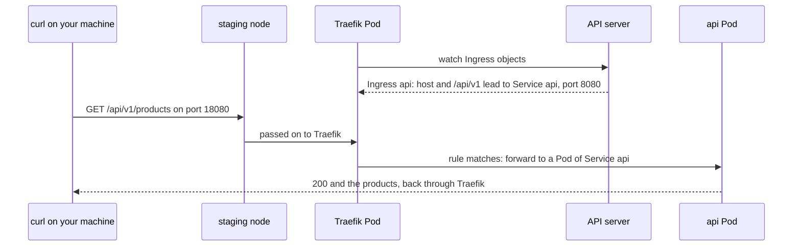

## Bạn cần biết trước

- [[k8s.l2.charts-through-argo-cd]] — Argo CD đã cài Traefik lên `donhang-staging` từ chart của nó. Ở bài này, Traefik bắt đầu định tuyến request.
- [[k8s.l1.service-and-dns]] — Pod gọi tới api qua Service của nó bằng tên. Ra ngoài cluster, cái tên đó không còn nghĩa gì.
- [[devops.l1.reverse-proxy-basics]] — trong Compose, Caddy đứng trước api làm reverse proxy và dựa vào path để quyết định mỗi request đi đâu.

## Tình huống

Trong Compose, `curl http://localhost:8080/api/v1/products` tới được api vì Caddy chuyển `/api/v1/*` sang nó. Trên `donhang-staging`, api chạy sau Service `api`. Pod gọi được nó bằng tên đó, còn máy bạn thì không: cả tên lẫn địa chỉ của nó chỉ tồn tại bên trong cluster. Traefik, cài ở bài trước, đã nghe sẵn trên port `18080` của máy bạn. Bạn gọi `http://ingress.donhang.localhost:18080/api/v1/products` và nhận `404`, do chính Traefik trả: Traefik đang chạy, api cũng đang chạy, nhưng chẳng có gì nối hai bên. Bạn viết luật gửi path này tới api ở đâu, và điều gì làm luật đó có hiệu lực?

## Khái niệm cốt lõi

- **Kubernetes Ingress** (Object Kubernetes liệt kê luật HTTP (host, path → Service); chỉ có tác dụng khi có Ingress controller) — một object Kubernetes liệt kê các luật HTTP cho request từ ngoài cluster. Mỗi luật gồm một host (không bắt buộc) và một path, dẫn tới một Service và một port.
- **Ingress controller** (Reverse proxy chạy trong cluster, theo dõi object Ingress và chuyển request từ ngoài vào theo luật của chúng) — một reverse proxy chạy trong cluster, ở đây là các Pod của Traefik. Nó theo dõi các object Ingress và chuyển request từ ngoài vào theo luật của chúng.
- `pathType` — cách so path của luật với path của request: `Prefix` khớp chính path đó và mọi thứ nằm dưới nó, tách theo từng dấu `/`, còn `Exact` chỉ khớp đúng path đó.
- `ingressClassName` — trường của Ingress ghi class của nó: cái tên mà một controller trong cluster dùng để nhận các object Ingress về mình, ở đây là `traefik`.
- Annotation — một ghi chú dạng key-value trong `metadata` của object. Mỗi controller tự định nghĩa annotation riêng cho những thiết lập nằm ngoài các luật cơ bản.

## Cơ chế hoạt động



Mảnh còn thiếu là một Ingress. Service của api không có `type`, nên Kubernetes gán cho nó type `ClusterIP`, một địa chỉ chỉ dùng được bên trong cluster. Phải có thứ gì đó bên trong nhận request từ ngoài rồi chuyển tiếp, đúng việc Caddy làm trong Compose.

Ingress chứa luật cho việc đó, và chỉ chứa luật. Mỗi luật ở đây ghi một host và một path, và request phải khớp cả header `Host` lẫn path. `curl` lấy header đó từ URL bạn gõ, nên nó mang `ingress.donhang.localhost`. Với `pathType: Prefix`, `/api/v1` khớp `/api/v1/products`, nhưng không khớp `/api/v1x`.

Tự viết Ingress ra thì chưa thay đổi gì. Kubernetes lưu nó như mọi object khác, nhưng không phần nào của Kubernetes định tuyến theo nó, và cluster không tự khởi động Ingress controller nào. Trên staging, Traefik là controller: các Pod của nó theo dõi object Ingress qua API server và biến mỗi luật thành cấu hình định tuyến của chính Traefik. Lời gọi của bạn tới port `18080` đến node staging, và node chuyển nó cho Traefik, phần sau sẽ cho thấy bằng cách nào. Request khớp luật được Traefik chuyển tới một Pod của api, tìm qua Service. Khi không luật nào khớp, Traefik tự trả `404`.

Traefik nhận Ingress này vì `ingressClassName` của nó là `traefik`, class mà Traefik dùng trên `donhang-staging`. Ingress ghi class khác thì để cho controller khác lo. Các luật cơ bản là những trường do chính Kubernetes định nghĩa, nên controller khác cũng đọc được. Mọi thứ thêm vào đều đặt bằng annotation, và mỗi controller tự đặt tên, tự đọc annotation theo cách riêng.

## Trong hệ thống Đơn Hàng

```yaml file=deploy/k8s/lessons/api-ingress.yaml tag=stage-3 lines=1-22
# lesson: k8s.l2.ingress
# One HTTP rule: a request for the host ingress.donhang.localhost whose path
# starts with /api/v1 goes to port 8080 of the Service api. ingressClassName names
# the controller that should act on it; without a controller, nothing does.
apiVersion: networking.k8s.io/v1
kind: Ingress
metadata:
  name: api
  namespace: donhang
spec:
  ingressClassName: traefik
  rules:
    - host: ingress.donhang.localhost
      http:
        paths:
          - path: /api/v1
            pathType: Prefix
            backend:
              service:
                name: api
                port:
                  number: 8080
```

Dòng 12–22 chứa một luật: một host, một path với `pathType: Prefix`, và một backend ghi Service `api` cùng port `8080`. Dòng 11 giao Ingress cho Traefik. File không nói Traefik chạy ở đâu: Ingress chỉ mô tả định tuyến, còn proxy do controller cung cấp. Host không cần bản ghi DNS: khi script chạy, `curl` gửi tên `ingress.donhang.localhost` tới chính máy này, như output bên dưới cho thấy. Ingress này chỉ tồn tại cho bài học, không thuộc repo cấu hình.

```bash file=scripts/k8s/ingress.sh tag=stage-3 lines=13-37
# The api's Service has no type: only Pods inside the cluster can reach it.
show kubectl get service api -n donhang
echo

# lesson: k8s.l2.ingress
# Traefik's Pods already listen on port 18080 of this machine, but without
# a rule they have nowhere to send the request: 404, from Traefik itself.
echo "== GET $url, no Ingress yet"
echo "HTTP $(status)"
echo

# The Ingress names Traefik's class; Traefik watches Ingress objects, sees
# the new rule and forwards matching requests to the Service api.
show kubectl apply -f deploy/k8s/lessons/api-ingress.yaml
echo "\$ kubectl get ingress api -n donhang"
kubectl get ingress api -n donhang -o custom-columns=NAME:.metadata.name,CLASS:.spec.ingressClassName,HOST:.spec.rules[0].host,PATH:.spec.rules[0].http.paths[0].path,SERVICE:.spec.rules[0].http.paths[0].backend.service.name
for _ in $(seq 60); do [ "$(status)" = 200 ] && break; sleep 1; done
echo
echo "== GET $url, with the Ingress"
curl -s -w '\nHTTP %{http_code}\n' "$url" | cut -c1-120
echo

# This Ingress only shows the idea: staging routes with Gateway API
# (scripts/k8s/gateway.sh), so the rule goes again.
show kubectl delete -f deploy/k8s/lessons/api-ingress.yaml
```

```text output=true
$ kubectl get service api -n donhang
NAME   TYPE        CLUSTER-IP   EXTERNAL-IP   PORT(S)    AGE
api    ClusterIP   ...          <none>        8080/TCP   ...

== GET http://ingress.donhang.localhost:18080/api/v1/products, no Ingress yet
HTTP 404

$ kubectl apply -f deploy/k8s/lessons/api-ingress.yaml
ingress.networking.k8s.io/api created
$ kubectl get ingress api -n donhang
NAME   CLASS     HOST                        PATH      SERVICE
api    traefik   ingress.donhang.localhost   /api/v1   api

== GET http://ingress.donhang.localhost:18080/api/v1/products, with the Ingress
[{"id":1,"name":"Bàn phím cơ","priceVnd":1250000},{"id":2,"name":"Chuột không dây","priceVnd":450000},{"id":3,"na
HTTP 200

$ kubectl delete -f deploy/k8s/lessons/api-ingress.yaml
ingress.networking.k8s.io "api" deleted from donhang namespace
```

Phía trên đoạn trích, script đặt `url` thành địa chỉ trong tình huống. `status` chỉ in mã trạng thái của một lần gọi tới địa chỉ đó, còn `show` in lệnh sau dấu `$` rồi chạy nó. Service `api` vẫn giữ `TYPE` là `ClusterIP` và không có `EXTERNAL-IP`. Lần gọi đầu nhận `404`. Sau khi apply, `kubectl get ingress` hiện class, host, path và Service. Script chọn các cột này bằng `-o custom-columns`, còn lệnh không kèm tùy chọn đó in bộ cột riêng của nó.

Vòng lặp gọi mỗi giây một lần, tối đa 60 lần, tới khi nhận `200`, vì Traefik chỉ nhận luật mới một lúc ngắn sau khi luật được lưu. Lần gọi tiếp theo trả về danh sách sản phẩm, cắt còn 120 ký tự. Rồi script xóa Ingress, vì staging không giữ nó: comment nhắc tới một loại object định tuyến khác của Kubernetes mà staging dùng thay thế, chủ đề của bài sau.

Vậy vì sao lời gọi của bạn tới được Traefik? Trong một phần của `apps/traefik.yaml` mà bài trước không trích, Service của chính Traefik có type `NodePort` với node port `30080`. Type này mở port đó trên mọi node và chuyển những gì tới đó cho các Pod của Service. `deploy/tofu/envs/staging/cluster/main.tf` cho node staging publish port đó thành `18080` trên máy bạn. Trên cloud, Service của controller sẽ có type `LoadBalancer`, type này xin cloud một địa chỉ IP bên ngoài và chuyển những gì tới địa chỉ đó cho Service.

## Senior hay nhầm rằng…

- **"Tạo một Ingress là đủ để Kubernetes bắt đầu định tuyến traffic."** → Thực ra Kubernetes chỉ lưu Ingress, vì không phần nào của chính Kubernetes định tuyến theo luật Ingress. Phải có một controller chạy trong cluster xử lý nó. Dù có controller hay không, `kubectl apply` vẫn in `created`. Bạn sẽ nhận ra khi một Ingress hiện trong `kubectl get ingress` trên cluster không có controller, mà request từ ngoài vẫn không tới đâu cả.
- **"Ingress thay cho Service, nên api không cần Service nữa."** → Thực ra backend của luật ghi một Service và một port, và controller dùng Service đó để tìm các Pod của api, vì Ingress chỉ thêm một lối vào từ bên ngoài phía trên Service. Không có Service, luật không có chỗ nào để gửi request. Bạn sẽ nhận ra khi script cho thấy Service `api` không đổi, vẫn là `ClusterIP`, và cột `SERVICE` của Ingress ghi `api`.
- **"Ingress có annotation chạy như nhau trên mọi controller."** → Thực ra Kubernetes chỉ định nghĩa các luật, còn annotation do từng controller tự định nghĩa, nên controller khác có thể bỏ qua chúng hoặc hiểu theo cách khác. Bạn sẽ nhận ra khi một Ingress chuyển sang cluster dùng controller khác thường vẫn định tuyến được các path của nó, nhưng mất những hành vi bổ sung mà annotation yêu cầu.

## Thử ngay (3 phút)

Khi `donhang-staging` đang chạy, trong thư mục `don-hang`:

1. Chạy `scripts/k8s/ingress.sh`.
2. Tự gọi cùng địa chỉ đó: `curl -s -o /dev/null -w '%{http_code}\n' http://ingress.donhang.localhost:18080/api/v1/products`.

Kết quả mong đợi: bước 1 in ra output như trên. Bước 2 in `404`: cuối script đã xóa Ingress, nên Traefik không còn luật nào cho host và path này.

## Liên hệ

- [[k8s.l1.services]] — tầng bên dưới: Service mà luật nhắc tới, thứ vẫn cho api một địa chỉ ổn định bên trong cluster.
- [[devops.l1.reverse-proxy-basics]] — cùng việc đó nhưng ngoài Kubernetes: trong `Caddyfile`, luật và proxy nằm chung một file. Ở đây luật là một object, còn proxy là một controller.
- [[k8s.l2.gateway-api]] — bài tiếp theo: các object định tuyến mà staging thực sự dùng, tách điểm vào khỏi các route.
- [[k8s.l3.service-types]] — các type Service `NodePort` và `LoadBalancer`, quyết định traffic từ ngoài tới một controller như Traefik bằng cách nào.

## Tóm tắt 5 dòng

1. Ingress chỉ liệt kê luật định tuyến HTTP. Thứ thực thi chúng là một Ingress controller chạy trong cluster, ở đây là Traefik.
2. Service không có `type` chỉ gọi được từ bên trong cluster, nên request từ ngoài cần một proxy đứng trước nó.
3. Mỗi luật khớp một path, theo `Prefix` hoặc `Exact`, cùng một host không bắt buộc, và dẫn tới một Service và một port.
4. `ingressClassName` ghi controller sẽ xử lý Ingress. Annotation cho mọi thứ thêm vào thì khác nhau giữa các controller.
5. Traefik trả `404` cho tới khi có luật, và tới được máy bạn qua các port mà node staging publish.
