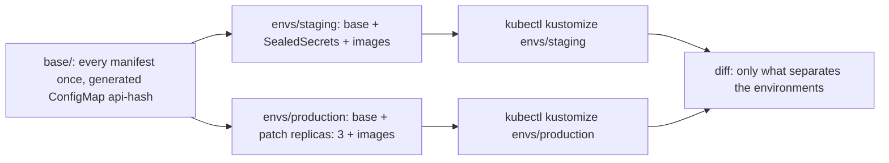

## Before you start

- [[k8s.l2.helm-charts]] — a chart varies manifests with placeholders in text; this lesson varies them without placeholders.
- [[devops.l3.promoting-between-environments]] — `envs/staging` and `envs/production` hold full copies that differ in a few values; this lesson keeps one copy and writes down only the differences.
- [[k8s.l1.configmaps]] — applying a changed ConfigMap does not change the Pod template, so no Pods roll; a generated ConfigMap changes that.

## The situation

The api needs one more setting. In the config repository you add it to the api's ConfigMap in `envs/staging`, then make the same edit in `envs/production`, because each folder holds a full copy of every manifest. The two copies differ only in the api's replica count and image, and staging's SealedSecrets, yet you edit both and hope you forgot nothing. After the sync, the api's Pods still run with the old setting until someone restarts them. A Helm chart would remove the copies, but its templates are text with placeholders. How can both environments share one copy of every manifest, written as plain YAML, with each environment's differences in one small file?

## Core concepts

- **Kustomize** — a tool built into `kubectl` that builds manifests from plain YAML: a `kustomization.yaml` lists the files to include and the changes to make, and `kubectl kustomize <folder>` prints the result.
- Base — a folder whose `kustomization.yaml` lists every manifest once, as every environment runs it; here `deploy/gitops/config-repo-kustomize/base`.
- **overlay (Kustomize)** — a folder whose `kustomization.yaml` lists the base as one of its resources and adds only what differs for one environment, such as `envs/production`.
- Patch — an entry in an overlay that picks objects (here one, by kind and name) and changes only the fields it gives.
- `images` — a field that sets the tag and digest of an image wherever that image appears in the output.
- `configMapGenerator` — a field that builds a ConfigMap from listed values and adds a hash of its content to its name.

## How it works



In the situation above, the base is `deploy/gitops/config-repo-kustomize/base`. Its `kustomization.yaml` lists every manifest of Đơn Hàng, and each file is an ordinary manifest with no `{{ ... }}` in it. The base's Deployment for the api says `replicas: 2` and names the image without a tag.

Each overlay lists `../../base` under `resources`, so Kustomize first builds the base, then applies the overlay's changes to the result. `envs/staging` adds the files of its SealedSecrets. `envs/production` adds a patch: it names the Deployment `api` and replaces only `/spec/replicas` with `3`. The path walks down the object's YAML: `replicas` is a field inside the top-level `spec` field. Everything else comes from the base unchanged.

Both overlays have an `images` entry for each of Đơn Hàng's own images. Kustomize finds every container using that image name in the output and sets the tag and digest given there. The api's Deployment and the migration that runs before it get their images from the same `images` field, each from its own entry.

The base also generates the api's ConfigMap. Kustomize names it `api-` plus a hash of its content and rewrites the reference in the api's Deployment to that name. A changed value gives a new name, so the Pod template changes and the Pods roll.

`kubectl kustomize` prints what an overlay builds and applies nothing; applying is a separate step. Diffing both renders shows exactly what separates the environments.

## In the Đơn Hàng system

```yaml file=deploy/gitops/config-repo-kustomize/envs/production/kustomization.yaml tag=stage-3 lines=1-24
# lesson: k8s.l2.kustomize-overlays
# Production: the same base, three replicas of the api, and its own images.
apiVersion: kustomize.config.k8s.io/v1beta1
kind: Kustomization
resources:
  - ../../base
# A patch names an object by kind and name and gives only the fields that
# change; everything else comes from the base as it is.
patches:
  - target:
      kind: Deployment
      name: api
    patch: |-
      - op: replace
        path: /spec/replicas
        value: 3
# lesson: k8s.l2.config-repo-overlays
# Promoting to production is one change here: the api's and the
# migration's tag and digest, the ones deploy-verified.sh verified for
# staging. Production runs what staging runs now.
images:
  - name: ghcr.io/duyan11110/donhang-api
    newTag: sha-25158b4d4f7cb9a5c0b944f5ea8482221a24b4be
    digest: sha256:4f05067078ab4e6bca443a2af2cd6e5c01324a332423ad9350068be0135ea83d
```

This is the whole of production's difference, except the remaining `images` entries below the excerpt. `resources` holds one line, the base. The patch is written as a list of operations, one of the ways to write a patch: each says what to do (`op`), where in the object (`path`), and the new value (`value`). `target` picks the object by `kind` and `name`, so no other Deployment is touched. Under `images`, `name` is the image as the base writes it, and `newTag` and `digest` are what this environment runs; the comments above it belong to the next lesson.

```bash file=scripts/k8s/kustomize-render.sh tag=stage-3 lines=28-47
for env in staging production; do
  kubectl kustomize "$work/envs/$env" > "$work/$env.yaml"
  echo "== kubectl kustomize envs/$env: $(grep -c '^kind:' "$work/$env.yaml") objects"
done
echo "\$ kubectl kustomize envs/staging | grep -e '^kind:' | sort | uniq -c"
grep '^kind:' "$work/staging.yaml" | sort | uniq -c
echo

# The generated ConfigMap's name carries a hash of its content, and the
# api's envFrom names it with the same hash.
echo "== the api's ConfigMap in staging, and the reference to it"
grep -A3 '^kind: ConfigMap' "$work/staging.yaml" | grep -o 'name: api-[a-z0-9]*' | head -1
grep -o 'name: api-[a-z0-9]*' "$work/staging.yaml" | sort | uniq -c
echo

# lesson: k8s.l2.kustomize-overlays
# What separates the two environments, and nothing else: the diff of the
# rendered output. The SealedSecrets are not in it: their files are empty here.
echo "\$ diff <(kubectl kustomize envs/staging) <(kubectl kustomize envs/production)"
diff "$work/staging.yaml" "$work/production.yaml" || true
```

```text output=true
...
== kubectl kustomize envs/staging: 41 objects
== kubectl kustomize envs/production: 41 objects
$ kubectl kustomize envs/staging | grep -e '^kind:' | sort | uniq -c
      3 kind: ConfigMap
      1 kind: CronJob
      7 kind: Deployment
     14 kind: NetworkPolicy
      1 kind: PersistentVolumeClaim
      3 kind: Pod
     10 kind: Service
      2 kind: StatefulSet

== the api's ConfigMap in staging, and the reference to it
name: api-...
      1 name: api-egress
      2 name: api-...

$ diff <(kubectl kustomize envs/staging) <(kubectl kustomize envs/production)
445c445
<   replicas: 2
---
>   replicas: 3
```

Above the excerpt, the script copies the layout to a temporary folder `$work` and creates empty files for the SealedSecrets, which live only in the config repository. Both overlays build 41 objects from the same base. Kinds you have not met come from other lessons; only the totals matter here.

The generated name appears twice in staging: once on the ConfigMap and once in the api's `envFrom`; `api-egress` is one of those other objects. The output shows `...` where the hash would be. The ConfigMap comes from a `configMapGenerator` named `api` in the base's `kustomization.yaml`, whose values are `NAME=value` lines such as `OTEL_SDK_DISABLED=true`. In the diff, `445c445` means line 445 changed: only the replica count, because both overlays now name the same images.

## Seniors often assume…

- **"Varying manifests per environment needs a template language like Helm's."** → Actually Kustomize changes plain YAML: it builds the base, then applies each overlay's patches, `images` and generators to the objects. No file holds a placeholder, so every file stays readable as a Kubernetes object. You notice this when you open `base/api.yaml` and find an ordinary Deployment, while production still runs three replicas.
- **"An overlay is a full copy of the base with some values edited."** → Actually an overlay lists the base as a resource and holds only its differences. You notice this when you list `envs/production` and find a single file, `kustomization.yaml`, and the diff of both renders is one line.
- **"The hash in a generated ConfigMap's name is noise that is better turned off."** → Actually the hash is what makes a changed value reach the Pods: a new name changes the Pod template, so the Pods roll. Kustomize can turn the suffix off, but then a changed value is applied to the ConfigMap and no Pod restarts. You notice this when `kubectl get configmap` shows the new value while the api still runs with the old one.

## Try it (3 minutes)

1. From the repository root, run `kubectl kustomize deploy/gitops/config-repo-kustomize/envs/production | grep -o 'name: api-[a-z0-9]*' | sort | uniq -c` and note the suffix after `api-`.
2. In `deploy/gitops/config-repo-kustomize/base/kustomization.yaml`, change `OTEL_SDK_DISABLED=true` to `OTEL_SDK_DISABLED=false`, run the same command again, then undo the edit with `git checkout -- deploy/gitops/config-repo-kustomize/base/kustomization.yaml`.

Expected result: both runs print `name: api-egress` once and `name: api-<suffix>` twice, the ConfigMap and the api's reference to it. The suffix after your edit differs from the first one, and nothing was applied.

## Connections

- [[k8s.l2.helm-charts]] — the other way to vary manifests: placeholders filled in text, where Kustomize patches plain YAML.
- [[devops.l3.promoting-between-environments]] — the problem this lesson solves: full copies per environment that differ in a few values.
- [[k8s.l1.configmaps]] — the gap the generated name closes: an edited ConfigMap rolls no Pods.
- [[devops.l3.tofu-modules]] — a similar split in OpenTofu: shared code written once, and each environment supplies only what differs.
- [[k8s.l2.config-repo-overlays]] — the next lesson: moving the running config repository to this layout.

## Five-line summary

1. A Kustomize overlay takes a shared base of plain manifests and adds only what differs for one environment.
2. `kustomization.yaml` lists what to include, and `kubectl kustomize` prints the result and applies nothing.
3. A patch picks an object, here by kind and name, and changes only the fields it gives, such as the api's replicas.
4. `images` sets an image's tag and digest everywhere it appears; `configMapGenerator` adds a content hash to the ConfigMap's name.
5. A changed generated ConfigMap gets a new name, so the Pod template changes and the Pods roll.
