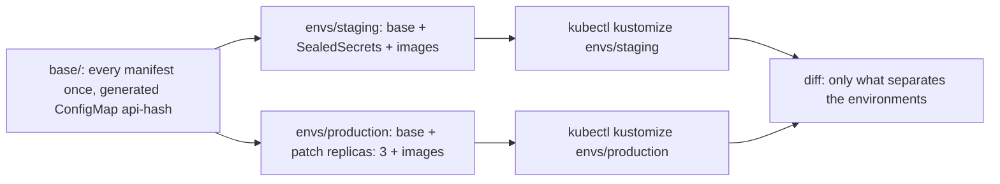

## Bạn cần biết trước

- [[k8s.l2.helm-charts]] — chart tạo biến thể cho manifest bằng chỗ trống trong văn bản. Bài này tạo biến thể mà không cần chỗ trống nào.
- [[devops.l3.promoting-between-environments]] — `envs/staging` và `envs/production` giữ hai bản đầy đủ, chỉ khác nhau vài giá trị. Bài này giữ một bản duy nhất và chỉ ghi ra phần khác nhau.
- [[k8s.l1.configmaps]] — apply một ConfigMap đã sửa không làm Pod template thay đổi, nên không Pod nào được thay. ConfigMap sinh tự động sẽ thay đổi điều đó.

## Tình huống

Api cần thêm một thiết lập. Trong repo cấu hình, bạn thêm nó vào ConfigMap của api trong `envs/staging`, rồi sửa y hệt trong `envs/production`, vì mỗi thư mục giữ một bản đầy đủ của mọi manifest. Hai bản chỉ khác nhau ở số replica và image của api, cùng các SealedSecret của staging, vậy mà bạn vẫn phải sửa cả hai và mong là không sót chỗ nào. Sync xong, các Pod của api vẫn chạy với thiết lập cũ cho tới khi có người restart chúng. Helm chart sẽ bỏ được các bản sao, nhưng template của nó là văn bản có chỗ trống. Làm sao để hai môi trường dùng chung một bản của mọi manifest, viết bằng YAML thường, còn phần khác của từng môi trường nằm trong một file nhỏ?

## Khái niệm cốt lõi

- **Kustomize** (Công cụ (có sẵn trong kubectl) dựng manifest từ YAML thường bằng danh sách file và patch, không dùng template) — công cụ có sẵn trong `kubectl`, dựng manifest từ YAML thường: một file `kustomization.yaml` liệt kê các file cần đưa vào và các thay đổi cần làm, còn `kubectl kustomize <folder>` in ra kết quả.
- Base — một thư mục có `kustomization.yaml` liệt kê mỗi manifest đúng một lần, đúng như mọi môi trường chạy nó. Ở đây là `deploy/gitops/config-repo-kustomize/base`.
- **overlay (Kustomize)** (Thư mục Kustomize dùng một base chung rồi chỉ thêm phần khác của một môi trường) — một thư mục có `kustomization.yaml` ghi base là một trong các resource của nó, rồi chỉ thêm phần khác của một môi trường, như `envs/production`.
- Patch — một mục trong overlay chọn ra object (ở đây là một object, theo kind và tên) và chỉ đổi những field nó ghi.
- `images` — field đặt tag và digest cho một image ở mọi chỗ image đó xuất hiện trong output.
- `configMapGenerator` — field dựng một ConfigMap từ các giá trị được liệt kê và gắn hash của nội dung vào tên của nó.

## Cơ chế hoạt động



Trong tình huống trên, base là `deploy/gitops/config-repo-kustomize/base`. `kustomization.yaml` của nó liệt kê mọi manifest của Đơn Hàng, và mỗi file là một manifest bình thường, không có `{{ ... }}` nào. Deployment của api trong base ghi `replicas: 2` và ghi tên image không kèm tag.

Mỗi overlay ghi `../../base` dưới `resources`, nên Kustomize dựng base trước, rồi áp các thay đổi của overlay lên kết quả. `envs/staging` thêm các file SealedSecret của nó. `envs/production` thêm một patch: patch này chỉ đích danh Deployment `api` và chỉ thay `/spec/replicas` bằng `3`. Đường dẫn đi dần xuống YAML của object: `replicas` là một field nằm trong field `spec` ở cấp cao nhất. Mọi thứ khác lấy nguyên từ base.

Cả hai overlay đều có một mục `images` cho mỗi image của chính Đơn Hàng. Kustomize tìm mọi container dùng tên image đó trong output và đặt tag cùng digest ghi ở đó. Deployment của api và migration chạy trước nó đều lấy image từ cùng field `images`, mỗi cái từ mục riêng của mình.

Base cũng sinh ra ConfigMap của api. Kustomize đặt tên nó là `api-` cộng với hash của nội dung, rồi viết lại chỗ tham chiếu trong Deployment của api theo tên đó. Đổi một giá trị thì tên mới ra đời, nên Pod template thay đổi và các Pod được thay.

`kubectl kustomize` in ra những gì một overlay dựng được và không apply gì cả. Apply là một bước riêng. Diff hai lần render cho thấy đúng những gì làm hai môi trường khác nhau.

## Trong hệ thống Đơn Hàng

```yaml file=deploy/gitops/config-repo-kustomize/envs/production/kustomization.yaml tag=stage-3 lines=1-24
# lesson: k8s.l2.kustomize-overlays
# Production: the same base, three replicas of the api, and its own images.
apiVersion: kustomize.config.k8s.io/v1beta1
kind: Kustomization
resources:
  - ../../base
# A patch names an object by kind and name and gives only the fields that
# change; everything else comes from the base as it is.
patches:
  - target:
      kind: Deployment
      name: api
    patch: |-
      - op: replace
        path: /spec/replicas
        value: 3
# lesson: k8s.l2.config-repo-overlays
# Promoting to production is one change here: the api's and the
# migration's tag and digest, the ones deploy-verified.sh verified for
# staging. Production runs what staging runs now.
images:
  - name: ghcr.io/duyan11110/donhang-api
    newTag: sha-25158b4d4f7cb9a5c0b944f5ea8482221a24b4be
    digest: sha256:4f05067078ab4e6bca443a2af2cd6e5c01324a332423ad9350068be0135ea83d
```

Đây là toàn bộ phần khác của production, trừ các mục `images` còn lại nằm dưới đoạn trích. `resources` chỉ có một dòng: base. Patch được viết thành một danh sách thao tác, một trong các cách viết patch: mỗi thao tác nói làm gì (`op`), ở đâu trong object (`path`), và giá trị mới (`value`). `target` chọn object theo `kind` và `name`, nên không Deployment nào khác bị đụng tới. Dưới `images`, `name` là image đúng như base ghi, còn `newTag` và `digest` là thứ môi trường này chạy. Các comment phía trên nó thuộc về bài sau.

```bash file=scripts/k8s/kustomize-render.sh tag=stage-3 lines=28-47
for env in staging production; do
  kubectl kustomize "$work/envs/$env" > "$work/$env.yaml"
  echo "== kubectl kustomize envs/$env: $(grep -c '^kind:' "$work/$env.yaml") objects"
done
echo "\$ kubectl kustomize envs/staging | grep -e '^kind:' | sort | uniq -c"
grep '^kind:' "$work/staging.yaml" | sort | uniq -c
echo

# The generated ConfigMap's name carries a hash of its content, and the
# api's envFrom names it with the same hash.
echo "== the api's ConfigMap in staging, and the reference to it"
grep -A3 '^kind: ConfigMap' "$work/staging.yaml" | grep -o 'name: api-[a-z0-9]*' | head -1
grep -o 'name: api-[a-z0-9]*' "$work/staging.yaml" | sort | uniq -c
echo

# lesson: k8s.l2.kustomize-overlays
# What separates the two environments, and nothing else: the diff of the
# rendered output. The SealedSecrets are not in it: their files are empty here.
echo "\$ diff <(kubectl kustomize envs/staging) <(kubectl kustomize envs/production)"
diff "$work/staging.yaml" "$work/production.yaml" || true
```

```text output=true
...
== kubectl kustomize envs/staging: 41 objects
== kubectl kustomize envs/production: 41 objects
$ kubectl kustomize envs/staging | grep -e '^kind:' | sort | uniq -c
      3 kind: ConfigMap
      1 kind: CronJob
      7 kind: Deployment
     14 kind: NetworkPolicy
      1 kind: PersistentVolumeClaim
      3 kind: Pod
     10 kind: Service
      2 kind: StatefulSet

== the api's ConfigMap in staging, and the reference to it
name: api-...
      1 name: api-egress
      2 name: api-...

$ diff <(kubectl kustomize envs/staging) <(kubectl kustomize envs/production)
445c445
<   replicas: 2
---
>   replicas: 3
```

Phía trên đoạn trích, script chép cấu trúc thư mục sang một thư mục tạm `$work` và tạo file rỗng cho các SealedSecret, vì chúng chỉ nằm trong repo cấu hình. Cả hai overlay đều dựng ra 41 object từ cùng một base. Những kind bạn chưa gặp đến từ các bài khác, ở đây chỉ tổng số là đáng kể.

Tên sinh ra xuất hiện hai lần trong staging: một lần trên ConfigMap và một lần trong `envFrom` của api. `api-egress` là một trong những object khác kia. Output hiện `...` ở chỗ lẽ ra là hash. ConfigMap này đến từ một `configMapGenerator` tên `api` trong `kustomization.yaml` của base, với các giá trị là những dòng `NAME=value` như `OTEL_SDK_DISABLED=true`. Trong diff, `445c445` nghĩa là dòng 445 đã đổi: chỉ có số replica, vì giờ hai overlay ghi cùng các image.

## Senior hay nhầm rằng…

- **"Muốn manifest khác nhau theo môi trường thì cần một ngôn ngữ template như của Helm."** → Thực ra Kustomize sửa trên YAML thường: nó dựng base, rồi áp patch, `images` và generator của từng overlay lên các object. Không file nào chứa chỗ trống, nên file nào cũng đọc được như một object Kubernetes. Bạn sẽ nhận ra khi mở `base/api.yaml` và thấy một Deployment bình thường, trong khi production vẫn chạy ba replica.
- **"Overlay là một bản sao đầy đủ của base với vài giá trị được sửa."** → Thực ra overlay ghi base là một resource và chỉ giữ phần khác của nó. Bạn sẽ nhận ra khi liệt kê `envs/production` và chỉ thấy một file duy nhất, `kustomization.yaml`, còn diff của hai lần render chỉ có một dòng.
- **"Hash trong tên ConfigMap sinh ra chỉ là thứ thừa, tắt đi thì hơn."** → Thực ra chính hash đưa giá trị mới tới được Pod: tên mới làm Pod template thay đổi, nên các Pod được thay. Kustomize có thể tắt phần đuôi này, nhưng khi đó giá trị mới chỉ được apply vào ConfigMap và không Pod nào khởi động lại. Bạn sẽ nhận ra khi `kubectl get configmap` hiện giá trị mới trong khi api vẫn chạy với giá trị cũ.

## Thử ngay (3 phút)

1. Từ thư mục gốc của repo, chạy `kubectl kustomize deploy/gitops/config-repo-kustomize/envs/production | grep -o 'name: api-[a-z0-9]*' | sort | uniq -c` và ghi lại phần đuôi sau `api-`.
2. Trong `deploy/gitops/config-repo-kustomize/base/kustomization.yaml`, đổi `OTEL_SDK_DISABLED=true` thành `OTEL_SDK_DISABLED=false`, chạy lại đúng lệnh trên, rồi hoàn tác bằng `git checkout -- deploy/gitops/config-repo-kustomize/base/kustomization.yaml`.

Kết quả mong đợi: cả hai lần đều in `name: api-egress` một lần và `name: api-<suffix>` hai lần, tức ConfigMap và chỗ api tham chiếu tới nó. Phần đuôi sau khi sửa khác với lần đầu, và không có gì được apply.

## Liên hệ

- [[k8s.l2.helm-charts]] — cách còn lại để tạo biến thể cho manifest: điền chỗ trống trong văn bản, trong khi Kustomize patch trên YAML thường.
- [[devops.l3.promoting-between-environments]] — vấn đề bài này giải quyết: mỗi môi trường một bản đầy đủ, chỉ khác nhau vài giá trị.
- [[k8s.l1.configmaps]] — lỗ hổng mà tên sinh ra lấp lại: sửa ConfigMap thì không Pod nào được thay.
- [[devops.l3.tofu-modules]] — cách chia tương tự trong OpenTofu: code dùng chung viết một lần, mỗi môi trường chỉ đưa vào phần khác của mình.
- [[k8s.l2.config-repo-overlays]] — bài tiếp: chuyển repo cấu hình đang chạy sang cấu trúc này.

## Tóm tắt 5 dòng

1. Overlay của Kustomize lấy một base manifest thường dùng chung và chỉ thêm phần khác của một môi trường.
2. `kustomization.yaml` liệt kê những gì cần đưa vào, còn `kubectl kustomize` in ra kết quả và không apply gì.
3. Patch chọn một object, ở đây theo kind và tên, và chỉ đổi những field nó ghi, như số replica của api.
4. `images` đặt tag và digest của một image ở mọi chỗ nó xuất hiện, còn `configMapGenerator` gắn hash nội dung vào tên ConfigMap.
5. ConfigMap sinh ra mà đổi giá trị thì có tên mới, nên Pod template thay đổi và các Pod được thay.
