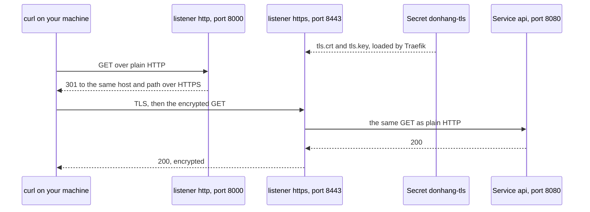

## Before you start

- [[k8s.l2.gateway-api]] — the Gateway `donhang` and its HTTPRoutes; this lesson adds the HTTPS listener that lesson left below its excerpt.
- [[devops.l3.sealed-secrets]] — `seal-secrets.sh` and `kubeseal --cert`, which seal one more Secret here.
- [[devops.l1.reverse-proxy-and-tls]] — TLS termination at Caddy in Compose; on staging the Gateway takes that place.
- [[backend.l2.validating-provider-tokens]] — the api checks each token's `iss`, which is why a new address for Keycloak reaches the api's settings.

## The situation

After the last lesson, staging answers on `http://donhang.localhost:18080`, so every request crosses in plain text, the `Authorization` header with its token included. In Compose, Caddy holds a certificate and decrypts HTTPS in front of the api, which never loads one. On staging, Traefik stands in that place but has no certificate yet. Giving it one moves three things together: Traefik needs the certificate and its private key, the key must reach the cluster through a config repository the whole team reads, and Keycloak, which writes its own address into every token, gets a new address. Where does the key live, and what else changes with the address?

## Core concepts

- HTTPS listener — a Gateway listener with `protocol: HTTPS`, which needs a certificate before it can answer.
- `tls.mode: Terminate` — the listener setting that has the controller end TLS at the Gateway; with no TLS configured toward the backends, as here, the request goes on to the Service as plain HTTP.
- `certificateRefs` — the listener's list of Secrets holding its certificate and key; a reference without a namespace means a Secret in the Gateway's own namespace.
- TLS Secret — a Secret of type `kubernetes.io/tls` whose keys `tls.crt` and `tls.key` hold a certificate and its private key.
- `RequestRedirect` — an HTTPRoute filter that answers a request with a redirect instead of forwarding it to a Service. A redirect is a 3xx response whose `Location` header gives the address the client should send the request to instead; `301` says the move is permanent.
- `iss` — the field of a token's payload in which Keycloak writes its public address, set by `KC_HOSTNAME`.

## How it works



In the diagram, the Gateway `donhang` has two listeners, both served by Traefik. From your machine, ports `18080` and `18443` lead to Traefik's `8000` and `8443`, which is why the URLs and the redirect use them. The listener `http`, on port `8000`, keeps a single route, `redirect-to-https`. Its `RequestRedirect` filter answers each request for the two hosts, `donhang.localhost` and `auth.donhang.localhost`, with `301` and the same host and path over HTTPS on port `18443`. So no request from outside reaches the api in plain text.

The listener `https`, on port `8443`, has `tls.mode: Terminate`. Traefik loads the certificate and key from the Secret `donhang-tls`, sets up TLS with curl, decrypts the request and matches it against the HTTPRoutes `api` and `keycloak`. Their `sectionName: https`, in `parentRefs`, names the one listener each route attaches to. Traefik forwards the request to port `8080` of the Service `api` as plain HTTP, so the api Pods never hold a certificate.

The Secret has type `kubernetes.io/tls`: the certificate under `tls.crt`, which Traefik sends to every client, and its private key under `tls.key`, which lets whoever holds it answer as `donhang.localhost`. So the Secret reaches the config repository only as a SealedSecret beside the Gateway in `platform/edge`, and the Sealed Secrets controller turns it back into `donhang-tls`.

A client accepts a certificate only if a certificate authority it already trusts signed it. Here the signer is the lab's own authority, made by `dev-secrets.sh` in `secrets/`, which nothing on your machine trusts at first. `curl --cacert secrets/lab-ca.crt` trusts it for one command (curl on Windows, built with Schannel, also needs `--ssl-no-revoke`, which the lab's scripts add). A browser trusts it only once you tell it to trust `lab-ca.crt`.

## In the Đơn Hàng system

```yaml file=deploy/gitops/config-repo/platform/edge/gateway.yaml tag=stage-3 lines=6-27
apiVersion: gateway.networking.k8s.io/v1
kind: Gateway
metadata:
  name: donhang
  namespace: donhang
spec:
  gatewayClassName: traefik
  listeners:
    - name: http
      port: 8000
      protocol: HTTP
    # lesson: k8s.l2.tls-at-the-gateway
    # HTTPS ends here: Traefik decrypts each request with the certificate and
    # key of the Secret donhang-tls, and the Pods behind it get plain HTTP.
    # The Secret comes from sealed-donhang-tls.yaml, beside this file.
    - name: https
      port: 8443
      protocol: HTTPS
      tls:
        mode: Terminate
        certificateRefs:
          - name: donhang-tls
```

Lines 21–27 are the listener the last lesson's script cut off before committing this file. `certificateRefs` names `donhang-tls` with no namespace, so the Secret sits in `donhang`, the Gateway's own namespace. Below the excerpt, the same file holds the HTTPRoute `redirect-to-https`, attached with `sectionName: http`, whose `RequestRedirect` sets `scheme: https`, `port: 18443` and `statusCode: 301`.

The Secret itself is built in `scripts/devops/seal-secrets.sh`, outside this excerpt: `kubectl create secret tls donhang-tls` reads `secrets/donhang-tls.crt` and `secrets/donhang-tls.key` with `--dry-run=client`, which builds the Secret as YAML without sending it to the cluster. `kubeseal` writes the result to `platform/edge/sealed-donhang-tls.yaml`.

```bash file=scripts/k8s/gateway-tls.sh tag=stage-3 lines=26-36
# lesson: k8s.l2.tls-at-the-gateway
# One commit: the Gateway with its https listener and the redirect on the
# http listener, the routes moved to the https listener, and Keycloak's
# public address in HTTPS. Keycloak writes that address into every token as
# the issuer, so the api's Keycloak__Authority changes with it.
cp deploy/gitops/config-repo/platform/edge/gateway.yaml "$config_repo/platform/edge/"
routes_without_refunds deploy/gitops/config-repo/platform/edge/httproutes.yaml > "$config_repo/platform/edge/httproutes.yaml"
perl -pi -e 's#http://localhost:8180#https://auth.donhang.localhost:18443#' \
  "$config_repo/envs/staging/keycloak.yaml" "$config_repo/envs/staging/api-configmap.yaml"
git -C "$config_repo" diff -U0 -- envs/staging/keycloak.yaml envs/staging/api-configmap.yaml | grep '^[-+] ' || true
[ -z "$(git -C "$config_repo" status --porcelain)" ] || config_commit gateway-tls.sh "HTTPS at the Gateway; Keycloak's public address is https://auth.donhang.localhost:18443"
```

```text output=true
== the certificate in secrets/donhang-tls.crt
subject=CN=donhang.localhost, O=donhang-dev
issuer=CN=Don Hang lab CA, O=donhang-dev
X509v3 Subject Alternative Name: 
    DNS:donhang.localhost, DNS:auth.donhang.localhost
sealed donhang-tls into platform/edge/sealed-donhang-tls.yaml

-   Keycloak__Authority: "http://localhost:8180/realms/donhang"
+   Keycloak__Authority: "https://auth.donhang.localhost:18443/realms/donhang"
-   value: "http://localhost:8180"
+   value: "https://auth.donhang.localhost:18443"
edge-staging: Synced, Healthy
staging: Synced, Healthy

== the Gateway's listeners
http: 1 route(s), Programmed=True
https: 2 route(s), Programmed=True

== GET http://donhang.localhost:18080/api/v1/products
HTTP 301, Location: https://donhang.localhost:18443/api/v1/products
== GET https://donhang.localhost:18443/api/v1/products, without and with --cacert secrets/lab-ca.crt
curl: error 60, the certificate is not trusted
HTTP 200 over HTTPS

== the token's issuer
"iss":"https://auth.donhang.localhost:18443/realms/donhang"
== GET https://donhang.localhost:18443/api/v1/orders/1 (an order of anh.tran), without and with the token
HTTP 401
HTTP 200
```

Line 32 copies the HTTPRoutes, now attached to `https`, leaving out the rule for `/api/v1/refunds`, whose Service staging does not run yet. Line 33 rewrites Keycloak's address in two files: `KC_HOSTNAME` in Keycloak's Deployment, the `value:` lines of the output, and `Keycloak__Authority` in the api's ConfigMap. The api still fetches Keycloak's metadata and keys from `Keycloak__MetadataAddress`, plain HTTP to `keycloak:8080` inside the cluster, not through the Gateway. Line 36 commits everything in the config repository at once, including the SealedSecret that `seal-secrets.sh --no-commit` wrote earlier in the script. After the excerpt, the script restarts the api's Pods, since the api reads its ConfigMap only when it starts.

The output then shows each step working. The certificate names both hosts and was signed by the lab's authority. The two `Synced, Healthy` lines are Argo CD having applied the commit. The listener `http` holds one route, the redirect, and `https` holds two. Without `--cacert`, curl stops with error `60`, which the script prints in its own words; with it, the api answers `200`. A token signed in through the Gateway carries the HTTPS address in `iss`, and the api accepts it.

Nothing renews this certificate. `dev-secrets.sh` signs it for 825 days, and only when `secrets/donhang-tls.key` does not exist yet. Once it expires, clients refuse it even with the lab's authority trusted, since its dates are checked like its signer. Every call through the Gateway then fails though no Pod changed. That is why a cluster can instead let a controller issue certificates and renew them before they expire.

## Seniors often assume…

- **"The hop from the Gateway to the api Pods is encrypted too, because the client used HTTPS."** → Actually `tls.mode: Terminate` ends TLS at Traefik, which sends the decrypted request to port `8080` of the Service `api` as plain HTTP. You notice this when you read the api's Deployment in `envs/staging/api.yaml`: it mounts no volume and names only `containerPort: 8080`, so there is no certificate for the api to use.
- **"A TLS Secret is safe to commit because certificates are public anyway."** → Actually only `tls.crt` is public; `tls.key` is the private key, and whoever holds it with the certificate can answer as `donhang.localhost` to any client that trusts the lab's authority. That is why `seal-secrets.sh` seals `donhang-tls` like the database password. You notice this when `platform/edge/sealed-donhang-tls.yaml` lists `tls.key` under `encryptedData` only in encrypted form, never as the key itself.
- **"Moving Keycloak behind a new address needs no change on the api's side."** → Actually Keycloak writes its public address into every token's `iss`, and the api checks `iss`. The api's `Keycloak__Authority` names Keycloak by that same public address, so it moves to the HTTPS address in the same commit as `KC_HOSTNAME`. You notice this when the diff in `gateway-tls.sh`'s output changes a line in the api's ConfigMap, not only in Keycloak's Deployment.

## Try it (3 minutes)

With `donhang-staging` running, in the `don-hang` folder:

1. Run `scripts/k8s/gateway-tls.sh`.
2. Run `openssl x509 -in secrets/donhang-tls.crt -noout -issuer -dates`, which prints fields of a certificate file: here, who signed it and its two dates.

Expected result: step 1 ends like the output above: `301` with the HTTPS `Location`, curl error `60` without the lab's authority and `200` with it, the HTTPS issuer, then `401` and `200`. Step 2 prints the lab's authority as the issuer, then `notBefore=` and `notAfter=` dates 825 days apart.

## Connections

- [[k8s.l2.gateway-api]] — the Gateway and HTTPRoutes this lesson moves to HTTPS.
- [[devops.l1.reverse-proxy-and-tls]] — the same TLS termination, done by Caddy in Compose instead of Traefik on staging.
- [[foundation.l1.tls-and-https]] — the checks behind curl's error `60`: the name, the signer and the dates of the certificate.
- [[devops.l3.sealed-secrets]] — the way the private key reaches the config repository without being readable there.
- [[k8s.l3.cert-manager]] — the fix for the certificate nothing renews here.

## Five-line summary

1. An HTTPS listener with `tls.mode: Terminate` decrypts at the Gateway with a Secret's certificate; the api Pods behind it get plain HTTP.
2. That Secret has type `kubernetes.io/tls` with `tls.crt` and `tls.key`; holding a private key, it enters the config repository only sealed.
3. The lab's own authority signs the certificate; `curl --cacert` trusts it, a browser only once told to.
4. A `RequestRedirect` route on the plain HTTP listener sends every request there to the same address over HTTPS.
5. Keycloak's HTTPS address becomes the tokens' issuer, so the api's settings move with it; nothing renews the certificate before it expires.
