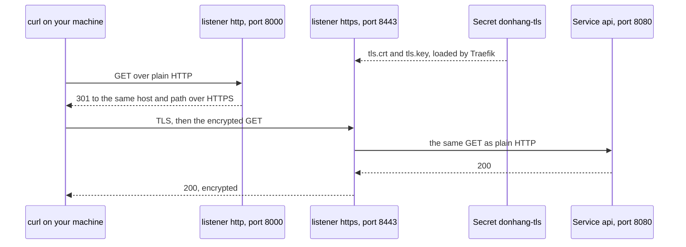

## Bạn cần biết trước

- [[k8s.l2.gateway-api]] — Gateway `donhang` và các HTTPRoute của nó. Bài này thêm listener HTTPS mà bài đó để lại phía dưới đoạn trích.
- [[devops.l3.sealed-secrets]] — `seal-secrets.sh` và `kubeseal --cert`, ở bài này dùng để seal thêm một Secret.
- [[devops.l1.reverse-proxy-and-tls]] — TLS termination ở Caddy trong Compose. Trên staging, Gateway đứng vào chỗ đó.
- [[backend.l2.validating-provider-tokens]] — api kiểm tra `iss` của từng token, nên khi Keycloak đổi địa chỉ thì cấu hình của api cũng phải đổi theo.

## Tình huống

Sau bài trước, staging trả lời ở `http://donhang.localhost:18080`, nên mọi request đi qua dưới dạng văn bản thường, kể cả header `Authorization` cùng token trong đó. Trong Compose, Caddy giữ chứng chỉ và giải mã HTTPS ngay trước api, còn api không bao giờ nạp chứng chỉ nào. Trên staging, Traefik đứng ở vị trí đó nhưng chưa có chứng chỉ. Cho nó một chứng chỉ sẽ kéo theo ba thay đổi cùng lúc. Traefik cần chứng chỉ và private key đi kèm. Key đó phải tới được cluster qua một repo cấu hình mà cả nhóm đều đọc. Và Keycloak, vốn ghi địa chỉ của chính nó vào mọi token, sẽ có địa chỉ mới. Key nằm ở đâu, và đổi địa chỉ thì còn gì đổi theo?

## Khái niệm cốt lõi

- Listener HTTPS — listener của Gateway có `protocol: HTTPS`. Nó cần một chứng chỉ thì mới trả lời được.
- `tls.mode: Terminate` — thiết lập của listener khiến controller kết thúc TLS ngay tại Gateway. Khi không cấu hình TLS nào về phía backend, như ở đây, request đi tiếp tới Service dưới dạng HTTP thường.
- `certificateRefs` — danh sách các Secret chứa chứng chỉ và key của listener. Tham chiếu không ghi namespace nghĩa là Secret nằm trong chính namespace của Gateway.
- TLS Secret — Secret kiểu `kubernetes.io/tls`, với hai key `tls.crt` và `tls.key` chứa một chứng chỉ và private key của nó.
- `RequestRedirect` — filter của HTTPRoute trả lời request bằng một lệnh chuyển hướng thay vì chuyển tiếp nó tới Service. Lệnh chuyển hướng là một response 3xx, trong đó header `Location` cho biết địa chỉ mà client nên gửi lại request tới. `301` báo việc chuyển chỗ này là vĩnh viễn.
- `iss` — trường trong payload của token, nơi Keycloak ghi địa chỉ công khai của nó, do `KC_HOSTNAME` quy định.

## Cơ chế hoạt động



Trong sơ đồ, Gateway `donhang` có hai listener, cả hai do Traefik phục vụ. Từ máy bạn, port `18080` và `18443` dẫn tới port `8000` và `8443` của Traefik, nên các URL và lệnh chuyển hướng đều dùng hai port đó. Listener `http`, trên port `8000`, chỉ giữ một route là `redirect-to-https`. Filter `RequestRedirect` của route này trả lời mọi request cho hai host `donhang.localhost` và `auth.donhang.localhost` bằng `301`, kèm cùng host và path đó qua HTTPS ở port `18443`. Nhờ vậy không request nào từ ngoài tới được api dưới dạng văn bản thường.

Listener `https`, trên port `8443`, đặt `tls.mode: Terminate`. Traefik nạp chứng chỉ và key từ Secret `donhang-tls`, thiết lập TLS với curl, giải mã request rồi so nó với các HTTPRoute `api` và `keycloak`. `sectionName: https` trong `parentRefs` của hai route này chỉ đúng một listener mà mỗi route gắn vào. Traefik chuyển request tới port `8080` của Service `api` dưới dạng HTTP thường, nên các Pod api không bao giờ giữ chứng chỉ.

Secret này có kiểu `kubernetes.io/tls`. Chứng chỉ nằm ở `tls.crt`, Traefik gửi nó cho mọi client. Private key của nó nằm ở `tls.key`, và ai giữ key này thì có thể trả lời với danh nghĩa `donhang.localhost`. Vì vậy Secret chỉ vào repo cấu hình dưới dạng một SealedSecret đặt cạnh Gateway trong `platform/edge`, và controller Sealed Secrets dựng lại nó thành `donhang-tls`.

Client chỉ chấp nhận một chứng chỉ khi nó được ký bởi một đơn vị cấp chứng chỉ mà client đã tin sẵn. Ở đây bên ký là đơn vị cấp chứng chỉ riêng của lab, do `dev-secrets.sh` tạo trong `secrets/`, và lúc đầu không thứ gì trên máy bạn tin nó. `curl --cacert secrets/lab-ca.crt` tin nó trong đúng một lệnh (curl trên Windows, build với Schannel, còn cần thêm `--ssl-no-revoke`, và các script của lab đã tự thêm). Trình duyệt chỉ tin nó sau khi bạn bảo trình duyệt tin `lab-ca.crt`.

## Trong hệ thống Đơn Hàng

```yaml file=deploy/gitops/config-repo/platform/edge/gateway.yaml tag=stage-3 lines=6-27
apiVersion: gateway.networking.k8s.io/v1
kind: Gateway
metadata:
  name: donhang
  namespace: donhang
spec:
  gatewayClassName: traefik
  listeners:
    - name: http
      port: 8000
      protocol: HTTP
    # lesson: k8s.l2.tls-at-the-gateway
    # HTTPS ends here: Traefik decrypts each request with the certificate and
    # key of the Secret donhang-tls, and the Pods behind it get plain HTTP.
    # The Secret comes from sealed-donhang-tls.yaml, beside this file.
    - name: https
      port: 8443
      protocol: HTTPS
      tls:
        mode: Terminate
        certificateRefs:
          - name: donhang-tls
```

Dòng 21–27 là listener mà script của bài trước đã cắt bỏ trước khi commit file này. `certificateRefs` ghi `donhang-tls` mà không kèm namespace, nên Secret nằm trong `donhang`, namespace của chính Gateway. Phía dưới đoạn trích, cùng file này chứa HTTPRoute `redirect-to-https`, gắn vào bằng `sectionName: http`. Filter `RequestRedirect` của nó đặt `scheme: https`, `port: 18443` và `statusCode: 301`.

Bản thân Secret được dựng trong `scripts/devops/seal-secrets.sh`, nằm ngoài đoạn trích này. `kubectl create secret tls donhang-tls` đọc `secrets/donhang-tls.crt` và `secrets/donhang-tls.key` với `--dry-run=client`, tức là dựng Secret thành YAML mà không gửi lên cluster. `kubeseal` ghi kết quả vào `platform/edge/sealed-donhang-tls.yaml`.

```bash file=scripts/k8s/gateway-tls.sh tag=stage-3 lines=26-36
# lesson: k8s.l2.tls-at-the-gateway
# One commit: the Gateway with its https listener and the redirect on the
# http listener, the routes moved to the https listener, and Keycloak's
# public address in HTTPS. Keycloak writes that address into every token as
# the issuer, so the api's Keycloak__Authority changes with it.
cp deploy/gitops/config-repo/platform/edge/gateway.yaml "$config_repo/platform/edge/"
routes_without_refunds deploy/gitops/config-repo/platform/edge/httproutes.yaml > "$config_repo/platform/edge/httproutes.yaml"
perl -pi -e 's#http://localhost:8180#https://auth.donhang.localhost:18443#' \
  "$config_repo/envs/staging/keycloak.yaml" "$config_repo/envs/staging/api-configmap.yaml"
git -C "$config_repo" diff -U0 -- envs/staging/keycloak.yaml envs/staging/api-configmap.yaml | grep '^[-+] ' || true
[ -z "$(git -C "$config_repo" status --porcelain)" ] || config_commit gateway-tls.sh "HTTPS at the Gateway; Keycloak's public address is https://auth.donhang.localhost:18443"
```

```text output=true
== the certificate in secrets/donhang-tls.crt
subject=CN=donhang.localhost, O=donhang-dev
issuer=CN=Don Hang lab CA, O=donhang-dev
X509v3 Subject Alternative Name: 
    DNS:donhang.localhost, DNS:auth.donhang.localhost
sealed donhang-tls into platform/edge/sealed-donhang-tls.yaml

-   Keycloak__Authority: "http://localhost:8180/realms/donhang"
+   Keycloak__Authority: "https://auth.donhang.localhost:18443/realms/donhang"
-   value: "http://localhost:8180"
+   value: "https://auth.donhang.localhost:18443"
edge-staging: Synced, Healthy
staging: Synced, Healthy

== the Gateway's listeners
http: 1 route(s), Programmed=True
https: 2 route(s), Programmed=True

== GET http://donhang.localhost:18080/api/v1/products
HTTP 301, Location: https://donhang.localhost:18443/api/v1/products
== GET https://donhang.localhost:18443/api/v1/products, without and with --cacert secrets/lab-ca.crt
curl: error 60, the certificate is not trusted
HTTP 200 over HTTPS

== the token's issuer
"iss":"https://auth.donhang.localhost:18443/realms/donhang"
== GET https://donhang.localhost:18443/api/v1/orders/1 (an order of anh.tran), without and with the token
HTTP 401
HTTP 200
```

Dòng 32 chép các HTTPRoute, giờ đã gắn vào `https`, và bỏ luật cho `/api/v1/refunds` vì staging chưa chạy Service của nó. Dòng 33 sửa địa chỉ của Keycloak trong hai file: `KC_HOSTNAME` trong Deployment của Keycloak, chính là các dòng `value:` trong output, và `Keycloak__Authority` trong ConfigMap của api. Api vẫn lấy metadata và key của Keycloak từ `Keycloak__MetadataAddress`, tức gọi HTTP thường tới `keycloak:8080` bên trong cluster, không đi qua Gateway. Dòng 36 commit mọi thứ trong repo cấu hình một lần, kể cả SealedSecret mà `seal-secrets.sh --no-commit` đã ghi ở phần trước của script. Sau đoạn trích, script khởi động lại các Pod của api, vì api chỉ đọc ConfigMap của nó lúc khởi động.

Phần output tiếp theo cho thấy từng bước đều chạy. Chứng chỉ ghi cả hai host và do đơn vị cấp chứng chỉ của lab ký. Hai dòng `Synced, Healthy` là Argo CD đã apply commit đó. Listener `http` giữ một route, chính là lệnh chuyển hướng, còn `https` giữ hai route. Không có `--cacert`, curl dừng với lỗi `60`, được script in ra bằng lời của nó. Có `--cacert`, api trả `200`. Token đăng nhập qua Gateway mang địa chỉ HTTPS trong `iss`, và api chấp nhận nó.

Không có gì gia hạn chứng chỉ này. `dev-secrets.sh` ký nó với thời hạn 825 ngày, và chỉ ký khi `secrets/donhang-tls.key` chưa tồn tại. Khi chứng chỉ hết hạn, client từ chối nó dù đã tin đơn vị cấp chứng chỉ của lab, vì ngày tháng của chứng chỉ cũng được kiểm tra như bên ký. Lúc đó mọi lời gọi qua Gateway đều thất bại dù không Pod nào thay đổi. Đó là lý do một cluster có thể giao cho một controller cấp chứng chỉ và gia hạn chúng trước khi hết hạn.

## Senior hay nhầm rằng…

- **"Chặng từ Gateway tới các Pod api cũng được mã hóa, vì client đã dùng HTTPS."** → Thực ra `tls.mode: Terminate` kết thúc TLS ở Traefik, và Traefik gửi request đã giải mã tới port `8080` của Service `api` dưới dạng HTTP thường. Bạn sẽ nhận ra khi đọc Deployment của api trong `envs/staging/api.yaml`: nó không mount volume nào và chỉ ghi `containerPort: 8080`, nên api không có chứng chỉ nào để dùng.
- **"TLS Secret commit thẳng được, vì chứng chỉ vốn công khai."** → Thực ra chỉ `tls.crt` là công khai. `tls.key` là private key, và ai giữ nó cùng chứng chỉ thì có thể trả lời với danh nghĩa `donhang.localhost` cho mọi client tin đơn vị cấp chứng chỉ của lab. Vì vậy `seal-secrets.sh` seal `donhang-tls` giống như mật khẩu database. Bạn sẽ nhận ra khi `platform/edge/sealed-donhang-tls.yaml` liệt kê `tls.key` dưới `encryptedData` chỉ ở dạng đã mã hóa, không bao giờ là chính key.
- **"Đưa Keycloak ra sau một địa chỉ mới thì phía api không cần đổi gì."** → Thực ra Keycloak ghi địa chỉ công khai của nó vào `iss` của mọi token, và api kiểm tra `iss`. `Keycloak__Authority` của api gọi Keycloak bằng chính địa chỉ công khai đó, nên nó chuyển sang địa chỉ HTTPS trong cùng commit với `KC_HOSTNAME`. Bạn sẽ nhận ra khi diff trong output của `gateway-tls.sh` đổi một dòng trong ConfigMap của api, chứ không chỉ trong Deployment của Keycloak.

## Thử ngay (3 phút)

Khi `donhang-staging` đang chạy, trong thư mục `don-hang`:

1. Chạy `scripts/k8s/gateway-tls.sh`.
2. Chạy `openssl x509 -in secrets/donhang-tls.crt -noout -issuer -dates`. Lệnh này in các trường của một file chứng chỉ: ở đây là bên đã ký nó và hai mốc ngày của nó.

Kết quả mong đợi: bước 1 kết thúc giống output ở trên: `301` kèm `Location` HTTPS, curl lỗi `60` khi chưa có đơn vị cấp chứng chỉ của lab và `200` khi có, issuer HTTPS, rồi `401` và `200`. Bước 2 in đơn vị cấp chứng chỉ của lab làm issuer, rồi hai mốc `notBefore=` và `notAfter=` cách nhau 825 ngày.

## Liên hệ

- [[k8s.l2.gateway-api]] — Gateway và các HTTPRoute mà bài này chuyển sang HTTPS.
- [[devops.l1.reverse-proxy-and-tls]] — cùng kiểu TLS termination, nhưng do Caddy làm trong Compose thay vì Traefik trên staging.
- [[foundation.l1.tls-and-https]] — các bước kiểm tra đứng sau lỗi `60` của curl: tên, bên ký và ngày tháng của chứng chỉ.
- [[devops.l3.sealed-secrets]] — cách private key tới repo cấu hình mà không ai đọc được nó ở đó.
- [[k8s.l3.cert-manager]] — lời giải cho chứng chỉ mà ở đây không gì gia hạn.

## Tóm tắt 5 dòng

1. Listener HTTPS với `tls.mode: Terminate` giải mã tại Gateway bằng chứng chỉ trong một Secret. Các Pod api phía sau nhận HTTP thường.
2. Secret đó có kiểu `kubernetes.io/tls` với `tls.crt` và `tls.key`. Vì chứa private key, nó chỉ vào repo cấu hình khi đã seal.
3. Đơn vị cấp chứng chỉ riêng của lab ký chứng chỉ này. `curl --cacert` tin nó, trình duyệt chỉ tin khi được bảo.
4. Một route `RequestRedirect` trên listener HTTP thường chuyển mọi request ở đó sang cùng địa chỉ qua HTTPS.
5. Địa chỉ HTTPS của Keycloak thành issuer của token, nên cấu hình của api đổi theo. Không gì gia hạn chứng chỉ trước khi nó hết hạn.
