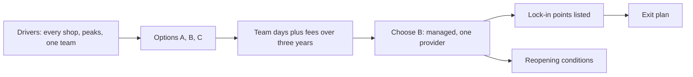

## Before you start

- [[k8s.l4.requests-drive-cluster-cost]] — you know a cluster's cost is counted in nodes and team days, every figure marked assumed.
- [[k8s.l4.managed-control-plane]] — you know a managed cluster runs the control plane for you, while workloads, add-ons and volume data stay yours.
- [[management.l3.exit-plan]] — you know an exit plan, written when a vendor is chosen, says how the team would leave it.
- [[design.l4.architectural-drivers]] — you know a choice is judged against the drivers of the system, not against a fashion.

## The situation

Real shops will soon run on Đơn Hàng, and production has nowhere to run yet. `deploy/tofu/envs/production/cluster/main.tf` describes only a lab cluster like staging's, with one control plane and two workers, and OpenTofu only plans it. The team lead asks you to propose where production's cluster runs. One colleague says to buy three machines and run kubeadm, since Kubernetes costs nothing. The product owner asks whether running on two providers at once would stop any provider from holding you hostage, and both sound reasonable. How do you compare the options so the choice still holds in three years, and what would make you change it?

## Core concepts

- Hosting option (not a new term) — one place production's cluster could run: your own machines, one provider's managed Kubernetes, or several providers at once.
- Total cost over years (not a new term) — the total cost of ownership of an option: the provider's fee plus the team's days to run and be on call for what the fee does not cover.
- **multi-cloud** — running one system on several cloud providers at the same time, so that no single provider is needed.
- Lock-in point (not a new term) — a place in the configuration or code that names the provider and must change before the system can leave it.
- Reopening condition (not a new term) — a checkable event, written in the ADR, that sends the decision back for a new comparison.

## How it works



The drivers come first. The multi-shop system of ADR `0012` must run for every shop without pause, absorb seasonal peaks, and be run by one team. Three options are weighed against them: A, your own machines; B, one provider's managed Kubernetes; C, two providers at once.

Your colleague counts only the software. Kubernetes has no licence fee, but someone runs it. On your own machines the team builds a control plane with kubeadm, keeps a majority of etcd members alive, upgrades every component and is on call for all of it. A bare-metal cluster also lacks the cloud parts: in option A, MetalLB gives the Gateway an address and Longhorn copies volumes between nodes, and both are the team's to run. A managed service takes the control plane and its upgrades for a fee. So the question is a total cost over years, the fee against the team days in one unit, and on that comparison the ADR picks B.

The decision then states its own limits. It lists the lock-in points, so the cost of leaving is known before you need it. The exit plan is built on that list: it fixes those points on the way out. The reopening conditions say what would bring the question back, so nobody has to guess later whether the choice still holds.

Multi-cloud answers the product owner's question, but at a price. Two providers mean two platforms to run, and the system can use only what both providers offer. The exit plan already keeps leaving possible, with one platform.

## In the Đơn Hàng system

ADR `0022` makes this decision. Just above the first excerpt, it says every figure is an assumption for comparing the three options over three years, not any provider's price, and that fees are converted to team days:

```markdown file=docs/adr/0022-production-tren-kubernetes-managed.md tag=stage-4 lines=23-47
| Mỗi tháng (giả định) | A. Máy riêng | B. Managed, một nhà cung cấp | C. Hai nhà cung cấp |
|---|---|---|---|
| Ngày công vận hành cluster | 6 | 2 | 5 |
| Phí và khấu hao, quy ra ngày công | 3 | 4 | 7 |
| Tổng | 9 | 6 | 12 |

### Các phương án

- A. Máy riêng: kubeadm dựng control plane ba node, MetalLB cấp địa chỉ cho
  Gateway, Longhorn sao chép volume giữa các node. Không phí dịch vụ, dữ liệu
  ở chỗ đội chọn. Đội tự lo control plane, etcd, lưu trữ sao chép, nâng cấp
  và trực cho tất cả. Máy phải mua trước cho đỉnh tải dự kiến.
- B. Kubernetes managed của một nhà cung cấp: control plane và nâng cấp của nó
  do nhà cung cấp lo; node pool thêm node khi có đỉnh tải. Trả phí, và gắn với
  nhà cung cấp ở vài chỗ (mục Hệ quả).
- C. Multi-cloud, chạy cùng lúc trên hai nhà cung cấp: không phụ thuộc một
  nhà cung cấp. Gấp đôi platform phải chạy, và hệ thống chỉ dùng được những gì
  cả hai đều có.

### Quyết định

Chọn B. Một nhóm không giữ được control plane và lưu trữ sao chép chạy suốt
ngày đêm như A đòi, và node pool lớn lên theo đỉnh tải còn máy riêng phải mua
trước. C bị từ chối: nó gấp đôi platform để tránh một rủi ro mà kế hoạch rời
đi bên dưới đã giữ được khả năng rời đi.
```

Look at the table first. Each month, option A costs 6 team days to run plus 3 days' worth of machines, 9 in total. B costs 2 plus 4, 6 in total. C costs 5 plus 7, 12 in total. A has no service fee, yet it is not the cheapest, because the team's days are the largest line.

The decision gives two reasons, both tied to drivers. One team cannot keep a control plane and replicated storage running day and night, as A demands. And node pools grow for a peak, while your own machines must be bought ahead for the peak you expect. C is rejected because it doubles the platform to avoid a risk the exit plan already covers. The next paragraph adds that the database and the other self-run components stay as `self-run-components.md` says, where PostgreSQL remains the team's to run and back up: this ADR decides only where the cluster runs.

The consequences and the exit plan follow:

```markdown file=docs/adr/0022-production-tren-kubernetes-managed.md tag=stage-4 lines=56-80
- Tên StorageClass trong các manifest có volume.
- Load balancer của nhà cung cấp đứng trước Gateway, thay cho NodePort của
  lab và MetalLB.
- Dịch vụ quản lý khóa (ADR 0023).
- Mã OpenTofu của lớp cluster.

Phần chuyển nguyên sang nhà cung cấp khác: manifest, overlay Kustomize, Argo
CD và repo cấu hình, admission policy. Secret niêm lại bằng khóa của cluster
mới.

Ở stage-4 Đơn Hàng chưa có mã cho cluster managed; cách chuyển sang ở
`docs/design/cluster-migration-plan.md`.

### Kế hoạch rời đi

Rời nhà cung cấp đi theo đúng cách chuyển sang: dựng cluster mới cạnh cluster
cũ từ repo cấu hình, sửa các chỗ gắn ở trên, chuyển dữ liệu bằng base backup
và WAL, rồi đổi traffic (`cluster-migration-plan.md`). Kế hoạch được diễn tập
trên staging, không chờ ngày phải rời đi.

Điều kiện mở lại:

- Hợp đồng của một khách đòi máy riêng hoặc dữ liệu ở một nơi xác định.
- Phí của nhà cung cấp vượt chi phí giả định của việc đội tự chạy cluster (cột
  A của bảng).
```

The four bullets are the lock-in points: StorageClass names in manifests with volumes, the provider's load balancer in front of the Gateway, the provider's key service of ADR `0023`, and the OpenTofu code of the cluster layer. The key service is the provider's service that holds the key signing Đơn Hàng's invoices, so it names the provider; the next lesson covers it. The next paragraph lists what moves unchanged: manifests, Kustomize overlays, Argo CD with the config repository, and admission policies. Sealed secrets are sealed again with the new cluster's key.

At stage-4 there is no code for the managed cluster yet. The exit plan is the same path as the move in: build a new cluster beside the old one, fix the lock-in points, move data with a base backup and WAL, then switch traffic. Two reopening conditions close the excerpt. The second compares the provider's fee alone, 4 in B's column, with column A's whole assumed cost of 9, not B's total with A's.

## Trade-offs

| | A. Own machines | B. Managed, one provider | C. Two providers at once |
|---|---|---|---|
| Who runs the control plane | The team, around the clock | The provider | The provider, twice over |
| Team days a month (assumed) | 6 | 2 | 5 |
| Fees and machines, in team days (assumed) | 3 | 4 | 7 |
| A seasonal peak | Machines bought ahead for it | The node pool grows for it | Each provider's node pool grows for it |
| Ties to one provider | None; data stays where the team chooses | Four lock-in points | None to one provider |
| What the system may use | Whatever the team installs | What the provider offers | Only what both providers offer |

## What would you choose if…

- …a large shop's contract requires its data on machines of its own or in a given place: reopen ADR `0022`, since that is its first reopening condition, and compare again with the contract as a new driver instead of fitting it into option B.
- …the provider raises its fee until the fee alone passes the assumed cost of the team running the cluster itself (column A): reopen the ADR with the second condition and redo the table with figures the team has measured, not the old assumptions.
- …the product owner asks again for two providers to get a better price: keep B, because the ADR records this same request and answers that a rehearsed exit plan gives that position without running two platforms.

## Seniors often assume…

- **"Self-hosting Kubernetes is cheaper because the software is free."** → Actually the larger cost is the team's days to run the control plane, load balancing, replicated storage and upgrades, and to be on call for them. You notice this when, as in ADR `0022`'s table, the option with no service fee has the highest team days and a higher total than the managed one.
- **"Running on two clouds at once is the safest way to avoid lock-in."** → Actually it doubles the platform the team runs and limits the system to features both providers share. You notice this when every release must be tested on both platforms, and a feature one provider offers stays unused because the other lacks it.
- **"A managed cluster from one provider moves to another by just pointing kubectl at it."** → Actually the manifests and Argo CD move unchanged, but the lock-in points do not: StorageClass names, the load balancer, the key service and the cluster's OpenTofu code. You notice this when the first `kubectl apply` to a new cluster leaves claims `Pending` because their StorageClass does not exist there.

## Try it (3 minutes)

From the root of the Đơn Hàng repository:

1. Open `docs/adr/0022-production-tren-kubernetes-managed.md` and find the table and the reopening conditions.
2. Keep every other figure. How low must A's team days fall for A to cost less than B? How high must B's fee rise for B to cost more than A?
3. Compare your second answer with the second reopening condition.

Expected result: two thresholds, the most A's team days can be and the least B's fee must reach, and one sentence comparing the second with the ADR's condition.

<details><summary>Suggested answer</summary>

B totals 6, and A's fee is 3, so A's team days must fall below 3 a month for A to cost less than 6. A totals 9, and B's team days are 2, so B's fee must rise above 7 for B to cost more than 9. The second reopening condition watches the same line: the provider's fee against column A's assumed cost of 9. Read literally, it fires only once the fee alone passes 9, later than the 7 you found, so the team may want to reopen sooner than the ADR requires. No condition watches the first number. Even if it fell, the first reason would stand: team days count effort, not whether one team can cover a control plane day and night.

</details>

## Connections

- [[k8s.l4.requests-drive-cluster-cost]] — one step earlier: the node and team-day counting that this decision compares across options.
- [[k8s.l4.managed-control-plane]] — what option B takes off the team, and what it leaves.
- [[management.l3.exit-plan]] — the same exit plan method, applied here to a whole cluster.
- [[design.l4.architectural-drivers]] — the drivers of ADR `0012` that each option is weighed against.
- [[management.l3.vendor-lock-in]] — the cost of leaving, here limited to four listed lock-in points.
- [[management.l3.self-hosting-costs]] — the recurring work of self-run components, which this ADR leaves as it is.
- [[k8s.l3.clusters-without-a-cloud]] — the cloud parts option A must replace with MetalLB and Longhorn.
- [[design.l4.over-abstraction]] — the same reasoning as rejecting multi-cloud: do not pay now for a switch an exit plan can cover.
- [[k8s.l4.data-decides-failover]] — another ADR that names the contract change that would reopen it.
- [[k8s.l4.keys-stay-in-the-key-service]] — next: the key service, one of the lock-in points.
- [[k8s.l4.moving-to-a-new-cluster]] — the move in, which is also the exit plan's path out.

## Five-line summary

1. Choose managed or self-hosted Kubernetes by total cost over years: the provider's fee against the team days to run and be on call.
2. ADR `0022` weighs own machines, one managed provider and two providers, with assumed figures, against the multi-shop drivers.
3. It chooses managed: one team cannot run a control plane and replicated storage around the clock, and node pools grow for peaks.
4. Multi-cloud is rejected: it doubles the platform and limits the system to what both offer, while the exit plan keeps leaving possible.
5. The ADR lists four lock-in points and what moves unchanged; it reopens on a contract needing own machines or the fee passing column A.
