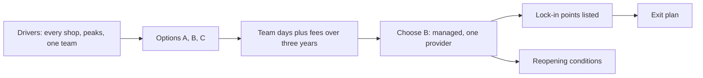

## Bạn cần biết trước

- [[k8s.l4.requests-drive-cluster-cost]] — bạn biết chi phí của một cluster được đếm bằng node và ngày công của đội, con số nào cũng ghi rõ là giả định.
- [[k8s.l4.managed-control-plane]] — bạn biết cluster managed chạy hộ control plane, còn workload, add-on và dữ liệu trên volume vẫn là của đội.
- [[management.l3.exit-plan]] — bạn biết kế hoạch rời đi, viết ngay khi chọn một nhà cung cấp, cho biết đội sẽ rời nhà cung cấp đó bằng cách nào.
- [[design.l4.architectural-drivers]] — bạn biết một lựa chọn được đánh giá theo các yếu tố định hình kiến trúc của hệ thống, không theo trào lưu.

## Tình huống

Sắp tới các shop thật sẽ chạy trên Đơn Hàng, mà production thì chưa có chỗ chạy. `deploy/tofu/envs/production/cluster/main.tf` mới chỉ mô tả một cluster lab giống staging, với một control plane và hai worker, và OpenTofu chỉ plan nó. Trưởng nhóm nhờ bạn đề xuất cluster của production sẽ chạy ở đâu. Một đồng đội bảo cứ mua ba cái máy rồi chạy kubeadm, vì Kubernetes đâu tốn tiền. Product owner hỏi chạy cùng lúc trên hai nhà cung cấp có giúp không nhà cung cấp nào nắm thóp được mình không. Nghe cả hai đều có lý. Bạn so sánh các phương án thế nào để ba năm nữa lựa chọn vẫn đứng vững, và điều gì sẽ khiến bạn đổi ý?

## Khái niệm cốt lõi

- Phương án hosting (không phải term mới) — một nơi cluster của production có thể chạy: máy của chính đội, Kubernetes managed của một nhà cung cấp, hoặc nhiều nhà cung cấp cùng lúc.
- Tổng chi phí qua nhiều năm (không phải term mới) — tổng chi phí sở hữu (TCO) của một phương án: phí trả cho nhà cung cấp cộng với số ngày công đội bỏ ra để vận hành và trực sự cố cho những gì khoản phí không bao.
- **multi-cloud** (Chạy một hệ thống trên nhiều nhà cung cấp cloud cùng lúc) — chạy một hệ thống trên nhiều nhà cung cấp cloud cùng một lúc, để không phải phụ thuộc vào riêng nhà cung cấp nào.
- Chỗ gắn với nhà cung cấp (không phải term mới) — một chỗ trong cấu hình hay code có nêu tên nhà cung cấp, và phải sửa trước khi hệ thống rời nhà cung cấp đó được.
- Điều kiện mở lại (không phải term mới) — một sự kiện kiểm tra được, ghi trong ADR, mà khi nó xảy ra thì quyết định phải đem ra so sánh lại.

## Cơ chế hoạt động



Các yếu tố định hình kiến trúc đi trước. Hệ thống nhiều shop của ADR `0012` phải chạy cho mọi shop không gián đoạn, chịu được đỉnh tải theo mùa, và do một đội vận hành. Ba phương án được đặt lên cân với chúng: A, máy của chính đội. B, Kubernetes managed của một nhà cung cấp. C, hai nhà cung cấp cùng lúc.

Người đồng đội chỉ tính phần mềm. Kubernetes không tốn phí bản quyền, nhưng phải có người chạy nó. Trên máy riêng, đội dựng control plane bằng kubeadm, giữ đa số thành viên etcd còn sống, nâng cấp từng thành phần và trực sự cố cho tất cả. Cluster bare-metal còn thiếu các phần cloud: ở phương án A, MetalLB cấp địa chỉ cho Gateway, Longhorn sao chép volume giữa các node, và cả hai đều do đội chạy. Dịch vụ managed nhận control plane và các đợt nâng cấp của nó, đổi lại một khoản phí. Vậy câu hỏi là tổng chi phí qua nhiều năm, đặt phí và ngày công của đội về cùng một đơn vị. Trên phép so sánh đó, ADR chọn B.

Sau đó quyết định tự nêu giới hạn của mình. Nó liệt kê các chỗ gắn với nhà cung cấp, để biết trước cái giá của việc rời đi trước khi phải rời. Kế hoạch rời đi dựa trên danh sách đó: trên đường ra, đội sửa đúng những chỗ ấy. Các điều kiện mở lại nói điều gì sẽ đưa câu hỏi quay lại, để sau này không ai phải đoán lựa chọn còn đúng hay không.

Multi-cloud trả lời được câu hỏi của product owner, nhưng có giá. Hai nhà cung cấp là hai platform phải chạy, và hệ thống chỉ dùng được những gì cả hai cùng có. Kế hoạch rời đi đã giữ được khả năng rời đi, mà chỉ với một platform.

## Trong hệ thống Đơn Hàng

ADR `0022` ra quyết định này. Ngay phía trên đoạn trích đầu tiên, ADR nói mọi con số đều là giả định để so ba phương án trong ba năm, không phải giá của nhà cung cấp nào, và phí được quy ra ngày công:

```markdown file=docs/adr/0022-production-tren-kubernetes-managed.md tag=stage-4 lines=23-47
| Mỗi tháng (giả định) | A. Máy riêng | B. Managed, một nhà cung cấp | C. Hai nhà cung cấp |
|---|---|---|---|
| Ngày công vận hành cluster | 6 | 2 | 5 |
| Phí và khấu hao, quy ra ngày công | 3 | 4 | 7 |
| Tổng | 9 | 6 | 12 |

### Các phương án

- A. Máy riêng: kubeadm dựng control plane ba node, MetalLB cấp địa chỉ cho
  Gateway, Longhorn sao chép volume giữa các node. Không phí dịch vụ, dữ liệu
  ở chỗ đội chọn. Đội tự lo control plane, etcd, lưu trữ sao chép, nâng cấp
  và trực cho tất cả. Máy phải mua trước cho đỉnh tải dự kiến.
- B. Kubernetes managed của một nhà cung cấp: control plane và nâng cấp của nó
  do nhà cung cấp lo; node pool thêm node khi có đỉnh tải. Trả phí, và gắn với
  nhà cung cấp ở vài chỗ (mục Hệ quả).
- C. Multi-cloud, chạy cùng lúc trên hai nhà cung cấp: không phụ thuộc một
  nhà cung cấp. Gấp đôi platform phải chạy, và hệ thống chỉ dùng được những gì
  cả hai đều có.

### Quyết định

Chọn B. Một nhóm không giữ được control plane và lưu trữ sao chép chạy suốt
ngày đêm như A đòi, và node pool lớn lên theo đỉnh tải còn máy riêng phải mua
trước. C bị từ chối: nó gấp đôi platform để tránh một rủi ro mà kế hoạch rời
đi bên dưới đã giữ được khả năng rời đi.
```

Nhìn bảng trước. Mỗi tháng, phương án A tốn 6 ngày công vận hành cộng 3 ngày công tiền máy, tổng 9. B tốn 2 cộng 4, tổng 6. C tốn 5 cộng 7, tổng 12. A không có phí dịch vụ nhưng không rẻ nhất, vì ngày công của đội là dòng lớn nhất.

Quyết định đưa ra hai lý do, cả hai đều gắn với các yếu tố định hình kiến trúc. Một đội không giữ nổi control plane và lưu trữ sao chép chạy suốt ngày đêm như A đòi hỏi. Và node pool lớn lên khi có đỉnh tải, còn máy riêng phải mua trước cho đỉnh tải dự kiến. C bị loại vì nó nhân đôi platform để tránh một rủi ro mà kế hoạch rời đi đã lo. Đoạn tiếp theo nói thêm rằng database và các thành phần tự chạy khác giữ nguyên như `self-run-components.md` ghi, trong đó PostgreSQL vẫn do đội chạy và sao lưu: ADR này chỉ quyết cluster chạy ở đâu.

Tiếp theo là phần hệ quả và kế hoạch rời đi:

```markdown file=docs/adr/0022-production-tren-kubernetes-managed.md tag=stage-4 lines=56-80
- Tên StorageClass trong các manifest có volume.
- Load balancer của nhà cung cấp đứng trước Gateway, thay cho NodePort của
  lab và MetalLB.
- Dịch vụ quản lý khóa (ADR 0023).
- Mã OpenTofu của lớp cluster.

Phần chuyển nguyên sang nhà cung cấp khác: manifest, overlay Kustomize, Argo
CD và repo cấu hình, admission policy. Secret niêm lại bằng khóa của cluster
mới.

Ở stage-4 Đơn Hàng chưa có mã cho cluster managed; cách chuyển sang ở
`docs/design/cluster-migration-plan.md`.

### Kế hoạch rời đi

Rời nhà cung cấp đi theo đúng cách chuyển sang: dựng cluster mới cạnh cluster
cũ từ repo cấu hình, sửa các chỗ gắn ở trên, chuyển dữ liệu bằng base backup
và WAL, rồi đổi traffic (`cluster-migration-plan.md`). Kế hoạch được diễn tập
trên staging, không chờ ngày phải rời đi.

Điều kiện mở lại:

- Hợp đồng của một khách đòi máy riêng hoặc dữ liệu ở một nơi xác định.
- Phí của nhà cung cấp vượt chi phí giả định của việc đội tự chạy cluster (cột
  A của bảng).
```

Bốn gạch đầu dòng là các chỗ gắn với nhà cung cấp: tên StorageClass trong các manifest có volume, load balancer của nhà cung cấp đứng trước Gateway, dịch vụ quản lý khóa của nhà cung cấp trong ADR `0023`, và mã OpenTofu của lớp cluster. Dịch vụ quản lý khóa là dịch vụ của nhà cung cấp giữ khóa ký hóa đơn của Đơn Hàng, nên nó nêu tên nhà cung cấp. Bài sau sẽ nói về nó. Đoạn kế tiếp liệt kê những gì chuyển đi nguyên vẹn: manifest, overlay Kustomize, Argo CD cùng repo cấu hình, và admission policy. Các SealedSecret được niêm lại bằng khóa của cluster mới.

Ở stage-4 chưa có code cho cluster managed. Kế hoạch rời đi đi đúng con đường chuyển sang: dựng cluster mới cạnh cluster cũ, sửa các chỗ gắn với nhà cung cấp, chuyển dữ liệu bằng base backup và WAL, rồi đổi traffic. Đoạn trích kết thúc bằng hai điều kiện mở lại. Điều kiện thứ hai so riêng phí của nhà cung cấp, 4 ở cột B, với toàn bộ chi phí giả định 9 của cột A, chứ không so tổng của B với tổng của A.

## Đánh đổi

| | A. Máy của đội | B. Managed, một nhà cung cấp | C. Hai nhà cung cấp cùng lúc |
|---|---|---|---|
| Ai chạy control plane | Đội, suốt ngày đêm | Nhà cung cấp | Nhà cung cấp, nhân hai |
| Ngày công mỗi tháng (giả định) | 6 | 2 | 5 |
| Phí và máy, quy ra ngày công (giả định) | 3 | 4 | 7 |
| Một đỉnh tải theo mùa | Mua máy trước cho nó | Node pool lớn lên theo nó | Node pool của từng nhà cung cấp lớn lên theo nó |
| Gắn với một nhà cung cấp | Không, dữ liệu ở chỗ đội chọn | Bốn chỗ gắn | Không gắn với nhà cung cấp nào |
| Hệ thống dùng được gì | Mọi thứ đội tự cài | Những gì nhà cung cấp có | Chỉ những gì cả hai nhà cung cấp cùng có |

## Bạn sẽ chọn gì nếu…

- …hợp đồng của một shop lớn đòi dữ liệu nằm trên máy riêng của họ hoặc ở một nơi xác định: mở lại ADR `0022`, vì đó là điều kiện mở lại thứ nhất của nó, và so sánh lại với hợp đồng là một yếu tố định hình mới, thay vì cố nhét nó vào phương án B.
- …nhà cung cấp tăng phí tới mức riêng khoản phí đã vượt chi phí giả định khi đội tự chạy cluster (cột A): mở lại ADR theo điều kiện thứ hai và lập lại bảng bằng số đội đã đo được, không dùng các giả định cũ.
- …product owner lại đề nghị dùng hai nhà cung cấp để có giá tốt hơn: giữ B, vì ADR đã ghi chính đề nghị này và trả lời rằng một kế hoạch rời đi đã diễn tập cho đội vị thế đó mà không phải chạy hai platform.

## Senior hay nhầm rằng…

- **"Tự chạy Kubernetes rẻ hơn vì phần mềm miễn phí."** → Thực ra khoản lớn hơn là ngày công của đội để chạy control plane, cân bằng tải, lưu trữ sao chép và các đợt nâng cấp, cộng với trực sự cố cho chúng. Bạn sẽ nhận ra khi, như trong bảng của ADR `0022`, phương án không có phí dịch vụ lại có nhiều ngày công nhất và tổng cao hơn phương án managed.
- **"Chạy cùng lúc trên hai cloud là cách an toàn nhất để tránh lock-in."** → Thực ra nó nhân đôi platform mà đội phải chạy và giới hạn hệ thống ở những tính năng cả hai nhà cung cấp cùng có. Bạn sẽ nhận ra khi mỗi bản phát hành đều phải test trên cả hai platform, và một tính năng một nhà cung cấp có lại bị bỏ không vì bên kia thiếu.
- **"Cluster managed của một nhà cung cấp chuyển sang nhà cung cấp khác chỉ cần trỏ kubectl sang đó."** → Thực ra manifest và Argo CD chuyển đi nguyên vẹn, nhưng các chỗ gắn với nhà cung cấp thì không: tên StorageClass, load balancer, dịch vụ quản lý khóa và mã OpenTofu của cluster. Bạn sẽ nhận ra khi lần `kubectl apply` đầu tiên lên cluster mới để các claim nằm ở `Pending` vì StorageClass của chúng không có ở đó.

## Thử ngay (3 phút)

Từ thư mục gốc của repo Đơn Hàng:

1. Mở `docs/adr/0022-production-tren-kubernetes-managed.md`, tìm bảng và các điều kiện mở lại.
2. Giữ nguyên mọi con số khác. Ngày công của A phải giảm xuống bao nhiêu thì A rẻ hơn B? Phí của B phải tăng lên bao nhiêu thì B đắt hơn A?
3. So câu trả lời thứ hai với điều kiện mở lại thứ hai.

Kết quả mong đợi: hai ngưỡng, ngày công tối đa của A và mức phí tối thiểu B phải chạm tới, cùng một câu so ngưỡng thứ hai với điều kiện của ADR.

<details><summary>Gợi ý đáp án</summary>

B tổng là 6, phí của A là 3, nên ngày công của A phải dưới 3 mỗi tháng thì A mới tốn ít hơn 6. A tổng là 9, ngày công của B là 2, nên phí của B phải vượt 7 thì B mới tốn hơn 9. Điều kiện mở lại thứ hai theo dõi đúng dòng này: phí của nhà cung cấp so với chi phí giả định 9 của cột A. Đọc đúng từng chữ, nó chỉ kích hoạt khi riêng khoản phí vượt 9, muộn hơn mốc 7 bạn tìm được, nên đội có thể muốn mở lại sớm hơn mức ADR đòi. Không điều kiện nào theo dõi con số thứ nhất. Mà kể cả nó có giảm, lý do thứ nhất vẫn đứng: ngày công đo công sức, không đo một đội có trực nổi control plane suốt ngày đêm hay không.

</details>

## Liên hệ

- [[k8s.l4.requests-drive-cluster-cost]] — lùi một bước: cách đếm node và ngày công mà quyết định này dùng để so các phương án.
- [[k8s.l4.managed-control-plane]] — những gì phương án B nhận khỏi tay đội, và những gì nó để lại.
- [[management.l3.exit-plan]] — cùng phương pháp kế hoạch rời đi, ở đây áp cho cả một cluster.
- [[design.l4.architectural-drivers]] — các yếu tố định hình kiến trúc của ADR `0012` mà từng phương án được đặt lên cân.
- [[management.l3.vendor-lock-in]] — cái giá của việc rời đi, ở đây gói gọn trong bốn chỗ gắn đã liệt kê.
- [[management.l3.self-hosting-costs]] — phần việc định kỳ của các thành phần tự chạy, thứ ADR này giữ nguyên.
- [[k8s.l3.clusters-without-a-cloud]] — các phần cloud mà phương án A phải thay bằng MetalLB và Longhorn.
- [[design.l4.over-abstraction]] — cùng lập luận với việc loại multi-cloud: đừng trả tiền từ bây giờ cho một lần chuyển đổi mà kế hoạch rời đi lo được.
- [[k8s.l4.data-decides-failover]] — một ADR khác cũng nêu thay đổi hợp đồng nào sẽ khiến nó bị mở lại.
- [[k8s.l4.keys-stay-in-the-key-service]] — tiếp theo: dịch vụ quản lý khóa, một trong các chỗ gắn với nhà cung cấp.
- [[k8s.l4.moving-to-a-new-cluster]] — đường chuyển sang, cũng chính là đường ra của kế hoạch rời đi.

## Tóm tắt 5 dòng

1. Chọn Kubernetes managed hay tự chạy theo tổng chi phí qua nhiều năm: phí của nhà cung cấp so với ngày công đội bỏ ra để vận hành và trực sự cố.
2. ADR `0022` cân máy riêng, một nhà cung cấp managed và hai nhà cung cấp, bằng số liệu giả định, theo các yếu tố định hình của hệ thống nhiều shop.
3. Nó chọn managed: một đội không chạy nổi control plane và lưu trữ sao chép suốt ngày đêm, còn node pool lớn lên theo đỉnh tải.
4. Multi-cloud bị loại: nó nhân đôi platform và giới hạn hệ thống ở những gì cả hai cùng có, trong khi kế hoạch rời đi đã giữ được khả năng rời đi.
5. ADR liệt kê bốn chỗ gắn với nhà cung cấp và những gì chuyển đi nguyên vẹn, và được mở lại khi có hợp đồng đòi máy riêng hoặc khi phí vượt cột A.
